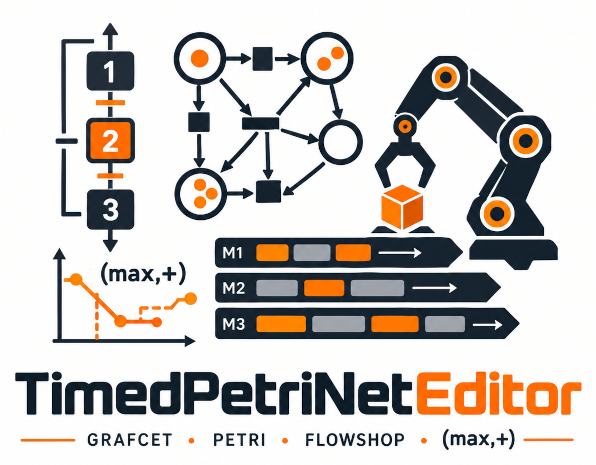
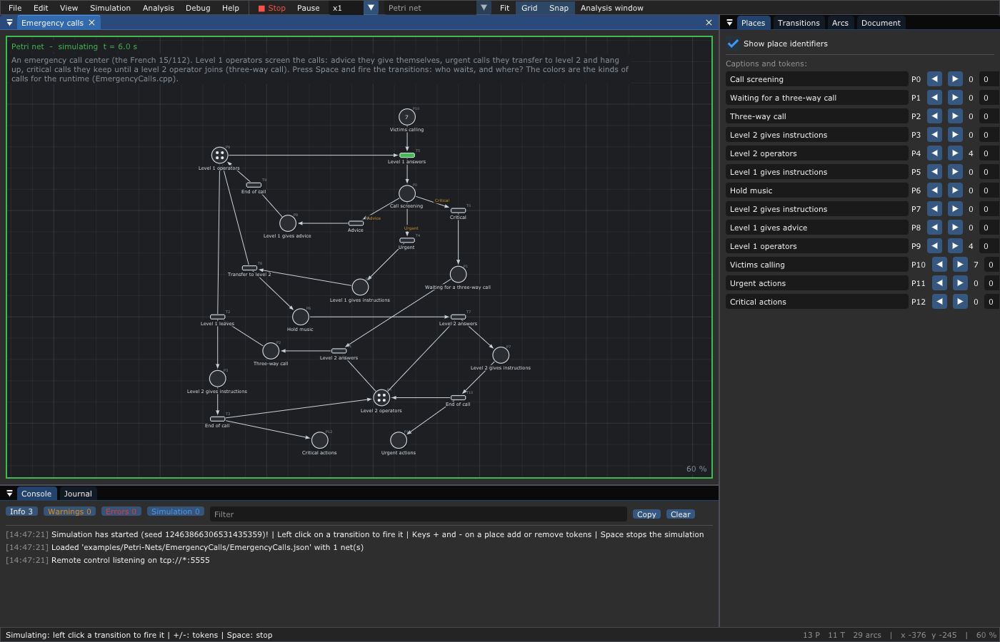
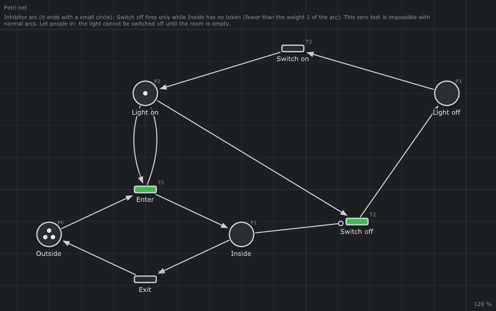
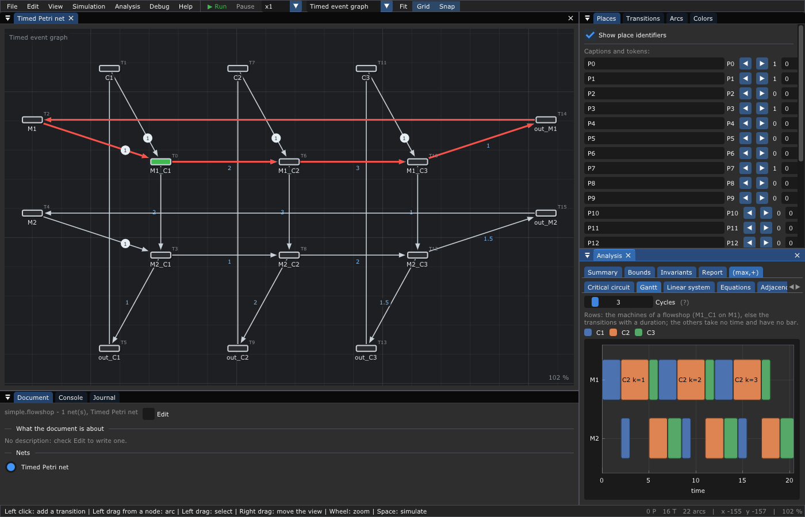
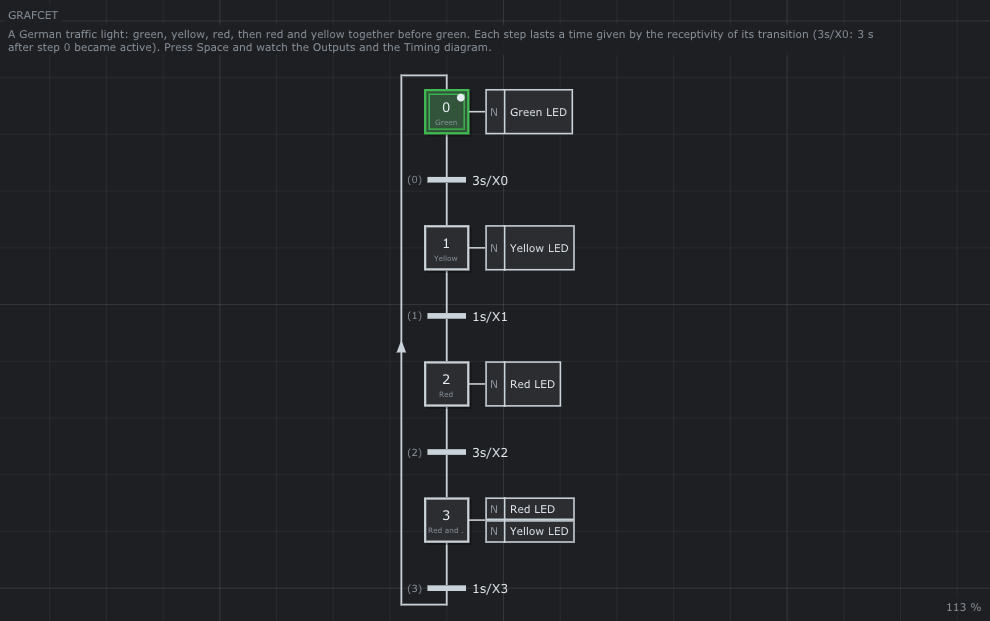
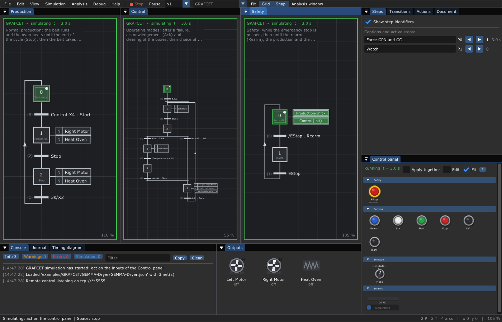
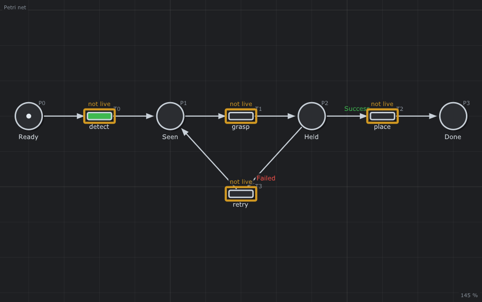

# ⏱️ Timed Petri Net Editor

[](https://github.com/Lecrapouille/TimedPetriNetEditor/actions/workflows/non_regression.yml)
[](LICENSE)


> **🌐 Try the online version instantly:**
> 👉 [Click here to launch TimedPetriNetEditor in your browser!](https://lecrapouille.github.io/TimedPetriNetEditor/TimedPetriNetEditor.html)
>

[TimedPetriNetEditor](https://github.com/Lecrapouille/TimedPetriNetEditor) is a C++20 library and a graphical editor and simulator of **Petri nets** and of the nets derived from them:

- 🔵 **Petri nets** and **extended Petri nets** (weights, capacities, inhibitor and reset arcs, priorities, colored tokens), with the analysis of their properties: deadlocks, bounds, liveness, invariants;
- ⏱️ **timed Petri nets** and **timed event graphs**, with the **(max,+) algebra**: cycle time, critical circuit (the bottleneck), Gantt chart, dater equations and linear systems;
- 🔘 **GRAFCET** (IEC 60848) and **GEMMA**, to describe and test the control of a machine with a control panel, and to generate its C++ code (usable for an Arduino);
- ⚙️ a **runtime** in the spirit of [Symmetri](https://github.com/thorstink/Symmetri): a net drawn in the editor drives your C++ program, each transition calling one of your functions, and the editor follows the program while it runs.
- It can import the following files: JSON (its own format), PNML (standard and Symmetri), GRML (GreatSPN), flowshops, `.teg`; and export to SVG, LaTeX (TikZ), Graphviz, draw.io, PN-Editor, Symfony workflows, Julia, C++.
- It allows a remote control by JSON commands over ZeroMQ (real time debugger).

It is also a set of C++ libraries (the nets, the file formats, the (max,+) algebra, the analysis, the runtime) usable without the editor, from C++ or Julia.



*An emergency call center modeled by a Petri net: callers, level 1 and level 2 operators are tokens; the kinds of calls are colors.*

## ✨ What it offers

| Family | Theory | What the editor does | Learn |
|--------|--------|----------------------|-------|
| 🔵 Petri nets | places, transitions, tokens, the firing rule; reachability, incidence matrix, invariants | draw with the mouse, fire transitions by hand, find deadlocks (and the path to them), dead transitions, bounds, liveness, P- and T-invariants; `tpne-check` does it in a CI | [3](doc/03-Petri-Nets.md), [4](doc/04-Analysis.md) |
| 🧪 Extended Petri nets | weights, capacities, inhibitor and reset arcs, priorities, colors | right click on an arc or a place; the simulation and the analysis follow them | [5](doc/05-Extended-Petri-Nets.md) |
| ⏱️ Timed Petri nets | durations on arcs, delays on transitions | a discrete event simulation, conflicts by priority or at random, a journal of the firings, timeouts | [6](doc/06-Timed-Petri-Nets.md) |
| 🔁 Timed event graphs | dater and counter equations, (max,+) algebra, eigenvalue, Howard's algorithm | the compact drawing, the cycle time and the critical circuit, the Gantt chart of the earliest dates, the (max,+) matrices and equations, export to Julia; factories described as flowshops | [7](doc/07-Timed-Event-Graphs.md), [8](doc/08-Max-Plus-Algebra.md) |
| 🔘 GRAFCET, GEMMA | IEC 60848: steps, receptivities, edges, timers, action qualifiers, forcing orders | several graphs running together, a control panel (push buttons, emergency stop, selectors, sensors), the outputs, a timing diagram, C++ code for a micro-controller checked against the editor | [9](doc/09-GRAFCET.md), [10](doc/10-GEMMA.md) |
| ⚙️ Runtime | a transition is a function, the result of a function colors its tokens and chooses the next transition | the skeleton of the program generated from the net, the program followed live in the editor, its journal replayed, saved for process mining (XES) | [11](doc/11-Runtime.md), [12](doc/12-Code-Generation.md), [13](doc/13-Debugging.md) |

| | | |
|:-:|:-:|:-:|
|  |  |  |
| 🍝 [the dining philosophers](examples/Petri-Nets/Philosophers/README.md) | 💡 [an inhibitor arc](examples/Extended-Petri-Nets/Inhibitor/README.md) | 🏭 [a factory, its bottleneck and its schedule](examples/Timed-Event-Graphs/Flowshop/README.md) |
|  |  |  |
| 🚦 [a GRAFCET with timers](examples/GRAFCET/GermanTrafficLights/README.md) | 🛑 [a dryer driven by a GEMMA](examples/GRAFCET/GEMMA-Dryer/README.md) | 🤖 [a robot program driven by a net](examples/Runtime/PickAndPlace/README.md) |

More than 40 examples, from one-notion textbook nets to real systems, are in the [gallery](examples/README.md).

## 🚀 Quick start

On Debian or Ubuntu (other systems: [chapter 2](doc/02-Getting-Started.md)):

```sh
sudo apt-get install build-essential pkg-config libdw-dev libzmq3-dev libglfw3-dev \
    libx11-dev libxinerama-dev libxrandr-dev libxi-dev libxcursor-dev libgl1-mesa-dev

git clone https://github.com/Lecrapouille/TimedPetriNetEditor --depth=1 --recursive
cd TimedPetriNetEditor/

make download-external-libs
make compile-external-libs
make -j"$(nproc --all)"

# Optional: only for developers
make test -j"$(nproc --all)"
```

You can run your first Petri net:

```sh
./build/TimedPetriNetEditor examples/Petri-Nets/FirstNet/FirstNet.json
```

- In the editor, press **Space** to simulate, click on the green transition to fire it. To draw: the **left** mouse button draws (a click adds a place, a drag from a node draws an arc), the **right** one moves (a click adds a transition); the status bar always says what a click would do; **F1** is the help.

Optional you can `sudo make install` to install the editor and its libraries. A web version, built with Emscripten by the CI: 🌐 [TimedPetriNetEditor.html](https://lecrapouille.github.io/TimedPetriNetEditor/TimedPetriNetEditor.html). The same sources also build for [ExaequOS](https://www.exaequos.com) ([how](doc/02-Getting-Started.md#13-build-for-exaequos)).

## 📚 Documentation

[The documentation](doc/README.md) goes from the theory of each family of nets to what the editor offers to solve its problems, step by step, with examples made from real runs.

| Part | Chapters |
|------|----------|
| 🧭 Discover | [1. Introduction](doc/01-Introduction.md) · [2. Getting started](doc/02-Getting-Started.md) |
| 🔵 Petri nets | [3. Petri nets](doc/03-Petri-Nets.md) · [4. Analysis](doc/04-Analysis.md) · [5. Extended Petri nets](doc/05-Extended-Petri-Nets.md) |
| ⏱️ Time | [6. Timed Petri nets](doc/06-Timed-Petri-Nets.md) · [7. Timed event graphs](doc/07-Timed-Event-Graphs.md) · [8. (max,+) algebra](doc/08-Max-Plus-Algebra.md) |
| 🏭 Automation | [9. GRAFCET](doc/09-GRAFCET.md) · [10. GEMMA](doc/10-GEMMA.md) |
| ⚙️ From the model to the program | [11. Runtime](doc/11-Runtime.md) · [12. Code generation](doc/12-Code-Generation.md) · [13. Debugging](doc/13-Debugging.md) |
| 📖 Reference | [14. Editor](doc/14-Editor-Reference.md) · [15. File formats](doc/15-File-Formats.md) · [16. C++ library](doc/16-Library.md) · [17. Julia](doc/17-Julia.md) · [18. Remote control](doc/18-Remote-Control.md) · [Glossary](doc/Glossary.md) · [Bibliography](doc/Bibliography.md) |

## 📜 Story

In the 1980s, researchers of INRIA (Cohen, Dubois, Quadrat, Viot) showed that the dates of the events of a timed event graph follow linear equations in the **(max,+) algebra**, where `max` plays the role of the addition and `+` the one of the multiplication: the speed of a factory or a railway network becomes an eigenvalue. A (max,+) toolbox for Scilab, then ScicosLab, computed it.

This current project started with the port of the Scilab (max,+) toolbox to Julia ([MaxPlus.jl](https://github.com/Lecrapouille/MaxPlus.jl)), and started this editor as its missing graphical half: draw the net, get the matrices, the cycle time and the critical circuit.

As engineer, GRAFCET was needed for a job, then as a complete engine of the standard IEC 60848 with GEMMA, control panel and timing diagram. C++ code can be generated for an Arduino (work in progress for CoDeSys).

In 2026 came the extended Petri nets and their analysis, then a runtime taking the idea of Symmetri, with the editor as its IDE and debugger.

This repo is currently used inside [Robotik](https://github.com/Lecrapouille/Robotik), a general and consistent C++ robot simulation-oriented library with its graphical editor.

## 🛠️ For developers

The libraries: `libTimedPetriNet` (nets, simulation, GRAFCET), `libTimedPetriIO` (file formats), `libTimedPetriMaxPlus`, `libTimedPetriAnalysis`, `libTimedPetriRuntime` ([chapter 16](doc/16-Library.md)).

The unit tests: `make -C tests`, then `../build/TimedPetriNetEditor-UnitTest` from `tests/`; the examples of the runtime: `make -C examples run`. In Visual Studio Code, **F5** starts the editor in the debugger.

## 📄 License

TimedPetriNetEditor is dual-licensed: GNU GPL v3 or later, or a commercial license for those who cannot use the GPL. See [LICENSING.md](LICENSING.md).
