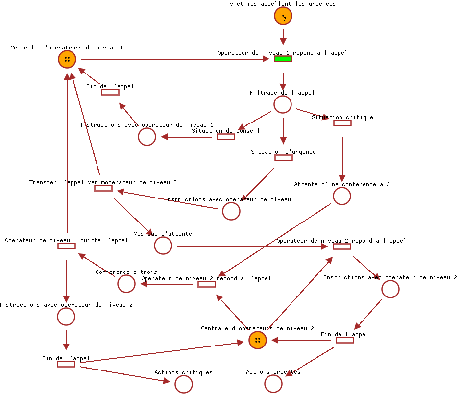
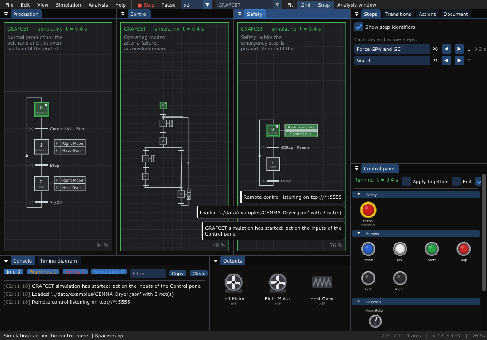

# Timed Petri Net Editor

Draw a system that does several things at the same time, run it, and ask:
*how fast can it go, where does it wait, and how do I control it?*
TimedPetriNetEditor is a graphical editor and simulator of **Petri nets**,
**timed event graphs** and **GRAFCETs**, with the **(max,+) algebra** that
answers these questions exactly.

[](https://youtu.be/hOhunzgFpcA)

*A French emergency call center as a timed Petri net: level 1 operators
filter the calls, level 2 operators take the urgent ones (click for the
video).*

An online version is in progress:
[try it in your browser](https://lecrapouille.github.io/TimedPetriNetEditor/TimedPetriNetEditor.html).

## Why this editor exists

It started as the missing piece of [ScicosLab](http://www.scicoslab.org/)'s
(max,+) toolbox, made at INRIA: the toolbox computed cycle times and
schedules of timed event graphs, but you had to write the matrices by hand.
ScicosLab is no longer developed; its toolbox lives on in Julia as
[MaxPlus.jl](https://github.com/Lecrapouille/MaxPlus.jl), and this editor is
the graphical side: draw the net, get the matrices, the cycle time, the
bottleneck, the Gantt chart.

The other Petri net editors of GitHub were not an option: most of them are
no longer maintained, need Windows, Visual Studio, Java or C#, or have code
too complex to extend. GRAFCET came next: teachers and students of
automation draw GRAFCETs and GEMMAs on paper, and the ones who want to run
them need a PLC or an expensive tool. Finally
[RobotIK](https://github.com/Lecrapouille/Robotik) drives its simulated
robot cells with the GRAFCET engine and the (max,+) algorithms of this
project.

## What makes it different

| | This editor | Most Petri net editors | GRAFCET tools of automation |
|-|-------------|------------------------|-----------------------------|
| Timed event graphs with the (max,+) algebra: cycle time, critical circuit, Gantt chart, dater equations, linear system | yes | rarely | no |
| GRAFCET by IEC 60848: receptivities with edges and timers, all qualifiers, forcing orders, several graphs (GEMMA) | yes | no | yes |
| Run a GRAFCET from a control panel (push buttons, emergency stop, selector, sensors) and see its timing diagram | yes | no | with a PLC |
| One file format (JSON) with descriptions; LaTeX, Graphviz, PNML, C++ exports | yes | partly | proprietary |
| Usable as a C++ library, from Julia, or remotely (ZeroMQ) | yes | rarely | no |

## Quick start

```sh
git clone https://github.com/Lecrapouille/TimedPetriNetEditor --depth=1 --recursive
cd TimedPetriNetEditor/
make download-external-libs
make compile-external-libs
make -j8
./build/TimedPetriNetEditor data/examples/GEMMA-Dryer.json
```

The remote control needs ZeroMQ (`sudo dnf install zeromq-devel`,
`sudo apt install libzmq3-dev`, `brew install zeromq`), or build without it:
`make TPNE_ZEROMQ=0`. `sudo make install` installs the editor and its
libraries.



*The GEMMA of a dryer: three GRAFCETs that run together, their control
panel and their outputs.*

In the editor, the left mouse button draws, the right one moves, and
**Space** runs the net. The status bar always says what the mouse would do.

## Documentation

Start with [the documentation index](doc/README.md). In order:

| # | Chapter | You will learn |
|---|---------|----------------|
| 1 | [Introduction](doc/01-Introduction.md) | places, transitions, tokens; the four kinds of nets |
| 2 | [Getting started](doc/02-Getting-Started.md) | draw and run your first net |
| 3 | [Timed nets and (max,+) algebra](doc/03-Timed-Nets-and-Max-Plus.md) | cycle time, bottleneck, Gantt chart of a factory |
| 4 | [GRAFCET and GEMMA](doc/04-GRAFCET-and-GEMMA.md) | control a machine; the dryer tutorial |
| 5 | [Exports and code generation](doc/05-Exports-and-Code-Generation.md) | LaTeX, Graphviz, PNML, C++ code of a GRAFCET |
| 6 | [File format](doc/06-File-Format.md) | the JSON file |
| 7 | [Editor reference](doc/07-Editor-Reference.md) | every window, gesture, key and menu |
| 8 | [Julia](doc/08-Julia.md) | the editor and the (max,+) algebra from Julia |
| 9 | [Remote control](doc/09-Remote-Control.md) | JSON commands over ZeroMQ |
| 10 | [Use the library in C++](doc/10-Library.md) | run a GRAFCET or compute dates in your program |

Examples are in [data/examples](data/examples/README.md); the words in the
[glossary](doc/Glossary.md); books and other tools in the
[bibliography](doc/Bibliography.md).

## For developers

This project may be compiled with `-ffast-math` (see `PERFORMANCE_FLAGS` in
`.makefile/rules/Makefile`), which implies `-ffinite-math-only`: the compiler
then considers that `NaN` and `±Inf` never occur, so `std::isnan()` and
`std::isinf()` become `false` and comparisons such as `x == -inf` are not
reliable. To detect a special value (the (max,+) zero `-inf`, the `NaN` "no
duration" of `Place -> Transition` arcs ...), use the helpers of
[`src/PetriNet/SafeFloat.hpp`](src/PetriNet/SafeFloat.hpp) (`safeIsNaN`,
`safeIsNegInf`, `safeIsPosInf`, `safeIsInf`).

In Visual Studio Code, F5 starts the editor in the debugger
(`.vscode/launch.json`). The unit tests: `make -C tests`, then
`../build/TimedPetriNetEditor-UnitTest` from `tests/`.
