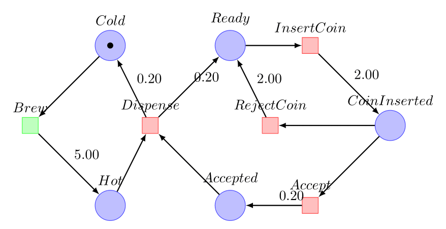
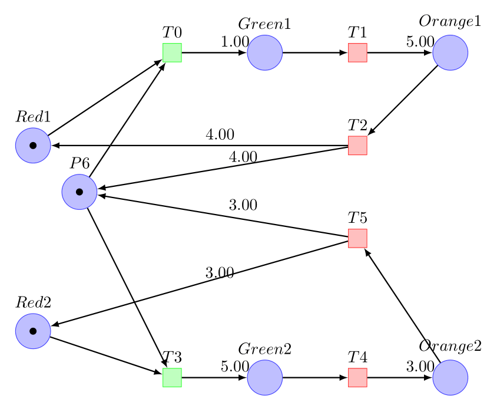
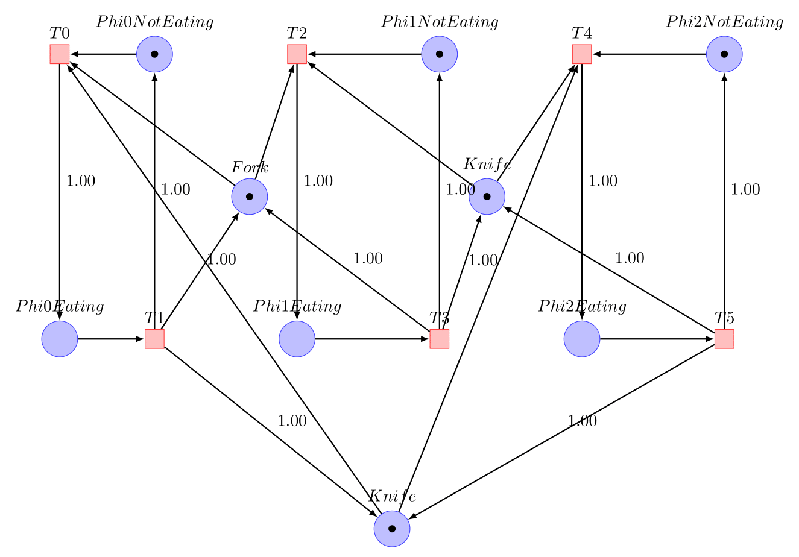
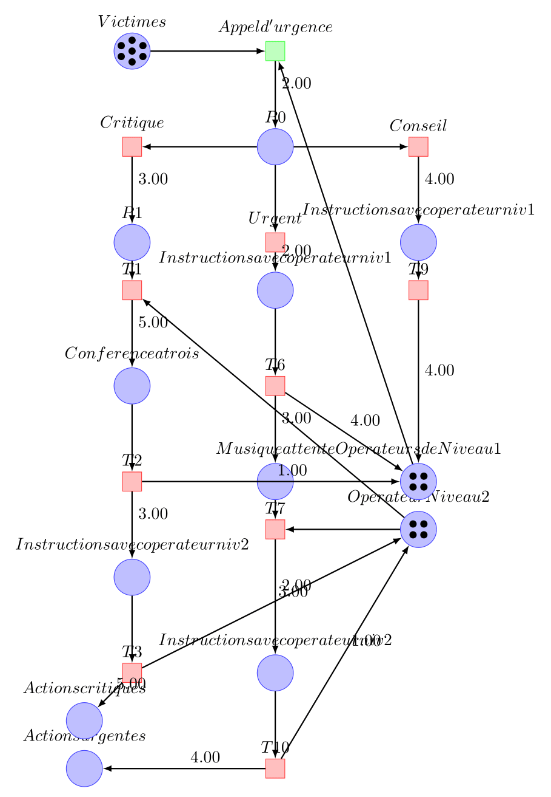
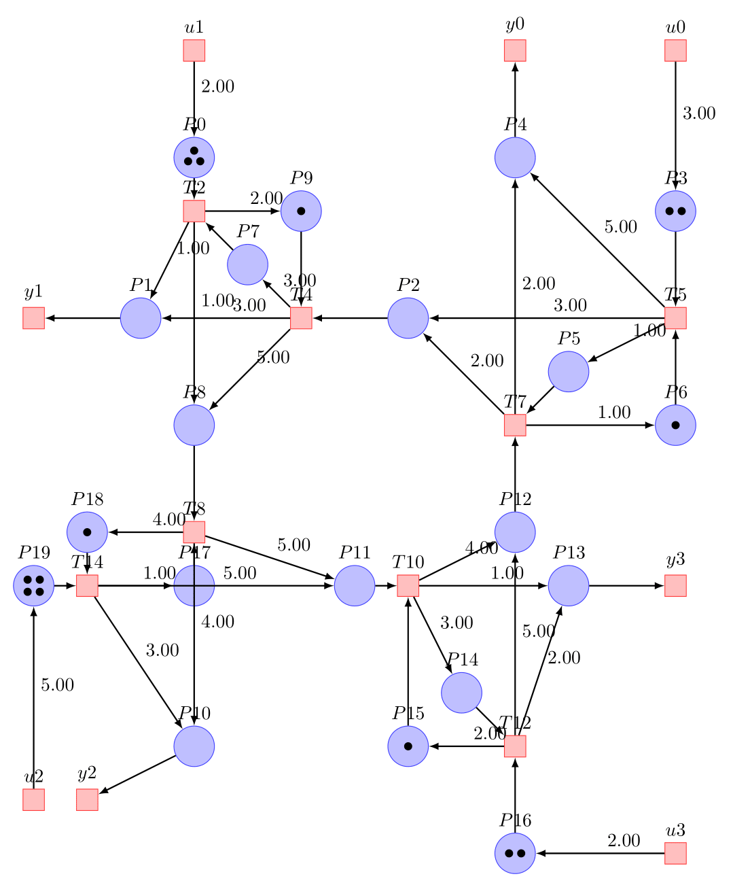
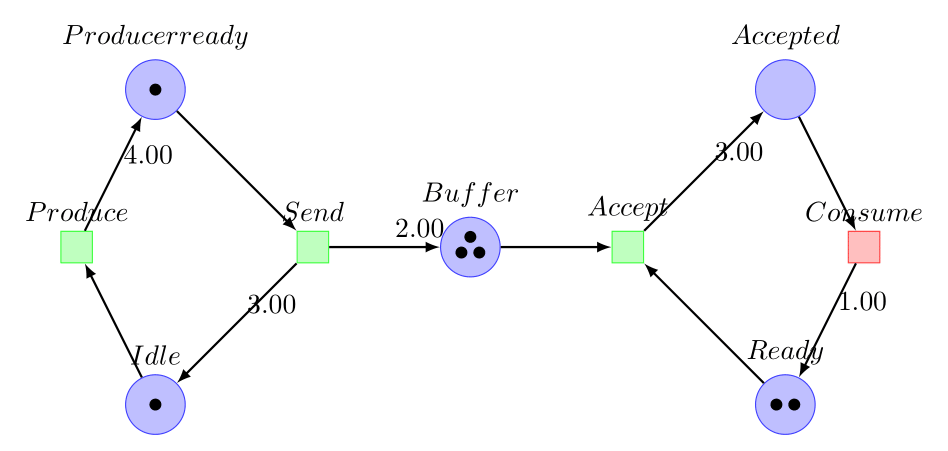
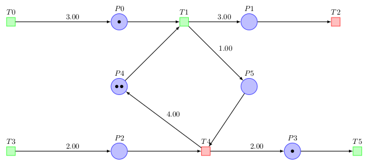
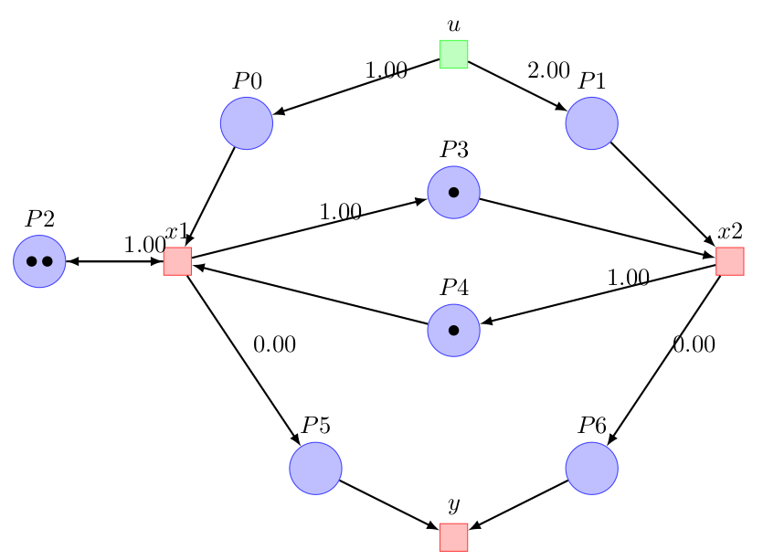

# Petri Net Examples

## GRAFCET Action Qualifiers

In GRAFCET mode, each step can have actions with different qualifiers that define their behavior according to IEC 60848:

| Qualifier | Name | Description |
|-----------|------|-------------|
| **N** | Normal | Action is active while the step is active |
| **S** | Set (Stored) | Action is latched ON when step becomes active, remains ON until Reset |
| **R** | Reset | Action is latched OFF when step becomes active |
| **D** | Delayed | Action becomes active after delay, only while step remains active |
| **L** | Limited | Action is active for limited duration while step is active |
| **SD** | Stored & Delayed | Action is set after delay (combination of S and D) |
| **DS** | Delayed & Stored | Action starts delayed, then stored (combination of D and S) |
| **SL** | Stored & Limited | Action is set for limited time (combination of S and L) |
| **P** | Pulse | Single pulse at step activation (impulse action) |

## GRAFCET with Actions (Cylinder Control)

This example demonstrates a pneumatic cylinder control sequence with various action qualifiers:
- **Init**: Initial waiting state
- **Extending**: Activates valve V1+ (Normal action)
- **Extended**: Starts a 2s timer (Delayed) and sets position indicator (Set)
- **Retracting**: Activates valve V1- (Normal) and resets indicator (Reset)
- **Alarm**: Sound buzzer (Normal) and flash lamp for 5s (Limited)

Sensors: `Start`, `s0` (retracted position), `s1` (extended position), `Error`, `Reset`

```
TimedPetriNetEditor data/examples/GrafcetActions.json
```

## Graphe des Modes de Marche et Arret (GEMMA)

Operating and Stopping Modes Graph (GEMMA)

This example models the GEMMA (Graph for the Study of Modes and Actions) which defines the coordination of three combined GRAFCETs to control an automated cell. The managed modes are:

- Normal production operation
- Safety operation
- Supervision/control of subordinate GRAFCETs

Production Line Description:
Workpieces are transported by a conveyor belt to an oven (KM3) for baking. The conveyor can move left or right thanks to two motors (KM2 and KM1).

Operator Panel (HMI) Controls, with their names in the file (the French
names of the original course in parentheses):

- Emergency stop button `EStop` (AU)
- Rearm button `Rearm` (Réarm)
- Acknowledge button `Ack` (Val)
- Selector switch for automatic `Auto` or manual `Manual` operation (Auto, Manu)
- Cycle start button `Start` (Dcy)
- Cycle stop button `Stop` (Acy)
- `Left` and `Right` buttons to move the conveyor during manual mode (GA, DR)
- Temperature sensor `Temperature` of the dryer

In the file, the dryer has three graphs: Safety (forces the two others to
their initial steps until Rearm), Control (acknowledgement and clearing of
the boxes, heating of the oven until the temperature reaches 80 °C,
automatic or manual production) and Production (the belt runs and the oven
heats until Stop, then the belt runs 3 s more). The control panel of the
editor shows these buttons, the Auto / Manual selector and the temperature
sensor (heated by the oven while the simulation runs); the Outputs window
shows the two motors and the oven. To start: Rearm, Ack, the selector on
Auto then Ack, wait for the temperature, then Start.

Credit: [NetProf](https://www.youtube.com/watch?v=y8lWIG71040&list=PLtbgSpNjNTOVxGj6zYv5MTdZuPwD7S1zh)

```
TimedPetriNetEditor data/examples/GEMMA-Dryer.json
```

## Coffee machine

The client inserts a coin and press to the brew button to get a coffee.
The machine accept to return the inserted client coin.



```
TimedPetriNetEditor data/examples/Coffee.json
```

## Traffic Lights

Two traffic lights (red, orange, red lights) synchronized by the Place `P6`.



```
TimedPetriNetEditor data/examples/TrafficLights.json
```

## German Traffic Lights

One traffic ligth. The particularity of German traffic lights is they are at the same time red and yellow before swaitching to green.

```
TimedPetriNetEditor data/examples/GermanTrafficLights.json
```

Credit: YAWL User Group
https://www.youtube.com/shorts/ZQZCpDRqwKY

## Philosphers

Three philosophers are eating but they are sharing their fork and knives.



```
TimedPetriNetEditor data/examples/Philosophers.json
```

## Urgency Call (French 911)

Victims is calling the 911. A first operator (level 1) is selecting the type of urgency (advice urgent, critical):
- For an advice the operator is giving instructions to the victim.
- For a urgent case, the phone call is transfered to the operator of level 2.
- For a critical case, the phone call is transfered to the operator of level 2 but the operator of level 1 is still present with the victim.



```
TimedPetriNetEditor data/examples/AppelsDurgence.json
```

## Four Roads Junction

Simulate a road junction.



```
TimedPetriNetEditor data/examples/FourRoadJunctions.json
```

## Producer Consumer

Simulate a producer and a consumer with a buffer.



```
TimedPetriNetEditor data/examples/ProducerConsumer.json
```

## Inputs Outputs

Show source and sinks transitions



```
TimedPetriNetEditor data/examples/InputsOutputs.json
```

## Event Graph

Show a timed event graph taken from
https://www.rocq.inria.fr/metalau/cohen/SED/book-online.html.



```
TimedPetriNetEditor data/examples/EventGraph.json
```

## Chainsaw Safety

Show security such as dead man works on a chainsaw.

```
TimedPetriNetEditor data/examples/Chainsaw.json
```

Credit: YAWL User Group
https://www.youtube.com/shorts/V42WiF2Ib3w

## Landing Gear

Show how to prevent damaging aircraft landing gear.
- The aircraft has initially its gear down and at low speed.
- On high speed, extending gears is not possible.
- If gears are down and aircraft go to high speed a warning is triggered.


```
TimedPetriNetEditor data/examples/LandingGear.json
```

Credit: YAWL User Group
https://www.youtube.com/shorts/IqMyF5JKoE4

## Smarthome Safety

Prevent shuttering down the last roller shutters.

```
TimedPetriNetEditor data/examples/SmarthomeSafety.json
```

Credit: YAWL User Group
https://www.youtube.com/shorts/BB5N9Nxtq00
