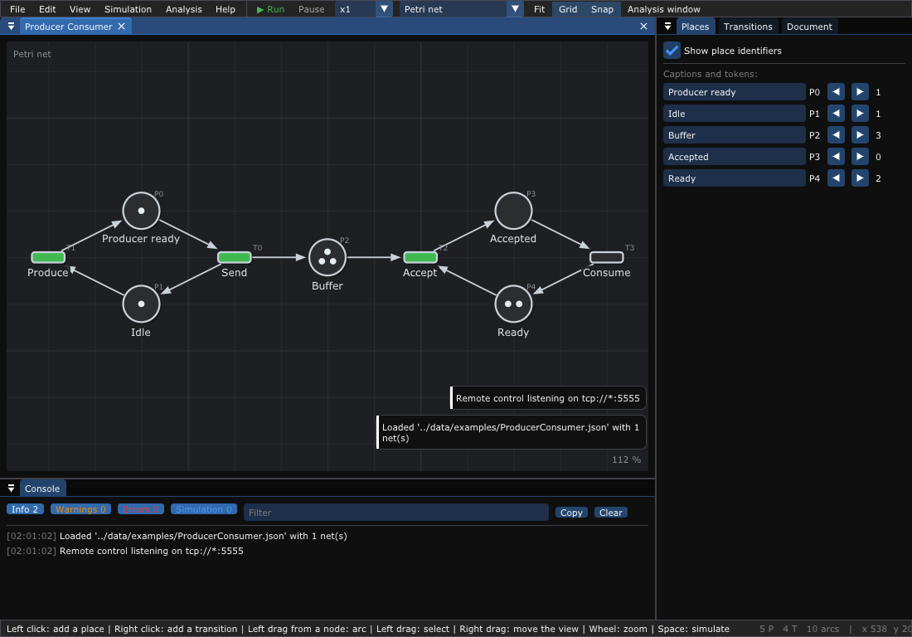

# 1. Introduction

What you will learn:

- what a Petri net is: places, transitions, tokens, and the one rule that
  moves the tokens;
- the four kinds of nets of the editor: Petri net, timed Petri net, timed
  event graph, GRAFCET;
- what each kind is good for, so that you know which chapter to read next.

You do not need any mathematics for this chapter. The words in **bold** are
also in the [glossary](Glossary.md).

---

## 1. A Petri net in one picture

A **Petri net** describes a system that does several things at the same
time and has to wait: a factory, a coffee machine, traffic lights, people
in a call center. It has three kinds of elements:

```text
   place          transition        arc            token
   (a state,      (an event)        (who feeds     (a resource,
    a stock)                         whom)           a piece ...)
     ( )             ▭               ──►              ●
```

Here is a producer and a consumer that share a buffer (the example
`data/examples/ProducerConsumer.json`):

```text
  Produce          Send            Accept          Consume
    ▭ ──► (●) ──► ▭ ──► (●●●) ──► ▭ ──► ( ) ──► ▭
    ▲   Producer    │    Buffer    ▲   Accepted   │
    │    ready      ▼              │              ▼
    └────────── (●) Idle           └──── (●●) Ready
```

## 2. The rule

A transition is **enabled** when each place before it has at least one
token. An enabled transition can **fire**: it takes one token from each place
before it and puts one token in each place after it. That is all.

```text
  before:  (●) ──► ▭ ──► ( )        after:  ( ) ──► ▭ ──► (●)
           P0      T0     P1                 P0      T0     P1
```

The number of tokens in each place (the **marking**) is the state of the
whole system. Several transitions can fire at the same time: the net shows
what happens in parallel and where things wait for each other.

In the editor, the transitions that can fire are drawn in green:



*The producer-consumer net in the editor: `Produce`, `Send` and `Accept` can fire.*

## 3. Four kinds of nets

The editor knows four kinds of nets. You choose the kind in the toolbar, or
in *Edit > Type of net*.

| Kind | What it adds | Good for | Chapter |
|------|--------------|----------|---------|
| **Petri net** | Nothing: you click on a transition to fire it | Understand a system step by step | [2](02-Getting-Started.md) |
| **Timed Petri net** | A **duration** on the arcs going out of a transition: the tokens take this time to travel | Simulate a system in time | [3](03-Timed-Nets-and-Max-Plus.md) |
| **Timed event graph** | Each place has one arc in and one arc out: no choice, only waiting. The (max,+) algebra then gives exact results | Speed of a factory, its bottleneck, its schedule | [3](03-Timed-Nets-and-Max-Plus.md) |
| **GRAFCET** | Steps with **actions**, transitions with **conditions** on buttons and sensors | Control a machine, as automation engineers do (IEC 60848) | [4](04-GRAFCET-and-GEMMA.md) |

A few words on each:

- In a **timed Petri net**, the token "travels" along the arc during the
  duration: this is the time the next place needs to do its job. The editor
  animates it.
- An **event graph** has no choice: a token in a place can only go to one
  transition. This removes the randomness, and the dates of all the events
  follow simple equations (chapter 3).
- A **GRAFCET** is a Petri net for machines: a place is a **step** that is
  active or not (one token at most), a transition has a **receptivity** (a
  condition such as "the button is pressed and the door is closed"), and an
  active step does **actions** (switch on a motor). Several GRAFCETs can work
  together and force each other: this is how a **GEMMA** describes the start
  and stop modes of a machine (chapter 4).

## 4. One question you will meet: who gets the token?

In the producer-consumer net, imagine that the buffer had two arcs going out,
to two different transitions. Both transitions are enabled, but there is
only one token: which one fires?

This is a **conflict**. A Petri net does not say: the result depends on the
order in which the simulation looks at the transitions. The editor chooses at
random, so two runs may differ. When you describe a real machine, avoid
conflicts:

- in a GRAFCET, make the conditions exclusive (`b1` on one transition,
  `b2 . /b1` on the other);
- in an event graph, there is no conflict by definition.

## 5. Identifiers

The editor names the nodes itself: places `P0, P1 ...`, transitions
`T0, T1 ...` (GRAFCET steps are shown as their number, `X3` in conditions).
The numbers are consecutive, without holes: they are the indices of the
matrices of chapter 3. When you delete a node, the last node takes its
number. In a GRAFCET, its actions go with it and the conditions that name it
(`X3`) follow its new number. The text you write on a node is its
**caption**.

---

Next: [2. Getting started](02-Getting-Started.md) — build the editor and draw
your first net.
