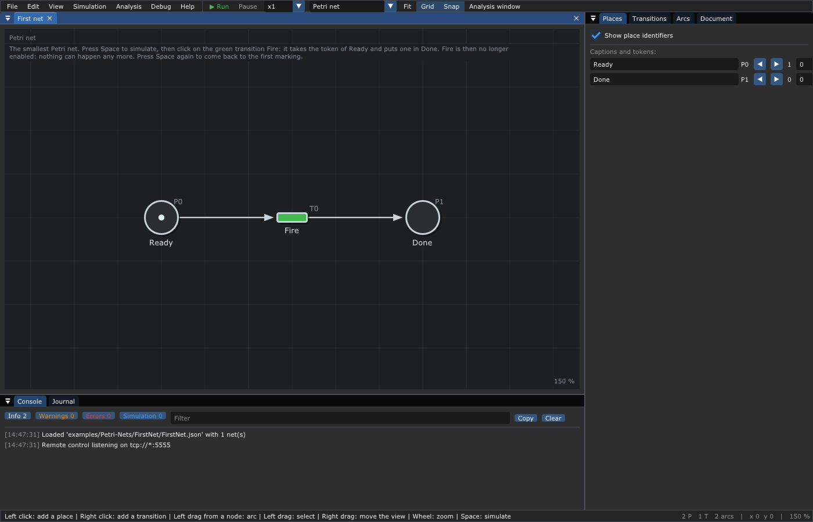
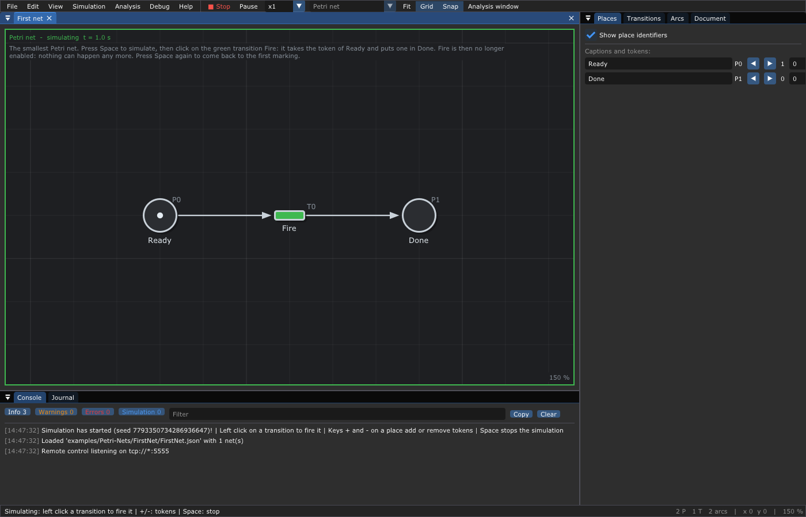
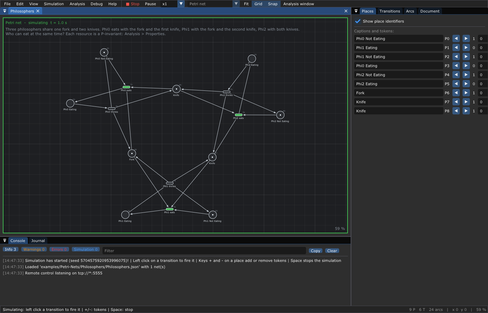

# 🚀 2. Getting started

**What you will learn**

- build and install the editor;
- open an example and run it;
- draw your first Petri net with the mouse, run it and save it;
- where to go next, depending on what you want to do.

**Prerequisites**: [chapter 1](01-Introduction.md) for the words place,
transition, token, firing.

---

## 1. 📦 Build and install

The editor is written in C++20 with [Dear ImGui](https://github.com/ocornut/imgui)
and GLFW. It is built and tested on Linux (the CI runs Ubuntu), and builds on
macOS; a web version made with Emscripten is in progress:
🌐 [try it in your browser](https://lecrapouille.github.io/TimedPetriNetEditor/TimedPetriNetEditor.html).

### 1.1 System packages

**Debian, Ubuntu** (the packages of the CI):

```sh
sudo apt-get install build-essential pkg-config libdw-dev libzmq3-dev libglfw3-dev \
    libx11-dev libxinerama-dev libxrandr-dev libxi-dev libxcursor-dev \
    libgl1-mesa-dev libglu1-mesa-dev libwayland-dev libxkbcommon-x11-dev
```

**Fedora**:

```sh
sudo dnf install gcc-c++ make pkgconf elfutils-devel zeromq-devel glfw-devel \
    libX11-devel libXinerama-devel libXrandr-devel libXi-devel libXcursor-devel \
    mesa-libGL-devel mesa-libGLU-devel
```

**macOS** (Homebrew): `brew install glfw zeromq pkg-config`.

[ZeroMQ](https://zeromq.org/) is needed by the remote control
([chapter 18](18-Remote-Control.md)) and the debugger
([chapter 13](13-Debugging.md)). Without it, build with `make TPNE_ZEROMQ=0`.

### 1.2 Build

```sh
git clone https://github.com/Lecrapouille/TimedPetriNetEditor --depth=1 --recursive
cd TimedPetriNetEditor/
make download-external-libs
make compile-external-libs
make -j8
```

This gives, in `build/`:

| File | What |
|------|------|
| `TimedPetriNetEditor` | the editor |
| `tpne-check` | checks the properties of nets in a terminal or a CI ([chapter 4](04-Analysis.md)) |
| `libTimedPetri*.so`, `.a` | the libraries, for your programs ([chapter 16](16-Library.md)) |

`sudo make install` installs them on the system. The examples run by the
runtime are built with `make -C examples` ([chapter 11](11-Runtime.md)), the
unit tests with `make -C tests`.

## 2. ▶️ Open an example

```sh
./build/TimedPetriNetEditor examples/Petri-Nets/FirstNet/FirstNet.json
```



In the middle, the net: the place `Ready` holds a token, the transition
`Fire` is green because it can fire. Above the net, its **description**
tells you what to do: most examples have one. On the right, the
**inspector** lists the places, the transitions and the arcs. At the bottom,
the console. The [editor reference](14-Editor-Reference.md) describes every
window; you do not need it to start.

Press **Space**: the simulation starts, the frame of the net turns green and
the console tells you what you can do. Click on `Fire`: the token leaves
`Ready` and arrives in `Done`. `Fire` is no longer green: nothing can happen
any more. Press **Space** again: the simulation stops and the net comes back
to its first marking.



Now a richer one:

```sh
./build/TimedPetriNetEditor examples/Petri-Nets/Philosophers/Philosophers.json
```

Three philosophers share one fork and two knives. Press **Space** and click
on the green transitions: when a philosopher eats, the ones who need the
same cutlery wait.



## 3. ✏️ Tutorial: draw your first net

*File > New > Petri net*. There is no mode and no palette: what a mouse
button does depends on what is under the mouse. **The left button draws,
the right button moves.** The status bar, at the bottom, always says what
each button would do now.

1. **Left click** in the void: a place `P0` appears.
2. **Right click** in the void, on its right: a transition `T0` appears.
3. **Left drag** from `P0` to `T0`: an arc. Release a drag in the void and
   the editor creates a node of the other kind there, already linked: left
   drag from `T0` to the right and release: a place `P1` and the arc
   `T0 → P1`.
4. Put the mouse on `P0` and press **+**: a token (**-** removes it).
5. **Right drag** a node to move it. Right drag in the void moves the view;
   the wheel zooms; **F** fits the net in its window.
6. **Double click** a node to rename it: write `Ready` on `P0`.

```text
   Ready          T0           P1
    (●)  ──────►  ▭  ──────►  ( )
```

Run it: **Space**, then click on `T0`. Stop it: **Space**. Save it:
**Ctrl+S** (the JSON file is described in [chapter 15](15-File-Formats.md)).
**Ctrl+Z** undoes anything, even a move.

Now close the loop: left drag from `P1` and release in the void (a new
transition `T1`), then left drag from `T1` to `Ready`. Run it again: the
token goes round for ever, `T0` then `T1` then `T0` … You have drawn a
cycle, the shape of every machine that repeats its work. (An arc always
links a place and a transition: a drag from `P1` to `Ready` would insert a
transition between them.)

## 4. 🔀 Try the other kinds of nets

Change the kind of the net in the toolbar (the combo box after the speed):

- **Timed Petri net**: double click an arc going out of a transition and
  give it a duration. Press **Space**: the tokens travel along the arcs by
  themselves, no click needed ([chapter 6](06-Timed-Petri-Nets.md)).
- **Timed event graph**: the places disappear into the arcs; the *Analysis*
  menu computes how fast the net goes ([chapter 7](07-Timed-Event-Graphs.md)).
- **GRAFCET**: places become steps, and you write conditions on the
  transitions ([chapter 9](09-GRAFCET.md)).

Right click on an arc or a place of a Petri net: weights, inhibitor and
reset arcs, capacities ([chapter 5](05-Extended-Petri-Nets.md)).

## 5. 🗺️ Where to go next

| You want to | Read | Open |
|-------------|------|------|
| understand Petri nets | [3](03-Petri-Nets.md), [4](04-Analysis.md), [5](05-Extended-Petri-Nets.md) | [examples/Petri-Nets](../examples/README.md#-petri-nets) |
| know how fast a system goes, and why | [6](06-Timed-Petri-Nets.md), [7](07-Timed-Event-Graphs.md), [8](08-Max-Plus-Algebra.md) | `examples/Timed-Event-Graphs/Flowshop/simple.flowshop` |
| control a machine | [9](09-GRAFCET.md), [10](10-GEMMA.md) | `examples/GRAFCET/GEMMA-Dryer/GEMMA-Dryer.json` |
| drive your program with a net | [11](11-Runtime.md), [12](12-Code-Generation.md), [13](13-Debugging.md) | `examples/Runtime/PickAndPlace/PickAndPlace.json` |

All the examples, with their pictures, are in the
[gallery](../examples/README.md). **F1** opens the help of the editor.

---

Next: [3. Petri nets](03-Petri-Nets.md) — the definition, the firing rule
and the patterns of modeling.
