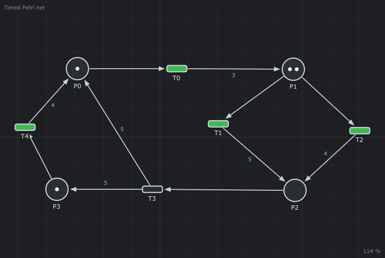
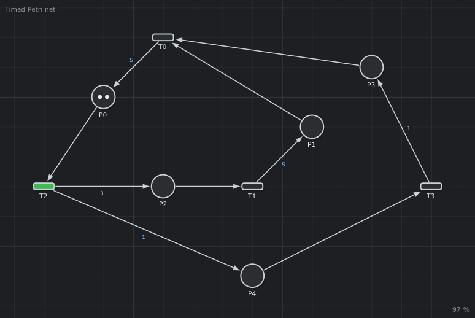
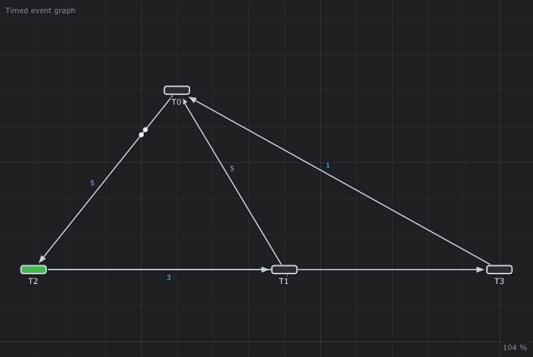
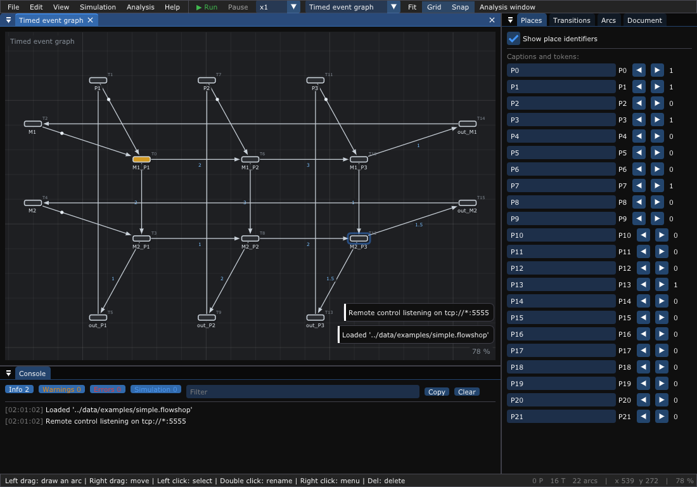
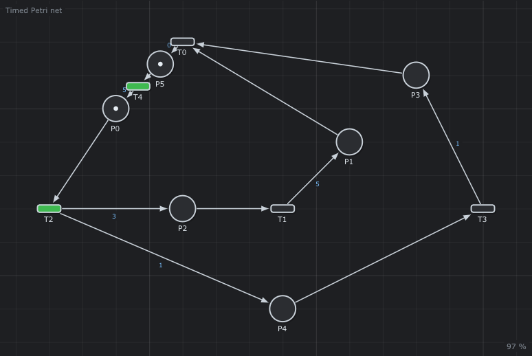
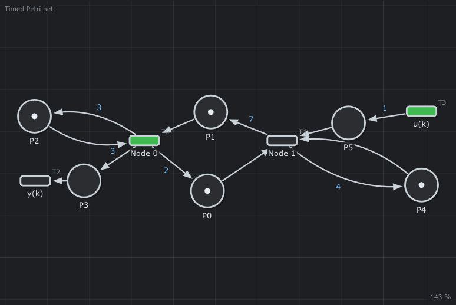
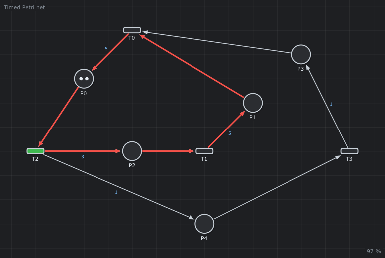

# 3. Timed nets and (max,+) algebra

What you will learn:

- add time to a Petri net, and what an event graph is;
- read a small factory (a flowshop) as a timed event graph;
- get its **cycle time**, its **bottleneck** and its **schedule** (Gantt
  chart) without simulating;
- follow the same dates in the simulation, the console and the plots;
- the (max,+) equations and matrices behind these results.

---

## 1. Durations

In a **timed Petri net**, an arc going out of a transition has a
**duration**. When the transition fires, its tokens travel along the arc
during this time: it is the time the next place needs to do its job (a
machine works, a person answers the phone).

```text
   (●) ──► ▭ ──── 3 ────► ( )      the token reaches P1 3 time units
   P0      T0             P1       after T0 fired
```

The editor writes the duration in the middle of the arc. Double click an arc
to change it, or use the *Arcs* panel. Arcs going into a transition have no
duration.



*A timed Petri net: `P1` has two tokens and two arcs going out. `T1` and
`T2` are in conflict (chapter 1).*

## 2. Event graphs: no choice, exact dates

An **event graph** is a Petri net where each place has exactly one arc in and
one arc out. Then a token never chooses: it waits for its single transition.
Transitions can still have several arcs: they wait for several things at
the same time (synchronization).



Because each place has one transition before it and one after it, the editor
can draw a **timed event graph** without its places: an arc `T0 → T2` holds
the duration and the tokens of the hidden place.



*The same net in the compact form: `5, P0(2)` is the place `P0`, with 2
tokens, on an arc of duration 5.*

For such nets, the date of each event follows a formula. This is what the
rest of the chapter uses.

## 3. Tutorial: how fast is my factory?

A **flowshop** is a factory where every piece visits the machines in the
same order. `data/examples/simple.flowshop` has 3 pieces and 2 machines:

```text
# data/examples/simple.flowshop (extract)
pieces: P1 P2 P3
M1: 2.0 3.0 1.0      <- M1 works 2 on P1, 3 on P2, 1 on P3
M2: 1.0 2.0 1.5
```

Open it: the editor turns it into a timed event graph.

```sh
./build/TimedPetriNetEditor data/examples/simple.flowshop
```



Each transition `M1_P2` is an **operation**: the machine `M1` starts the
piece `P2`. Its output arc holds the processing time. The transitions `M1`,
`P1` ... and `out_M1`, `out_P1` ... close the loops: a machine works on one
piece at a time, a piece is on one machine at a time.

### 3.1 Cycle time and bottleneck

*Analysis > Critical circuit*. The editor finds the loop of the net that
limits the speed (Howard's algorithm) and draws it in orange. For this
factory the cycle time is

```text
λ = 6 time units
```

So in the long run the factory makes one set of pieces every 6 time units.
Why 6? The machine `M1` works 2 + 3 + 1 = 6 per set, `M2` works 1 + 2 + 1.5
= 4.5: `M1` is the **bottleneck**. To go faster, speed up `M1`, not `M2`.

### 3.2 The schedule: Gantt chart

*Analysis > Gantt chart*. One row per machine, one bar per operation, one
color per piece. The label `P2 k=2` means: the 2nd time (**cycle** k = 2)
that the machine works on `P2`. The dates are the earliest possible ones, the
initial tokens being ready at time 0. For the first 3 cycles:

```text
M1_P1: 0 6 12          M2_P1: 2 8.5 14.5
M1_P2: 2 8 14          M2_P2: 5 11 17
M1_P3: 5 11 17         M2_P3: 7 13 19
```

`M1_P1` starts every 6: the cycle time. `M2` waits for `M1` (it starts `P1`
at 2, when `M1` has finished it). The *Cycles* slider shows more cycles; the
mouse on a bar gives its start and end.

### 3.3 The same dates in the simulation

Press **Space**. The console (*Simulation* messages) writes each firing with
the words of the Gantt chart:

```text
t = 0.05  M1 starts P1 (k = 1), until 2.05
t = 2.10  M1 starts P2 (k = 1), until 5.10
t = 2.10  M2 starts P1 (k = 1), until 3.10
t = 3.10  out_P1 (T5) fires (k = 1)
t = 3.15  P1 (T1) fires (k = 1)
t = 5.15  M1 starts P3 (k = 1), until 6.15
t = 5.15  M2 starts P2 (k = 1), until 7.15
t = 6.15  out_M1 (T14) fires (k = 1)
t = 6.20  M1 (T2) fires (k = 1)
t = 6.25  M1 starts P1 (k = 2), until 8.25
```

The simulation advances by steps of one frame, so its dates come a little
after the Gantt chart (6.25 instead of 6). While it runs, a red line on the
Gantt chart shows its time. **P** pauses it, and the speed (x0.1 to x50, in
the toolbar) makes it easier to follow.

*Analysis > Firing dates of the simulation* plots the date `y(k)` of each
firing. With *Subtract drift λ·k*, the curves become flat once the factory
runs at its cycle time: what remains is the start-up.

## 4. The equations behind: (max,+) algebra

### 4.1 Dater form

Call `x(k)` the date of the k-th firing of a transition. A transition fires
when the last of the tokens it waits for arrives. *Analysis > Equations*
writes it for each transition (here, part of the flowshop):

```text
M1_P1(k) = max(P1(k - 1), M1(k - 1))
M2_P1(k) = max(2 + M1_P1(k), M2(k - 1))
M1_P2(k) = max(2 + M1_P1(k), P2(k - 1))
M2_P2(k) = max(1 + M2_P1(k), 3 + M1_P2(k))
```

Read the second line: `M2` starts `P1` for the k-th time after `M1` has
finished it (2 after `M1` started it) and after `M2` is free again (`M2`
fired for the cycle k - 1: the token gives `k - 1`). The durations add, the
tokens shift `k`. This is the same `k` as in the Gantt chart.

### 4.2 The algebra

These formulas only use `max` and `+`. The **(max,+) algebra** writes `⨁`
for `max` and `⨂` (or nothing) for `+`:

```text
M2_P2(k) = 1 M2_P1(k) ⨁ 3 M1_P2(k)
```

Its "zero" is `ε = -∞` (no arc). With this algebra the dates of a timed
event graph are **linear**: matrices and vectors, as in school algebra.
The [MaxPlus.jl](https://github.com/Lecrapouille/MaxPlus.jl) package has
tutorials on it. The *(min,+) notation* option writes the counter form:
`x(t)` is the number of firings before the time t.

### 4.3 Matrices

A timed event graph is two matrices: the durations `N` and the tokens `T` of
its arcs (*Analysis > Adjacency matrices*). For the compact graph of §2:

```text
    | .  .  2  . |       | .  .  5  . |
    | 0  .  .  . |       | 5  .  .  . |
T = | .  0  .  0 |,  N = | .  3  .  1 |
    | 0  .  .  . |       | 1  .  .  . |
```

`T[0,2] = 2` and `N[0,2] = 5`: the arc from `T2` to `T0` holds 2 tokens and
lasts 5 (the order is "to, from", for the product `M x` of a matrix by a
column vector). `.` is `ε`.

### 4.4 Canonical form and linear system

An event graph is **canonical** when each place has at most one token, and
the places after an input transition or before an output transition have
none. Any event graph can become canonical: a place with N tokens is N places
in a row with one token each. *Edit > To canonical form* does it.



The dater form of a canonical graph is a linear system (*Analysis > (max,+)
linear system*):

```text
X(k) = D X(k) ⨁ A X(k-1) ⨁ B U(k)
Y(k) = C X(k)
```

| Name | Holds |
|------|-------|
| `U` | the inputs: transitions with nothing before them |
| `Y` | the outputs: transitions with nothing after them |
| `X` | the other transitions (the state) |
| `D` | arcs whose place has no token (same cycle k) |
| `A` | arcs whose place has one token (previous cycle k - 1) |
| `B`, `C` | arcs from the inputs, arcs to the outputs |

With one input and one output:



```text
    | .  . |      | 3  7 |      | . |
D = | .  . |, A = | 2  4 |, B = | 1 |, C = | 3 . |
```

Each matrix has a *Copy as Julia* button for MaxPlus.jl.

### 4.5 Critical circuit

The cycle time `λ` is the (max,+) eigenvalue of the system: the largest mean
of (durations / tokens) over the loops of the graph. In this net, the loop
`T0, T2, T1` lasts 5 + 5 + 3 = 13 for 2 tokens: λ = 6.5.



*Analysis > Critical circuit* also gives the **bias** of each transition
(its offset in the periodic regime). The algorithm is
[Howard's](http://www.cmap.polytechnique.fr/~gaubert/HOWARD2.html).

## 5. Reference: the Analysis window

| Tab | Shows | Needs |
|-----|-------|-------|
| Critical circuit | λ, the arcs of the circuit (orange on the net), the bias | an event graph |
| Gantt | earliest dates of the first cycles, by machine | an event graph |
| Linear system | `D`, `A`, `B`, `C` | an event graph |
| Equations | dater (max,+) and counter (min,+) forms, with captions or identifiers | an event graph |
| Adjacency | `N` (durations) and `T` (tokens) | an event graph |
| Firing dates | `y(k)` of each transition during the simulation | a timed net that runs |

A timed Petri net that is an event graph has the same analysis: the editor
checks it.

---

Next: [4. GRAFCET and GEMMA](04-GRAFCET-and-GEMMA.md) — control a machine
with steps and conditions.
