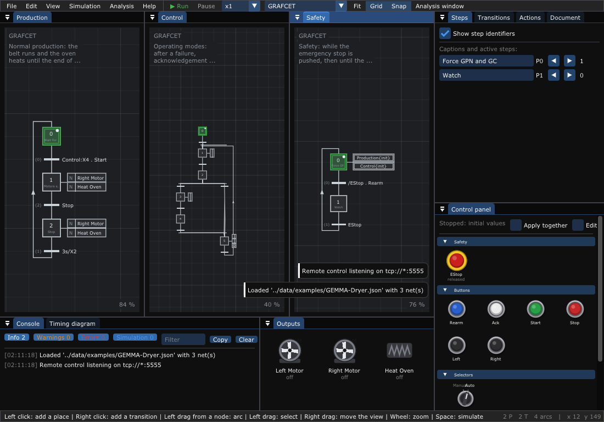

# 4. GRAFCET and GEMMA

What you will learn:

- what a GRAFCET is: steps, transitions with conditions, actions;
- how it runs (the rules of IEC 60848);
- the control panel (the buttons of the machine), the outputs, the timing
  diagram and the timers;
- a GEMMA: three graphs that start, stop and protect a dryer.

---

## 1. What is a GRAFCET?

A **GRAFCET** (IEC 60848, also called SFC) describes the control of a
machine. It is a Petri net made for automation:

```text
   ╔════╗
   ║ X0 ║ Wait                 <- initial step (double square): active at the start
   ╚═╤══╝
     ┼  Dcy                    <- transition and its receptivity: the button Dcy
   ┌─┴──┐ ┌───┬───────┐
   │ X1 ├─┤ N │ Motor │        <- step and its action: Motor runs while X1 is active
   └─┬──┘ └───┴───────┘
     ┼  30s/X1                 <- 30 s after X1 became active
    ...
```

- A **step** is active (it has one token) or not. An active step does its
  **actions**.
- A **transition** has a **receptivity**: a condition on the inputs (buttons,
  sensors), on the steps and on time.
- The **inputs** are what the GRAFCET reads, the **outputs** what it drives.
  An output has the name of its actions.

## 2. How a GRAFCET runs

The editor runs the GRAFCETs of a document with one engine
(`GrafcetEngine`), following IEC 60848:

1. A transition **can fire** when all the steps above it are active and its
   receptivity is true.
2. All the transitions that can fire **fire together**: their steps above
   become inactive, their steps below become active. A step deactivated and
   activated at the same time stays active.
3. After a change of the inputs, the graphs evolve **until they are stable**
   (nothing can fire). Only then are the actions computed: the steps passed
   through on the way do not run their actions.
4. A **forcing order** of an active step wins: the forced graph takes the
   given situation and does not evolve.

An edge (`↑a`) is true during one instant only, so a button seen once fires
one transition once.

## 3. Tutorial: the GEMMA of a dryer

A **GEMMA** splits the control of a machine in several graphs: one for the
safety, one for the modes (manual, automatic ...), one for the production.
The example `data/examples/GEMMA-Dryer.json` is a dryer:

```text
  Safety:     X0 forces the two other graphs to their start ──/EStop . Rearm──► X1 watch EStop
  Control:    X0 wait ──↑Ack──► X1 clear the boxes (Left Motor) ──3s/X1──► X2 choose
              X2 ──Auto . ↑Ack──► X3 heat (Heat Oven) ──[Temperature >= 80]──► X4 normal production
              X2 ──Manual . ↑Ack──► X5 by hand ──Auto . ↑Ack──► X1
  Production: X0 wait ──Control:X4 . Start──► X1 belt and oven ──Stop──► X2 belt and oven ──3s/X2──► X0
```

```sh
./build/TimedPetriNetEditor data/examples/GEMMA-Dryer.json
```



Each net writes its description in its top left corner; the *Document* tab
of the inspector shows the description of the whole file. The boxes on the
right of the steps are the actions: `N Right Motor`, `N Heat Oven`,
`if Right: Right Motor` (only while the button `Right` is pressed), and in a
double frame the forcing orders `Production{init}` and `Control{init}`.

### 3.1 Run it

Press **Space**. `Safety:X0` is active: it forces `Production` and `Control`
to their initial steps until you rearm.


The **Control panel** shows the inputs as the desk of the machine: the
emergency stop `EStop`, the push buttons, the `Mode` selector (Auto or
Manual, never both), the temperature sensor. The **Outputs** window shows
the motors and the oven. Now act on the panel:

| You do | What happens |
|--------|--------------|
| press **Rearm** | `Safety` goes to X1: the forcing stops |
| press **Ack** | `Control:X1`: the left motor clears the boxes; 3 s later, `Control:X2` |
| the selector is on **Auto**: press **Ack** | `Control:X3`, the oven heats |
| wait | the temperature rises (it follows the oven); at 80 °C, `Control:X4` |
| press **Start** | `Production:X1`: the belt (right motor) runs and the oven heats |
| press **Stop** | `Production:X2`; a timer `0.0 / 3 s` counts under `3s/X2`, then back to `Production:X0` |

The same sequence, run by the engine alone (the program of
[chapter 10](10-Library.md), one cycle every 0.1 s), gives:

```text
start  t=0.1  steps: Production:X0 Control:X0 Safety:X0  outputs:
Rearm  t=0.3  steps: Production:X0 Control:X0 Safety:X1  outputs:
Ack  t=0.5  steps: Production:X0 Control:X1 Safety:X1  outputs: Left Motor
3 s later  t=3.5  steps: Production:X0 Control:X2 Safety:X1  outputs:
Ack (Auto)  t=3.7  steps: Production:X0 Control:X3 Safety:X1  outputs: Heat Oven
Temperature = 85  t=3.8  steps: Production:X0 Control:X4 Safety:X1  outputs:
Start  t=4  steps: Production:X1 Control:X4 Safety:X1  outputs: Heat Oven Right Motor
Stop  t=4.2  steps: Production:X2 Control:X4 Safety:X1  outputs: Heat Oven Right Motor
3 s later  t=7.2  steps: Production:X0 Control:X4 Safety:X1  outputs:
```

Then push **EStop** (the emergency stop): `Safety` goes back to X0 and
forces everything to its start. Try the manual mode: selector on
**Manual**, **Ack**, then hold **Right**: the right motor turns only while
you hold it.

### 3.2 Follow it

- The **Timing diagram** (next to the console) draws, over time, the active
  steps (blue), the inputs (orange) and the outputs (green), and the
  temperature as a curve. The mouse gives the time and the value.
- The console (*Simulation* messages) writes each firing and each input
  ([chapter 7](07-Editor-Reference.md#6-console-and-notifications)).
- The timers that count are drawn under their receptivity (`1.2 / 3 s`),
  and listed in the *Transitions* panel. The *Steps* panel writes how long
  each active step has been active.
- To go slower, choose **x0.5** in the toolbar (or faster, **x10**). **P**
  pauses.

## 4. Reference: receptivities

| Write | Means | Also |
|-------|-------|------|
| `a . b` | a and b | `a * b`, `a and b` |
| `a + b` | a or b | `a \| b`, `a or b` |
| `/a` | not a | `!a`, `not a` |
| `1`, `0` | always true, never true | `true`, `false` |
| `X3` | step 3 of this graph is active | |
| `Safety:X3` | step 3 of the graph Safety is active | |
| `↑a` | a rises (true during one instant) | `^a`, `rising(a)` |
| `↓a` | a falls (true during one instant) | `falling(a)` |
| `3s/X2` | true 3 s after step 2 became active | units `ms`, `s`, `min`, `h` |
| `2s/a/5s` | true 2 s after a rose, false 5 s after it fell | |
| `[count >= 3]` | comparison of an integer input | `=`, `!=`, `<`, `<=`, `>`, `>=` |
| `Dcy` | an input | `sensor_2`, `holding(cube)` |

Precedence: not, then and, then or. An empty receptivity is always true. The
editor checks the syntax while you type; *Syntax help* in the *Transitions*
panel opens this table. A transition can also have a **delay** (its field
in the *Transitions* panel): the same as `3s/...` on its condition.

## 5. Reference: actions

An action has a **qualifier**, a **name** (the output), an optional
**condition** (drawn `if Dr: Motor`) and a duration `d` for the timed
qualifiers. When you choose a qualifier in the *Actions* panel, the editor
draws its timing diagram; *Help > GRAFCET actions* shows all of them.

| Qualifier | The output is on ... |
|-----------|----------------------|
| `N` | while the step is active |
| `S` | from the activation of the step until a reset (stored) |
| `R` | (resets the action of the same name stored by S, SD, DS) |
| `D` | d seconds after the activation, while the step stays active |
| `L` | during the first d seconds of the step |
| `SD` | d seconds after the activation, even if the step was left, until a reset |
| `DS` | if the step is still active after d seconds, until a reset |
| `SL` | during d seconds from the activation, even if the step was left |
| `P1` | during one cycle when the step becomes active |
| `P0` | during one cycle when the step becomes inactive |

**Forcing orders** (an action with no name, drawn in a double frame):

| Order | The forced graph |
|-------|------------------|
| `Production{init}` | takes its initial steps |
| `Production{2,5}` | has the steps 2 and 5 active, only |
| `Production{}` | has no active step |
| `Production{*}` | is frozen in its current situation |

## 6. Reference: the control panel

The inputs read by the receptivities appear by themselves as switches.
*Edit* (on the panel) chooses how each one is drawn and what it is; this is
saved in the file ([chapter 6](06-File-Format.md#4-grafcet-inputs-and-outputs)).

| Kind | Drawn as | Behavior |
|------|----------|----------|
| `button` | push button | on while pressed (one cycle at least); a right click keeps it pressed |
| `switch` | rotary switch 0 / 1 | a click turns it on or off |
| `pulse` | square button | on during one cycle per click |
| `emergency` | red mushroom on yellow | pushed (on) until a second click pulls it back |
| `selector` | rotary selector | its positions are the inputs of the same group; one only is on |
| `value` | gauge and slider | an integer (temperature, level, counter); it can follow an output: it rises while the output is on |
| `clock` | blinking light | on during half of its period |

| Output kind | Drawn as |
|-------------|----------|
| `light` | pilot light of the color of its action |
| `motor` | a fan that turns while on |
| `heater` | a resistor that glows while on |
| `valve` | a cylinder whose rod goes out while on |
| `horn` | sound waves while on |

While stopped, a click changes the **initial value** (saved). While
running, it acts at once; with *Apply together*, the changes wait for *Apply*
(F7), so that several inputs change in the same instant. *Fit* draws the
buttons smaller to see all of them.

## 7. Write your own GRAFCET

1. `File > New > GRAFCET`. Left click: a step; right click: a transition;
   left drag from a node: a link (chapter 2).
2. Double click a transition and write its receptivity.
3. Right click a step: *Add an action*, then set its qualifier and its name
   in the *Actions* panel.
4. Put a token on the initial step (`+` on it): it becomes a double square.
5. Several graphs: *Edit > Add a net to the document*, then name the graphs
   in the *Document* tab and read their steps with `Name:X3`.
6. Space: the control panel shows your inputs.

To run the GRAFCET on a real target, generate its C++ code
([chapter 5](05-Exports-and-Code-Generation.md#7-c-code-of-a-grafcet)) or use
the engine in your program ([chapter 10](10-Library.md)).

---

Next: the references, starting with
[5. Exports and code generation](05-Exports-and-Code-Generation.md).
