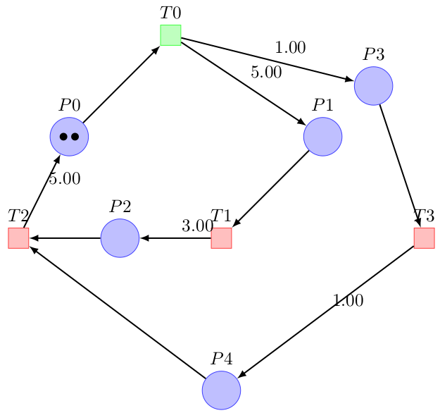
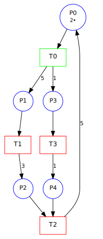
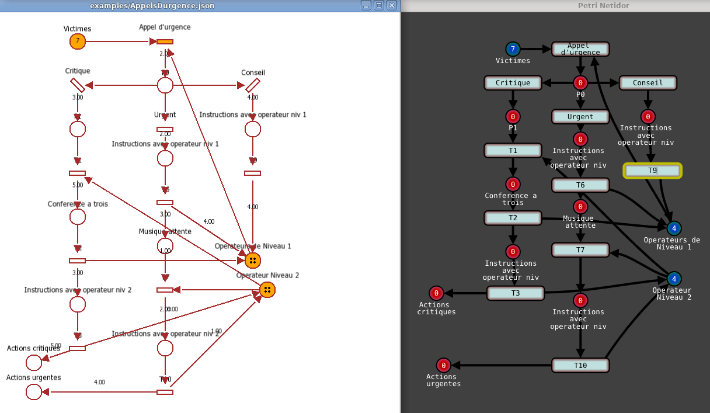

# 5. Exports and code generation

What you will find here:

- the file formats the editor reads and writes (*File > Import*,
  *File > Export*), and the formats of the journals;
- how to turn a net into a C++ program calling your functions;
- how to turn GRAFCETs into C++ code for a small computer (Arduino ...), and
  watch it run in the editor.

---

## 1. Formats

The extension of the file chooses the format (the longest one:
`net.symmetri.pnml` is the Symmetri flavor of PNML).

| Format | Extension | Import | Export | For |
|--------|-----------|:------:|:------:|-----|
| JSON | `.json` | yes | yes | the format of the editor ([chapter 6](06-File-Format.md)) |
| Petri Net Markup Language | `.pnml` | yes | yes | the standard exchange format of Petri net tools (§2) |
| PNML for Symmetri | `.symmetri.pnml` | yes | yes | [Symmetri](https://github.com/thorstink/Symmetri) (§2) |
| GreatSPN GRML | `.grml` | yes | yes | [GreatSPN](https://github.com/greatspn/SOURCES), read by Symmetri too (§3) |
| Flowshop | `.flowshop` | yes | | a factory as a table of processing times ([chapter 3](03-Timed-Nets-and-Max-Plus.md#3-tutorial-how-fast-is-my-factory)) |
| Timed event graph | `.teg` | yes | yes | a compact text format (§8) |
| C++ functions for the runtime | `.cpp` | | yes | a program calling one function per transition (§9) |
| C++ GRAFCET | `.hpp` `.h` | | yes | the GRAFCETs of a document as C++ code for a board or a computer (§10) |
| Julia | `.jl` | | yes | the matrices of a timed event graph for [MaxPlus.jl](https://github.com/Lecrapouille/MaxPlus.jl) (§7) |
| SVG picture | `.svg` | | yes | a picture of the net for a document or a web page (§4) |
| Petri LaTeX | `.tex` | | yes | a drawing for a document (§5) |
| Grafcet LaTeX | `.tex` | | yes | a GRAFCET drawing for a document (§5) |
| Graphviz | `.gv` `.dot` | | yes | a drawing by Graphviz (§6) |
| Draw.io | `.drawio.xml` | | yes | an editable drawing in [draw.io](https://app.diagrams.net) |
| PN-Editor | `.pns` ... | | yes | [pn-editor](https://gitlab.com/porky11/pn-editor) (§6) |
| Symfony | `.yaml` | | yes | a [Symfony workflow](https://symfony.com/doc/current/components/workflow.html) |

What each format keeps:

| | weights | inhibitor arcs | reset arcs | durations | colors | capacities, priorities | positions |
|---|:---:|:---:|:---:|:---:|:---:|:---:|:---:|
| JSON | yes | yes | yes | yes | yes | yes | yes |
| PNML | yes | yes (\*) | yes (\*) | yes (\*) | yes | yes (\*) | yes |
| GRML | yes | yes | refused | as delays | yes | priorities | yes |
| SVG, LaTeX, Graphviz, draw.io | shown | shown | shown | shown | shown | capacities shown | yes |
| PN-Editor | yes | refused | refused | | | | yes |
| Symfony | | | | | | | |

(\*) in `<toolspecific tool="TimedPetriNetEditor">` elements, that other
tools ignore.

## 2. PNML and Symmetri

PNML writes the places with their initial marking, the transitions and the
arcs with their weight (`<inscription>`). What PNML does not know (the type
of net, the durations, the kinds of arcs, the capacities, the priorities and
the delays) goes in `<toolspecific>` elements: a file written by the editor
comes back the same.

Symmetri reads its own flavor of PNML: the identifiers of the nodes are their
names (the names of your functions), each `<initialMarking>` is one token,
and arcs carry the color of their tokens in an attribute `color`. Export with
the extension `.symmetri.pnml`; the import reads both flavors, and the files
of the old versions of the editor (the duration in the inscription).

## 3. GRML (GreatSPN)

GRML is the XML of CosyVerif, written by GreatSPN and read by Symmetri:
places with their marking, transitions with their priority and their
distribution, arcs with their valuation (the weight) and their type
(`inhibitorarc`). A timed net exports its transitions as `DETERMINISTIC`,
with the duration of their output arcs; the import gives the delay of a
`DETERMINISTIC` transition to its output arcs.

## 4. SVG

A picture of the net at the positions of the editor: places with their
tokens (GRAFCET: steps, double for the initial ones), transitions, arcs with
their weight, duration and color; inhibitor arcs end with a circle. A timed
event graph drawn compactly keeps its places on its arcs. Open it with a
browser, insert it in a document.

## 5. LaTeX

Two exports write a `.tex` file to compile with `pdflatex file.tex`:

- **Petri LaTeX** uses the `petri` library of TikZ: places with their tokens,
  transitions, arcs with their weight, duration and color (inhibitor arcs end
  with a circle, reset arcs with a double arrow). 50 pixels of the editor
  are 1 cm.
- **Grafcet LaTeX** (GRAFCET only) draws the steps as squares (double for an
  initial step) and the transitions as bars with their receptivity.



*A canonical event graph exported to LaTeX.* On Linux, install LaTeX with
`sudo apt-get install texlive-base`.

## 6. Graphviz and pn-editor

Graphviz: a `.dot` file; view it with `xdot file.dot`, draw it with
`dot -Tsvg file.dot -o file.svg`. The layout is the one of Graphviz, not the
one of the editor (the SVG export keeps the latter).



pn-editor: the files of [pn-editor](https://gitlab.com/porky11/pn-editor) (to
install by hand). An arc of weight 3 is written three times.



## 7. Julia

Writes the (max,+) matrices of a timed event graph as a Julia script for
MaxPlus.jl. The tables of *Analysis* also have a *Copy as Julia* button.
[Chapter 8](08-Julia.md) drives the editor from Julia.

## 8. Timed event graph (`.teg`)

A compact text format for timed event graphs, from the
[Howard algorithm](http://www.cmap.polytechnique.fr/~gaubert/HOWARD2.html)
project:

```text
TimedEventGraph <number of transitions> <number of arcs>
<from transition> <to transition>: <duration> <tokens>
...
```

One line per arc between two transitions (the hidden place holds the
tokens). The format has no names.

## 9. C++ functions for the runtime

*File > Export > C++ functions for the runtime* writes a program for the
runtime of [chapter 10](10-Library.md#6-run-your-functions-the-runtime): the
net is built in the code (a board has no file system), each transition gets
a function to fill, the comment of a function says what it takes and gives,
and which results the next arcs ask for:

```c++
//! \brief grasp: takes Seen, gives Held.
//! Its result chooses what comes next: Failed (retry), Success (place).
Color grasp()
{
    // TODO: what grasp does.
    return Success;
}
...
int main()
{
    Net const net = pick_and_place::makeNet();
    Runtime runtime(net, std::make_shared<ThreadPoolExecutor>(4u), options);
    runtime.on("grasp", pick_and_place::grasp);
    ...
    auto instance = runtime.instantiate("main", {}, { { "Done", Success } });
    Color const result = runtime.run(*instance);
```

The goal of the instance is the places without output arc. Build it with
the runtime:

```sh
g++ -std=c++20 -I<TimedPetriNetEditor>/src pick_and_place.cpp \
    -L<TimedPetriNetEditor>/build -lTimedPetriRuntime -lTimedPetriNet -pthread
```

With `-DTPNE_DEBUG -lzmq`, the program publishes its journal and the editor
shows it running (§11).

## 10. C++ code of GRAFCETs

*File > Export > C++ GRAFCET* writes the GRAFCETs of the document in one C++
header: one class runs them together, as the simulation of the editor does
(IEC 60848, [chapter 4](04-GRAFCET-and-GEMMA.md)):

- search of the stable situation: transitions fire, all graphs together,
  until none can (no stable situation after 256 evolutions: `cycle()`
  returns false);
- edges (`↑a`, `↓a`) and time operators (`3s/X2`, `2s/a/500ms`) of the
  receptivities, delays of the transitions;
- actions with their qualifiers (N, S, R, D, L, SD, DS, SL, P, P0) and their
  conditions;
- forcing orders between graphs (GEMMA), references to the steps of the other
  graphs (`Production:X3`).

The code needs no library, not even the standard one: it runs on an Arduino.
Each period, the program writes the inputs, calls `cycle(dt)` and reads the
outputs:

```c++
#include "GEMMA-Dryer.hpp"

gemma_dryer::Grafcet grafcet;

void loop()
{
    grafcet.in.Start = digitalRead(2);
    grafcet.in.Temperature = analogRead(A0) / 10;
    grafcet.cycle(0.01f);                          // seconds since the last cycle
    digitalWrite(3, grafcet.out.Left_Motor);
    delay(10);
}
```

The inputs are `int` (`in`), the outputs `bool` (`out`, the names of the
actions as C++ identifiers), the steps `X0[]`, `X1[]` ... (one array per
graph, in the order of the document). Try it on a computer:

```sh
g++ -std=c++11 -x c++ -DGRAFCET_STANDALONE_TEST GEMMA-Dryer.hpp -o grafcet_test
./grafcet_test
```

The generated code is checked against the simulation of the editor: same
steps and same outputs, cycle after cycle, for the GRAFCETs of
`data/examples` (`tests/codegen/run.sh`).

## 11. The editor as a debugger

Built with `-DGRAFCET_DEBUG`, the GRAFCET code publishes its firings, its
steps and its inputs and outputs; the program of §9 does the same with
`-DTPNE_DEBUG`. Open the net in the editor, then *Debug > Connect*
(`tcp://localhost:5556`, or `-c tcp://localhost:5556` on the command line):
the *Journal* follows the program and the net shows its marking as it
changes; the *Program* window shows the inputs and outputs and the
transitions without function.

| Where the code runs | How it publishes |
|---------------------|------------------|
| a computer | ZeroMQ PUB on `tcp://*:5556` (link with `-lzmq`; `GRAFCET_DEBUG_ENDPOINT` changes it) |
| an Arduino | one JSON object per line on `Serial`; `python3 tools/serial-bridge.py /dev/ttyACM0` publishes them on ZeroMQ |
| elsewhere | define `GRAFCET_DEBUG_SEND(text)` to send each line yourself |

The messages are the ones of the runtime ([chapter 9](09-Remote-Control.md#4-follow-a-running-program)).

## 12. Journals

The *Journal* of the editor and the runtime write their journals as:

| Format | Extension | For |
|--------|-----------|-----|
| JSON lines | `.jsonl` | the editor (*Journal > Open*), `Runtime::restore()` after a crash |
| CSV | `.csv` | a spreadsheet |
| XES (IEEE 1849) | `.xes` | process mining: [ProM](https://promtools.org), [PM4Py](https://pm4py.fit.fraunhofer.de), Disco |

In a program: `saveJournal(instance->log(), net.colors, "orders.xes")`
(`Runtime/Journal.hpp`), the format by the extension.

---

Next: [6. File format](06-File-Format.md).
