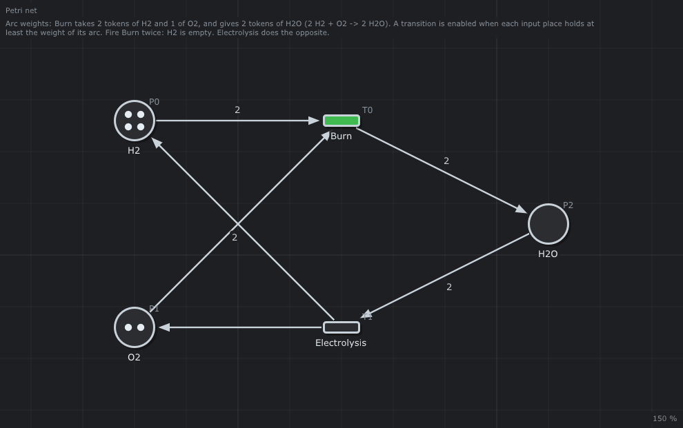
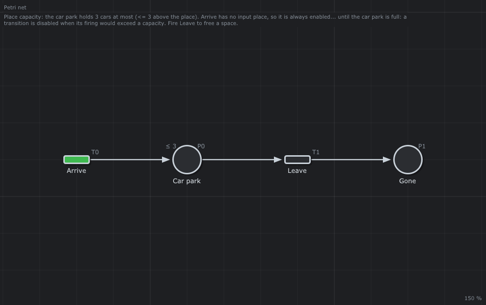
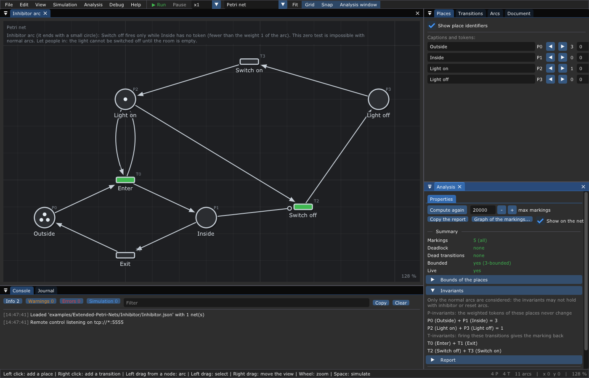
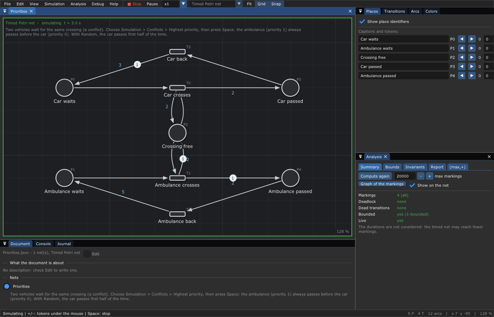
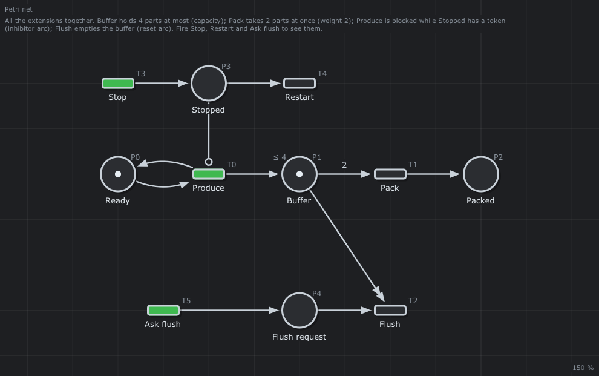

# 5. 🧪 Extended Petri nets

**What you will learn**

- six extensions of the Petri nets of [chapter 3](03-Petri-Nets.md): **weights**,
  **capacities**, **inhibitor arcs**, **reset arcs**, **priorities** and
  **colored tokens**;
- for each one: the intuition, the change of the firing rule, a small
  example, how to draw it in the editor and how it is saved;
- what each extension costs: the analyses of [chapter 4](04-Analysis.md)
  that stop working, and why;
- which types of nets accept which extension.

**Prerequisites**: [chapter 3](03-Petri-Nets.md) (the firing rule, `Pre` and
`Post`) and [chapter 4](04-Analysis.md) (reachability, Karp-Miller,
invariants).

---

## Why extend Petri nets?

Ordinary Petri nets (arcs of weight 1, places without limit) are enough in
theory for many systems, but the models get long: a machine that takes a
dozen parts needs a dozen arcs, a buffer of 4 places needs a complementary
place, and some behaviors cannot be described at all. "Fire only when the
room is **empty**" is impossible: an ordinary transition can only wait for
tokens to be **present**, never for their **absence**.

Extensions make models shorter and more expressive. The price: the more a
model can say, the less an algorithm can prove about it. The extensions of
this chapter are carried by the arcs and the places, not by the type of the
net: a net stays a *Petri net* or a *timed Petri net*, and the editor
computes which extensions it uses.

| Extension | On | Rule | Example |
|-----------|----|------|---------|
| Weight | arc | takes or gives `w` tokens at once | [Weights](../examples/Extended-Petri-Nets/Weights/README.md) |
| Capacity | place | never more than `k` tokens | [Capacity](../examples/Extended-Petri-Nets/Capacity/README.md) |
| Inhibitor arc | arc from a place | fires only while the place has fewer than `w` tokens | [Inhibitor](../examples/Extended-Petri-Nets/Inhibitor/README.md) |
| Reset arc | arc from a place | empties the place when the transition fires | [Reset](../examples/Extended-Petri-Nets/Reset/README.md) |
| Priority | transition | the highest priority wins a conflict | [Priorities](../examples/Extended-Petri-Nets/Priorities/README.md) |
| Color | arc | takes or gives tokens of a given color | [Colors](../examples/Extended-Petri-Nets/Colors/README.md) |

## 1. Weights

**Intuition.** A chemical reaction `2 H2 + O2 → 2 H2O` consumes two
molecules of hydrogen at once. A packing machine takes 12 bottles to make a
box. A **weight** `w` on an arc says how many tokens move along it.

**Rule.** This is the general form already given in
[chapter 3](03-Petri-Nets.md#4-the-mathematical-definition): `Pre(p, t)` and
`Post(p, t)` are the weights. `t` is enabled when `M(p) ≥ Pre(p, t)` for
every input place, and firing it gives `M − Pre(·, t) + Post(·, t)`. An
ordinary net is a net whose weights are all 1; nets with weights are
sometimes called *generalized* Petri nets.

**Example.** [Weights](../examples/Extended-Petri-Nets/Weights/README.md):
`Burn` takes 2 tokens of `H2` and 1 of `O2`, gives 2 of `H2O`;
`Electrolysis` does the opposite.



```text
M0 = (4, 2, 0)  enabled: Burn
fire Burn -> (2, 1, 2)  enabled: Burn Electrolysis
fire Burn -> (0, 0, 4)  enabled: Electrolysis
Burn not enabled
fire Electrolysis -> (2, 1, 2)  enabled: Burn Electrolysis
```

After two firings `H2` and `O2` are empty and `Burn` is no longer enabled.
Try with 5 tokens in `H2`: after two firings one token stays, alone, and
`Burn` cannot fire, since it needs 2.

**Analysis.** Weights keep every analysis of chapter 4. P-invariants get
weights: the editor finds `P0 (H2) + P2 (H2O) = 4` and `2 P1 (O2) + P2 (H2O)
= 4`, the conservation of the hydrogen and of the oxygen atoms.

**In the editor.** Right click on an arc > *Weight...* (or *Duration and
weight...* in a timed net), or double click on the arc. The weight is drawn
in the middle of the arc when it is not 1. JSON: `"weight": 2` in the arc.

## 2. Capacities

**Intuition.** A car park has 3 spaces; a buffer between two machines holds
4 parts. A **capacity** `k` on a place forbids it to hold more than `k`
tokens.

**Rule.** A transition is enabled only if, after its firing, no output place
exceeds its capacity (counting the tokens it takes from the same place, and,
in a timed net, the tokens already on their way to it). Unbounded places
have no capacity.

**Example.** [Capacity](../examples/Extended-Petri-Nets/Capacity/README.md):
`Arrive` has no input place, so it is always enabled... until the car park
is full.



```text
M0 = (0, 0)  enabled: Arrive
fire Arrive -> (1, 0)  enabled: Arrive Leave
fire Arrive -> (2, 0)  enabled: Arrive Leave
fire Arrive -> (3, 0)  enabled: Leave
Arrive not enabled
fire Leave -> (2, 1)  enabled: Arrive Leave
fire Arrive -> (3, 1)  enabled: Leave
```

**The classic trick.** A capacity can be replaced by a **complementary
place** `p'`: give `p'` the tokens `k − M0(p)`, and to each transition that
adds `w` tokens to `p` an arc taking `w` tokens from `p'` (and the opposite
for the transitions that take from `p`). `p + p'` is then a P-invariant
equal to `k`. The net becomes ordinary again, and all the analyses come back.
The places `Remaining` of [SmarthomeSafety](../examples/Petri-Nets/SmarthomeSafety/README.md)
and `Mutex` of [MutualExclusion](../examples/Petri-Nets/MutualExclusion/README.md)
are such places.

**In the editor.** Right click on a place > check *Max tokens* and give the
capacity. It is drawn `≤ 3` above the place, and the editor refuses to add
tokens beyond it. JSON: `"capacity": 3` in the place. A GRAFCET step has the
capacity 1 by nature.

## 3. Inhibitor arcs

**Intuition.** "Switch off the light only when the room is empty", "do not
produce while the machine is stopped". An **inhibitor arc** from a place to
a transition tests the **absence** of tokens. It is drawn with a small
circle instead of an arrow head.

**Rule.** An inhibitor arc of weight `w` from `p` to `t` adds the condition
`M(p) < w` to the enabling of `t` (with `w = 1`: `p` is empty). It takes no
token when `t` fires.

**Example.** [Inhibitor](../examples/Extended-Petri-Nets/Inhibitor/README.md):
`Switch off` fires only while `Inside` is empty.


```text
M0 = (3, 0, 1, 0)  enabled: Enter Switch off
fire Enter -> (2, 1, 1, 0)  enabled: Enter Exit
Switch off not enabled
fire Exit -> (3, 0, 1, 0)  enabled: Enter Switch off
fire Switch off -> (3, 0, 0, 1)  enabled: Switch on
```

`Enter` also reads `Light on` with an arc in each direction: people enter
only when the light is on.

**What it costs.** The zero test is exactly what ordinary nets lack: with
inhibitor arcs, Petri nets can simulate a counter machine (Minsky), and
become as powerful as any computer program (Turing complete). The price is
that reachability, boundedness and liveness become **undecidable** in
general: no algorithm can answer them for every net. Concretely in the
editor: the reachability graph is still built (it follows all the rules),
but Karp-Miller is refused (more tokens can disable a transition), and
invariants are computed on the normal arcs only, with a warning:



*The net is small and bounded: its 5 markings are all explored, and the
properties are exact. The note says that the invariants ignore the inhibitor
arc.*

**In the editor.** Right click on an arc from a place > *Kind* >
*inhibitor*. JSON: `"kind": "inhibitor"` (and `"weight"` for `w`).

## 4. Reset arcs

**Intuition.** Empty the trash, flush a buffer, clear a counter: take
**all** the tokens of a place, however many there are. A **reset arc** is
drawn with a double arrow head.

**Rule.** A reset arc from `p` to `t` does not change the enabling of `t`
(it does not need any token); when `t` fires, `p` becomes empty.

**Example.** [Reset](../examples/Extended-Petri-Nets/Reset/README.md):


```text
M0 = (1, 0, 1)  enabled: Throw Empty
fire Throw -> (1, 1, 1)  enabled: Throw Empty
fire Throw -> (1, 2, 1)  enabled: Throw Empty
fire Throw -> (1, 3, 1)  enabled: Throw Empty
fire Empty -> (1, 0, 1)  enabled: Throw Empty
fire Empty -> (1, 0, 1)  enabled: Throw Empty
```

**What it costs.** Reset nets can be analyzed less than ordinary ones:
reachability and boundedness become undecidable (Dufourd, Finkel and
Schnoebelen, 1998). The editor refuses Karp-Miller and warns on the
invariants, as for inhibitor arcs. Since `Throw` can fire for ever, the
reachability graph of this example is infinite, and the editor says it
stopped:

```text
Reachable markings: 100000 (stopped)
...
Note: Karp-Miller does not apply to nets with reset arcs: the bounds and the dead transitions are the ones of the explored markings.
Note: Only the normal arcs are considered: the invariants may not hold with inhibitor or reset arcs.
```

**In the editor.** Right click on an arc from a place > *Kind* > *reset*.
JSON: `"kind": "reset"`.

## 5. Priorities

**Intuition.** An ambulance and a car wait for the same crossing: the
ambulance passes first. A **priority** on a transition solves the conflicts
it is in.

**Rule.** Among the transitions that can fire at the same time, the one of
highest priority fires first; among equal priorities, the first declared
(lowest identifier). Priorities change *which* transition fires, never
*whether* one is enabled.

**Where it applies.** Priorities matter only when the program chooses:

- in a **timed Petri net** simulated by the editor, with *Simulation >
  Conflicts > Highest priority* (the default policy is *Random*);
- in the **runtime** ([chapter 11](11-Runtime.md)), whose default policy is
  the priority.

In a Petri net simulated by hand, you choose by clicking, and the priority
is not used.

**Example.** [Priorities](../examples/Extended-Petri-Nets/Priorities/README.md):
`Ambulance crosses` has priority 1, `Car crosses` priority 0.



*After 3 time units of simulation: the ambulance crossed first, its token
travels back. The tokens on the arcs are on their way ([chapter 6](06-Timed-Petri-Nets.md)).*

**What it costs.** The analysis ignores priorities: it explores every
enabled transition, so it may find markings, and deadlocks, that the
priorities make impossible. The opposite is safe: priorities only choose
among enabled transitions, so a net proved free of deadlocks without them
stays free of deadlocks with them.

**In the editor.** The *Transitions* tab of the inspector has a priority
column; *Simulation > Conflicts* chooses the policy, and the seed of the
random one (*Replay the last simulation*). JSON: `"priority": 1` in the
transition.

## 6. Colored tokens

### 6.1 Colored Petri nets in general

In the **colored Petri nets** of Kurt Jensen (1981, the tool CPN Tools), a
token carries a value of some type (its color: an integer, a record, a
client with its name), and arcs carry expressions that say which values are
taken and produced. A whole family of similar subnets folds into one: one
place `Philosopher` with three colored tokens instead of three places.
Colored nets are as expressive as programs, and their analysis usually
unfolds them back into ordinary nets.

### 6.2 The colors of this editor: results that choose the way

This editor implements a simpler idea, borrowed from
[Symmetri](https://github.com/thorstink/Symmetri): a color is a **name**,
and it is mainly the **result** of the action of a transition.

- A token has a color among `Success`, `Failed`, `Canceled` (built in) and
  the colors of the net (its list `colors`).
- An arc **from** a place can ask for a color: the transition takes only the
  tokens of this color. Without color, it takes any token.
- An arc **to** a place can give a color. Without color, it gives the
  **result** of the function of the transition (`Success`, `Failed`, or a
  color of yours) when the net is run by the runtime.

**Not a general colored Petri net (yet).** A color is only a name: a token
does not carry a typed object (an identifier, a value, a set of fields), and
arcs have no expressions nor bindings on token values. General colored Petri
nets in the sense of §6.1 are planned for a later version.

So a transition whose function can succeed or fail puts a token whose color
is its result, and the next arcs choose: the `Success` arc goes on, the
`Failed` arc retries. The result of a function **chooses what comes next**.

**Example.** [Colors](../examples/Extended-Petri-Nets/Colors/README.md):
`Inspect` returns `Good` or `Bad`; `Ship` takes only the `Good` tokens,
`Scrap` only the `Bad` ones.


Run by the runtime (`build/examples/Colors`, [chapter 11](11-Runtime.md)):

```text
inspect part 1: Good
inspect part 2: Bad
inspect part 3: Good
  ship it
  ship it
  scrap it
lot_1: Deadlocked, shipped 2, scrapped 1
```

The same mechanism chooses `Accept` or `Reject Coin` in
[Coffee](../examples/Petri-Nets/Coffee/README.md) and the kind of the call
in [EmergencyCalls](../examples/Petri-Nets/EmergencyCalls/README.md).

**In the simulation.** The simulation of the editor follows the colors with
the same rule as the runtime: an arc that asks for a color takes only the
tokens of this color. There is no function to give a result, so the result
of a firing is drawn at random among the colors asked by the arcs after the
transition (in Colors: `Good` or `Bad`), `Success` when no arc asks for one.
The [analysis](04-Analysis.md) still ignores the colors, and says so ("The
colors of the tokens are not considered").

**In the editor.** The *Colors* window lists the colors of the user: *Add*
creates one. Right click on an arc > *Color of the tokens*, or the Color
column of *Arcs*, chooses one; *any* removes it. A new color can also be
typed in the menu of the arc. JSON: `"color": "Good"` in the arc, and
`"colors": ["Good", "Bad"]` in the net for the colors of the user.

## 7. All together: the bounded buffer

[BoundedBuffer](../examples/Extended-Petri-Nets/BoundedBuffer/README.md)
uses four extensions in a small production line: `Buffer` holds 4 parts at
most (capacity), `Pack` takes 2 parts at once (weight), `Produce` is blocked
while `Stopped` has a token (inhibitor arc), `Flush` empties the buffer
(reset arc). `Stop`, `Restart` and `Ask flush` let you try each one.



Run by the runtime on a simulated clock (a part every time unit, a pack of 2
every 3), the four rules show in the table (`build/examples/BoundedBuffer`):

```text
 date  Buffer  Packed  Stopped  event
    0       2       0        0  
    1       3       0        0  
    2       4       0        0  
    3       3       1        0  
    4       4       1        0  
    5       4       1        0  
    6       3       2        0  
    7       4       2        0  
    8       4       2        1  Stop: the producer waits
    9       2       3        1  
   10       2       3        1  
   11       2       3        1  
   12       1       4        0  Restart
   13       2       4        0  
   14       3       4        0  
   15       0       5        0  Ask flush: Buffer emptied
   16       1       5        0  
   17       2       5        0  
   18       1       6        0  
   19       2       6        0  
   20       3       6        0  
```

At dates 2, 4, 5 and 7 the buffer is full: the capacity blocks the
producer. From 8 to 11 the inhibitor arc stops it: only the packer works.
At 15 the reset arc empties the buffer.

## 8. What the extensions cost

| Extension | Reachability graph | Karp-Miller (boundedness of infinite nets) | Invariants | Decidability |
|-----------|:---:|:---:|:---:|---|
| Weights | yes | yes | yes, with weights | as ordinary nets |
| Capacities | yes | refused | the capacity is not in `C` | as ordinary nets (complementary places) |
| Inhibitor arcs | yes | refused | normal arcs only, warning | Turing complete: undecidable in general |
| Reset arcs | yes | refused | normal arcs only, warning | reachability and boundedness undecidable |
| Priorities | ignored (all enabled transitions) | ignored | ignored | — |
| Colors | ignored (any color) | ignored | ignored | — |

Karp-Miller needs a **monotonic** rule: if a transition is enabled in `M`,
it must be enabled in every larger marking. Inhibitor arcs (more tokens
disable), reset arcs and capacities break this, so the editor refuses it for
them ("Karp-Miller does not apply to nets with places with a capacity"). A
bounded net is still fully analyzed by its reachability graph, whatever its
extensions; only infinite ones are out of reach.

## 9. Which nets accept which extension

| Type of net | Weights | Capacities | Inhibitor | Reset | Colors | Priorities |
|-------------|:---:|:---:|:---:|:---:|:---:|:---:|
| Petri net | ✅ | ✅ | ✅ | ✅ | ✅ | ✅ (runtime) |
| Timed Petri net | ✅ | ✅ | ✅ | ✅ | ✅ | ✅ |
| Timed event graph | ❌ | ❌ | ❌ | ❌ | ❌ | — |
| GRAFCET | ❌ | ❌ (1 by nature) | ❌ | ❌ | ❌ | — |

An event graph must have ordinary arcs only, so that its dates follow the
(max,+) equations of [chapter 8](08-Max-Plus-Algebra.md); a GRAFCET follows
the rules of IEC 60848 ([chapter 9](09-GRAFCET.md)). Changing the type of a
net that uses a refused extension (*Edit > Type of net*) fails with a message
naming it (for example "A GRAFCET cannot have inhibitor arcs") and marks the
offending arcs. The menus of the arcs only show the extensions the type
accepts.

## 10. Try it

| Example | Do | Observe |
|---------|----|---------|
| [Weights](../examples/Extended-Petri-Nets/Weights/README.md) | fire `Burn` twice, then `Electrolysis` | the weighted invariants in *Analysis > Properties* |
| [Capacity](../examples/Extended-Petri-Nets/Capacity/README.md) | fire `Arrive` until it turns grey | a full place blocks its input transitions |
| [Inhibitor](../examples/Extended-Petri-Nets/Inhibitor/README.md) | let people in, try `Switch off` | a zero test |
| [Reset](../examples/Extended-Petri-Nets/Reset/README.md) | throw 3 things, then `Empty` | all the tokens go at once |
| [Priorities](../examples/Extended-Petri-Nets/Priorities/README.md) | run it with *Random*, then with *Highest priority* | who crosses first |
| [Colors](../examples/Extended-Petri-Nets/Colors/README.md) | run `build/examples/Colors` | the result of a function chooses the branch |
| [BoundedBuffer](../examples/Extended-Petri-Nets/BoundedBuffer/README.md) | fire `Stop`, then `Ask flush` | four extensions in one net |

## 11. Pitfalls

- **An inhibitor arc of weight 2** does not test emptiness: it allows up to
  1 token. Check the weight.
- **A reset arc does not enable**: the transition needs its other input
  places; a reset arc alone on an empty place is fine.
- **Colors in the editor**: if the simulation does not choose the branch you
  expect, remember that it ignores colors; run the net with the runtime.
- **Priorities in a Petri net simulated by hand**: they have no effect, you
  choose.
- **Prefer complementary places to capacities** when you need the full
  analysis of an unbounded-looking net.

## 12. Going further

- K. Jensen, L. M. Kristensen, *Coloured Petri Nets: Modelling and
  Validation of Concurrent Systems*, Springer, 2009.
- C. Dufourd, A. Finkel, P. Schnoebelen, *Reset nets between decidability and
  undecidability*, ICALP 1998.
- M. Minsky, *Computation: Finite and Infinite Machines*, 1967 (counter
  machines, the reason why inhibitor arcs give Turing power).
- [Symmetri](https://github.com/thorstink/Symmetri), the runtime that
  inspired the colors of results.

---

Next: [6. Timed Petri nets](06-Timed-Petri-Nets.md) — add time: durations,
delays, timeouts.
