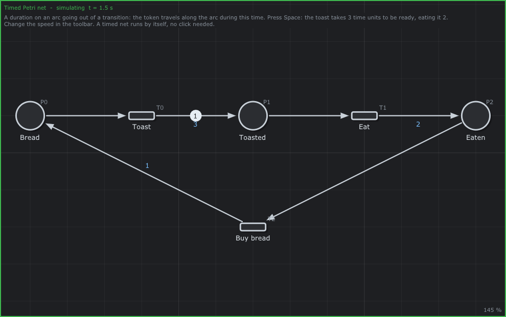
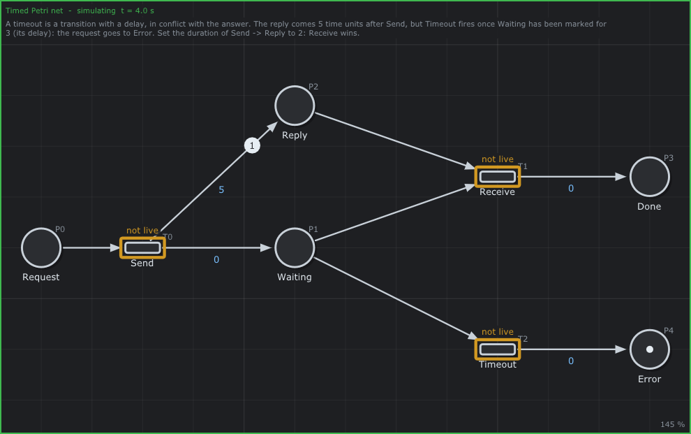
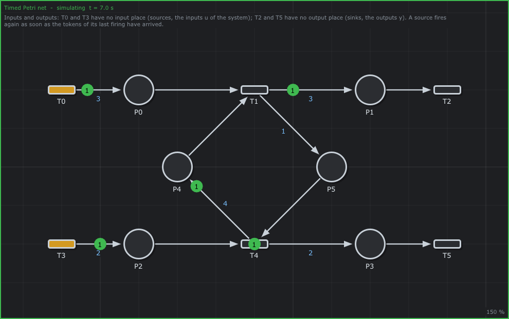
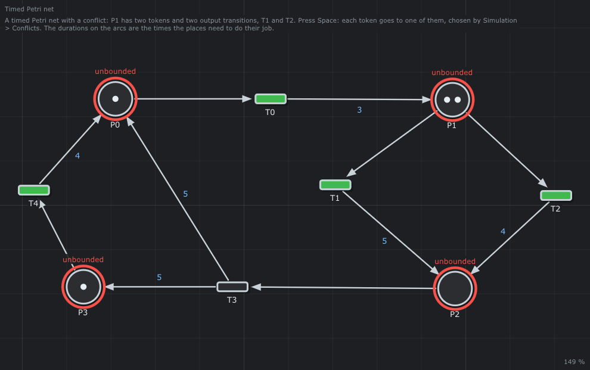
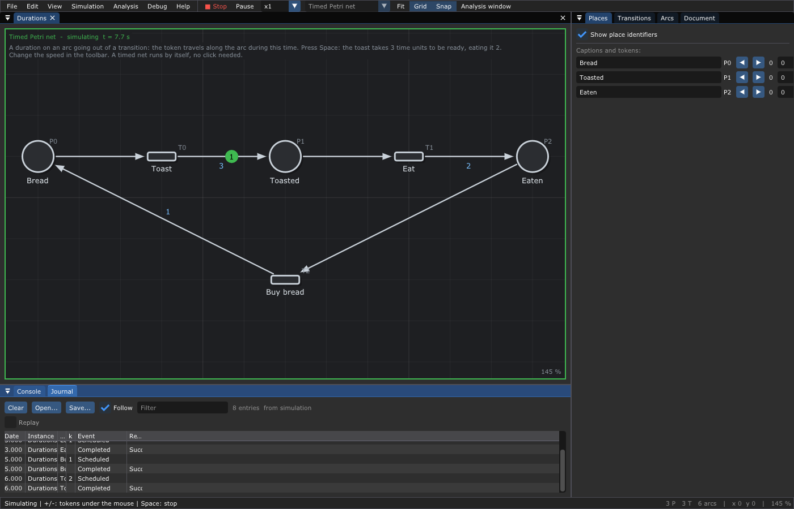
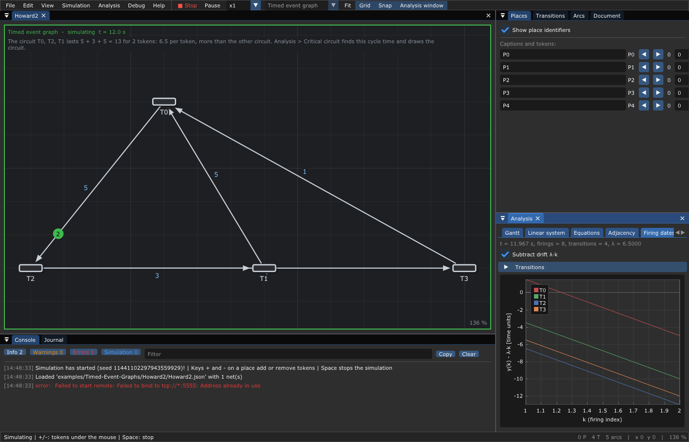

# ⏱️ 6. Timed Petri nets

**What you will learn**

- why we add time to a Petri net, and the three places where the
  literature puts it;
- the choice of this editor: a **duration** on the arcs going out of a
  transition, and a **delay** on the transitions;
- exactly how a timed net runs in the editor: earliest firing, tokens on
  their way, events, conflicts in time, cycles without duration;
- four patterns: the duration of a job, the **timeout**, the **sources** and
  **sinks** (inputs and outputs of a system), the queue that grows;
- what the editor shows: the animation, the speed, the *Journal*, the plot of
  the firing dates.

**Prerequisites**: [3. Petri nets](03-Petri-Nets.md) (marking, firing rule,
conflict) and the priorities of [5. Extended Petri nets](05-Extended-Petri-Nets.md).

---

## 1. Why time?

A Petri net as seen in chapter 3 says **what** can happen and in which
order, never **when**. The firing of a transition is instantaneous and nobody
knows how long a token stays in a place. That is enough to find a deadlock,
but not to answer the questions of an engineer:

- *How many products per hour does my factory make?* (the **throughput**)
- *How long does a client wait?* (the **response time**)
- *What happens if the server does not answer within 3 seconds?* (a
  **timeout**)
- *Which machine should I buy to go faster?* (the **bottleneck**)

To answer them, we give the net a clock: an event happens at a date, and some
activities last some time.

## 2. Where to put the time? A short history

The idea came in the 1970s, in three different places of the net:

| Time on ... | Meaning | Introduced by |
|-------------|---------|---------------|
| the **transitions**: a firing duration | the transition takes its input tokens, works during `d`, then gives its output tokens | C. Ramchandani, MIT, 1974 (*timed Petri nets*) |
| the **transitions**: an interval `[a, b]` | once enabled, the transition fires between `a` and `b` time units later | P. Merlin, 1974 (*time Petri nets*) |
| the **places**: a holding time | a token that arrives in the place is available only `d` time units later | J. Sifakis, 1977 |

Later, the durations became random (stochastic Petri nets, M. Molloy 1982;
generalized stochastic Petri nets, M. Ajmone Marsan, G. Balbo, G. Conte 1984,
the nets of [GreatSPN](https://github.com/greatspn/SOURCES)). The (max,+)
algebra of chapters 7 and 8 uses the holding times on places.

These models are not equivalent in general, but they are close: a transition
with a firing duration `d` is the same as an instantaneous transition
*start*, a place *busy* with a holding time `d`, and an instantaneous
transition *end*.

```text
   firing duration on T             the same with a holding time on a place
   ( ) ──► [ T, d ] ──► ( )         ( ) ──► [start] ──► (busy, d) ──► [end] ──► ( )
```

## 3. The choice of this editor

The editor puts the time in two places.

### 3.1 The duration of an arc

An arc going **from a transition to a place** has a **duration** `d` (a real
number, 0 by default). When the transition fires, it takes its input tokens
at once, then its output tokens **travel along the arc** during `d`: they
reach the place `d` time units after the firing. Meanwhile they are in no
place: they are *on their way* (a **flight**, in the code). The arcs going
into a transition have no duration.

```text
   (●) ──► ▭ ──── 3 ────► ( )      T0 fires at t = 0: P0 is empty at once,
   P0      T0             P1       P1 gets its token at t = 3
```

This is the holding time of Sifakis, written on the arc that feeds the place
instead of in the place: it lets two arcs feeding the same place have two
different durations. When all the output arcs of a transition have the same
duration, it is also the firing duration of Ramchandani.

### 3.2 The delay of a transition

A transition has a **delay** (0 by default): it fires only after having been
**able to fire without interruption** during this delay. If it is disabled
before the end (another transition took its token), its delay starts again
from zero the next time it is enabled. This is Merlin's interval `[d, d]`
with the *enabling memory* policy. The delay is the tool of the **timeout**
(§6.2).

### 3.3 Earliest firing

In the editor, a timed net runs by itself: **a transition fires as soon as it
can** (enabled, and its delay elapsed). Nothing waits on purpose. This is the
*earliest* behavior, the one of a system that never wastes time; chapter 7
shows that it gives the smallest possible dates.

## 4. How the editor runs a timed net

The engine of the editor (`Engine`, in `src/PetriNet/Engine.hpp`) is a
**discrete event simulation**:

1. The engine keeps the marking, the tokens on their way (each with its date
   of arrival) and, for each transition with a delay, the date since which it
   can fire.
2. At a date, it fires, **one at a time**, the transitions that can fire,
   until none can. Each firing takes the input tokens and puts the output
   tokens on their way. A token whose duration is 0 arrives at once and can
   make another transition fire at the same date.
3. Then the clock **jumps to the next event**: the next arrival of tokens or
   the next end of a delay. Nothing happens in between, so the dates are
   exact: they do not depend on the frame rate of the screen nor on the
   speed of the animation.
4. The simulation goes on until nothing is on its way and nothing can fire:
   the net is **deadlocked** (or until you stop it).

Three more rules complete the semantics:

- **Conflicts.** When several transitions can fire at a date and share a
  token, the order matters. *Simulation > Conflicts* chooses the policy:
  *Random* (the default: a random choice, from a **seed** written in the
  console, `Simulation has started (seed 4343662601744704737)!`, to replay the
  same run), *Highest priority* (the priority of the transitions, then the
  first declared) or *First declared* (the lowest identifier).
- **Sources.** A transition without input place is always enabled. In a
  timed net it fires once, then **fires again when the tokens of its last
  firing have arrived**: its period is the longest duration of its output
  arcs. In a Petri net without time, it fires when you click on it.
- **Cycles without duration.** A circuit of transitions whose arcs all have
  a duration 0 could fire for ever at the same date (a *Zeno* behavior). The
  engine stops after 10000 firings at one date and warns: `Transitions keep
  firing at the date ...: a cycle without duration. The simulation stops.`

## 5. Your first timed net: the toaster

[`examples/Timed-Petri-Nets/Durations`](../examples/Timed-Petri-Nets/Durations/README.md)
toasts a slice of bread (3 time units), eats it (2), and buys bread again
(1):

```text
   (●) Bread ──► [Toast] ── 3 ──► ( ) Toasted ──► [Eat] ── 2 ──► ( ) Eaten
      ▲                                                                │
      └──────────────── 1 ──────── [Buy bread] ◄───────────────────────┘
```

Compute the dates by hand. At `t = 0` only `Toast` is enabled: it fires, the
token travels 3. At `t = 3` it reaches `Toasted`: `Eat` fires, the token
travels 2. At `t = 5` `Buy bread` fires; at `t = 6` the bread is back and
`Toast` fires again. The cycle lasts 3 + 2 + 1 = 6. The engine gives the
same dates:

```text
t =  0.00  Toast              k = 1
t =  3.00  Eat                k = 1
t =  5.00  Buy bread          k = 1
t =  6.00  Toast              k = 2
t =  9.00  Eat                k = 2
t = 11.00  Buy bread          k = 2
t = 12.00  Toast              k = 3
```

`k` counts the firings of each transition: `Toast` fires for the k-th time at
`6 (k - 1)`.

```sh
./build/TimedPetriNetEditor examples/Timed-Petri-Nets/Durations/Durations.json
```

Press **Space**: the net runs by itself; the token moves along the arc with
its count in a green disk. The top left corner writes the simulated time.



*At `t = 1.5`, the token is halfway between `Toast` and `Toasted`: no place
holds it.*

## 6. Four patterns

### 6.1 A job that lasts: the duration

Put the duration of a job on the arc that leaves the transition starting it.
A machine that works 5 on a piece is `[start] ── 5 ──► (done)`. If the
machine can do one piece at a time, give it a place *free* with one token,
taken by `start` and given back by the end of the job: this is the loop of
the machines of a factory (chapter 7).

### 6.2 The timeout

[`examples/Timed-Petri-Nets/Timeout`](../examples/Timed-Petri-Nets/Timeout/README.md)
sends a request and waits for the reply, but not for ever:

```text
                    ┌── 5 ──► ( ) Reply ──┐
   (●) Request ──► [Send]                 ├──► [Receive] ──► ( ) Done
                    └── 0 ──► ( ) Waiting ┘
                                   │
                                   └──► [Timeout, delay 3] ──► ( ) Error
```

`Receive` and `Timeout` share the token of `Waiting`: they are in conflict.
`Timeout` has a delay of 3: it can fire 3 time units after `Waiting` got its
token, `Receive` as soon as the reply is there. The first one wins.

| Duration of `Send → Reply` | What happens |
|----------------------------|--------------|
| 5 (as in the file) | `t = 0` Send, `t = 3` **Timeout**: the request goes to `Error`; the reply arrives at 5 and stays alone in `Reply` |
| 2 (double click the arc) | `t = 0` Send, `t = 2` **Receive**: the request is `Done`, the timeout never fires |



*At `t = 4`: the timeout has fired (a token in `Error`), the reply is still
on its way.*

This is the pattern of every protocol, and of the runtime of chapter 11
(`examples/Runtime/MicroServices`).

### 6.3 Sources and sinks: the inputs and outputs of a system

A transition without input place is a **source**: it brings tokens from
outside (clients, pieces, messages). A transition without output place is a
**sink**: it sends them outside. In the language of control theory, the
sources are the **inputs** `u` of the system and the sinks its **outputs**
`y` (chapter 8 writes the equations between them).

[`examples/Timed-Petri-Nets/InputsOutputs`](../examples/Timed-Petri-Nets/InputsOutputs/README.md)
has two sources, `T0` (period 3, the duration of its arc) and `T3` (period
2), and two sinks, `T2` and `T5`:



*The sources are drawn in orange while their tokens are on their way.*

### 6.4 The queue that grows

Look at the place `P2` of the same net. `T3` puts a token in it every 2
time units. `T4` takes one only when `P5` has a token, and `P5` is fed by
`T1`, which cannot go faster than its source `T0`: once every 3 time units.
The engine gives (marking `P0 ... P5` after each firing, tokens on their way
not counted):

```text
t =  0.00  T0  k = 1   marking: 1 0 0 1 2 0
t =  0.00  T1  k = 1   marking: 0 0 0 1 1 0
t =  0.00  T3  k = 1   marking: 0 0 0 1 1 0
t =  0.00  T5  k = 1   marking: 0 0 0 0 1 0
t =  2.00  T3  k = 2   marking: 0 0 1 0 1 1
t =  2.00  T4  k = 1   marking: 0 0 0 0 1 0
...
t = 10.00  T3  k = 6   marking: 0 0 2 0 0 1
t = 10.00  T4  k = 4   marking: 0 0 1 0 0 0
t = 12.00  T0  k = 5   marking: 1 1 2 1 1 0
...
t = 12.00  T5  k = 5   marking: 0 0 2 0 0 0
```

At `t = 12`, `T3` fired 7 times and `T4` 4 times: `P2` holds 2 tokens and
gains one every 6 time units. The input `u1` is faster than the system: the
queue grows without end. A timed net that is bounded without time can thus
become unbounded with time, and the opposite: time removes some markings
(chapter 4 ignores time).

The smallest example of growth is
[`Unbounded`](../examples/Timed-Petri-Nets/Unbounded/README.md): `T0` gives
its token back to `P0` and one more to `P1`, every time unit:

```text
t =  0.00  T0  k = 1   marking: 0 0
t =  1.00  T0  k = 2   marking: 0 1
t =  2.00  T0  k = 3   marking: 0 2
t =  3.00  T0  k = 4   marking: 0 3
t =  4.00  T0  k = 5   marking: 0 4
```

## 7. Conflicts in time

[`examples/Timed-Petri-Nets/TimedConflict`](../examples/Timed-Petri-Nets/TimedConflict/README.md)
is the net of the first version of this documentation:



`P1` has two tokens and two output transitions, `T1` (5 to reach `P2`) and
`T2` (4). At `t = 0`, both can fire. With *First declared*, the engine fires
`T1` twice (its identifier is the lowest); with *Random* and the seed 7, it
fires `T2` twice; and the whole future changes:

| | First declared | Random, seed 7 |
|-|----------------|----------------|
| at `t = 0` | `T0`, `T1`, `T1`, `T4` | `T4`, `T2`, `T0`, `T2` |
| first firing of `T3` | `t = 5` | `t = 4` |
| firings of `T3` before `t = 12` | 4 (the last at 12) | 4 (the last at 12) |

The policy is part of the model: when the order matters, decide it with
priorities instead of hoping for luck.
[`Priorities`](../examples/Extended-Petri-Nets/Priorities/README.md) (chapter
5) is a crossing where an ambulance (priority 1) and a car (priority 0) wait.
With *Simulation > Conflicts > Highest priority*:

```text
t =  0.00  Ambulance crosses  k = 1
t =  2.00  Car crosses        k = 1
t =  2.00  Ambulance back     k = 1
t =  4.00  Car back           k = 1
t =  7.00  Ambulance crosses  k = 2
t =  9.00  Car crosses        k = 2
```

When both wait, the ambulance passes first, every time.

## 8. In the editor

| To ... | Do |
|--------|----|
| make a net timed | the type in the toolbar, or *Edit > Type of net > Timed Petri net* |
| give a duration | double click the arc going out of a transition, or the *Arcs* panel, or right click on the arc |
| give a delay or a priority | the *Transitions* panel of the inspector |
| choose how conflicts are solved | *Simulation > Conflicts* (and its seed for *Random*), before starting |
| run, pause, change the speed | **Space**, **P**, the speed `x0.1` to `x50` in the toolbar: at `x1` one time unit is one second |
| add or remove tokens while it runs | keys **+** and **-** on a place |
| read what happened | the *Journal* (next to the console) |

The **Journal** lists the firings of the simulation: the date, the net, the
transition, its number `k`, the event (`Scheduled` when the tokens are taken,
`Completed` when they are given) and the result. *Save* writes it as JSON
lines, CSV or XES for a spreadsheet or a process mining tool; *Replay* shows
the marking at any date ([chapter 13](13-Debugging.md)).



When the timed net is also an event graph (chapter 7), *Analysis > Firing
dates* plots the date `y(k)` of the k-th firing of each transition. With
*Subtract drift λ·k*, a transition that fires regularly every `λ` gives a
flat curve: what remains is the start of the system.



The [runtime](11-Runtime.md) runs timed nets the same way in your programs:
its arcs with a duration give their tokens later, its delays wait, its
priorities order the conflicts (with one difference: a source fires only
when the program injects it).

## 9. Try it

| Example | Do | Observe |
|---------|----|---------|
| [Durations](../examples/Timed-Petri-Nets/Durations/README.md) | Space, then `x5` | a cycle of 6; *Analysis > Critical circuit* finds λ = 6 |
| [Timeout](../examples/Timed-Petri-Nets/Timeout/README.md) | Space; then set `Send → Reply` to 2 | Error, then Done |
| [TimedConflict](../examples/Timed-Petri-Nets/TimedConflict/README.md) | run it twice with *Random*, then with *First declared* | different runs, then always the same |
| [InputsOutputs](../examples/Timed-Petri-Nets/InputsOutputs/README.md) | Space, wait | `P2` fills up |
| [Unbounded](../examples/Timed-Petri-Nets/Unbounded/README.md) | Space; *Analysis > Properties* | `P1` grows; the net is unbounded |
| [Priorities](../examples/Extended-Petri-Nets/Priorities/README.md) | *Conflicts > Highest priority*, Space | the ambulance first |
| [Flowshop](../examples/Flowshops/README.md) | Space | a real factory, the subject of chapter 7 |

## 10. Pitfalls

- **A duration on an arc into a transition is ignored**: put it on the arc
  that leaves the transition.
- **Durations need the type *Timed Petri net***: in a *Petri net*, durations
  are kept in the file but the tokens arrive at once and you fire by clicks.
- **A source with a duration 0 fires for ever** at the same date: the engine
  stops it (the Zeno warning). Give its arc a duration.
- **The analysis of chapter 4 ignores time**: a deadlock found there may
  never happen in time, and a bounded net can overflow in time (§6.4).
- **Random means random**: write down the seed of the console to replay a
  run.

## 11. Going further

- J. Wang, *Timed Petri Nets: Theory and Application*, Kluwer, 1998.
- B. Bérard, F. Cassez, S. Haddad, D. Lime, O. H. Roux, *Comparison of the
  expressiveness of timed automata and time Petri nets*, FORMATS 2005.
- M. Ajmone Marsan, G. Balbo, G. Conte, S. Donatelli, G. Franceschinis,
  *Modelling with Generalized Stochastic Petri Nets*, Wiley, 1995 (free
  online).
- The [bibliography](Bibliography.md).

---

Next: [7. Timed event graphs](07-Timed-Event-Graphs.md) — when no token ever
has a choice, the dates follow exact equations.
