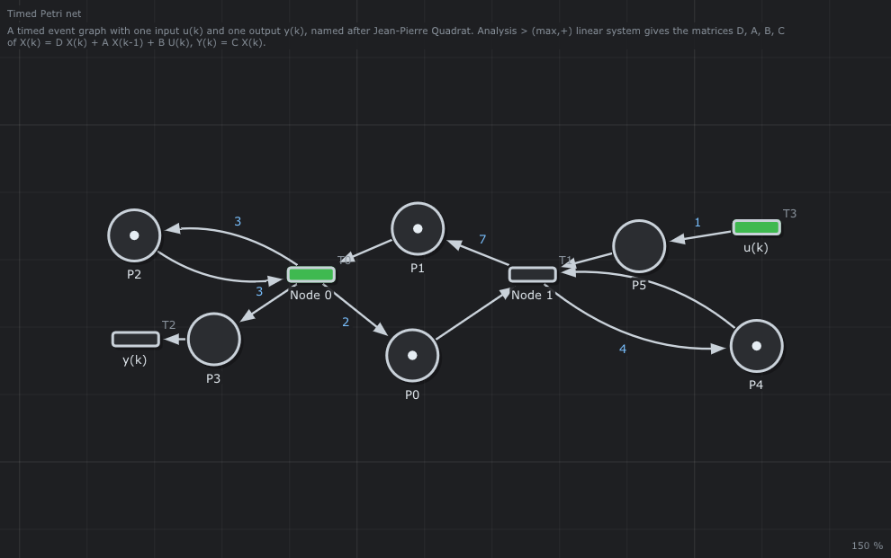
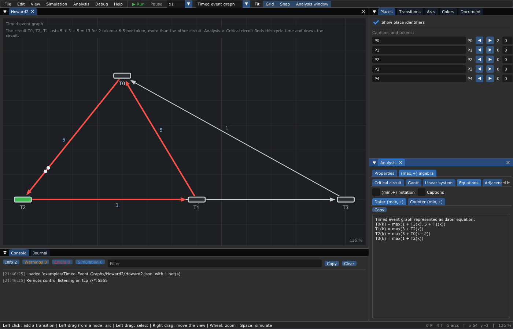
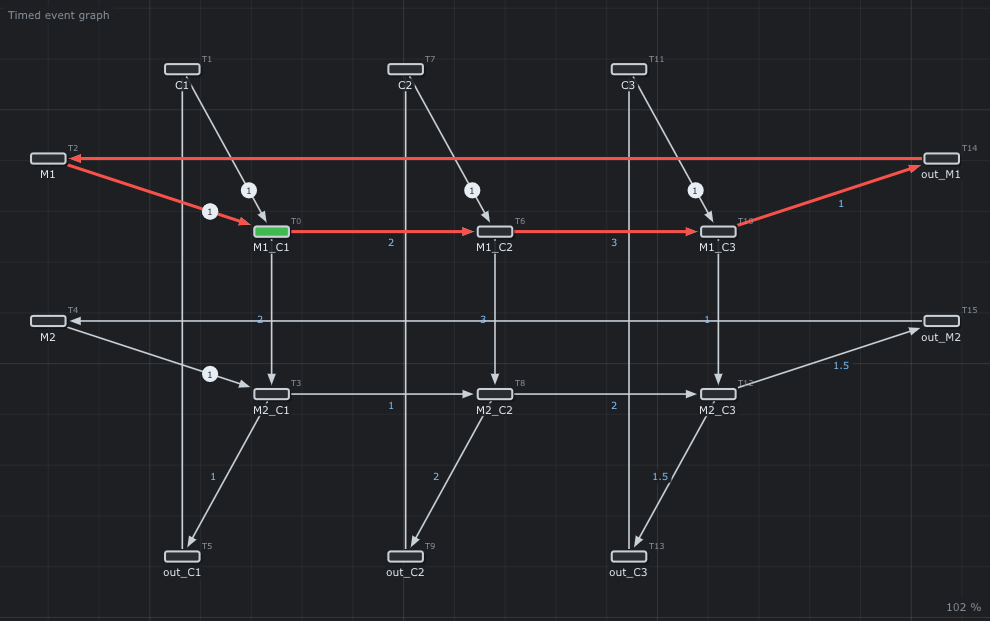
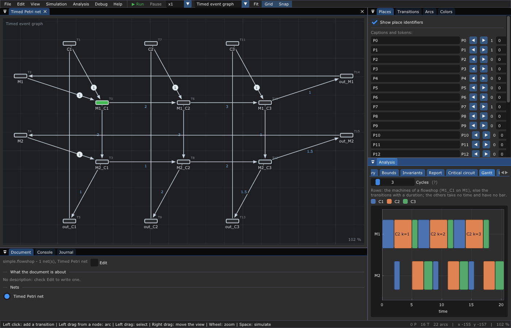
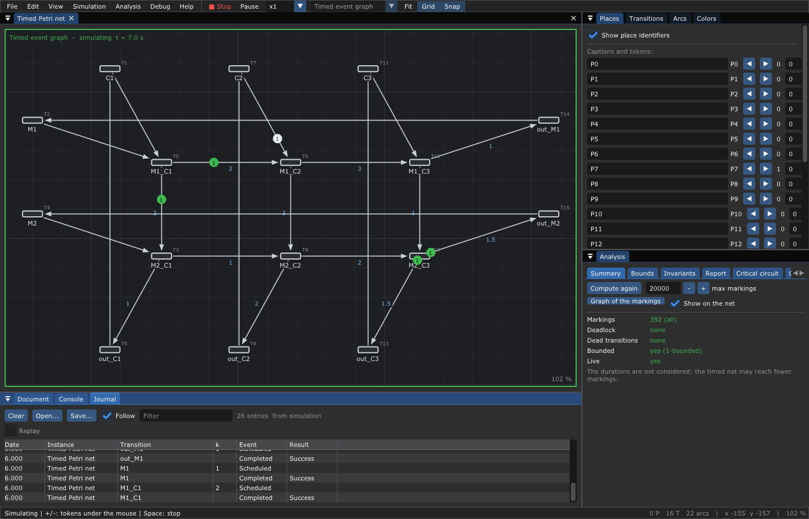
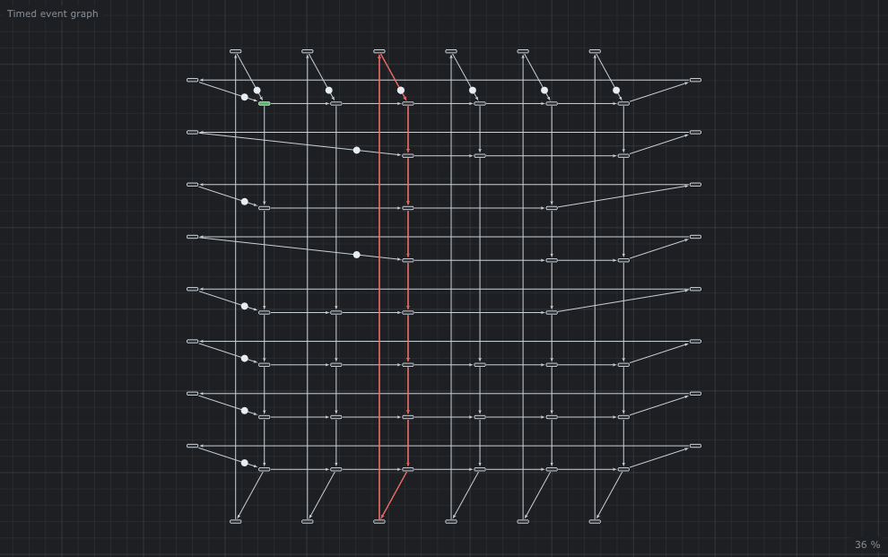
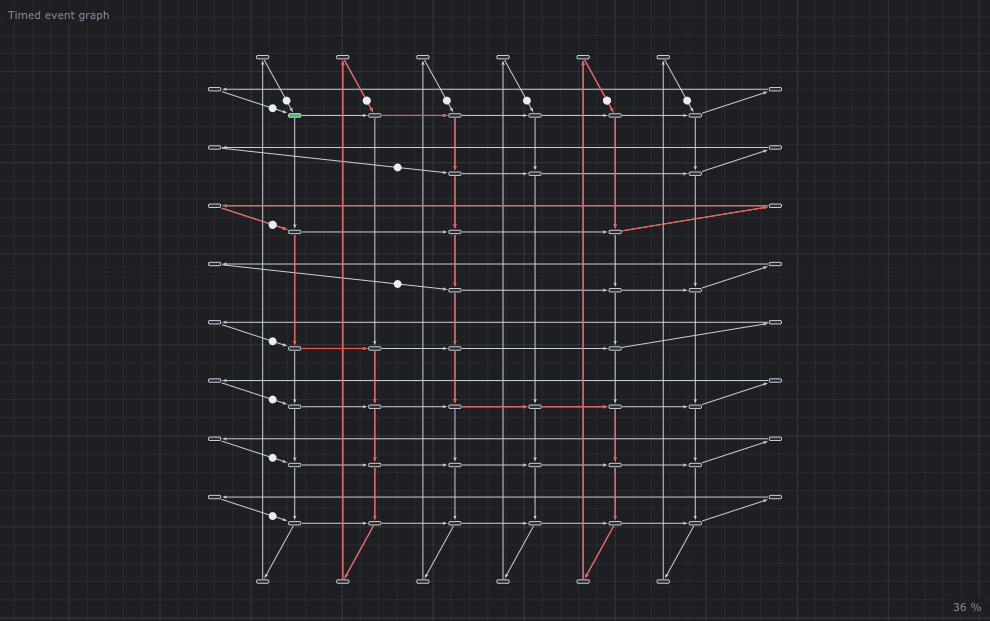
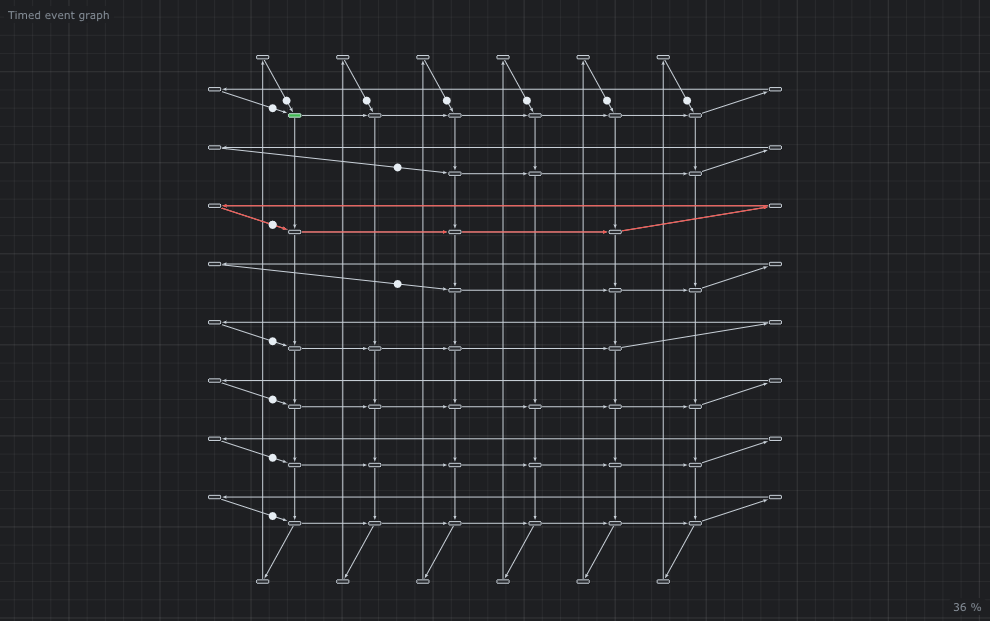

# 🔁 7. Timed event graphs

**What you will learn**

- what an **event graph** is, and why it has no conflict;
- its properties: the tokens of a circuit never change, liveness and
  boundedness read on the circuits;
- the **compact drawing** of the editor (places hidden on the arcs);
- the **dater** and **counter** equations, computed by hand, then by the
  editor;
- the **canonical form**, the **inputs** and **outputs** of a system;
- a factory (a **flowshop**): machines, conveyors, the resource that limits it, and its **Gantt chart**;
- the `.teg` file format.

**Prerequisites**: [6. Timed Petri nets](06-Timed-Petri-Nets.md).

---

## 1. Event graphs

A Petri net is an **event graph** (also called a **marked graph**) when
**each place has exactly one input transition and exactly one output
transition**. Transitions may have many arcs: they still wait for several
things at once (synchronization) and start several things at once
(parallelism). What is forbidden is a place with two exits (a choice) or two
entries (a merge).

```text
   allowed (synchronization)          forbidden (choice)
   ( ) ──┐                                      ┌──► [T1]
          ├──► [T]                     ( ) ─────┤
   ( ) ──┘                                      └──► [T2]
```

The first consequence is the most important one: **there is never a
conflict**. A token in a place can go to one transition only; nothing is
random, nothing depends on a policy. The order of the events is fixed by the
structure and the tokens; with durations, their **dates** are fixed too, and
follow simple equations (§3).

Event graphs model systems that repeat the same work: production lines,
assembly, railway timetables, the pipelines of a processor, the loops of a
real-time program. They were studied by F. Commoner, A. Holt, S. Even and A.
Pnueli (*Marked directed graphs*, 1971).

### 1.1 What the circuits tell

In an event graph, a transition on a circuit takes one token from the place
before it on the circuit and gives one to the place after it on the same
circuit. So **the number of tokens of each circuit never changes**: each
circuit is a P-invariant ([chapter 4](04-Analysis.md)). Three results
follow (Commoner et al., 1971):

| Property | Reads on the circuits |
|----------|-----------------------|
| **live** (each transition can always fire again) | every circuit holds at least one token |
| **bounded** | a strongly connected event graph is bounded: a place never holds more than the tokens of the circuits through it |
| **safe** (at most one token per place), when live | every place is on a circuit holding exactly one token |

A circuit without token is a dead end: its transitions wait for each other
for ever. The editor says it in the Gantt chart: `A circuit has no token: the
event graph never fires`.

## 2. The compact drawing

Since a place of an event graph has one transition before it and one after
it, it can be drawn as an **arc between two transitions**, which carries the
tokens (a disk with their number, near its end) and the duration of the hidden place. This is
the way of the (max,+) books, and the way the editor draws a **timed event
graph**.

The same net, [JPQ](../examples/Timed-Event-Graphs/JPQ/README.md), as a timed
Petri net:



and [Howard2](../examples/Timed-Event-Graphs/Howard2/README.md) drawn
compactly: the arc `T0 → T2` is the place `P0`, its disk `2` is the two
tokens of `P0`, and `5` is its duration:


The disk near the end of an arc holds the number of tokens waiting in the
hidden place for the next transition: one disk whatever their number, so
that the arcs stay readable. While the simulation runs, the tokens on their
way are a green disk with their number that moves along the arc during its
duration, then joins the disk of the waiting tokens.

In the editor, the type *Timed event graph* (toolbar or *Edit > Type of net*)
is a timed Petri net drawn compactly: a click in the void adds a transition,
a drag between two transitions adds the hidden place, double click an arc to
give its duration and tokens. Switching a timed Petri net to *Timed event
graph* checks that it is an event graph and says which places are not.

## 3. The dates follow equations

### 3.1 The dater form

Number the firings of each transition: `x_i(k)` is the **date** of the
**k-th firing** of the transition `i` (a **dater**). Look at a place between
the transitions `j` and `i`, with `m` tokens and the duration `t`. The k-th
token taken by `i` in this place is:

- one of the `m` initial tokens, for `k ≤ m` (available at time 0);
- else the token given by the `(k - m)`-th firing of `j`, which arrived at
  `x_j(k - m) + t`.

With the earliest firing of chapter 6, `i` fires as soon as all its input
places have their k-th token: the date is the **largest** of these arrivals.

```text
   x_i(k) = max over the input places of i ( x_j(k - m) + t )
```

This is the **dater equation**: it contains only `max` and `+`.

### 3.2 By hand on Howard2

The places of [Howard2](../examples/Timed-Event-Graphs/Howard2/README.md):

| Place | From → to | Tokens `m` | Duration `t` |
|-------|-----------|:----------:|:------------:|
| P0 | T0 → T2 | 2 | 5 |
| P1 | T1 → T0 | 0 | 5 |
| P2 | T2 → T1 | 0 | 3 |
| P3 | T3 → T0 | 0 | 1 |
| P4 | T2 → T3 | 0 | 1 |

give the equations (*Analysis > Equations > Dater (max,+)* writes the same):

```text
T0(k) = max(1 + T3(k), 5 + T1(k))
T1(k) = max(3 + T2(k))
T2(k) = max(5 + T0(k - 2))
T3(k) = max(1 + T2(k))
```

Solve them cycle by cycle. For `k = 1` and `k = 2`, `T2` takes the initial
tokens of `P0`, available at 0: `T2(1) = T2(2) = 0`. Then:

| k | T2(k) | T1(k) = 3 + T2(k) | T3(k) = 1 + T2(k) | T0(k) = max(1 + T3(k), 5 + T1(k)) |
|---|-------|-------------------|-------------------|-----------------------------------|
| 1 | 0 | 3 | 1 | max(2, 8) = 8 |
| 2 | 0 | 3 | 1 | max(2, 8) = 8 |
| 3 | 5 + T0(1) = 13 | 16 | 14 | max(15, 21) = 21 |
| 4 | 5 + T0(2) = 13 | 16 | 14 | max(15, 21) = 21 |

The editor computes these **earliest dates** for the Gantt chart; for 4
cycles it gives exactly:

```text
T0: 8 8 21 21
T1: 3 3 16 16
T2: 0 0 13 13
T3: 1 1 14 14
```

Two firings every 13 time units: 6.5 per firing. Chapter 8 shows how to find
this number without computing the dates.



### 3.3 The counter form

Turn the question around: `x_i(t)` is now the **number of firings** of the
transition `i` up to the date `t` (a **counter**). A place between `j` and
`i` with `m` tokens and the duration `t_ij` lets `i` fire at most `m` times
more than `j` fired `t_ij` time units ago:

```text
   x_i(t) = min over the input places of i ( m + x_j(t - t_ij) )
```

*Analysis > Equations > Counter (min,+)* gives for Howard2:

```text
T0(t) = min(T3(t - 1), T1(t - 5))
T1(t) = min(T2(t - 3))
T2(t) = min(2 + T0(t - 5))
T3(t) = min(T2(t - 1))
```

The roles of tokens and durations are exchanged: in the dater form the
tokens shift the index `k` and the durations are added; in the counter form
the durations shift the time `t` and the tokens are added. The dater form is
usually preferred:

- a real system has few tokens (2 trains, 3 machines) but long durations (2
  hours for a system sampled at 1 Hz is 7200 steps of delay); each step of
  delay costs a variable of memory in a computation;
- with the canonical form (§4) every token shift is 0 or 1.

## 4. The canonical form

An event graph is **canonical** when:

- each place holds **at most one token**;
- the places leaving an input transition, and the places entering an output
  transition, hold **no token**.

Any event graph has an equivalent canonical form: a place with `m` tokens is
`m` places in a row with one token each, separated by new transitions; a
place with a token next to an input or an output gets an empty place before
or after it. On Howard2, the place `P0` (2 tokens, duration 5) becomes:

```text
   before:  T0 ──(●●, 5)──► T2
   after:   T0 ──(●, 0)──► T4 ──(●, 5)──► T2
```

*Edit > To canonical form* does it (here it adds `T4`). In the canonical
form, the shift `k - m` of the dater equation is `k` (no token) or `k - 1`
(one token): the equations become the linear system of chapter 8.

## 5. Inputs and outputs

A transition without input place is an **input** `u` of the system (the
arrival of raw material, of a train, of a client). A transition without
output place is an **output** `y` (a product, a departure). The others are
the **state** `x`. In the earliest dates, an input is always ready: it fires
at 0 for every `k`.

[JPQ](../examples/Timed-Event-Graphs/JPQ/README.md) has the input `u(k)` and
the output `y(k)`. Its dater equations (*Analysis > Equations*):

```text
T0(k) = max(7 + T1(k - 1), 3 + T0(k - 1))
T1(k) = max(2 + T0(k - 1), 4 + T1(k - 1), 1 + T3(k))
T2(k) = max(3 + T0(k))
```

with `T0 = Node 0`, `T1 = Node 1`, `T2 = y(k)`, `T3 = u(k)`. The output
follows the state: `y(k) = 3 + Node0(k)`. The earliest dates of 4 cycles:

```text
Node 0: 0 8 12 17
Node 1: 1 5 10 14
y(k):   3 11 15 20
u(k):   0 0 0 0
```

Chapter 8 writes these equations with matrices.

## 6. Tutorial: how fast is my factory?

### 6.1 The flowshop

A **flowshop** is a factory that produces parts. Every part visits the
machines in the same order. A **job shop** lets each part have its own
route; it needs choices, so it is not an event graph. The flowshop is.

On the timed event graph the editor builds, the resources are drawn in two
directions:

- a **machine** is a **horizontal** cycle (a row);
- a **conveyor** is a **vertical** cycle (a column).

The numbers in the file are how many of each resource the factory owns. The
examples below start with **one machine** of each kind and **one conveyor**
of each kind: one token on each cycle.

[`examples/Flowshops/simple.flowshop`](../examples/Flowshops/README.md)
has 2 machines and 3 conveyors:

```text
nconveyors: 3
nmachines: 2
nm: 1 1              # one machine of each kind
np: 1 1 1            # one conveyor of each kind
conveyors: C1 C2 C3
M1: 2.0 3.0 1.0      # M1 works 2 on C1, 3 on C2, 1 on C3
M2: 1.0 2.0 1.5      # M2 works 1 on C1, 2 on C2, 1.5 on C3
```

The format: `key: values` lines, `#` starts a comment. `nconveyors` and
`nmachines` give the size, `nm` and `np` how many machines and conveyors,
`conveyors` their names, then one line per machine (its name, then its
processing time for each conveyor). A time `-inf`, `eps`, `nan` or `%0` means
that the conveyor does not visit this machine (it is the ε of chapter 8).

### 6.2 The timed event graph of a flowshop

Open it: the editor builds the timed event graph.

```sh
./build/TimedPetriNetEditor examples/Flowshops/simple.flowshop
```


| Transition | Meaning |
|------------|---------|
| `M1_C2` | an **operation**: machine `M1` starts work on conveyor `C2`; its output arcs carry the processing time 3 |
| `M1`, `M2` | the machine is free again: its token goes to its first operation (`nm` tokens, here 1) |
| `C1`, `C2`, `C3` | the conveyor is free again: its token goes to its first machine (`np` tokens, here 1) |
| `out_M1`, `out_C2` ... | the machine has done its last operation of the cycle, the conveyor has left its last machine |

Each row is the loop of a machine: `M1 → M1_C1 → M1_C2 → M1_C3 → out_M1 →
M1`, one token. The machine works on one conveyor at a time, in the order of
the columns. Each column is the loop of a conveyor: `C1 → M1_C1 → M2_C1 →
out_C1 → C1`, one token. The conveyor is on one machine at a time, in the
order of the rows. An operation waits for both its machine and its conveyor:
it has two input places, a synchronization.

### 6.3 Cycle time and the critical resource

*Analysis > Critical circuit* (chapter 8 explains it) answers:

```text
Cycle time λ: 6.00 time units.
```

and draws in red the **critical circuit**: `M1 → M1_C1 → M1_C2 → M1_C3 →
out_M1 → M1`. The red circuit is horizontal: the machine `M1` is the
resource that limits the factory.



In the long run the factory finishes one round of the three conveyors every
6 time units. Why 6? This circuit is the loop of `M1`: it works 2 + 3 + 1 =
6 per round, with its single token. `M2` works 1 + 2 + 1.5 = 4.5. The column
of conveyor `C2` is 3 + 2 = 5, `C1` is 2 + 1 = 3, `C3` is 1 + 1.5 = 2.5.
`M1` is the slowest resource: to go faster, buy a faster `M1`, or a second
one (`nm: 2 1`), not a faster `M2`.

### 6.4 The schedule: the Gantt chart

*Analysis > Gantt*: one row per machine, one bar per operation, one color
per conveyor (the legend above the chart names them; the line above it
recalls which rows are drawn). The bar `C2 k=2` is the 2nd time (cycle
`k = 2`) the machine works on conveyor `C2`; it starts at the earliest date
of the dater equation (§3) and lasts the processing time. The *Cycles*
slider shows more cycles; the mouse on a bar gives its start and end.



**Why are there only the rows `M1` and `M2`, and not one row per
transition?** The Gantt chart draws only the **operations**: the transitions
followed by a duration (the longest duration of their output arcs is not 0).
Then:

- a transition named `<machine>_<conveyor>` (the operations built from a
  flowshop) is drawn on the row of `<machine>`, with the color of
  `<conveyor>`: `M1_C1`, `M1_C2`, `M1_C3` all go on the row `M1`;
- any other transition with a duration gets a row of its own, named after
  it (in a net that is not a flowshop, each timed transition is a row);
- the transitions without duration take no time, so there is nothing to
  draw: here `M1`, `M2` (a machine is free again), `C1`, `C2`, `C3` (a
  conveyor is free again) and the `out_...` transitions (end of a cycle).
  They still count in the dates: they pass the tokens of the machines and of
  the conveyors from a cycle to the next.

The earliest dates of the first 3 cycles (the editor, 4 cycles shown):

```text
M1_C1: 0 6 12 18       M2_C1: 2 8.5 14.5 20.5
M1_C2: 2 8 14 20       M2_C2: 5 11 17 23
M1_C3: 5 11 17 23      M2_C3: 7 13 19 25
```

`M1` never stops: `M1_C1` at 0, `M1_C2` at 2 (after 2), `M1_C3` at 5 (after
3), `M1_C1` again at 6 (after 1): a cycle of 6. `M2` waits for `M1`: it
starts `C1` at 2, when `M1` has finished it; from the second cycle `M2_C1`
starts at 8.5 and not at 8, because `M2` is busy with `C3` until 7 + 1.5 =
8.5.

### 6.5 The same dates in the simulation

Press **Space**: the simulation of chapter 6 runs the same net. The
*Journal* lists the firings: `M1_C1` at 0, `M1_C2` and `M2_C1` at 2 ... the
dates of the Gantt chart, because a timed event graph has no choice and the
simulation fires as early as possible.



### 6.6 A conveyor, then a machine

[`complex.flowshop`](../examples/Flowshops/README.md) is
the same kind of factory with 8 machines and 6 conveyors, still one of each
resource. Some conveyors skip a machine (`-inf`).

*Critical circuit* gives `λ = 16.95` and paints one column in red, the loop
of `Conveyor3`:



The circuit is vertical. `Conveyor3` visits every machine, and with its
single token the column lasts

```text
0.95 + 2 + 2.2 + 2 + 3 + 4.3 + 1 + 1.5 = 16.95
```

No machine row is that long (the longest is `Machine3`, 3.7 + 2.2 + 6.4 =
12.3). The scarce resource is a conveyor, not a machine.

A conveyor costs less than a machine, so the next purchase is a conveyor.
[`complex-conveyors.flowshop`](../examples/Flowshops/complex-conveyors.flowshop)
is the same table with a second `Conveyor3` (`np: 1 1 2 1 1 1`). The cycle
time drops to 15.12. The red circuits are no longer that one column: they
are the columns of `Conveyor2` and `Conveyor5`, and the row of `Machine3`.



Keep adding conveyors.
[`complex-machine.flowshop`](../examples/Flowshops/complex-machine.flowshop)
has two of every conveyor (`np: 2 2 2 2 2 2`) and still one of each machine.
The cycle time is 12.30, and the only red circuit is the row of `Machine3`
(3.7 + 2.2 + 6.4 = 12.3, one token). The circuit is horizontal: the machine
is now the resource that limits the factory. Another conveyor would not
help; a second `Machine3` would.



The editor does not choose these numbers. There is no automatic setting of
an ideal flowshop: you edit `nm` and `np`, open the file again, and read the
critical circuit.

## 7. The `.teg` file format

Timed event graphs can also be saved in a small text format, inherited from
the [Howard algorithm](http://www.cmap.polytechnique.fr/~gaubert/HOWARD2.html)
programs (*File > Export > Timed event graph*, extension `.teg`):

```text
TimedEventGraph <number of transitions> <number of arcs>
<from transition> <to transition>: <duration> <tokens>
...
```

One line per hidden place, from the transition before it to the transition
after it. [SemiHoward.teg](../examples/Timed-Event-Graphs/SemiHoward/README.md):

```text
TimedEventGraph 3 5

0 1:   0   1
1 0:   1   0
2 0:   0   0
2 1:   1   0
2 2:   2   1
```

The format has no names nor positions: the editor puts the transitions on a
circle. [SemiNetherlands.teg](../examples/Timed-Event-Graphs/SemiNetherlands/README.md)
is a bigger one (8 transitions, 12 places).

## 8. Reference: the Analysis window of event graphs

The window has one row of tabs: *Summary*, *Bounds*, *Invariants* and
*Report* for every net (the Petri net theory of [chapter 4](04-Analysis.md)),
then, for a timed event graph, the tabs below; they appear by themselves.
When the timed net is not an event graph, one tab *(max,+)* says why (a
place with two input arcs, a weight ...) and *Show the faulty arcs* draws the
arcs to change.

| Tab | Shows | Chapter |
|-----|-------|---------|
| Critical circuit | λ, the arcs of the critical circuit (red on the net), the bias | [8](08-Max-Plus-Algebra.md) |
| Gantt | earliest dates of the first cycles, by machine | §6.4 |
| Linear system | the matrices `D`, `A`, `B`, `C` | [8](08-Max-Plus-Algebra.md) |
| Equations | dater (max,+) and counter (min,+) forms, with identifiers or captions | §3 |
| Adjacency | durations and tokens as matrices | [8](08-Max-Plus-Algebra.md) |
| Firing dates | `y(k)` of each transition while the simulation runs | [6](06-Timed-Petri-Nets.md) |
| Properties | deadlocks, bounds, liveness, invariants | [4](04-Analysis.md) |

## 9. Try it

| Example | Do | Observe |
|---------|----|---------|
| [Howard2](../examples/Timed-Event-Graphs/Howard2/README.md) | *Analysis > Gantt*, *Equations* | the dates of §3.2 |
| [Howard1](../examples/Timed-Event-Graphs/Howard1/README.md) | *Analysis > Equations* | every token shift is `k - 2` |
| [JPQ](../examples/Timed-Event-Graphs/JPQ/README.md) | *Equations*; change the type to *Timed event graph* | inputs and outputs; the compact drawing |
| [EventGraph](../examples/Timed-Event-Graphs/EventGraph/README.md) | *Equations* | the example of the book of Baccelli, Cohen, Olsder, Quadrat |
| [Flowshop](../examples/Flowshops/README.md) | *Critical circuit* on `complex.flowshop`, then `complex-conveyors.flowshop`, then `complex-machine.flowshop` | the red circuit goes from a column (a conveyor) to a row (a machine) |
| [SemiHoward](../examples/Timed-Event-Graphs/SemiHoward/README.md) | open the `.teg` | a net without names |

## 10. Pitfalls

- **A choice breaks everything**: one place with two output transitions and
  the (max,+) tabs disappear (the window says why). Use a timed Petri net
  (chapter 6) and simulate.
- **A circuit without token never fires**: the Gantt chart says so.
- **The earliest dates suppose the inputs always ready** (they fire at 0):
  real inputs come later; the dates are then larger.

## 11. Going further

- F. Commoner, A. W. Holt, S. Even, A. Pnueli, *Marked directed graphs*,
  Journal of Computer and System Sciences, 1971.
- F. Baccelli, G. Cohen, G. J. Olsder, J.-P. Quadrat, *Synchronization and
  Linearity*, Wiley, 1992, chapter 2
  ([free online](https://www.rocq.inria.fr/metalau/cohen/SED/book-online.html)).
- The [bibliography](Bibliography.md).

---

Next: [8. The (max,+) algebra](08-Max-Plus-Algebra.md) — the equations of
this chapter become linear, and the cycle time an eigenvalue.
