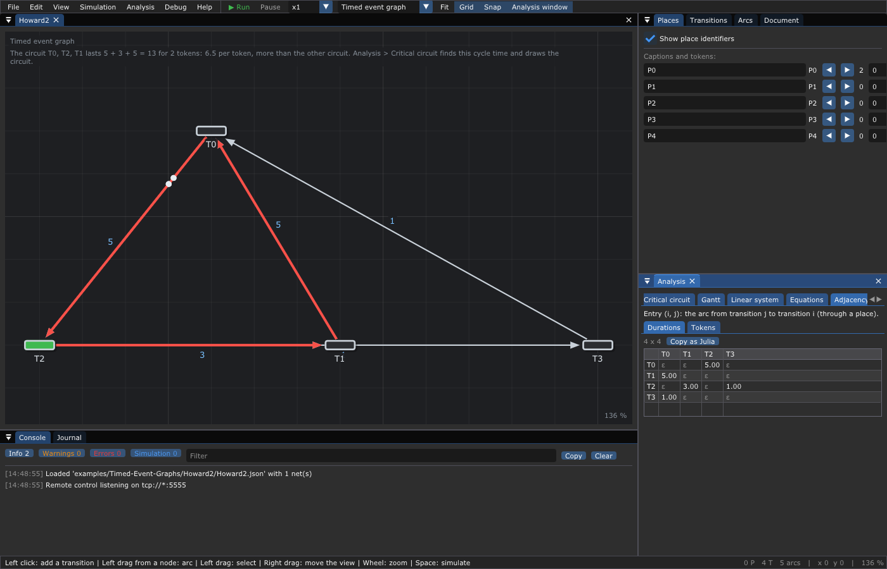
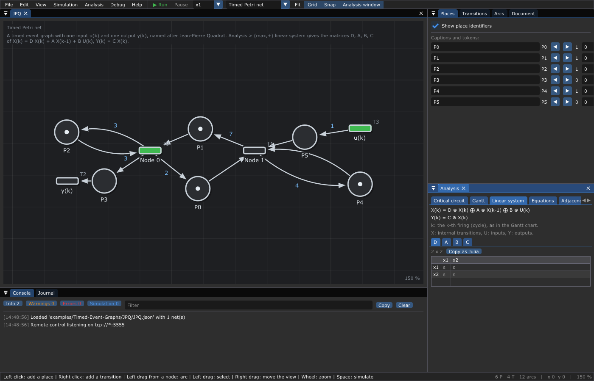
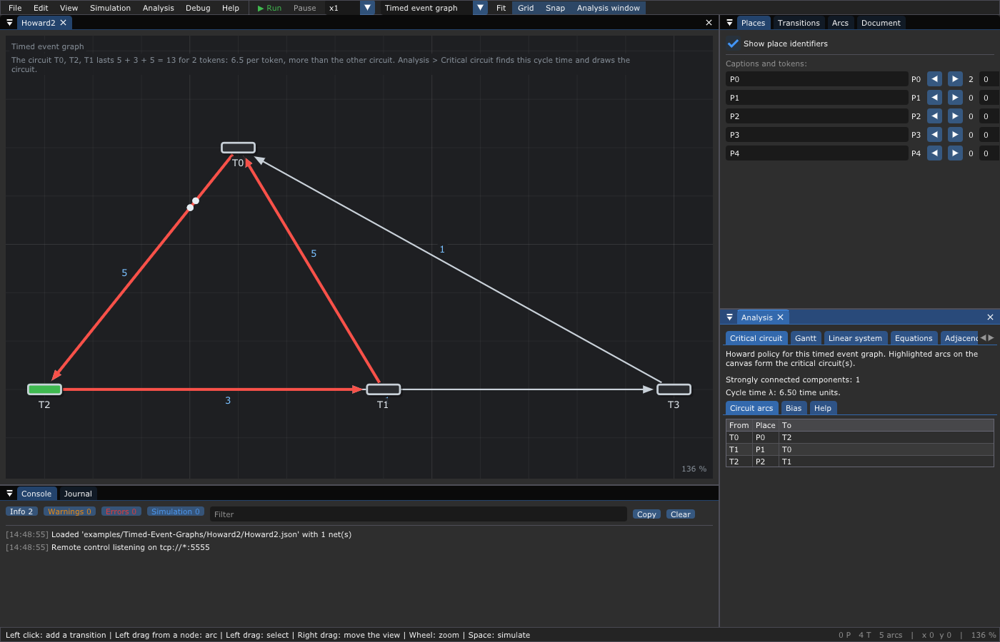
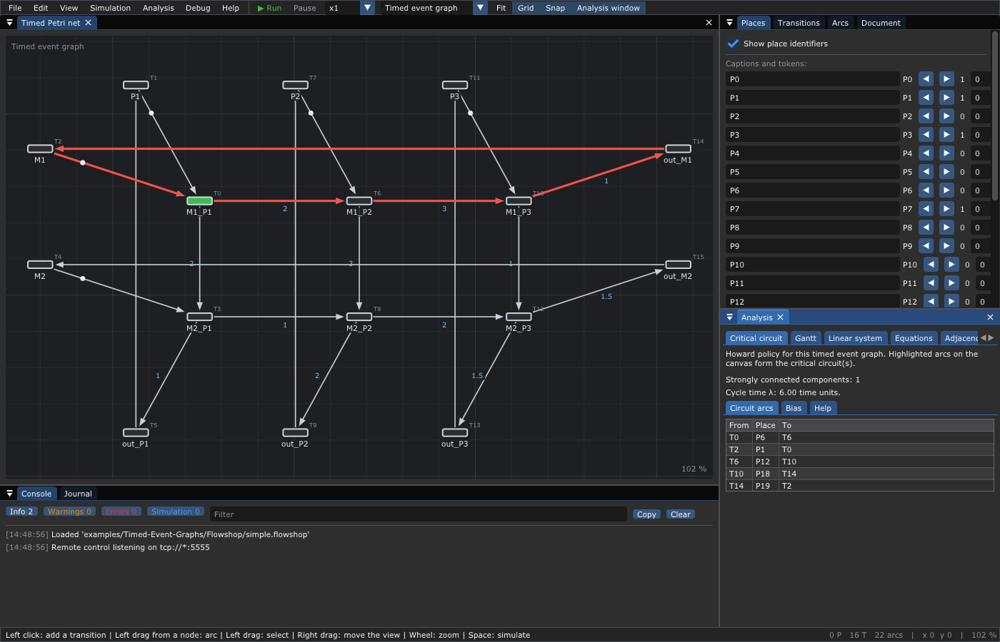
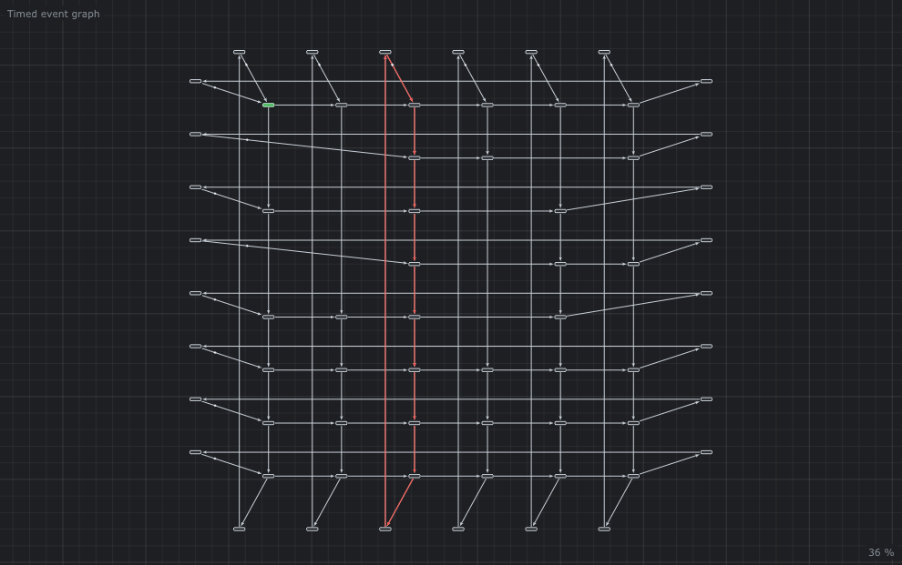

# ➕ 8. The (max,+) algebra

**What you will learn**

- the **(max,+) algebra**: a world where "plus" is `max` and "times" is `+`;
- its matrices, and products computed by hand;
- how a timed event graph becomes a **linear system**
  `X(k) = D X(k) ⊕ A X(k-1) ⊕ B U(k)`, `Y(k) = C X(k)`;
- the **Kleene star** and the explicit form of the system;
- the **cycle time** as an **eigenvalue**, the periodic regime, the
  **critical circuit**;
- **Howard's algorithm**, step by step on an example;
- what the editor computes, and how to go on in Julia.

**Prerequisites**: [7. Timed event graphs](07-Timed-Event-Graphs.md)
(dater equations, canonical form, inputs and outputs).

---

## 1. A short history

In the early 1980s, at INRIA, G. Cohen, D. Dubois, J.-P. Quadrat and M. Viot
noticed that the dates of a timed event graph obey equations that are
**linear** if one replaces the usual `+` by `max` and the usual `×` by `+`
(*A linear system theoretic view of discrete event processes and its use for
performance evaluation in manufacturing*, IEEE TAC, 1985). Linear systems
theory then applied to factories, railway networks and computer systems:
eigenvalues, transfer functions, feedback. The book *Synchronization and
Linearity* (F. Baccelli, G. Cohen, G. J. Olsder, J.-P. Quadrat, Wiley, 1992)
gathers the theory; it is [free online](https://www.rocq.inria.fr/metalau/cohen/SED/book-online.html).

The (max,+) toolbox of [ScicosLab](http://www.scicoslab.org/) (the INRIA
fork of Scilab) computed these objects, with **Howard's algorithm** for the
eigenvalue (J. Cochet-Terrasson, G. Cohen, S. Gaubert, M. McGettrick, J.-P.
Quadrat, *Numerical computation of spectral elements in max-plus algebra*,
1998). ScicosLab is no longer developed; the toolbox lives on in Julia as
[MaxPlus.jl](https://github.com/Lecrapouille/MaxPlus.jl), and this editor is
its graphical half: it draws the net and writes the matrices, and it runs the
same Howard algorithm (the C code of the toolbox, `src/MaxPlus/Howard.c`).

## 2. The algebra

### 2.1 Two operations

On the real numbers completed with `-∞`:

| (max,+) | Means | Example |
|---------|-------|---------|
| `a ⊕ b` | `max(a, b)` | `3 ⊕ 5 = 5` |
| `a ⊗ b` (or `a b`) | `a + b` | `3 ⊗ 5 = 8` |
| `ε` (zero) | `-∞` | `ε ⊕ a = a`, `ε ⊗ a = ε` |
| `e` (one) | `0` | `e ⊗ a = a` |
| `a^n` | `n × a` | `3^2 = 6` |

The rules of school algebra still hold: `⊕` and `⊗` are associative and
commutative, `⊗` distributes over `⊕`: `a ⊗ (b ⊕ c) = (a ⊗ b) ⊕ (a ⊗ c)`, that
is `a + max(b, c) = max(a + b, a + c)`. Two rules are new:

- `⊕` is **idempotent**: `a ⊕ a = a` (`max(a, a) = a`);
- so `⊕` has **no inverse**: there is no `x` with `5 ⊕ x = ε`. You cannot
  "subtract" in (max,+); equations are solved by other means (residuation,
  the Kleene star of §4).

Such a structure is an **idempotent semiring**, or **dioid**. The (min,+)
algebra is its twin: `⊕ = min`, `ε = +∞`; it is the algebra of the counters
(chapter 7, §3.3) and of the shortest paths.

### 2.2 The dater equation is linear

The dater equation of chapter 7, `x_i(k) = max_j (x_j(k - m_ij) + t_ij)`,
becomes:

```text
x_i(k) = ⊕_j  t_ij ⊗ x_j(k - m_ij)
```

a sum of products by constants: a **linear** equation. On Howard2 the editor
writes (*Analysis > Equations*, the dater form in (max,+) notation):

```text
T0(k) = 1 T3(k) ⨁ 5 T1(k)
T1(k) = 3 T2(k)
T2(k) = 5 T0(k - 2)
T3(k) = 1 T2(k)
```

## 3. Matrices

### 3.1 Products

Matrices follow the usual rules with the new operations:

```text
(A ⊕ B)_ij = max(A_ij, B_ij)        (A ⊗ B)_ij = max over l of (A_il + B_lj)
```

The identity `I` has `e = 0` on its diagonal and `ε` elsewhere. A matrix of
the editor writes `ε` as `.` in text or `ε` in the tables.

By hand, with the matrix `A` of [JPQ](../examples/Timed-Event-Graphs/JPQ/README.md)
and the vector `x = (0, 1)`:

```text
    | 3  7 |       | 0 |     | max(3 + 0, 7 + 1) |   | 8 |
A = | 2  4 |,  x = | 1 |,    | max(2 + 0, 4 + 1) | = | 5 |   = A ⊗ x
```

### 3.2 A matrix is a graph

A square matrix `A` is a graph: an arc `j → i` of weight `A_ij` for each entry
that is not `ε` (the order "to, from" makes `A ⊗ x` give, in `x_i`, the
contributions of the predecessors of `i`). Then:

- `(A^n)_ij` is the **heaviest path** of `n` arcs from `j` to `i`;
- `A^+ = A ⊕ A^2 ⊕ A^3 ⊕ ...` is the heaviest path of any length;
- a circuit of the graph has a **mean weight**: its weight divided by its
  length.

This graph is the **precedence graph**: for a timed event graph it is the
compact drawing of chapter 7, read backwards.

### 3.3 The adjacency matrices of the editor

*Analysis > Adjacency* gives a timed event graph as two matrices: the
**durations** and the **tokens** of the arcs between transitions, the entry
`(i, j)` being the arc from `T_j` to `T_i`. For Howard2:

```text
             Tokens                 Durations
       T0 T1 T2 T3            T0 T1 T2 T3
  T0 |  .  .  2  . |     T0 |  .  .  5  . |
  T1 |  0  .  .  . |     T1 |  5  .  .  . |
  T2 |  .  0  .  0 |     T2 |  .  3  .  1 |
  T3 |  0  .  .  . |     T3 |  1  .  .  . |
```

`(T0, T2)`: the place from `T2` to `T0`... read it as "`T0` receives from
`T2`"? No: the editor writes, under the tab, *Entry (i, j): the arc from
transition j to transition i*. So `(T2, T0) = 2 tokens, 5`: from `T0` to `T2`,
the place `P0`.



## 4. The linear system of a timed event graph

### 4.1 The implicit form

Take the **canonical form** of the net (chapter 7, §4): every token shift is
then 0 or 1. Sort the transitions into the inputs `U` (no input place), the
outputs `Y` (no output place) and the states `X` (the others). The dater
equations become:

```text
X(k) = D X(k) ⊕ A X(k-1) ⊕ B U(k)
Y(k) = C X(k)
```

| Matrix | Holds the arcs ... |
|--------|--------------------|
| `D` | between states, through a place **without** token (same cycle `k`) |
| `A` | between states, through a place **with one** token (previous cycle `k - 1`) |
| `B` | from the inputs to the states |
| `C` | from the states to the outputs |

The system is **implicit**: `X(k)` is on both sides.

*Analysis > Linear system* shows the four matrices (the editor computes the
canonical form for you), each with a *Copy as Julia* button. For
[JPQ](../examples/Timed-Event-Graphs/JPQ/README.md) (states `x1 = Node 0`,
`x2 = Node 1`, input `u(k)`, output `y(k)`):

```text
    | .  . |       | 3  7 |       | . |
D = | .  . |,  A = | 2  4 |,  B = | 1 |,  C = | 3  . |
```



`D` is empty: every place between two states holds a token. Check the system
against the earliest dates of chapter 7 (`Node 0: 0 8 12 17`, `Node 1: 1 5 10
14`, the input always ready: `u(k) = 0`):

```text
X(2) = A X(1) ⊕ B u(2) = | max(3 + 0, 7 + 1)    |   | 8 |
                         | max(2 + 0, 4 + 1, 1) | = | 5 |

X(3) = A X(2) ⊕ B u(3) = | max(3 + 8, 7 + 5)    |   | 12 |
                         | max(2 + 8, 4 + 5, 1) | = | 10 |

Y(k) = C X(k) = 3 + x1(k):  3, 11, 15 ...
```

(`X(1) = (0, 1)` comes from the initial tokens, available at time 0.)

### 4.2 The Kleene star and the explicit form

For Howard2, the canonical form adds the transition `T4` (the place `P0` of
two tokens becomes two places of one token, chapter 7 §4), and *Analysis >
Linear system* gives two 5 × 5 matrices (rows and columns `T0 ... T4`, no
input, no output):

```text
    | .  5  .  1  . |        | .  .  .  .  . |
    | .  .  3  .  . |        | .  .  .  .  . |
D = | .  .  .  .  . |,   A = | .  .  .  .  5 |
    | .  .  1  .  . |        | .  .  .  .  . |
    | .  .  .  .  . |        | 0  .  .  .  . |
```

To remove `X(k)` from the right side, replace it again and again:

```text
X(k) = D X(k) ⊕ R      with R = A X(k-1) ⊕ B U(k)
     = D (D X(k) ⊕ R) ⊕ R = D² X(k) ⊕ D R ⊕ R = ...
     = (I ⊕ D ⊕ D² ⊕ D³ ⊕ ...) R = D* R
```

`D* = I ⊕ D ⊕ D² ⊕ ...` is the **Kleene star** of `D`: the heaviest paths of
any length through places without token. It is finite when the graph of `D`
has no circuit, that is when **every circuit of the net holds a token**,
the liveness condition of chapter 7. Then `D^n = ε` from `n` = the number of
states, and:

```text
X(k) = D* A X(k-1) ⊕ D* B U(k)        (explicit form)
```

The editor shows `D` and `A`; it does not compute `D*`. By hand for Howard2:
the paths of `D` are `T1 → T0` (5), `T3 → T0` (1), `T2 → T1` (3), `T2 → T3`
(1); of length 2, `T2 → T1 → T0` (8) and `T2 → T3 → T0` (2), so
`(D²)_02 = max(8, 2) = 8`; no path of length 3: `D³ = ε`.

```text
              | 0  5  8  1  . |                 | .  .  .  .  13 |
              | .  0  3  .  . |                 | .  .  .  .   8 |
D* = I⊕D⊕D² = | .  .  0  .  . |,   M = D* A =   | .  .  .  .   5 |
              | .  .  1  0  . |                 | .  .  .  .   6 |
              | .  .  .  .  0 |                 | 0  .  .  .   . |
```

So `T0(k) = 13 + T4(k-1)` and `T4(k) = T0(k-1)`: `T0(k) = 13 + T0(k-2)`. The
earliest dates of chapter 7 (`T0: 8 8 21 21 34 34`) grow by 13 every two
cycles.

## 5. The cycle time is an eigenvalue

### 5.1 Eigenvalue and eigenvector

Without inputs, the system is `X(k) = M X(k-1)`. A number `λ` and a vector
`v` (not all `ε`) such that

```text
M ⊗ v = λ ⊗ v        (that is  max_j (M_ij + v_j) = λ + v_i  for each i)
```

are an **eigenvalue** and an **eigenvector** of `M`. If the net starts at
`X(0) = v`, then `X(k) = k λ + v`: every transition fires every `λ` time
units. `λ` is the **cycle time** (its inverse is the **throughput**).

The fundamental theorem of the (max,+) algebra says, for an **irreducible**
matrix `M` (its graph is strongly connected):

1. `M` has **one** eigenvalue, the **largest mean weight of its circuits**:
   `λ = max over the circuits c of  weight(c) / length(c)`;
2. whatever the start, the dates become **periodic**: there are `K` and a
   **cyclicity** `c` such that `X(k + c) = c λ + X(k)` for `k ≥ K`.

For a timed event graph, a circuit of `M` is a circuit of the net, its
weight is the sum of the durations, its length is the number of tokens on
it. So:

```text
λ = max over the circuits of the net of  (sum of the durations) / (sum of the tokens)
```

The circuits reaching this maximum are **critical**: they set the pace of
the whole system; they are its **bottleneck**.

### 5.2 By hand

**Howard2** has two circuits:

| Circuit | Durations | Tokens | Mean |
|---------|-----------|:------:|------|
| `T0 → T2 → T1 → T0` | 5 + 3 + 5 = 13 | 2 | **6.5** |
| `T0 → T2 → T3 → T0` | 5 + 1 + 1 = 7 | 2 | 3.5 |

`λ = 6.5` and the cyclicity is 2: `T0: 8 8 21 21 34 34 47 47`, so
`T0(k + 2) = 13 + T0(k)` from `k = 1`.

**JPQ** (`A` above) has three circuits: `x1 → x1` (3, 1 token), `x2 → x2` (4,
1 token), `x1 → x2 → x1` (2 + 7 = 9, 2 tokens: 4.5). `λ = 4.5`. The dates of 10
cycles: `Node 0: 0 8 12 17 21 26 30 35 39 44`: from `k = 2`, the steps
alternate 4 and 5, and `Node0(k + 2) = 9 + Node0(k)`: cyclicity 2, `λ = 9 / 2`.

**The flowshop** of chapter 7: the loop of `M1` lasts 2 + 3 + 1 = 6 with one
token, the loop of `M2` 4.5, the loops of the pieces 3, 5 and 2.5, and the
mixed circuits less: `λ = 6`.

### 5.3 What if the net is not strongly connected?

Then each strongly connected component has its own eigenvalue, and a
transition goes at the pace of the slowest component **upstream** of it
(a fast machine fed by a slow one waits for it).
[SemiHoward](../examples/Timed-Event-Graphs/SemiHoward/README.md) has a
component `{T0, T1}` of mean 1 and a component `{T2}` of mean 2 that feeds
it: the earliest dates grow by 2 for every transition (`T0: 2 4 6 8`, `T1: 1
3 5 7`, `T2: 0 2 4 6`). The editor finds the two components (`Found 2
connected components of the optimal policy`) and their circuits, but its
table of cycle times gives each transition the mean of the component it
reaches, 1 for `T0` and `T1`: trust the earliest dates there.

## 6. Howard's algorithm

Computing the mean weight of every circuit is impossible on a big net (there
are exponentially many). Howard's **policy iteration** (R. Howard, 1960, for
Markov decision processes; adapted to (max,+) by Cochet-Terrasson, Cohen,
Gaubert, McGettrick and Quadrat, 1998) finds `λ` in a few iterations, in
practice almost linear in the size of the net.

### 6.1 The idea

Write, for each place, the arc `i → j` between its two transitions, its
duration `w` and its tokens `τ`. A **policy** chooses, for each transition,
**one** of its arcs. The graph of a policy has one arc per node: following
the arcs always ends on a circuit, whose mean is easy to compute. The
algorithm improves the policy until no choice can make a circuit heavier:

1. **Start** with any policy.
2. **Evaluate** it: for each circuit of the policy, its mean `λ = Σw / Στ`;
   then the **bias** `v` of each transition, a relative date such that, along
   the chosen arc `i → j`: `v_i = w − λ τ + v_j` (with `v = 0` at one node of
   each circuit).
3. **Improve** it: for each transition, look at all its arcs `i → j`; prefer
   an arc that reaches a circuit of larger `λ`, else the one of largest
   `w − λ τ + v_j`. Switch only if strictly better.
4. If nothing changed, **stop**: `λ` is the cycle time, the circuits of the
   policy are the critical circuits, `v` is the bias. Else go to 2.

### 6.2 By hand on Howard2

The arcs, as `from → to (w, τ)`: `T0 → T2 (5, 2)`, `T1 → T0 (5, 0)`, `T2 → T1
(3, 0)`, `T2 → T3 (1, 0)`, `T3 → T0 (1, 0)`. Only `T2` has a choice.

| Iteration | Policy of `T2` | Circuit | λ | Bias `v_T0, v_T1, v_T2, v_T3` | Improvement at `T2` |
|-----------|----------------|---------|---|-------------------------------|---------------------|
| 1 | `T2 → T3` | `T0 T2 T3`: 7 / 2 | 3.5 | 0, 5, 2, 1 | `T2 → T1`: 3 + v_T1 = 8 > 1 + v_T3 = 2: switch |
| 2 | `T2 → T1` | `T0 T2 T1`: 13 / 2 | 6.5 | 0, 5, 8, 1 | `T2 → T3`: 1 + 1 = 2 < 3 + 5 = 8: keep |

Two iterations: `λ = 6.5`, the critical circuit is `T0 → T2 → T1 → T0`, and
the bias is `(0, 5, 8, 1)`. Check the bias of iteration 2: `v_T1 = 5 − 0 +
v_T0 = 5`, `v_T2 = 3 + v_T1 = 8`, `v_T3 = 1 + v_T0 = 1`, and around the
circuit `v_T0 = 5 − 6.5 × 2 + v_T2 = 0`.

### 6.3 In the editor

*Analysis > Critical circuit* runs Howard's algorithm and gives the same
numbers:

```text
Strongly connected components: 1
Cycle time λ: 6.50 time units.
```

The tab *Circuit arcs* lists the places of the critical circuit (`T0 P0 T2`,
`T1 P1 T0`, `T2 P2 T1`), drawn in red on the net; the tab *Bias* gives
`T0: 0`, `T1: 5`, `T2: 8`, `T3: 1`.



On the flowshop, it draws the loop of the machine `M1`, `λ = 6`:



and on `complex.flowshop` the column of `Piece3`, `λ = 16.95` (chapter 7,
§6.6):



The algorithm needs every transition to have at least one input place (each
node must have an arc to choose). On a net with **inputs**, such as JPQ or
EventGraph, the tab says `No optimal policy found`: compute `λ` by hand from
the matrix `A` (§5.2), or close the input with a loop (a source that waits
for its last token is the same as a place with one token from and to it).

## 7. Earliest dates and the Gantt chart

The Gantt chart of chapter 7 is the solution of the dater equation from the
initial marking, cycle after cycle: `X(k) = D X(k) ⊕ A X(k-1) ⊕ B U(k)`
solved in the order of the places without token, with the inputs always ready.
It is the **fastest schedule** of the system: no transition can fire earlier
without breaking a place. After a transient, it becomes periodic with the
period `λ` (or `c λ` every `c` cycles).

## 8. The (min,+) view

The counter `x_i(t)` (the number of firings up to the date `t`) obeys
`x_i(t) = min_j (m_ij + x_j(t − t_ij))`: a linear equation in (min,+), with
the tokens as coefficients and the durations as delays. Both views describe
the same net; the dater view gives dates for a given number of events, the
counter view counts events for a given date. In the long run, a transition
fires `t / λ` times up to the date `t`. *Analysis > Equations > Counter
(min,+)* writes this form, with the option *(min,+) notation*.

## 9. Julia

Every matrix of the *Analysis* window has a *Copy as Julia* button.
*File > Export > Julia* (`.jl`) writes the whole system for
[MaxPlus.jl](https://github.com/Lecrapouille/MaxPlus.jl); for JPQ it ends
with:

```julia
D = sparse([], [], MP([]), 2, 2) # States without tokens
A = sparse([1, 1, 2, 2], [1, 2, 1, 2], MP([3, 7, 2, 4]), 2, 2) # States with 1 token
B = sparse([2], [1], MP([1]), 2, 1) # Inputs
C = sparse([1], [1], MP([3]), 1, 2) # Outputs
S = MPSysLin(A, B, C, D)
```

In Julia, MaxPlus.jl computes the star, the eigenvalues, the transfer
functions and the simulations of these systems. [Chapter 17](17-Julia.md)
drives the editor from Julia.

## 10. Reference

| Tab of *Analysis* | Gives |
|-------------------|-------|
| Critical circuit | λ, the number of strongly connected components, *Circuit arcs* (red on the net), *Bias*, *Help* |
| Linear system | `D`, `A`, `B`, `C` of the canonical form, *Copy as Julia* |
| Adjacency | durations and tokens, entry `(i, j)` = arc from `T_j` to `T_i` |
| Equations | dater (max,+), counter (min,+) |
| Gantt | the earliest dates |

The library gives the same results to a program: `findCriticalCycle()`,
`toSysLin()`, `toAdjacencyMatrices()`, `earliestDates()`,
`showDaterEquation()` ([chapter 16](16-Library.md)).

## 11. Try it

| Example | Do | Observe |
|---------|----|---------|
| [Howard2](../examples/Timed-Event-Graphs/Howard2/README.md) | *Critical circuit*; change the duration `T2 → T3` to 10 | λ = 6.5, then the other circuit: (5 + 10 + 1) / 2 = 8 |
| [Howard1](../examples/Timed-Event-Graphs/Howard1/README.md) | *Critical circuit* | λ = 2: the loop of `T1` (4 for 2 tokens) |
| [JPQ](../examples/Timed-Event-Graphs/JPQ/README.md) | *Linear system* | `D`, `A`, `B`, `C` of §4.1 |
| [SemiHoward](../examples/Timed-Event-Graphs/SemiHoward/README.md) | *Critical circuit*, *Gantt* | two components (§5.3) |
| [SemiNetherlands](../examples/Timed-Event-Graphs/SemiNetherlands/README.md) | *Critical circuit* | λ = 47.67 on a net of 8 transitions |
| [Flowshop](../examples/Timed-Event-Graphs/Flowshop/README.md) | add a token to a machine | λ goes down, the critical circuit moves |

## 12. Pitfalls

- **Only event graphs**: one choice in the net and the algebra no longer
  applies (the tabs disappear).
- **A circuit without token** makes `D*` infinite: the net never starts.
- **Inputs**: the Howard tab needs every transition to have an input place
  (§6.3).
- **Not strongly connected**: read §5.3 before trusting a cycle time per
  transition.

## 13. Going further

- F. Baccelli, G. Cohen, G. J. Olsder, J.-P. Quadrat, *Synchronization and
  Linearity*, Wiley, 1992.
- B. Heidergott, G. J. Olsder, J. van der Woude, *Max Plus at Work*,
  Princeton University Press, 2006 (the Dutch railway network, whose example
  inspired `SemiNetherlands.teg`).
- J. Cochet-Terrasson, G. Cohen, S. Gaubert, M. McGettrick, J.-P. Quadrat,
  *Numerical computation of spectral elements in max-plus algebra*, IFAC
  SSC, 1998.
- The tutorials of [MaxPlus.jl](https://github.com/Lecrapouille/MaxPlus.jl),
  and the lectures of [J.-P. Quadrat](https://jpquadrat.github.io/).
- The [bibliography](Bibliography.md).

---

Next: [9. GRAFCET](09-GRAFCET.md) — Petri nets for the control of machines.
