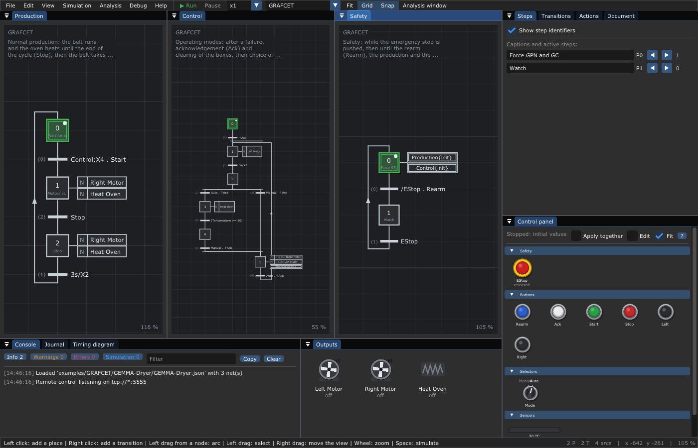
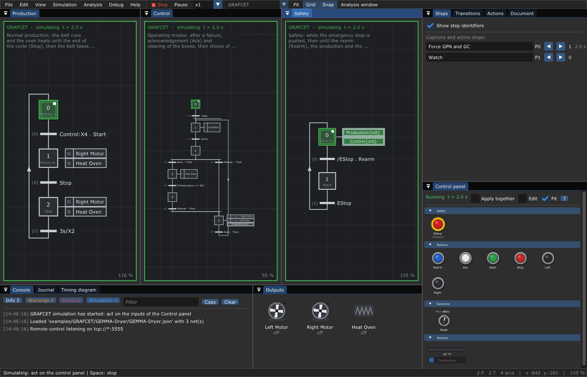

# 10. 🛑 GEMMA

**What you will learn**

- what a GEMMA is: the map of all the ways a machine starts, stops and
  recovers;
- its three families of procedures (A, F, D) and its rectangles;
- how a GEMMA becomes a hierarchy of GRAFCETs that force each other;
- to run a dryer driven by three GRAFCETs, from its control panel and from a
  program.

**Prerequisites**: [9. GRAFCET](09-GRAFCET.md), in particular the forcing
orders (§7) and the documents with several graphs (§8).

---

## 1. Why a GEMMA

A GRAFCET describes the **normal cycle** of a machine well: wait for the
start button, run, stop. But a real machine spends a large part of its life
outside this cycle: it is switched on, it heats up, an operator runs it by
hand, a sensor fails, someone hits the emergency stop, the parts left inside
must be cleared before it can start again. If these cases are added one by
one to the normal GRAFCET, it soon becomes a plate of spaghetti that nobody
can check.

In 1981 the ADEPA (the French agency for the automation of production, the
same one that worked on the GRAFCET) published the **GEMMA**: *Guide d'Étude
des Modes de Marches et d'Arrêts*, the study guide of the run and stop
modes. It is a form, one A3 page, that lists **all** the modes a machine may
be in, and the ways from one to another. The designer goes through the form
with the customer, keeps the modes the machine needs, crosses out the others
and draws the arrows between them. Then the GEMMA is translated into
GRAFCETs.

The blank form is in the repository: [GEMMA.pdf](../data/GEMMA.pdf), and
editable with [draw.io](https://app.diagrams.net):
[GEMMA.drawio](../data/GEMMA.drawio).

## 2. The three families of procedures

The form is split in three zones, one per family of **procedures** (modes).
Each procedure is a rectangle with a code:

**A — Stop procedures** (*procédures d'Arrêt*): the machine is stopped, or
is stopping, for a normal reason.

| Code | Procedure |
|------|-----------|
| A1 | Stop in the initial state: the machine is ready to start |
| A2 | Stop asked at the end of the cycle: the cycle goes on to its end |
| A3 | Stop asked in a given state (not the end of the cycle) |
| A4 | Stop obtained (the machine stopped in another state than the initial one) |
| A5 | Preparation of the restart after a failure (clear, repair, check) |
| A6 | Setting the operative part in its initial state |
| A7 | Setting the operative part in a given state |

**F — Operating procedures** (*procédures de Fonctionnement*): the machine
works.

| Code | Procedure |
|------|-----------|
| F1 | Normal production: the reason the machine exists |
| F2 | Preparation run: heating, filling, before the production |
| F3 | Closing run: emptying, cleaning, after the production |
| F4 | Verification run out of order: each movement by hand, in any order |
| F5 | Verification run in order: the cycle step by step |
| F6 | Test run: calibration, tests of the sensors |

**D — Failure procedures** (*procédures en Défaillance*): something went
wrong.

| Code | Procedure |
|------|-----------|
| D1 | Emergency stop: everything that is dangerous stops at once |
| D2 | Diagnosis and treatment of the failure |
| D3 | Production despite the failure (degraded mode) |

The rectangles inside the large frame of the form are "in production"
(products are made), the others are not. Around them, the form also
separates the states where the control part is **off** (no power) and
**on**: the GEMMA starts at the power on.

## 3. From the GEMMA to GRAFCETs

The usual translation is a **hierarchy** of GRAFCETs, each one forcing the
ones below it ([chapter 9 §7](09-GRAFCET.md#7-forcing-orders)):

```text
   ┌──────────────┐  forces   ┌──────────────────┐  forces / reads  ┌──────────────┐
   │ Safety       │ ────────► │ Control (modes)  │ ───────────────► │ Production   │
   │ D1           │ ────────────────────────────────────────────►   │ F1           │
   └──────────────┘           └──────────────────┘                  └──────────────┘
```

1. **Safety** (the highest level): watches the emergency stop. While it is
   pushed, and until the operator rearms, a step forces all the other graphs
   to their initial situation (D1).
2. **Control**, or modes: follows the rectangles A and F of the GEMMA.
   Each mode is a step; the transitions are the arrows of the form. The
   production graph reads its steps (`Control:X4`) or is forced by it.
3. **Production**: the normal cycle (F1), as simple as if nothing else
   existed.

Because forcing has priority over the evolution (the forced graph does not
evolve), a higher graph is always obeyed: no transition of the production
can fire while the safety forces it.

## 4. Tutorial: the GEMMA of a dryer

The example [`examples/GRAFCET/GEMMA-Dryer`](../examples/GRAFCET/GEMMA-Dryer/README.md)
is a dryer: a belt brings boxes into an oven, they dry, the belt takes them
out. It comes from the GEMMA lessons of NetProf
([video](https://www.youtube.com/watch?v=y8lWIG71040), in French).

```sh
./build/TimedPetriNetEditor examples/GRAFCET/GEMMA-Dryer/GEMMA-Dryer.json
```



The document holds three graphs, side by side:

```text
  Safety      X0 forces Production{init} and Control{init}  ──/EStop . Rearm──►  X1 watch  ──EStop──► X0

  Control     X0 wait for the acknowledgement  ──↑Ack──►  X1 clear the boxes (N Left Motor)  ──3s/X1──►  X2 choose
              X2 ──Auto . ↑Ack──►  X3 heating (N Heat Oven)  ──[Temperature >= 80]──►  X4 normal production
              X2 ──Manual . ↑Ack──► X5 manual run: if Left: Left Motor, if Right: Right Motor, Production{init}
              X4 ──Manual . ↑Ack──► X5          X5 ──Auto . ↑Ack──► X1

  Production  X0 wait  ──Control:X4 . Start──►  X1 belt and oven  ──Stop──►  X2 belt and oven  ──3s/X2──►  X0
```

They can be read on the GEMMA form:

| Step | GEMMA procedure |
|------|-----------------|
| Safety:X0 | D1, emergency stop, until the rearm |
| Control:X0 | A5, preparation of the restart after the failure |
| Control:X1 | A6, setting in the initial state (clearing the boxes) |
| Control:X2 | A1, stop in the initial state: the mode is chosen here |
| Control:X3 | F2, preparation run (heating) |
| Control:X4 | F1 allowed: the production graph may start |
| Control:X5 | F4, verification run out of order (manual) |
| Production:X1, X2 | F1, normal production; X2 is the end of the cycle asked by Stop (A2) |

The **inputs** are the desk of the dryer, each one of its own kind: the
emergency stop `EStop` (`emergency`), the push buttons `Rearm`, `Ack`,
`Start`, `Stop`, `Left`, `Right` (`button`), the selector `Mode` with the
positions `Auto` and `Manual` (`selector`), and the sensor `Temperature`
(`value`, from 20 to 120 °C, driven by the output `Heat Oven`: +6 °C per
second while the oven heats, -1 °C per second otherwise). The **outputs**
are the motors `Left Motor`, `Right Motor` and the heater `Heat Oven`.

### 4.1 Run it in the editor

Press **Space**.



*`Safety:X0` is active: its two forcing orders (double frames) keep
`Production` and `Control` in their initial steps. The control panel shows
the emergency stop, the buttons, the selector on Auto and the thermometer.*

| You do | What happens |
|--------|--------------|
| press **Rearm** | `Safety` goes to X1: the forcing stops |
| press **Ack** | `Control:X1`: the left motor turns (it clears the boxes); 3 s later, `Control:X2` |
| the selector is on **Auto**: press **Ack** | `Control:X3`: the oven heats, the thermometer rises |
| wait about 10 s | at 80 °C, `Control:X4` |
| press **Start** | `Production:X1`: the belt (right motor) turns and the oven heats |
| press **Stop** | `Production:X2`: the timer `x / 3 s` counts under `3s/X2`, then `Production:X0` |
| push **EStop** | `Safety:X0`: everything goes back to its start; the motors stop |
| pull EStop back, **Rearm**, **Ack**, wait 3 s, selector on **Manual**, **Ack** | `Control:X5`, the manual mode |
| hold **Right** (a right click keeps it pressed) | the right motor turns only while the button is held |

Follow it on the *Timing diagram* tab (the steps of the three graphs, the
buttons, the temperature as a curve, the motors), and in the console. A
lower speed (**x0.5**) helps.

### 4.2 Run it from a program

The same scenario, run by the GRAFCET engine of the library without the
editor (one cycle every 0.1 s, the temperature following the oven as in the
control panel), prints the active steps and outputs after each action:

```text
start (forced by Safety)     t=  0.1 s  T= 20 °C  steps: Production:X0 Control:X0 Safety:X0  outputs:
Rearm                        t=  0.3 s  T= 20 °C  steps: Production:X0 Control:X0 Safety:X1  outputs:
Ack: clear the boxes         t=  0.5 s  T= 20 °C  steps: Production:X0 Control:X1 Safety:X1  outputs: [Left Motor]
3 s later                    t=  3.5 s  T= 20 °C  steps: Production:X0 Control:X2 Safety:X1  outputs:
Ack (selector on Auto)       t=  3.7 s  T= 21 °C  steps: Production:X0 Control:X3 Safety:X1  outputs: [Heat Oven]
80 °C reached               t= 13.6 s  T= 80 °C  steps: Production:X0 Control:X3 Safety:X1  outputs: [Heat Oven]
Start                        t= 13.8 s  T= 81 °C  steps: Production:X1 Control:X4 Safety:X1  outputs: [Heat Oven] [Right Motor]
5 s of drying                t= 18.8 s  T=111 °C  steps: Production:X1 Control:X4 Safety:X1  outputs: [Heat Oven] [Right Motor]
Stop                         t= 19.0 s  T=112 °C  steps: Production:X2 Control:X4 Safety:X1  outputs: [Heat Oven] [Right Motor]
3 s later                    t= 22.0 s  T=119 °C  steps: Production:X0 Control:X4 Safety:X1  outputs:
Start again                  t= 22.2 s  T=120 °C  steps: Production:X1 Control:X4 Safety:X1  outputs: [Heat Oven] [Right Motor]
EStop pushed                 t= 22.3 s  T=120 °C  steps: Production:X1 Control:X4 Safety:X0  outputs: [Heat Oven] [Right Motor]
EStop pulled back            t= 22.4 s  T=119 °C  steps: Production:X0 Control:X0 Safety:X0  outputs:
Rearm                        t= 22.6 s  T=119 °C  steps: Production:X0 Control:X0 Safety:X1  outputs:
Ack, 3 s later               t= 25.8 s  T=116 °C  steps: Production:X0 Control:X2 Safety:X1  outputs:
selector on Manual, Ack      t= 26.1 s  T=116 °C  steps: Production:X0 Control:X5 Safety:X1  outputs:
Right held                   t= 27.1 s  T=115 °C  steps: Production:X0 Control:X5 Safety:X1  outputs: [Right Motor]
Right released               t= 27.2 s  T=115 °C  steps: Production:X0 Control:X5 Safety:X1  outputs:
Start in manual mode         t= 27.4 s  T=114 °C  steps: Production:X0 Control:X5 Safety:X1  outputs:
```

Three lines deserve a second look:

- **Start** (13.8 s): in one cycle, `Control` goes from X3 to X4 (the
  temperature was read at the previous cycle) *and* `Production` goes from
  X0 to X1, because its receptivity `Control:X4 . Start` becomes true during
  the search of the stable situation ([chapter 9 §3.1](09-GRAFCET.md#31-the-stable-situation)).
- **EStop pushed** (22.3 s): `Safety` is back in X0 at once, but the motors
  still turn during this cycle. The forcing orders are read from the
  situation at the beginning of the cycle, so the other graphs are forced at
  the next cycle (22.4 s), 0.1 s later. On a real machine the emergency
  stop also cuts the power of the actuators by wires: the GRAFCET only
  follows.
- **Start in manual mode**: nothing happens. `Control:X5` forces
  `Production{init}`, and `Production` needs `Control:X4` anyway.

The program is short: it loads the file with
`importAllNetsFromJSON()`, gives the three nets to a `GrafcetEngine`, then
calls `setInput()`, `step(0.1f)` and reads `outputs()`. See
[chapter 16](16-Library.md) for the API.

## 5. Make your own GEMMA

1. *File > New > GEMMA (3 GRAFCETs)*: a document with three empty GRAFCETs,
   named `Securite`, `Production` and `Controle` (the French names), side by
   side. Rename them with *Edit* in the *Document* tab if you like.
2. Print the [GEMMA form](../data/GEMMA.pdf), cross out the procedures your
   machine does not need, draw the arrows between the others, and write on
   each arrow its condition (a button, a sensor, a mode).
3. Draw the **Safety** graph: an initial step whose action holds the
   forcing orders `Production{init}` and `Controle{init}` (*Add an action*,
   then *Add order* in the *Actions* panel), and a step "watch" reached
   when the emergency stop is released and the operator rearms.
4. Draw the **Control** graph: one step per rectangle you kept, one
   transition per arrow. Use edges (`↑Ack`) for the buttons that move from
   mode to mode, and make the choices exclusive (`Auto . ↑Ack` and
   `Manual . ↑Ack`).
5. Draw the **Production** graph as if it were alone; add the mode it needs
   to its first receptivity (`Controle:X4 . Start`), and force it from the
   modes where it must not run (`Production{init}`).
6. On the control panel, *Edit* the kinds of the inputs: the emergency stop
   as `emergency`, the mode as a `selector` group, the sensors as `value`.
7. Run it, and try every arrow of your GEMMA, the emergency stop first.

## 6. Pitfalls

- **Two graphs forcing the same graph differently.** The forcing orders are
  applied in the order of the graphs and of the steps: the last one wins.
  Keep one master per graph.
- **A mode reached through a transient step.** The search of the stable
  situation may cross a mode without running its actions
  ([chapter 9 §12](09-GRAFCET.md#12-pitfalls)): use edges on the buttons
  that change the mode.
- **Forgetting the restart after the emergency stop.** After D1 the machine
  must not restart by itself: the dryer asks `Rearm` (safety), then `Ack`
  and a clearing of the boxes (A5, A6) before the choice of the mode.

## 7. Going further

- The [GEMMA form](../data/GEMMA.pdf) ([draw.io](../data/GEMMA.drawio)).
- NetProf, *Introduction au GEMMA*:
  <https://www.youtube.com/watch?v=y8lWIG71040> (in French), the source of
  the dryer.
- The [bibliography](Bibliography.md) for the courses on GRAFCET and GEMMA.
- Run the GRAFCETs of the dryer on an Arduino:
  [chapter 12](12-Code-Generation.md); watch them run from the editor:
  [chapter 13](13-Debugging.md).

---

Next: [11. The runtime](11-Runtime.md) — a net that calls the functions of
your program.
