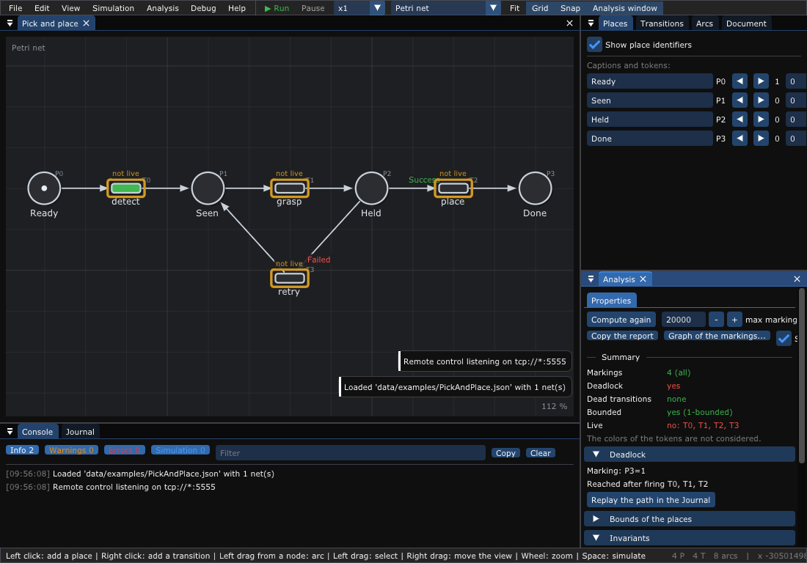
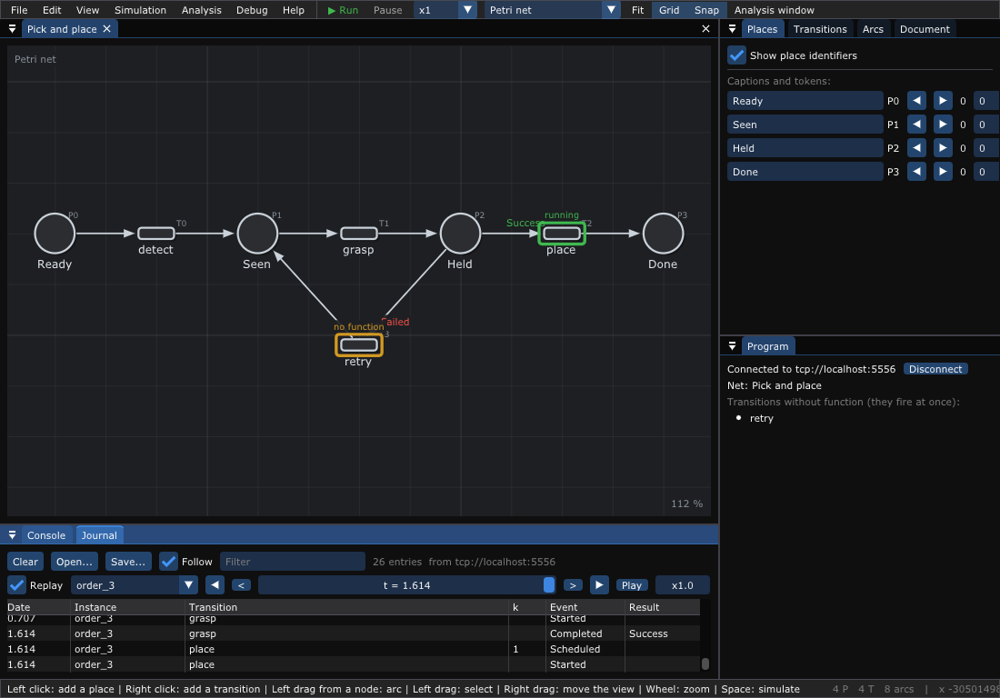

# 11. From the editor to the code

What you will find here: one example from the drawing to a running program,
step by step: a robot picks an object and places it, and tries again when
the object slips. You draw the net, check it, generate the program, write
the functions of the robot, run it, and watch it run in the editor.

---

## 1. Draw the net

The net is `data/examples/PickAndPlace.json`; open it, or draw it:

```text
 (Ready) -> [detect] -> (Seen) -> [grasp] -> (Held) --Success--> [place] -> (Done)
                           ^                    |
                           +---- [retry] <------+ Failed
```

- A click adds a place, a right click a transition, a drag from a node draws
  an arc ([chapter 2](02-Getting-Started.md)). Double click: the name.
- A transition is a function of the program: `detect`, `grasp`, `place`.
  `retry` has no function: it fires at once.
- The result of `grasp` colors the token it gives to `Held`: `Success` or
  `Failed`. Right click on the arc `Held -> place` > *Color of the tokens* >
  `Success`, on `Held -> retry` > `Failed`: each transition takes only the
  tokens of its color. This is how the result of a function chooses what
  comes next.

## 2. Check it

*Analysis > Properties* (or `tpne-check` in a terminal or a CI):



```text
$ tpne-check --allow-deadlock data/examples/PickAndPlace.json
Net: Pick and place (Petri net, 4 places, 4 transitions)
Reachable markings: 4
Deadlock: yes, marking (P0=0, P1=0, P2=0, P3=1) after firing T0 (detect), T1 (grasp), T2 (place)
Dead transitions: none
Bounded: yes (1-bounded)
Live: no, not live: T0 (detect), T1 (grasp), T2 (place), T3 (retry)
P-invariants:
  P0 (Ready) + P1 (Seen) + P2 (Held) + P3 (Done) = 1
T-invariants:
  T1 (grasp) + T3 (retry)
```

The only deadlock is `Done`: the end of the job, wanted
(`--allow-deadlock`). The P-invariant says that there is always one object,
somewhere; the T-invariant that `grasp` then `retry` comes back to the same
marking (a loop).

## 3. Generate the program

*File > Export > C++ functions for the runtime*, `pick_and_place.cpp`: the
net built in the code and one function per transition, with what it takes,
what it gives and which results the next arcs ask for:

```c++
//! \brief grasp: takes Seen, gives Held.
//! Its result chooses what comes next: Failed (retry), Success (place).
Color grasp()
{
    // TODO: what grasp does.
    return Success;
}
```

## 4. Write the functions

Fill the functions with the code of the robot. Here, fake ones: the gripper
slips once.

```c++
Color grasp()
{
    static int attempts = 0;
    std::this_thread::sleep_for(std::chrono::milliseconds(300)); // the gripper
    bool const held = (++attempts >= 2);                          // slips once
    std::cout << "gripper: " << (held ? "holding" : "slipped") << std::endl;
    return held ? Success : Failed;
}
```

`detect` and `place` print and return `Success`; `retry` is left as
generated. Build and run:

```sh
g++ -std=c++20 -I<TimedPetriNetEditor>/src pick_and_place.cpp \
    -L<TimedPetriNetEditor>/build -lTimedPetriRuntime -lTimedPetriNet -pthread -o pick
./pick
```

```text
camera: object seen
gripper: slipped
gripper: holding
arm: placed
Pick and place: Success
```

The instance ends with `Success`: its goal, a token in `Done`, is reached.
The functions run on a pool of threads (`ThreadPoolExecutor`); on a board,
use the `InlineExecutor` and call `runtime.step(*instance)` from `loop()`
(`examples/runtime/TrafficLight.cpp`).

## 5. Watch it run

Build with `-DTPNE_DEBUG -lzmq`: the program publishes what it does. Open the
net in the editor, then *Debug > Connect* (`tcp://localhost:5556`): the
*Journal* follows the orders, the net shows their tokens, the transition
whose function runs is marked `running`, `retry` is marked `no function`.
`examples/runtime/Debugger.cpp` runs the orders over and over to try it:

```sh
make -C examples/runtime
./build/examples/Debugger &
./build/TimedPetriNetEditor -c tcp://localhost:5556 data/examples/PickAndPlace.json
```



## 6. Keep the journal

The journal of an instance says when each function started and ended, and
its result. Save it in the program:

```c++
#include "Runtime/Journal.hpp"

saveJournal(instance->log(), net.colors, "orders.xes");   // .jsonl, .csv, .xes
```

`.jsonl` opens in the *Journal* of the editor (*Replay* shows the marking at
any date), and `Runtime::restore()` rebuilds an instance from it after a
crash; `.xes` opens in the process mining tools (ProM, PM4Py) to measure the
real durations of the functions; `.csv` in a spreadsheet.

---

Back to the [documentation](README.md).
