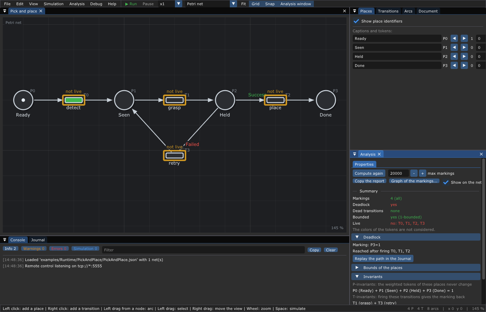

# 11. ⚙️ The runtime: a transition is a function

**What you will learn**

- the idea taken from [Symmetri](https://github.com/thorstink/Symmetri): your
  program is driven by a Petri net, each transition calls one of your
  functions, and the result of the function chooses what comes next;
- how the runtime works inside: the net and its instances, the loop that
  owns the marking, the executors, the colors of the results;
- guards, injected events, durations, timeouts, priorities, nets inside nets;
- the journal of an instance, and how to restart after a crash;
- the whole way from a drawing to a running robot, then five programs written
  next to the nets of [`examples/`](../examples/README.md).

**Prerequisites**: [3. Petri nets](03-Petri-Nets.md) and
[5. Extended Petri nets](05-Extended-Petri-Nets.md) (colored tokens);
[6. Timed Petri nets](06-Timed-Petri-Nets.md) for the durations. You need to
read C++.

---

## 1. Why drive a program with a Petri net?

A program that controls a robot, a machine or a chain of web services does
several things at the same time, waits for answers, retries when something
fails, and must never end in a state nobody planned. Written by hand with
threads, flags and callbacks, this logic is spread over the code and hard to
check. A Petri net puts it in one drawing:

- a **place** is a state or a stock ("an object is seen", "the gripper is
  free");
- a **transition** is an action ("grasp the object");
- the **tokens** say which actions can run now, and several tokens mean
  several things at the same time.

Draw the net in the editor, check it ([chapter 4](04-Analysis.md): no
deadlock, bounded places), then let a small engine run it: this engine is the
**runtime**. Your program only gives the functions of the transitions.

### 1.1 The idea of Symmetri

[Symmetri](https://github.com/thorstink/Symmetri) (Thomas Horstink, BSD-3
license) runs Petri nets this way. Its idea fits in one sentence:

> **A transition is a function.** When a transition can fire, the runtime
> takes its input tokens, calls the function, then puts the output tokens.
> The value returned by the function (`Success`, `Failed`, or a color of
> yours) becomes the **color** of the tokens it produces, and this color
> decides which transition can take them next.

It is a state machine, but:

- several states can be active at the same time (the parallelism of Petri
  nets comes for free);
- the next branch is chosen by the **result of the function**, not by a
  condition computed somewhere else.

TimedPetriNetEditor started as an editor and an analyzer. It then took the
idea of Symmetri and wrote its own runtime, the library
`libTimedPetriRuntime` (`src/Runtime/`), which keeps what makes Symmetri
good and adds what the editor already knew: durations, guards, analysis,
and the editor as a visual debugger ([chapter 13](13-Debugging.md)).

### 1.2 One example, all the ideas

```text
 (Ready) ─► [detect] ─► (Seen) ─► [grasp] ─► (Held) ──Success──► [place] ─► (Done)
                           ▲                    │
                           └──── [retry] ◄──────┘ Failed
```

`grasp` gives its token to `Held` **colored by its result**. The arc
`Held → place` asks for `Success` tokens, the arc `Held → retry` for `Failed`
ones: only one of them can take the token. When the gripper slips, the
object goes back to `Seen` and `grasp` is tried again. `retry` has no
function: it fires at once.


*The net [`PickAndPlace.json`](../examples/Runtime/PickAndPlace/PickAndPlace.json)
in the editor: the colors asked by the arcs are written on them.*

## 2. Anatomy of the runtime

### 2.1 The net, the runtime, the instances

| Object | What it is | Who owns it |
|--------|------------|-------------|
| `Net` | The structure: places, transitions, arcs, weights, colors, durations. Drawn in the editor and loaded with `loadFromFile()`, or built in the code. It does not change while the runtime lives. | your program |
| `Runtime` | The net and the functions of its transitions (`on()`), their guards (`guard()`), the executor, the options. | your program |
| `Instance` | One run of the net: its **colored marking**, its date, its journal, its result. A runtime can run many instances at the same time (one per order, per client, per robot cell). | `runtime.instantiate()` |

```c++
#include "IO/IO.hpp"
#include "Runtime/Runtime.hpp"
using namespace tpne;

Net net;
loadFromFile(net, "examples/Runtime/PickAndPlace/PickAndPlace.json");
Runtime runtime(net, std::make_shared<ThreadPoolExecutor>(4u));
runtime.on("detect", [] { camera.detect(); });      // nothing returned: Success
runtime.on("grasp",  [] { return gripper.grasp(); }); // bool: Success or Failed
runtime.on("place",  [] { arm.place(); });
auto order = runtime.instantiate("order_42", {}, { { "Done", Success } });
Color result = runtime.run(*order);
```

A function is found by the **name** of its transition (its caption, or its
key `T2`). Several transitions with the same caption share the function
(the three `End of call` of the emergency calls).

### 2.2 Initial marking, goal, result

`instantiate(id, initial, goal)`:

- **initial**: the tokens at the start, as `{ place, color, count }`. Empty:
  the tokens drawn in the net, colored `Success`.
- **goal**: when these tokens are present, the instance ends with `Success`.
  Empty: the instance ends when nothing can happen any more.

An instance ends with one of these **results** (they are colors too):

| Result | When |
|--------|------|
| `Success` | the goal marking is reached |
| `Deadlocked` | nothing can happen any more, and no `Failed` token is left (with no goal, this is the normal end) |
| `Failed` | nothing can happen any more and a `Failed` token is left that nobody took; or a cycle of transitions fired more than `Options::max_firings_per_date` times (10000) at the same date |
| `Canceled` | `runtime.cancel(instance)` was called |

"Nothing can happen any more" means: no transition can fire, no function is
running, no token is on its way along an arc with a duration, no delay is
counting, the net has no source transition that `inject()` could fire, and
no transition is waiting for its guard (§3.1).

### 2.3 The colors

A token has a **color**: a small number, named in the table `net.colors`.
The first ones are built in: `Success`, `Failed`, `Canceled`, `Deadlocked`;
yours are listed in the file (`"colors": ["Good", "Bad"]`) or added with
`net.colors.add("Good")`.

- An **input arc** (place → transition) takes tokens of its color only; with
  no color, it takes any token.
- An **output arc** (transition → place) gives tokens of its own color if it
  has one, else of the **result of the function**.
- A function returns nothing (`Success`), a `bool` (`true`: `Success`,
  `false`: `Failed`) or a `Color` (any of the table).

The other extensions of [chapter 5](05-Extended-Petri-Nets.md) are followed
too: weights, inhibitor arcs, reset arcs, capacities (counting the tokens on
their way).

### 2.4 The loop: one owner, no lock

```text
       ┌────────────── thread of run() or step(): the only one to touch the marking ─────────────┐
       │                                                                                         │
 queue │ 1. take the requests posted by the other threads (end of a function, inject, cancel)    │
 of    │ 2. tokens arriving at this date (arcs with a duration)                                  │
 re-  ─┼►3. goal reached?                              → Success, the end                       │
 quests│ 4. pick a transition that can fire (priority, policy), take its input tokens, and       │
   ▲   │      - a synchronous function: call it now, give the output tokens                      │
   │   │      - else: post it to the executor                                                    │
   │   │ 5. repeat 4 until nothing can fire at this date; nothing left to wait for?  → the end   │
   │   └─────────────────────────────────────────────────────────────────────────────────────────┘
   │
   └── executor (a thread of the pool): calls the function, then posts the request
       "give the output tokens, colored by this result"
```

The marking of an instance is only changed by the thread that calls `run()`
or `step()`. The functions running on other threads never touch it: when
they end, they **post a request** (a small function `Instance& → void`, a
*reducer*), and the owner applies it at its next turn. This is the pattern
of Redux or of the actors: the marking needs **no lock**, and a function
can be slow without blocking the others.

A consequence: **a transition lasts the time of its function**. Its input
tokens disappear when it starts (`Scheduled`), its output tokens appear when
the function ends (`Completed`). The runtime checks all the transitions
once, then only those around the places whose tokens changed: on a net of
1921 transitions this makes it fast (§9).

### 2.5 Executors: where the functions run

| Executor | The functions run | For |
|----------|-------------------|-----|
| `InlineExecutor` (default) | in the thread of `run()` or `step()`, at once, one after the other | tests (deterministic), micro-controllers, short functions |
| `ThreadPoolExecutor(n)` | on `n` threads | desktop, services, slow functions (camera, network) |
| `TaskflowExecutor(n)` | on the work-stealing threads of [Taskflow](https://github.com/taskflow/taskflow), with `-DTPNE_WITH_TASKFLOW` | programs already using Taskflow |

Taskflow is not a replacement of the loop: it runs a fixed graph of tasks,
without marking, choice or tokens. Here it only lends its threads. Any class
with `void post(std::function<void()> task)` can be an executor
(`Runtime/Executor.hpp`).

### 2.6 Functions of any type

`on()` takes a `Callback`, which accepts **any type** (the type erasure of
Sean Parent): a function, a lambda, or any object `T` for which a free
function `fire(T const&)` exists in the namespace of `T` (found by ADL).
Optional free functions add behaviors; without them, the defaults apply:

| Free function | Called when | Default |
|---------------|-------------|---------|
| `Color fire(T const&)` | the transition fires (required, unless `T` is callable) | |
| `void cancel(T const&)` | the instance is canceled while the function runs | nothing |
| `void pause(T const&)`, `void resume(T const&)` | `runtime.pause()`, `runtime.resume()` | nothing |
| `bool isSynchronous(T const&)` | to know where to call it | `false`: posted to the executor; `true`: called at once by the loop |

```c++
namespace robot {
struct Grasp { Gripper* gripper; };
Color fire(Grasp const& g)   { return g.gripper->grasp() ? Success : Failed; }
void cancel(Grasp const& g)  { g.gripper->open(); }
}
runtime.on("grasp", robot::Grasp{ &gripper });
```

A whole net can be such an object: this is how nets are nested (§3.6).

## 3. Controlling the flow

### 3.1 Guards

A **guard** is an extra condition of a transition, given by the program: the
transition fires only while it returns `true`. It sees the net, the
instance, its marking and its date (`Context`):

```c++
runtime.guard("place", [](Context const& c) { return !estop && c.tokens("Held", Success) > 0u; });
```

A transition **enabled by the marking but blocked by its guard** does not
end the instance: the guard may open later (an emergency stop released, a
sensor, the time). `run()` then looks at the guards again every 10 ms; with
`step()`, they are looked at each time you call it. Guards are evaluated in
the thread of the loop: keep them short, and use atomic variables when other
threads change what they read.

### 3.2 Sources and injected events

A transition **without input place** (a source) never fires by itself in the
runtime: it fires once each time the program asks, from any thread:

```c++
runtime.inject(*instance, "button");   // a button, a message, an interrupt
```

This is how the outside world talks to the net: an operator, the answer of
a web service, a ROS message. While the net has a source, an instance never
ends by itself (an event may still come): end it with `cancel()`.

### 3.3 Time: durations and delays

In a **timed Petri net** ([chapter 6](06-Timed-Petri-Nets.md)):

- an output arc with a **duration** gives its tokens this time after the
  firing (the tokens are "on their way", and count for the capacities);
- a transition with a **delay** fires only after being able to fire during
  this time.

The runtime keeps the dates in a list of events: no thread sleeps for a
duration. In a Petri net that is not timed, durations are ignored.

### 3.4 Timeouts

A timeout is a **delayed transition in conflict** with the slow one:

```text
 (Waiting) ──► [Receive] ◄── (Answer) ◄── injected by the service
     │
     └──► [timeout, delay 0.5 s] ──► (Error)
```

If the answer comes first, `Receive` takes the `Waiting` token and the
timeout can no longer fire. Else, after 0.5 s, `timeout` takes it. See
[`examples/Runtime/MicroServices`](../examples/Runtime/MicroServices/README.md)
and the editor example
[`Timeout`](../examples/Timed-Petri-Nets/Timeout/Timeout.json).

### 3.5 Conflicts and priorities

When several transitions can fire, `Options::policy` chooses:

| Policy | Chooses |
|--------|---------|
| `Priority` (default) | the highest `Transition::priority`, then the first declared |
| `FirstDeclared` | the lowest identifier |
| `Random` | at random (`Options::seed`, 0: drawn) |

With colors, most conflicts disappear: the arcs choose by the color of the
token.

### 3.6 A net inside a net

A net can be the function of a transition of another net, as a macro step:

```c++
auto pick = std::make_shared<Runtime>(pick_net);
pick->on("grasp", ...);
cell.on("pick", SubNet(pick, { { "Done", Success } }));   // Runtime/SubNet.hpp
```

Each firing of `pick` runs a new instance of the sub net until it ends; its
result (`Success`, `Deadlocked`, `Canceled`, `Failed`) is the result of the
transition, so it colors the tokens and chooses the branch of the parent.
Canceling, pausing or resuming the parent does the same to the instances of
the sub net running.

## 4. run() or step()

| | `run(instance)` | `step(instance, now)` |
|-|-----------------|-----------------------|
| Blocks | until the instance ends | never: it does what is due at the date `now`, then returns |
| Time | the real time (`Options::clock`) | the date you give (seconds since the first call), or `Options::clock` |
| For | a program whose main job is the net | a program that has its own loop: Dear ImGui, a ROS timer, the `loop()` of an Arduino, a simulation |
| Returns | the result | `false` when the instance has ended |

With `step()` and a date that you increase yourself, time is **simulated**:
a run of hours takes microseconds, and it is the same at each run (the
examples `BoundedBuffer` and `TrafficLight` work this way).

## 5. The journal

Each instance writes a **journal**: for each firing of a transition, three
lines `Scheduled` (tokens taken), `Started` (function called), `Completed`
(tokens given, with the result) and their dates. A transition without
function has no `Started`.

```text
{"instance":"order_42","transition":"grasp","event":"Scheduled","date":0.05015729}
{"instance":"order_42","transition":"grasp","event":"Started","date":0.05015729}
{"instance":"order_42","transition":"grasp","event":"Completed","result":"Failed","date":0.150359935}
{"instance":"order_42","transition":"retry","event":"Scheduled","date":0.150359935}
{"instance":"order_42","transition":"retry","event":"Completed","result":"Success","date":0.150359935}
```

- `instance->log()` gives it at the end; `Options::journal` receives each
  line as it is written (to save it as you go, or publish it to the editor);
  `Options::log = false` keeps no journal (a micro-controller).
- `saveJournal(log, net.colors, "orders.xes")` (`Runtime/Journal.hpp`)
  writes it as JSON lines (`.jsonl`), CSV (`.csv`) or XES (`.xes`, for the
  process mining tools): see [chapter 13](13-Debugging.md).

### 5.1 Restart after a crash

When the journal is saved line by line, a program that crashed can rebuild
its instances: `restore()` replays the journal from the initial marking, and
the transitions whose function was running (`Scheduled` without
`Completed`) are either called again (`Recovery::Restart`: the function
shall be idempotent) or ended with `Failed` (`Recovery::Fail`).

```c++
std::vector<LogEntry> entries;
fromJsonLines(journal_text, net.colors, entries);
auto order = runtime.restore("order_42", entries, Runtime::Recovery::Restart,
                             {}, { { "Done", Success } });
Color result = runtime.run(*order);
```

A program that saved its journal and crashed while `grasp` ran (the function
threw an exception) gives, when restarted with this code (§9.8 does it in a
whole program):

```text
crash!
{"instance":"order_42","transition":"detect","event":"Scheduled","date":0.0}
{"instance":"order_42","transition":"detect","event":"Started","date":0.0}
{"instance":"order_42","transition":"detect","event":"Completed","result":"Success","date":0.0}
{"instance":"order_42","transition":"grasp","event":"Scheduled","date":0.0}
{"instance":"order_42","transition":"grasp","event":"Started","date":0.0}
grasp called again
placed
order_42: Success
```

## 6. Targets

| Target | How | Example |
|--------|-----|---------|
| Desktop | `ThreadPoolExecutor`, `run()` | [PickAndPlace](../examples/Runtime/PickAndPlace/README.md) |
| Services | a pool; the answers of the services are injected; timeouts | [MicroServices](../examples/Runtime/MicroServices/README.md) |
| ROS 2 | a timer of the node calls `step()`; functions send ROS actions, their results come back by `inject()` | [Ros2Node](../examples/Runtime/Ros2Node/README.md) |
| Micro-controller | build the net in `setup()` (no file system), `InlineExecutor`, `Options::log = false`, `step()` in `loop()` with the time of `millis()` | [TrafficLight](../examples/Runtime/TrafficLight/README.md) |

The core and the runtime compile with `-fno-exceptions -fno-rtti`, as on a
board (`make -C examples` checks it). After `instantiate()`, the runtime
only allocates memory for the requests of `inject()` and for the tokens on
their way along arcs with a duration. A real AVR without the standard
library is still out of reach: for it, generate the code of a GRAFCET
([chapter 12](12-Code-Generation.md)).

## 7. The runtime and the simulation of the editor

The editor simulates a net to let you understand it; the runtime runs it to
drive a program. They share the firing rule but differ on purpose:

| | Simulation of the editor | Runtime |
|-|--------------------------|---------|
| Colors of the tokens | used: the arcs take their color; the results are drawn among the colors asked after the transition | used: the arcs take their color, functions give theirs |
| A transition fires | Petri net: when you click on it; timed net: as soon as it can | as soon as it can, and its guard allows it |
| Its duration | the durations of the arcs | the time of its function, plus the durations of the arcs (timed nets) |
| Source transitions | Petri net: on a click; timed net: again when the tokens of their last firing arrived | only on `inject()` |
| Conflicts | *Simulation > Conflicts* | `Options::policy`, priorities |
| End | never (you stop it) | goal, deadlock, failure or cancel |

## 8. 🤖 From the drawing to a running robot

The whole way with the pick and place of §1.2.

### 8.1 Draw the net

Open [`PickAndPlace.json`](../examples/Runtime/PickAndPlace/PickAndPlace.json),
or draw it ([chapter 2](02-Getting-Started.md)): a click adds a place, a
right click a transition, a drag from a node draws an arc, a double click
names a node. Then the colors: right click on the arc `Held → place` >
*Color of the tokens* > `Success`, on `Held → retry` > `Failed`.

### 8.2 Check it

*Analysis > Properties*, or `tpne-check` in a terminal or a CI:



```text
$ tpne-check --allow-deadlock examples/Runtime/PickAndPlace/PickAndPlace.json
examples/Runtime/PickAndPlace/PickAndPlace.json:
Net: Pick and place (Petri net, 4 places, 4 transitions)
Reachable markings: 4
Deadlock: yes, marking (P0=0, P1=0, P2=0, P3=1) after firing T0 (detect), T1 (grasp), T2 (place)
Dead transitions: none
Bounded: yes (1-bounded)
Live: no, not live: T0 (detect), T1 (grasp), T2 (place), T3 (retry)
P-invariants:
  P0 (Ready) + P1 (Seen) + P2 (Held) + P3 (Done) = 1
T-invariants:
  T1 (grasp) + T3 (retry)
Note: The colors of the tokens are not considered.
```

The only deadlock is `Done`: the end of the job, wanted, hence
`--allow-deadlock` (without it the exit code is 1, which fails a CI). The
P-invariant says that there is always exactly one object somewhere; the
T-invariant that `grasp` then `retry` gives the same marking back: the retry
loop. The analysis does not see colors: for it, `place` and `retry` can both
take the token.

### 8.3 Generate the program

*File > Export > C++ functions for the runtime*, `pick_and_place.cpp`: the
net built in the code (a board has no file system), one function per
transition, and a `main()`:

```c++
//! \brief grasp: takes Seen, gives Held.
//! Its result chooses what comes next: Failed (retry), Success (place).
Color grasp()
{
    // TODO: what grasp does.
    return Success;
}
```

The whole file is shown in [chapter 12](12-Code-Generation.md).

### 8.4 Write the functions

Fill them with the code of the robot. Here, fake ones: the gripper slips
once.

```c++
Color grasp()
{
    static int attempts = 0;
    std::this_thread::sleep_for(std::chrono::milliseconds(300)); // the gripper
    bool const held = (++attempts >= 2);                          // slips once
    std::cout << "gripper: " << (held ? "holding" : "slipped") << std::endl;
    return held ? Success : Failed;
}
```

`detect` and `place` print and return `Success`; `retry` is left as
generated. Build and run:

```sh
g++ -std=c++20 -I<TimedPetriNetEditor>/src pick_and_place.cpp \
    -L<TimedPetriNetEditor>/build -lTimedPetriRuntime -lTimedPetriNet -pthread -o pick
./pick
```

```text
camera: object seen
gripper: slipped
gripper: holding
arm: placed
Pick and place: Success
```

The instance ends with `Success`: its goal, a token in `Done`, is reached.

### 8.5 Watch it run

Build with `-DTPNE_DEBUG -lzmq`: the program publishes its journal, and the
editor connected to it (*Debug > Connect*) moves the tokens as the program
runs. This is [chapter 13](13-Debugging.md).

## 9. The example programs

Each one is next to its net, and is built by `make -C examples` and run by
`make -C examples run` (from the root of the project, after `make`).

### 9.1 ☕ Coffee: the result chooses the branch

[`examples/Petri-Nets/Coffee/Coffee.cpp`](../examples/Petri-Nets/Coffee/Coffee.cpp)
runs [`Coffee.json`](../examples/Petri-Nets/Coffee/Coffee.json). The coin
checker `Insert Coin` returns `true` (`Success`) for a good coin, `false`
(`Failed`) for a fake one; the arcs from `Coin Inserted` ask `Success` for
`Accept` and `Failed` for `Reject Coin`. A guard lets `Insert Coin` fire only
while clients are waiting.

```c++
runtime.on("Insert Coin", [&coins, &coin]() {
    bool const good = coins[coin++];
    std::cout << "coin " << coin << ": " << (good ? "good" : "fake") << std::endl;
    return good; // true: Success, false: Failed
});
runtime.guard("Insert Coin", [&coins, &coin](Context const&) { return coin < coins.size(); });
```

```text
  heater: water is hot
coin 1: good
  coin accepted
  coffee 1 served
  heater: water is hot
coin 2: fake
  coin given back
coin 3: good
  coin accepted
  coffee 2 served
  heater: water is hot
coin 4: good
  coin accepted
  coffee 3 served
  heater: water is hot
3 coffees for 4 coins
```

### 9.2 ✈️ Landing gear: the net as a safety layer

[`examples/Petri-Nets/LandingGear/LandingGear.cpp`](../examples/Petri-Nets/LandingGear/LandingGear.cpp)
runs [`LandingGear.json`](../examples/Petri-Nets/LandingGear/LandingGear.json).
The pilot gives orders: each one opens the guard of its transition. The net
lets only the allowed ones fire: `Extend` reads `Low speed`, so an order to
extend the gear at high speed waits. `Start warning` has no guard: it fires
by itself when the plane flies fast with its gear down.

```c++
for (char const* name : { "Faster", "Slower", "Retract", "Extend", "Ack" })
{
    runtime.guard(name, [&order, name](Context const&) { return order[name]; });
    runtime.on(name, [&order, name]() { order[name] = false; ... });
}
```

```text
t = 1  pilot: Faster
        Faster done
        WARNING: gear down at high speed!
t = 2  pilot: Retract
        Retract done
t = 3  pilot: Ack
        Ack done
t = 4  pilot: Extend  (refused by the net, the order waits)
t = 5  pilot: Slower
        Slower done
        Extend done
end: [Low speed] [Gear down] [Warning off]
```

Between two orders, nothing can fire but the instance does not end: the
transitions wait for their guards (§3.1).

### 9.3 🎨 Colors: colors of your own

[`examples/Extended-Petri-Nets/Colors/Colors.cpp`](../examples/Extended-Petri-Nets/Colors/Colors.cpp)
runs [`Colors.json`](../examples/Extended-Petri-Nets/Colors/Colors.json),
whose colors `Good` and `Bad` are listed in the file. `Inspect` returns one
of them; `Ship` takes the `Good` tokens, `Scrap` the `Bad` ones.

```c++
Color const good = *net.colors.find("Good");
Color const bad = *net.colors.find("Bad");
runtime.on("Inspect", [&part, good, bad]() {
    bool const ok = (++part != 2); // the second part has a scratch
    return ok ? good : bad;
});
```

```text
inspect part 1: Good
inspect part 2: Bad
inspect part 3: Good
  ship it
  ship it
  scrap it
lot_1: Deadlocked, shipped 2, scrapped 1
```

With no goal, `Deadlocked` is the normal end: all the parts are handled.

### 9.4 📦 Bounded buffer: extensions, time and events

[`examples/Extended-Petri-Nets/BoundedBuffer/BoundedBuffer.cpp`](../examples/Extended-Petri-Nets/BoundedBuffer/BoundedBuffer.cpp)
runs [`BoundedBuffer.json`](../examples/Extended-Petri-Nets/BoundedBuffer/BoundedBuffer.json)
on a simulated clock (`step()` with dates). Guards give the rhythm of the
machines: a part every time unit, a pack of 2 parts every 3. `Stop` and
`Ask flush` are sources: the program injects them. `Restart` waits for the
operator (a guard).

```c++
runtime.on("Produce", [&now, &next_part]() { next_part = now + 1.0; });
runtime.guard("Produce", [&next_part](Context const& c) { return c.now >= next_part; });
...
if (date == 8) runtime.inject(*line, "Stop");
if (date == 12) restart = true;
if (date == 15) runtime.inject(*line, "Ask flush");
runtime.step(*line, now);
```

```text
 date  Buffer  Packed  Stopped  event
    0       2       0        0  
    1       3       0        0  
    2       4       0        0  
    3       3       1        0  
    4       4       1        0  
    5       4       1        0  
    6       3       2        0  
    7       4       2        0  
    8       4       2        1  Stop: the producer waits
    9       2       3        1  
   10       2       3        1  
   11       2       3        1  
   12       1       4        0  Restart
   13       2       4        0  
   14       3       4        0  
   15       0       5        0  Ask flush: Buffer emptied
   16       1       5        0  
   17       2       5        0  
   18       1       6        0  
   19       2       6        0  
   20       3       6        0  
```

The capacity holds `Buffer` at 4 (dates 2 to 8: the producer waits for the
packer); the inhibitor arc from `Stopped` stops the producer (dates 9 to
11); the reset arc of `Flush` empties the buffer at once (date 15).

### 9.5 🚑 Emergency calls: the kind of the call is a color

[`examples/Petri-Nets/EmergencyCalls/EmergencyCalls.cpp`](../examples/Petri-Nets/EmergencyCalls/EmergencyCalls.cpp)
runs [`EmergencyCalls.json`](../examples/Petri-Nets/EmergencyCalls/EmergencyCalls.json).
When a level 1 operator answers, the function returns the kind of the call,
a color of the net (`Advice`, `Urgent`, `Critical`); the three arcs from
`Call screening` take the token of their color.

```c++
std::vector<std::string> const calls = { "Critical", "Advice", "Urgent", "Urgent",
                                         "Advice", "Critical", "Urgent" };
runtime.on("Level 1 answers", [&net, &calls, &call]() {
    return *net.colors.find(calls[call++]);
});
```

The journal gives the transitions in the order they ended (the net is not
timed: the durations of its arcs are not waited):

```text
  1  Level 1 answers      -> Critical
  2  Critical            
  3  Level 2 answers     
  4  Level 1 leaves      
  5  End of call         
  6  Level 1 answers      -> Advice
  7  Level 1 answers      -> Urgent
  8  Urgent              
  9  Level 1 answers      -> Urgent
 10  Urgent              
 11  Level 1 answers      -> Advice
 12  Transfer to level 2 
 13  Level 1 answers      -> Critical
 14  Critical            
 15  Level 2 answers     
 16  Level 1 leaves      
 17  End of call         
 18  Level 1 answers      -> Urgent
 19  Urgent              
 20  Transfer to level 2 
 21  Transfer to level 2 
 22  Level 2 answers     
 23  Level 2 answers     
 24  Level 2 answers     
 25  Advice              
 26  Advice              
 27  End of call         
 28  End of call         
 29  End of call         
 30  End of call         
 31  End of call         
Deadlocked: 3 urgent and 2 critical calls handled by level 2
```

### 9.6 🚨 Priorities: who wins a conflict

[`examples/Extended-Petri-Nets/Priorities/Priorities.cpp`](../examples/Extended-Petri-Nets/Priorities/Priorities.cpp)
runs [`Priorities.json`](../examples/Extended-Petri-Nets/Priorities/Priorities.json)
on a simulated clock. The car and the ambulance want the crossing at the
same date; `Options::policy` chooses, as *Simulation > Conflicts* in the
editor:

```c++
Runtime::Options options;
options.policy = Engine::Policy::Random; // Priority (default), Random, FirstDeclared
options.seed = 7u;                       // the same seed, the same draws
Runtime runtime(net, std::make_shared<InlineExecutor>(), options);
```

```text
Policy Priority:
  t =  0.0  Ambulance crosses
  t =  2.0  Car crosses
  t =  7.0  Ambulance crosses
...
Policy Random, first to cross for the seeds 1 to 10:
  Car Ambulance Ambulance Ambulance Ambulance Ambulance Ambulance Car Ambulance Ambulance
  the car first 42 times for the seeds 1 to 100
Seed 7 twice: the same crossings
```

### 9.7 🍝 Philosophers: the tokens are the locks

[`examples/Petri-Nets/Philosophers/Philosophers.cpp`](../examples/Petri-Nets/Philosophers/Philosophers.cpp)
runs [`Philosophers.json`](../examples/Petri-Nets/Philosophers/Philosophers.json)
on a pool of three threads. A meal is the function of `PhiN eats`: it lasts
100 ms, on its own thread. The program has no mutex: a meal starts only
once the runtime has taken the tokens of its cutlery. The program counts
the philosophers eating at the same time:

```text
   0 ms  Phi0 starts meal 1 (1 eating)
 102 ms  Phi1 starts meal 1 (1 eating)
...
 817 ms  Phi2 starts meal 3 (1 eating)
 919 ms  Canceled: 3, 3 and 3 meals, at most 1 philosopher eating at once
```

Never more than one, as the P-invariants of the analysis said: the net
proved the property before the program ran.

### 9.8 🏭 Producer and consumers: restart after a crash

[`examples/Petri-Nets/ProducerConsumer/ProducerConsumer.cpp`](../examples/Petri-Nets/ProducerConsumer/ProducerConsumer.cpp)
runs [`ProducerConsumer.json`](../examples/Petri-Nets/ProducerConsumer/ProducerConsumer.json)
and is §5.1 in a real program. The journal goes to a file line by line; the
program dies while two consumers work; the second run rebuilds the
instance from the file and calls the two `Consume` again:

```c++
options.journal = [&](LogEntry const& entry) {
    journal << toJsonLine(entry, net.colors) << std::endl; // flushed: it survives a crash
};
...
fromJsonLines(text.str(), net.colors, entries);
auto line = runtime->restore("line", entries, Runtime::Recovery::Restart);
```

```text
  crash! (while the parts 3 to 4 are used)
Second run
  journal: 47 lines, 5 parts made, 2 used
  restored: Buffer 5, Accepted 0, Ready 0; Consume running at the crash: 2, called again
...
Done: 6 parts made, 10 used (expected 10)
```

No part is lost, none is used twice.

### 9.9 More programs

[`examples/Runtime/`](../examples/Runtime/README.md) has the programs for
each target: pick and place on a pool of threads, micro-services with a
timeout and process mining, a traffic light written as an Arduino sketch, a
ROS 2 node, the debugger and the benchmark.

## 10. Compared with Symmetri

| Symmetri | This runtime |
|----------|--------------|
| Tokens colored by the result | kept: the central idea |
| Single loop thread and reducers | kept |
| Callbacks of any type, by type erasure and ADL | kept (`fire`, `cancel`, `pause`, `resume`, `isSynchronous`) |
| Nested nets | kept (`SubNet`) |
| Places and transitions as strings everywhere | names when building, indices when running |
| No time on arcs or transitions | durations of arcs and delays of transitions, with no sleeping thread |
| No guard | guards (the receptivities of a GRAFCET) |
| No analysis | the editor and `tpne-check`: deadlocks, bounds, liveness, invariants, (max,+) |
| One marking per `PetriNet` object | one `Net` shared by many `Instance`s |
| `fire(app)` blocks the caller | `run()` blocks, `step()` does not: for the loop of ImGui, ROS or an Arduino |
| A cycle without function fires for ever | stopped after `max_firings_per_date` firings, the instance `Failed` |
| Journal | the same three events, saved as JSON lines, CSV, XES, published to the editor, replayed after a crash |

Both runtimes were measured on the same machine (AMD Ryzen 7 9700X, Linux,
g++ 16.2, `-O3`, Symmetri at commit `22e47a4`):

| Net | Firings | TimedPetriNetEditor | Symmetri |
|-----|:-------:|--------------------:|---------:|
| default of Symmetri (2 transitions, 6 tokens) | 6 | 1.0 µs | 0.6 µs |
| `auto.pnml` (1921 transitions, 29152 arcs) | 12 / 19 | **0.43 ms** | 2.8 ms |
| `n1.pnml`, `sat.pnml` (a cycle without duration) | 10000 | stopped: 2.1 ms, 3.3 ms | never ends |

Symmetri is faster on tiny nets (its journal keeps indices, this one keeps
names); this runtime is 4 to 6 times faster on big nets, because it checks
only the transitions around the places that changed. The method and all the
numbers: [the benchmark](../examples/Runtime/Benchmark/README.md). To compare
on the same nets, the editor reads and writes the PNML of Symmetri
(`.symmetri.pnml`, [chapter 15](15-File-Formats.md)).

## 11. Pitfalls

- **A function is never called**: its name does not match the caption of a
  transition (`on()` returns `false`); `runtime.unregisteredTransitions()`
  lists the transitions without function, which fire at once.
- **The instance ends with `Deadlocked` too early**: look for a color asked
  by an arc that no function gives (the token waits for ever), or a token in a
  place that no transition reads. Sources and closed guards never end an
  instance.
- **The instance `Failed` with "Transitions keep firing"**: a cycle of
  transitions without function nor duration (`max_firings_per_date`). Give a
  function, a guard or a duration to one of them.
- **Functions on a pool share data**: they run on several threads; protect
  what they share. Guards run in the loop thread.
- **Analysis and colors**: `tpne-check` ignores colors; a net safe for the
  runtime may look unsafe to it, and the opposite.

## 12. Going further

- [12. Code generation](12-Code-Generation.md): the skeleton of the program,
  and the C++ code of GRAFCETs.
- [13. Debugging](13-Debugging.md): watch the program run in the editor.
- [16. C++ library](16-Library.md): the API of `libTimedPetriRuntime`.
- [Symmetri](https://github.com/thorstink/Symmetri) and its documentation.
- Sean Parent, *Inheritance Is The Base Class of Evil* (GoingNative 2013),
  for the type erasure of `Callback`.

---

Next: [12. Code generation](12-Code-Generation.md).
