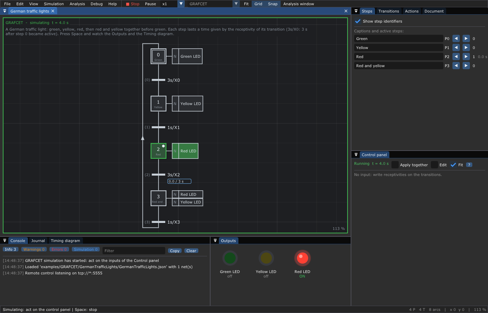

# 12. 🏗️ Code generation

**What you will learn**

- turn a net into the skeleton of a C++ program for the runtime: the net
  built in the code, one function per transition to fill;
- turn the GRAFCETs of a document into one C++ header that runs them on a
  computer or on an Arduino, with no library;
- how the generated code is checked against the editor.

**Prerequisites**: [11. The runtime](11-Runtime.md) for the first part,
[9. GRAFCET](09-GRAFCET.md) (and [10. GEMMA](10-GEMMA.md)) for the second.

Both are in *File > Export*, chosen by the extension of the file:

| Export | Extension | For | What you get |
|--------|-----------|-----|--------------|
| C++ functions for the runtime | `.cpp` `.cc` `.cxx` | Petri nets, timed Petri nets | a program using `libTimedPetriRuntime` ([chapter 11](11-Runtime.md)) |
| C++ GRAFCET (Arduino, computer) | `.hpp` `.h` `.hh` `.h++` | the GRAFCETs of the document | a header with no dependency, for a micro-controller |

Why two? The runtime runs any Petri net and calls your functions; it needs
the standard C++ library and C++20. A GRAFCET has its own rules (IEC 60848),
and a small board (an Arduino Uno: 2 KB of memory) has no standard library:
for it, the editor writes the whole engine of your GRAFCETs as plain code.

---

## 1. The skeleton of a program for the runtime

### 1.1 What is generated

Exporting the pick and place
([`PickAndPlace.json`](../examples/Runtime/PickAndPlace/PickAndPlace.json))
as `pick_and_place.cpp` gives this file, complete:

```c++
// Generated by TimedPetriNetEditor from the net "Pick and place".
// Fill the functions of the transitions, then build the program with the runtime:
//   g++ -std=c++20 -I<TimedPetriNetEditor>/src pick_and_place.cpp
//       -L<TimedPetriNetEditor>/build -lTimedPetriRuntime -lTimedPetriNet -pthread
// With -DTPNE_DEBUG -lzmq it publishes its journal on tcp://*:5556: the editor
// shows it (Debug > Connect).

#include "Runtime/Runtime.hpp"
#ifdef TPNE_DEBUG
#  include "Runtime/JournalPublisher.hpp"
#endif

#include <cstdlib>
#include <iostream>

using namespace tpne;

namespace pick_and_place {

//------------------------------------------------------------------------------
//! \brief The net, built in the code.
Net makeNet()
{
    Net net(TypeOfNet::PetriNet);
    net.name = "Pick and place";
    [[maybe_unused]] Place& p0 = net.addPlace(1u, "Ready");
    [[maybe_unused]] Place& p1 = net.addPlace(0u, "Seen");
    [[maybe_unused]] Place& p2 = net.addPlace(0u, "Held");
    [[maybe_unused]] Place& p3 = net.addPlace(0u, "Done");
    [[maybe_unused]] Transition& t0 = net.addTransition("detect");
    [[maybe_unused]] Transition& t1 = net.addTransition("grasp");
    [[maybe_unused]] Transition& t2 = net.addTransition("place");
    [[maybe_unused]] Transition& t3 = net.addTransition("retry");
    net.addArc(p0, t0);
    net.addArc(t0, p1);
    net.addArc(p1, t1);
    net.addArc(t1, p2);
    net.addArc(p2, t2);
    Arc* arc = net.findArc(p2, t2);
    arc->color = net.colors.add("Success");
    net.addArc(t2, p3);
    net.addArc(p2, t3);
    arc = net.findArc(p2, t3);
    arc->color = net.colors.add("Failed");
    net.addArc(t3, p1);
    return net;
}

//------------------------------------------------------------------------------
//! \brief detect: takes Ready, gives Seen.
Color detect()
{
    // TODO: what detect does.
    return Success;
}

//------------------------------------------------------------------------------
//! \brief grasp: takes Seen, gives Held.
//! Its result chooses what comes next: Failed (retry), Success (place).
Color grasp()
{
    // TODO: what grasp does.
    return Success;
}

//------------------------------------------------------------------------------
//! \brief place: takes Held, gives Done.
Color place()
{
    // TODO: what place does.
    return Success;
}

//------------------------------------------------------------------------------
//! \brief retry: takes Held, gives Seen.
Color retry()
{
    // TODO: what retry does.
    return Success;
}

} // namespace pick_and_place

//------------------------------------------------------------------------------
int main()
{
    Net const net = pick_and_place::makeNet();
    Runtime::Options options;
#ifdef TPNE_DEBUG
    JournalPublisher publisher(net);
    options.journal = [&publisher](LogEntry const& entry) { publisher.publish(entry); };
#endif
    // The functions run on a pool of threads (InlineExecutor: in the thread of run()).
    Runtime runtime(net, std::make_shared<ThreadPoolExecutor>(4u), options);
    runtime.on("detect", pick_and_place::detect);
    runtime.on("grasp", pick_and_place::grasp);
    runtime.on("place", pick_and_place::place);
    runtime.on("retry", pick_and_place::retry);
#ifdef TPNE_DEBUG
    publisher.manifest(runtime);
#endif

    // Ends with Success when the tokens reach the goal, else when nothing
    // can fire any more (Deadlocked).
    auto instance = runtime.instantiate("main", {}, { { "Done", Success } });
    Color const result = runtime.run(*instance);
    std::cout << net.name << ": " << net.colors.name(result) << std::endl;
    return (result == Success) ? EXIT_SUCCESS : EXIT_FAILURE;
}
```

Read it from the top:

- **`makeNet()`** builds the net in the code: places with their tokens,
  transitions, arcs with their weights, kinds, colors and durations,
  capacities, priorities, delays. A board has no file system, and the program
  does not depend on the JSON file any more. The positions of the drawing are
  not needed.
- **One function per transition**, named after its caption (made a C++
  identifier), in a namespace named after the file. Its comment says what it
  takes and what it gives, and, when the next arcs ask for colors, which
  result leads where: here `Failed (retry), Success (place)`.
- **`main()`** creates the runtime on a pool of 4 threads, gives it the
  functions, and runs one instance until its **goal**: the places without
  output arc (here `Done`). Change the executor, the goal, the number of
  instances as you need ([chapter 11](11-Runtime.md)).

The generated file builds and runs as it is (every function returns
`Success`):

```text
$ g++ -std=c++20 -I<TimedPetriNetEditor>/src pick_and_place.cpp \
      -L<TimedPetriNetEditor>/build -lTimedPetriRuntime -lTimedPetriNet -pthread -o pick
$ ./pick
Pick and place: Success
```

### 1.2 Fill it

Write the code of each action in its function, and return its result. The
walkthrough of [chapter 11](11-Runtime.md#8--from-the-drawing-to-a-running-robot)
fills the pick and place with a gripper that slips once:

```text
camera: object seen
gripper: slipped
gripper: holding
arm: placed
Pick and place: Success
```

A transition that should fire at once, without doing anything (`retry`), can
keep its generated function, or lose its `runtime.on()` line: a transition
without function fires at once.

### 1.3 Debug it

Add `-DTPNE_DEBUG` and `-lzmq`: the program publishes its journal on
`tcp://*:5556`, and the editor shows it running
([chapter 13](13-Debugging.md)):

```sh
g++ -std=c++20 -DTPNE_DEBUG -I<TimedPetriNetEditor>/src pick_and_place.cpp \
    -L<TimedPetriNetEditor>/build -lTimedPetriRuntime -lTimedPetriNet -lzmq -pthread -o pick
```

### 1.4 When you change the net

The export writes the whole file again. Keep the functions you wrote in
another file (declare them, and erase the generated ones), or copy the new
`makeNet()` into your program.

*File > Export* does not propose this export for a GRAFCET: the runtime
does not read receptivities nor actions. For a GRAFCET, use the next
section.

## 2. The C++ code of GRAFCETs

### 2.1 The story

A French video, [*Programmation d'un Grafcet en C pour
Arduino*](https://youtu.be/v5FwJvtGaEw), writes a GRAFCET by hand in C for
an Arduino: a boolean per step, the receptivities as `if`, the actions in a
`switch`. This is long and error prone, and the result rarely follows the
rules of the standard (several transitions firing together, the search of a
stable situation, the timers, the stored actions). The editor writes this
code for you, and the code follows the same rules as its simulation.

### 2.2 What is supported

Everything the simulation of the editor runs ([chapter 9](09-GRAFCET.md)):

- the **rules of evolution** of IEC 60848: all the transitions that can fire
  fire together, in all the graphs of the document; the search of the stable
  situation (the graphs evolve until nothing can fire, then the actions are
  computed); after 256 evolutions without a stable situation, `cycle()`
  returns `false`;
- **receptivities** with and, or, not, the steps (`X3`), the steps of the
  other graphs (`Production:X3`), **edges** (`↑a`, `↓a`), **time operators**
  (`3s/X2`, `2s/a/500ms`), integer comparisons (`[Temperature >= 80]`), and
  the **delay** of a transition;
- **actions** with their qualifiers `N`, `S`, `R`, `D`, `L`, `SD`, `DS`,
  `SL`, `P1`, `P0`, their durations and their **conditions**;
- **forcing orders** between graphs (a GEMMA: `Production{init}`,
  `{2,5}`, `{}`, `{*}`).

The names of the inputs must be C identifiers (`sensor_2`, not `sensor 2`);
an output name becomes one (`Left Motor` → `Left_Motor`). A receptivity with
a syntax error is refused, with its message.

### 2.3 Tutorial: the German traffic light

[`GermanTrafficLights.json`](../examples/GRAFCET/GermanTrafficLights/GermanTrafficLights.json)
is one GRAFCET of four steps: green 3 s, yellow 1 s, red 3 s, red and yellow
1 s.



*The GRAFCET running in the editor: step 2 (red) is active, its timer
`3s/X2` starts counting, the Outputs window shows the red light.*

*File > Export > C++ GRAFCET*, `GermanTrafficLights.hpp`. The interesting
parts of the 387 lines:

```c++
namespace german_traffic_lights {

//! \brief Inputs read by the receptivities: written by the program.
struct Inputs
{
    int none = 0;
};

//! \brief Outputs of the actions: read by the program.
struct Outputs
{
    bool Green_LED = false; // Green LED
    bool Red_LED = false; // Red LED
    bool Yellow_LED = false; // Yellow LED
};

class Grafcet
{
public:

    Inputs in;
    Outputs out;
    //! \brief Active steps of each graph.
    bool X0[4] = {}; // German traffic lights

    Grafcet() { reset(); }
    void reset();                  // the initial situation
    bool cycle(float const dt);    // one cycle, dt seconds after the previous one
    float time() const;            // seconds since reset()

private:

    // Receptivities.
    bool R0_0() { return timer(0); } // German traffic lights T0: 3s/X0
    bool R0_1() { return timer(1); } // German traffic lights T1: 1s/X1
    bool R0_2() { return timer(2); } // German traffic lights T2: 3s/X2
    bool R0_3() { return timer(3); } // German traffic lights T3: 1s/X3
    ...
```

and the heart, the search of the stable situation:

```c++
    // Fire the transitions that can, all graphs together, until none can.
    bool evolve()
    {
        for (int evolution = 0; evolution < 256; ++evolution)
        {
            bool any = false;
            bool F0[4];
            F0[0] = R0_0() && X0[0] && !m_forced[0];
            any |= F0[0];
            ...
            if (!any)
                return true;
            // Deactivate the upstream steps, then activate the downstream ones.
            if (F0[0]) { X0[0] = false; }
            ...
            if (F0[0]) { X0[1] = true; GRAFCET_FIRED(0, 0); }
            ...
        }
        return false;
    }
```

The interface of the class:

| Member | What |
|--------|------|
| `in` | the inputs, as `int` (a button is 0 or 1, a sensor any integer), with their initial values of the file; written by the program |
| `out` | the outputs, as `bool`, one per action name; read by the program |
| `X0[]`, `X1[]` ... | the steps of each graph, in the order of the document (`X0` is the first graph) |
| `cycle(dt)` | one cycle, `dt` seconds after the previous one: time passes (timers, delays, timed actions), forcing orders, evolution until stable, actions. Returns `false` when no stable situation is reached |
| `reset()` | back to the initial situation |
| `time()` | seconds since `reset()` |

The namespace is the name of the file (`gemma_dryer` for
`GEMMA-Dryer.hpp`). The code uses no library, not even the standard one, and
only C++11: it builds for an AVR.

### 2.4 Test it on a computer

The header has its own test program, which runs the cycles every 100 ms and
prints the active steps every second:

```sh
g++ -std=c++11 -x c++ -DGRAFCET_STANDALONE_TEST GermanTrafficLights.hpp -o grafcet_test
./grafcet_test
```

```text
t = 0.1 s: German_traffic_lights:X0
t = 1.1 s: German_traffic_lights:X0
t = 2.1 s: German_traffic_lights:X0
t = 3.1 s: German_traffic_lights:X1
t = 4.1 s: German_traffic_lights:X2
t = 5.1 s: German_traffic_lights:X2
t = 6.1 s: German_traffic_lights:X2
t = 7.1 s: German_traffic_lights:X3
t = 8.1 s: German_traffic_lights:X0
t = 9.1 s: German_traffic_lights:X0
```

Or your own program, which reads the outputs:

```c++
#include "GermanTrafficLights.hpp"
#include <cstdio>

int main()
{
    german_traffic_lights::Grafcet grafcet;
    for (int cycle = 0; cycle <= 90; ++cycle)  // 9 s, one cycle every 100 ms
    {
        grafcet.cycle(0.1f);
        if (cycle % 5 == 0)                    // print every 0.5 s
            std::printf("t = %.1f s  %s %s %s\n", double(grafcet.time()),
                        grafcet.out.Red_LED ? "RED" : "   ",
                        grafcet.out.Yellow_LED ? "YELLOW" : "      ",
                        grafcet.out.Green_LED ? "GREEN" : "");
    }
}
```

```text
t = 0.1 s             GREEN
t = 0.6 s             GREEN
t = 1.1 s             GREEN
t = 1.6 s             GREEN
t = 2.1 s             GREEN
t = 2.6 s             GREEN
t = 3.1 s      YELLOW 
t = 3.6 s      YELLOW 
t = 4.1 s  RED        
t = 4.6 s  RED        
t = 5.1 s  RED        
t = 5.6 s  RED        
t = 6.1 s  RED        
t = 6.6 s  RED        
t = 7.1 s  RED YELLOW 
t = 7.6 s  RED YELLOW 
t = 8.1 s             GREEN
t = 8.6 s             GREEN
t = 9.1 s             GREEN
```

The time is the one given to `cycle()`: this loop does not wait, and gives
the same output at each run.

### 2.5 On an Arduino

Copy the header next to the sketch. Each period: read the sensors into
`in`, call `cycle()` with the time elapsed, write `out` to the actuators. For
the dryer of [chapter 10](10-GEMMA.md) (`GEMMA-Dryer.hpp`, three graphs, the
inputs `Ack`, `Auto`, `EStop`, `Left`, `Manual`, `Rearm`, `Right`, `Start`,
`Stop`, `Temperature`, the outputs `Heat_Oven`, `Left_Motor`,
`Right_Motor`):

```c++
#include "GEMMA-Dryer.hpp"

gemma_dryer::Grafcet grafcet;
unsigned long last = 0;

void setup()
{
    pinMode(2, INPUT_PULLUP);  // Start
    pinMode(3, OUTPUT);        // Left motor
}

void loop()
{
    unsigned long const now = millis();
    grafcet.in.Start = (digitalRead(2) == LOW);
    grafcet.in.Temperature = analogRead(A0) / 10;
    grafcet.cycle((now - last) / 1000.0f);   // seconds since the last cycle
    last = now;
    digitalWrite(3, grafcet.out.Left_Motor);
    delay(10);
}
```

On a computer, the same class runs in any loop: a thread, a timer of Qt or
ROS, a simulation.

### 2.6 Trust it: checked against the editor

`tests/codegen/run.sh` generates the code of every GRAFCET of `examples/`,
builds it in C++11 with `-Wall -Wextra -Werror` (and again with
`GRAFCET_DEBUG` and ZeroMQ), runs it with a scenario of inputs and compares,
cycle after cycle, the steps and the outputs with the engine of the editor:

```text
$ bash tests/codegen/run.sh
ok   ExclusiveChoice (plain)
ok   ExclusiveChoice (debug)
ok   ParallelSequences (plain)
ok   ParallelSequences (debug)
ok   GermanTrafficLights (plain)
ok   GermanTrafficLights (debug)
ok   GrafcetActions (plain)
ok   GrafcetActions (debug)
ok   GEMMA-Dryer (plain)
ok   GEMMA-Dryer (debug)
```

The CI runs it at each commit.

### 2.7 Debug it

Build with `-DGRAFCET_DEBUG`: the code publishes its firings, its steps, its
inputs and its outputs, and the editor shows the GRAFCET running on the
board ([chapter 13](13-Debugging.md#6-follow-generated-grafcet-code)):

| Where the code runs | How it publishes |
|---------------------|------------------|
| a computer | ZeroMQ PUB on `tcp://*:5556` (link with `-lzmq`; define `GRAFCET_DEBUG_ENDPOINT` to change it) |
| an Arduino (`ARDUINO` defined) | one JSON object per line on `Serial`; `tools/serial-bridge.py` publishes them on ZeroMQ |
| elsewhere | define `GRAFCET_DEBUG_SEND(text)` to send each line yourself |

## 3. Pitfalls

- **`cycle()` returns `false`**: a loop of transitions always true (two
  steps with receptivities `1` between them). The editor warns the same way
  in its simulation.
- **"not a C identifier"**: rename the input in the receptivities
  (`sensor_2`).
- **A short pulse is missed**: an input is read once per cycle; a pulse
  shorter than the period of `loop()` can be lost. Use a shorter period, or
  latch the input in an interrupt.
- **Time drifts**: give `cycle()` the time really elapsed (`millis()`), not
  the period you wished.

## 4. Going further

- [9. GRAFCET](09-GRAFCET.md) and [10. GEMMA](10-GEMMA.md): the rules the
  code follows.
- [11. The runtime](11-Runtime.md): what to put in the skeleton.
- [13. Debugging](13-Debugging.md): watch the code run.
- [15. File formats](15-File-Formats.md): all the other exports.

---

Next: [13. Debugging](13-Debugging.md).
