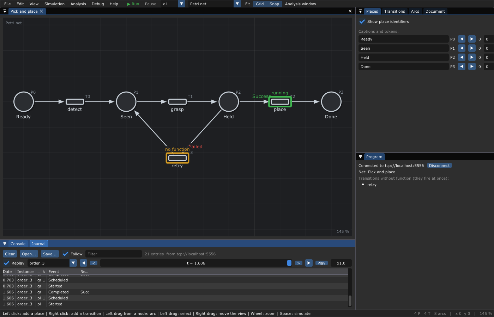
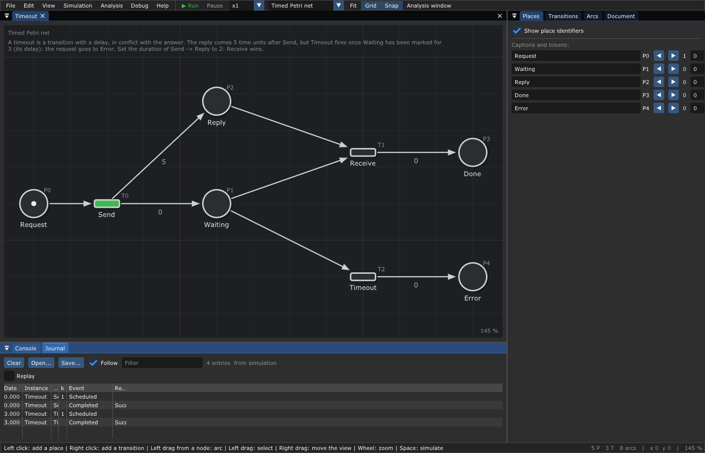
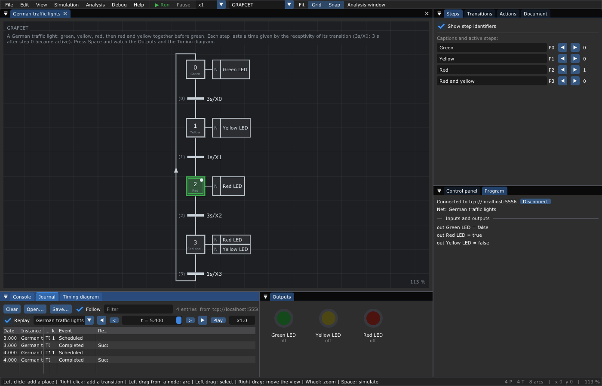

# 13. 🐞 Debugging: the editor as a visual debugger

**What you will learn**

- connect the editor to a running program and watch its tokens move on the
  net you drew;
- the messages a program sends, and how to send them from your own program,
  from the generated code of a GRAFCET, or from an Arduino;
- the *Journal* window: read, replay, save and open journals;
- what to do with a journal: process mining, restart after a crash.

**Prerequisites**: [11. The runtime](11-Runtime.md), and
[12. Code generation](12-Code-Generation.md) for §6 and §7.

---

## 1. The idea

A program driven by a Petri net has its logic in a drawing. When something
goes wrong, the best place to look is the same drawing: which tokens are
where, which function is running, which one failed. The editor can show
that, live, for a program running anywhere:

```text
  your program (runtime, or generated GRAFCET)              the editor
  ┌───────────────────────────────┐                    ┌──────────────────────┐
  │ runtime ─► journal lines ─────┼── ZeroMQ PUB ────► │ SUB: Journal window, │
  │            manifest, marking  │   tcp://*:5556     │ tokens on the net,   │
  └───────────────────────────────┘                    │ Program window       │
                                                       └──────────────────────┘
```

The program **publishes**; the editor **subscribes**. This is the opposite
of the remote control of [chapter 18](18-Remote-Control.md), where another
program drives the editor. The program does not wait for the editor: it runs
the same whether an editor listens or not, and several editors can listen
to the same program.

## 2. Try it

The example `Debugger` runs the pick and place of chapter 11 over and over,
with slow functions (so that you can see the tokens move) and a gripper that
fails one time out of three:

```sh
make -C examples                       # after make at the root
./build/examples/Debugger &            # publishes for 30 s (or: Debugger 120)
./build/TimedPetriNetEditor -c tcp://localhost:5556 examples/Runtime/PickAndPlace/PickAndPlace.json
```

In the editor, *Debug > Connect* with the endpoint `tcp://localhost:5556`
does the same as `-c`.



*The editor connected to the program: `place` is marked `running` (its
function runs now), `retry` is marked `no function` (it fires at once); the
Journal lists the events of the order `order_3`; the Program window names the
net of the program and its transitions without function.*

What you see:

- **On the net**: the tokens of the instance at the last event; a transition
  whose function runs has a halo marked `running`; a transition without
  function has one marked `no function`.
- **Journal** (bottom): each event of each instance, as it comes. *Follow*
  keeps the last one in sight; *Replay* shows the marking of an instance at
  a date (§4).
- **Program** (right): the endpoint, the net of the program, its transitions
  without function, and the inputs and outputs of a GRAFCET (§6). If the
  program has not the same number of transitions as the net open, a warning
  asks: *is it the same net?*

*Debug > Disconnect* (or *Disconnect* in the Program window) stops
following.

## 3. The messages

Each message is one JSON object, as text. There are four kinds.

| Message | Example | The editor |
|---------|---------|------------|
| a line of the journal | `{"instance":"order_1","transition":"grasp","event":"Completed","result":"Failed","date":1.614213573}` | adds it to the Journal, moves the tokens |
| manifest | `{"type":"manifest","net":"Pick and place","places":[...],"transitions":[...],"unregistered":["retry"]}` | marks the transitions without function |
| marking | `{"type":"marking","instance":"German traffic lights","date":3.000,"tokens":[0,1,0,0]}` | starts the replay of the instance from these tokens |
| inputs and outputs | `{"type":"io","inputs":{},"outputs":{"Green LED":false,"Red LED":false,"Yellow LED":true}}` | shows them in the Program window |

`event` is `Scheduled` (the transition took its input tokens), `Started` (its
function runs) or `Completed` (it gave its output tokens, colored by
`result`). A transition without function has no `Started`.

Here is what a subscriber of 6 lines of Python receives from `Debugger`:

```python
import zmq
socket = zmq.Context().socket(zmq.SUB)
socket.connect("tcp://localhost:5556")
socket.setsockopt_string(zmq.SUBSCRIBE, "")
for _ in range(12):
    print(socket.recv_string())
```

```text
{"instance":"order_1","transition":"detect","event":"Completed","result":"Success","date":0.7065038330000001}
{"instance":"order_1","transition":"grasp","event":"Scheduled","date":0.7065038330000001}
{"instance":"order_1","transition":"grasp","event":"Started","date":0.7065038330000001}
{"type":"manifest","net":"Pick and place","places":["Ready","Seen","Held","Done"],"transitions":["detect","grasp","place","retry"],"unregistered":["retry"]}
{"instance":"order_1","transition":"grasp","event":"Completed","result":"Failed","date":1.614213573}
{"instance":"order_1","transition":"retry","event":"Scheduled","date":1.614213573}
{"instance":"order_1","transition":"retry","event":"Completed","result":"Success","date":1.614213573}
{"instance":"order_1","transition":"grasp","event":"Scheduled","date":1.614213573}
{"instance":"order_1","transition":"grasp","event":"Started","date":1.614213573}
{"instance":"order_1","transition":"grasp","event":"Completed","result":"Success","date":2.522026006}
{"instance":"order_1","transition":"place","event":"Scheduled","date":2.522026006}
{"instance":"order_1","transition":"place","event":"Started","date":2.522026006}
```

The subscriber started a moment before the program and still missed its
first messages: with ZeroMQ, a subscriber connecting needs some time before
it receives (the "slow joiner"). This is why the program sends the
**manifest** again every second, and a **marking** at the start of each
instance: an editor connected late knows the net and the tokens anyway.

## 4. The Journal window

The *Journal* (next to the *Console*) holds the events of one source: the
last simulation of the editor, a journal file opened, the path to a
deadlock found by *Analysis > Properties* ([chapter 4](04-Analysis.md)), or
a connected program.



*The journal of the simulation of
[`Timeout`](../examples/Timed-Petri-Nets/Timeout/Timeout.json): `Send` at 0,
then `Timeout` at 3 (its delay), since the reply comes at 5.*

| Part | What |
|------|------|
| *Clear* | empty it |
| *Open...* | read a journal of the runtime (`.jsonl`, `.json`, `.log`: JSON lines) |
| *Save...* | write it, the format by the extension: `.jsonl` (JSON lines), `.csv`, `.xes` |
| *Follow* | keep the last event in sight |
| Filter | keep the lines containing a text |
| columns | `Date`, `Instance`, `Transition`, `k` (the number of the firing of this transition: k = 2 is its second firing), `Event`, `Result` (in red when it is not `Success`) |
| *Replay* | show on the net the marking of the chosen instance at a date: the slider chooses the date, `<` and `>` go to the previous and next event, the arrows to the first and last, *Play* lets the time run at the speed given (`x1.0`). The transitions whose function runs at this date are marked `running` |
| a click on a line | goes to its date; out of the replay, marks its transition |

The replay rebuilds the marking with the runtime itself
(`Runtime::restore()`), from the initial tokens of the net: what you see is
what the program had.

*Debug > Open a journal...*, *Save the journal...* do the same as the
buttons; *Debug > Clear the marks of the nodes* removes the halos left by
the journal, a program or the analysis.

## 5. Publish from your program

A program using the runtime publishes with `JournalPublisher`
(`Runtime/JournalPublisher.hpp`). Only the programs including this header
link libzmq: the runtime itself does not depend on it.

```c++
#include "Runtime/JournalPublisher.hpp"   // link with -lzmq

JournalPublisher publisher(net);           // binds tcp://*:5556
if (!publisher.error().empty()) { /* the port is taken ... */ }
Runtime::Options options;
options.journal = [&publisher](LogEntry const& e) { publisher.publish(e); };
Runtime runtime(net, executor, options);
runtime.on("grasp", grasp);
publisher.manifest(runtime);               // its transitions without function
auto order = runtime.instantiate("order_42");
publisher.marking(*order);                 // for an editor connected later
```

| `JournalPublisher` | Does |
|--------------------|------|
| `JournalPublisher(net, endpoint)` | binds a PUB socket (`tcp://*:5556` by default); the net names the colors |
| `publish(entry)` | sends a line of the journal (any thread) |
| `manifest(runtime)` | sends the manifest, and again every second with the next messages |
| `marking(instance)` | sends the tokens of the instance at its date |
| `send(text)` | sends any message (a GRAFCET sends its inputs and outputs this way) |

The program generated by *File > Export > C++ functions for the runtime*
does all of this when built with `-DTPNE_DEBUG -lzmq`
([chapter 12](12-Code-Generation.md)).

Without ZeroMQ, the same information can go to a file: `toManifest(runtime)`
written in a file is opened by *Debug > Open a manifest...* (it marks the
transitions without function), and the journal saved as `.jsonl` is opened
by the Journal.

## 6. Follow generated GRAFCET code

The C++ code of a GRAFCET ([chapter 12](12-Code-Generation.md)) built with
`-DGRAFCET_DEBUG` publishes at each cycle the firings, the active steps (a
marking per graph, each graph being an instance named after it), and the
inputs and outputs when they change; the manifest every second. A test on a
computer with the German traffic light:

```c++
#include "GermanTrafficLights.hpp"
#include <chrono>
#include <thread>

int main()
{
    german_traffic_lights::Grafcet grafcet;
    for (int cycle = 0; cycle < 600; ++cycle) // 60 s, a cycle every 100 ms
    {
        grafcet.cycle(0.1f);
        std::this_thread::sleep_for(std::chrono::milliseconds(100));
    }
}
```

```sh
g++ -std=c++11 -DGRAFCET_DEBUG lights_debug.cpp -lzmq -o lights_debug
./lights_debug &
./build/TimedPetriNetEditor -c tcp://localhost:5556 examples/GRAFCET/GermanTrafficLights/GermanTrafficLights.json
```

It publishes:

```text
{"type":"manifest","net":"German traffic lights","places":["P0","P1","P2","P3"],"transitions":["T0","T1","T2","T3"],"unregistered":[]}
{"type":"marking","instance":"German traffic lights","date":1.100,"tokens":[1,0,0,0]}
{"type":"io","inputs":{},"outputs":{"Green LED":true,"Red LED":false,"Yellow LED":false}}
...
{"instance":"German traffic lights","transition":"T0","event":"Scheduled","date":3.000}
{"instance":"German traffic lights","transition":"T0","event":"Completed","result":"Success","date":3.000}
{"type":"marking","instance":"German traffic lights","date":3.000,"tokens":[0,1,0,0]}
{"type":"io","inputs":{},"outputs":{"Green LED":false,"Red LED":false,"Yellow LED":true}}
```



*The editor following the generated code: step 2 (red) is active in the
program, the Program window shows its outputs (`out Red LED = true`), the
Journal its firings. The Outputs window belongs to the simulation of the
editor, which is stopped: it stays off.*

The transitions of a GRAFCET are named by their keys (`T0`), since their
captions are receptivities.

## 7. From an Arduino

A board has no network. The generated code, built for an Arduino with
`GRAFCET_DEBUG` defined, writes the same messages on `Serial`, one JSON
object per line. `tools/serial-bridge.py` reads the serial line and
publishes the lines on ZeroMQ:

```sh
pip install pyserial pyzmq
python3 tools/serial-bridge.py /dev/ttyACM0 [115200] [tcp://*:5556]
./build/TimedPetriNetEditor -c tcp://localhost:5556 my_grafcet.json
```

The sketch starts the serial line at the same speed
(`Serial.begin(115200);` in `setup()`). The lines that are not JSON (your own
`Serial.print`) are printed by the bridge, not sent to the editor.
Elsewhere (a CAN bus, a radio), define `GRAFCET_DEBUG_SEND(text)` to send
each line yourself, and publish them on ZeroMQ on the other side.

## 8. Use the journals

### 8.1 Spreadsheets and process mining

The journal of an instance says when each function started and ended, and
how. Saved as CSV, it opens in a spreadsheet:

```text
instance,transition,event,result,date
fast,request,Scheduled,,0
fast,request,Started,,0
fast,request,Completed,Success,0.0101056
fast,paid,Scheduled,,0.100624
```

Saved as **XES** (IEEE 1849), it opens in the **process mining** tools:
[ProM](https://promtools.org), [PM4Py](https://pm4py.fit.fraunhofer.de),
Disco. Each instance is a trace, each event an event with `concept:name`
(the transition), `lifecycle:transition` (`schedule`, `start`, `complete`)
and `org:resource` (the result). These tools draw the process that really
happened from thousands of instances, measure the real durations of the
functions, and find the paths you did not expect.

```c++
#include "Runtime/Journal.hpp"
saveJournal(instance->log(), net.colors, "orders.xes");   // .jsonl, .csv, .xes
```

The dates of the runtime are seconds since the start of the instance; give
`saveJournal()` an origin (seconds since 1970) to get real calendar dates in
the XES file, else the dates are in 1970. The example
[`MicroServices`](../examples/Runtime/MicroServices/README.md) saves its
journal in the three formats.

### 8.2 After a crash

A journal saved line by line (`Options::journal` writing each line to a
file) is enough to rebuild the instances of a program that stopped:
`Runtime::restore()` replays it, then calls again, or fails, the functions
that were running ([chapter 11](11-Runtime.md#51-restart-after-a-crash)). The
same file opened in the Journal shows, with *Replay*, where each instance
was when the program stopped.

## 9. Pitfalls

- **Nothing comes**: the program binds `tcp://*:5556`, the editor connects
  to `tcp://localhost:5556` (or the address of the machine of the program).
  Only one program can bind a port: `publisher.error()` says so.
- **The tokens do not match the net**: the editor shows the program on the
  net open; open the same net (the Program window warns when the numbers of
  transitions differ).
- **The first events are missing**: the slow joiner of ZeroMQ (§3); call
  `publisher.marking()` at the start of each instance.
- **Too many messages**: a GRAFCET cycling every millisecond publishes only
  what changes, but the runtime publishes every event: on a big load, keep
  the journal in a file and open it later.

## 10. Going further

- [11. The runtime](11-Runtime.md) and [12. Code generation](12-Code-Generation.md).
- [14. Editor reference](14-Editor-Reference.md): the Journal and Program
  windows, the option `-c`.
- [18. Remote control](18-Remote-Control.md): the other direction.
- W. van der Aalst, *Process Mining: Data Science in Action*, Springer, for
  what to do with XES journals.

---

Next: the references, starting with
[14. Editor reference](14-Editor-Reference.md).
