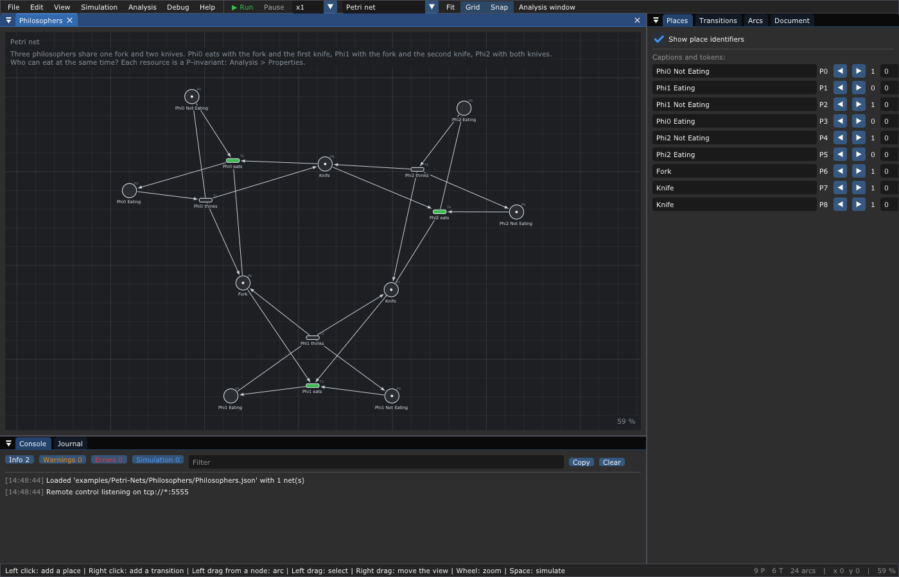
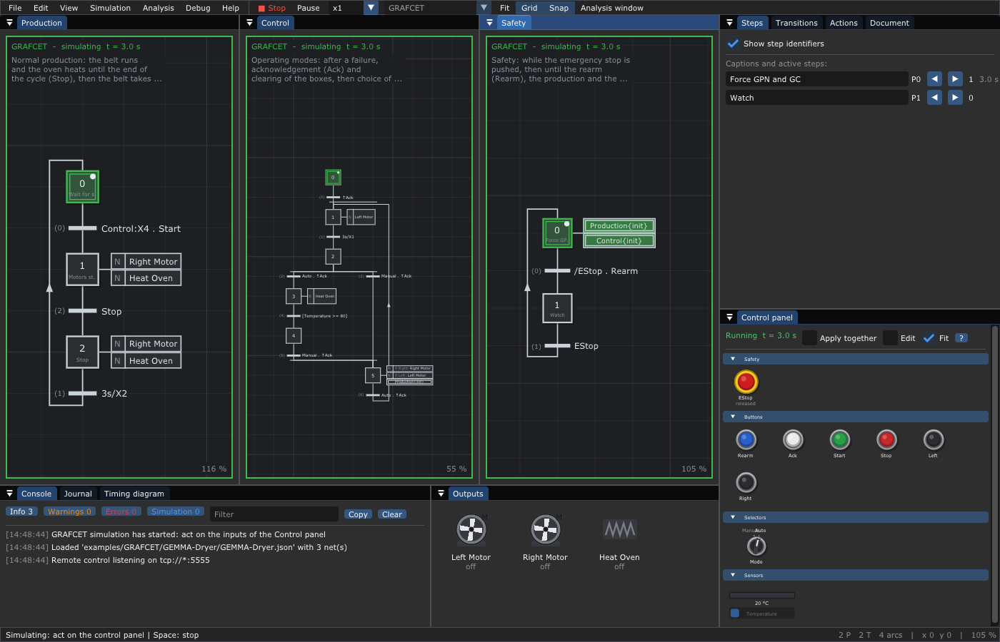
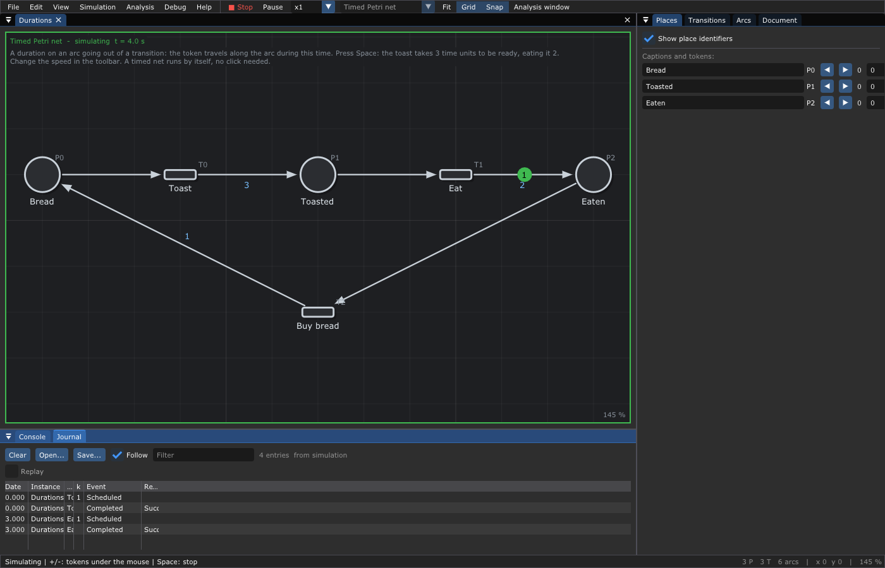
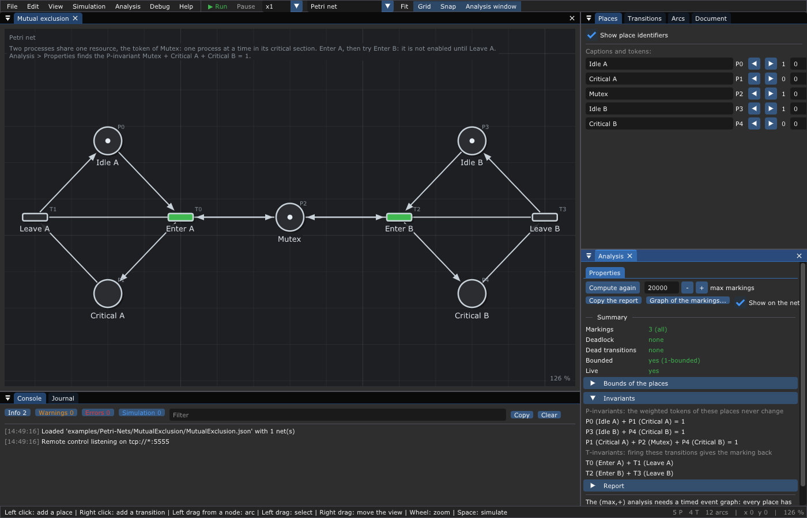

# 🖱️ 14. Editor reference

What you will find here: every window, mouse gesture, key, menu and command
line option of the editor, checked against the code. The learning chapters
show them in use: [2](02-Getting-Started.md) (first net),
[3](03-Petri-Nets.md) (simulation), [4](04-Analysis.md) (properties),
[7](07-Timed-Event-Graphs.md) and [8](08-Max-Plus-Algebra.md) (the (max,+)
analysis), [9](09-GRAFCET.md) (GRAFCET), [13](13-Debugging.md) (journal and
debugger). In the editor, **F1** opens the same help.

---

## 1. The main window



*`examples/Petri-Nets/Philosophers/Philosophers.json` just opened (window of
1400 x 900 pixels).*

From top to bottom and left to right:

| Area | What it is |
|------|------------|
| Menu bar | *File, Edit, View, Simulation, Analysis, Debug, Help* (§9) |
| Toolbar (end of the menu bar) | **▶ Run** / **■ Stop**, *Pause*, the speed `x1`, the type of the active net, *Fit*, *Grid*, *Snap*, *Analysis window* |
| Net window (middle, tab *Philosophers*) | the drawing of a net. In its top left corner: its type, while simulating `simulating t = 3.0 s` (and *paused*), then its description. In its bottom right corner: the zoom |
| Inspector (right) | tabs *Places* (*Steps* for a GRAFCET), *Transitions*, *Arcs* (*Actions* for a GRAFCET), *Document* |
| Under the inspector | *Control panel* (GRAFCET), *Analysis*, *Program* (when connected to a program) |
| Bottom | *Console*, *Journal*, *Timing diagram* (GRAFCET); *Outputs* (GRAFCET) on the right |
| Status bar | on the left, what the mouse buttons would do now; on the right, the counts of places, transitions and arcs, the position of the mouse in the net and the zoom |

A GRAFCET document of three nets while it runs:



*`examples/GRAFCET/GEMMA-Dryer/GEMMA-Dryer.json`, 3 s after **Space**: the
three nets side by side with a green frame (simulating), the control panel
(emergency stop, push buttons, selector, sensor) under the inspector, the
outputs (two motors, an oven) at the bottom right.*

The windows can be moved, docked elsewhere, put in tabs or closed. The
layout and the theme are saved in the settings folder of the user:

| System | Settings folder |
|--------|-----------------|
| Linux | `$XDG_CONFIG_HOME/TimedPetriNetEditor`, else `~/.config/TimedPetriNetEditor` |
| macOS | `~/Library/Application Support/TimedPetriNetEditor` |
| Windows | `%APPDATA%\TimedPetriNetEditor` |

*View > Reset the layout of the windows* builds the default layout again.
*Help > Mouse and keys*, tab *Paths*, shows the folders used.

## 2. Windows

| Window | Shows | When |
|--------|-------|------|
| Net (one per net of the document) | the drawing; several nets of a document are side by side and keep their share of the width when the main window changes size | always |
| Places / Steps | caption, identifier, `◀ ▶` and the number of tokens of each place, and its initial tokens; for a running GRAFCET, how long each active step has been active | always |
| Transitions | caption (the receptivity of a GRAFCET, checked while typing, with *Syntax help*); priority (Petri and timed nets); delay in seconds (GRAFCET); the timers that count while simulating | always |
| Arcs | a table: arc, kind (normal, inhibitor, reset), weight, color of the tokens, duration (timed nets) | Petri and timed nets |
| Actions | actions of each step: qualifier (with its timing diagram), name, condition, duration, forcing orders; *Qualifiers help* | GRAFCET |
| Document | what the document is about and the description of each net (*Edit* to change them); the nets of the document (a radio button chooses the active one); the colors of the tokens of the user (*Add*); the GRAFCET inputs and outputs | always |
| Control panel | the inputs of the GRAFCETs drawn as the buttons of a machine; *Apply together*, *Apply (F7)*, *Edit*, *Fit*, `?` (§8) | GRAFCET |
| Outputs | the actuators named by the actions: lights, motors, heaters, valves, horns | GRAFCET |
| Timing diagram | steps, inputs and outputs over time (§8) | GRAFCET |
| Analysis | tab *Properties* for every net; for a timed event graph also *Critical circuit*, *Gantt*, *Linear system*, *Equations*, *Adjacency*, *Firing dates* (§7) | *Analysis window* in the toolbar, or the *Analysis* menu |
| Console | all the messages (§6) | always |
| Journal | the firings of the simulation, of an opened journal, or of a connected program; replays them on the net (§7) | always |
| Program | the program followed: its net, its transitions without function, its inputs and outputs ([chapter 13](13-Debugging.md)) | connected (*Debug*) |

A net is fitted to its window, again each time the window changes size,
until you move or zoom its view (**F** fits it again).

## 3. Mouse

There is no mode to choose. What a button does depends on what is under the
mouse, and on whether the mouse moves before the button is released (less
than 4 pixels is a click). **The left button draws, the right button
moves.** The status bar always says what the buttons would do now.

| Under the mouse | Click | Drag |
|-----------------|-------|------|
| nothing, left button | add a place (a timed event graph: a transition); with a selection, the first click only clears it | select in a rectangle |
| nothing, right button | add a transition | move the view |
| node, left button | select it (Ctrl: add it to or remove it from the selection) | draw an arc from it |
| node, right button | the menu of the node | move it, with the selection |
| arc, left button | select it | select in a rectangle |
| arc, right button | the menu of the arc | move the view |
| anything, middle button | | move the view |

- An arc released in the void creates a node of the other kind there,
  already linked; between two nodes of the same kind, a node of the other
  kind is inserted in the middle.
- **Double click** on a node: rename it (a GRAFCET transition: its
  receptivity, checked while typing). On an arc: its duration (timed nets)
  and its weight, and the tokens of its place in a timed event graph. Enter
  applies, Esc cancels.
- **Wheel**: zoom around the mouse. Shift + wheel, or a touchpad: move the
  view.
- While a Petri net is simulated, a left click on an enabled transition
  fires it. Timed nets and GRAFCETs run by themselves.
- With several nets in a document, a click in a net makes it the active one
  (the inspector shows it) and acts at once.
- Nodes with a halo are marked: by the *Journal* (the transitions whose
  function runs), by a connected program (transitions without function), or
  by the *Analysis* (dead transitions, not live, unbounded places, the nodes
  of an invariant). *Debug > Clear the marks of the nodes* removes them.

### Menu of a node (right click)

| Item | Node | Effect |
|------|------|--------|
| Rename | all | same as a double click |
| Select | all | select it |
| Add a token (+), Remove a token (-), Tokens | place | its tokens |
| Max tokens | place (Petri and timed nets) | check it to give a capacity; unchecked: unbounded |
| Activate step, Deactivate step | GRAFCET step | its initial token |
| Add an action | GRAFCET step | a new action in the *Actions* window |
| Delete | all | delete it and its arcs |

### Menu of an arc (right click)

| Item | Effect |
|------|--------|
| Duration and weight... (timed nets), Weight... | the numbers of the arc |
| Normal, Inhibitor, Reset | its kind (inhibitor and reset arcs go from a place to a transition, Petri and timed nets only, [chapter 5](05-Extended-Petri-Nets.md)) |
| Color of the tokens | the color the transition takes (arc from a place) or gives (arc to a place); *any*, the built-in colors, the colors of the net, or a new color typed in the field |
| Select, Delete | |

## 4. Keys

The keys act on the net window that has the focus.

| Key | Action | While simulating |
|-----|--------|:----------------:|
| **Space** | start or stop the simulation | yes |
| **P** | pause or resume the simulation | yes |
| **F** | fit the net in its window | yes |
| **Esc** | cancel the current drag, else clear the selection | yes |
| **+** / **-** (also keypad, **=**) | tokens of the place under the mouse | yes |
| **G** | snap the nodes to the grid (on / off) | |
| **L** | spring layout (again to stop) | |
| **Delete**, **Backspace** | delete the selection, else what is under the mouse | |
| Arrows (**Shift**: by 1 pixel) | move the selection (by half a grid step) | |
| **Ctrl+Z**, **Ctrl+Y** (**Ctrl+Shift+Z**) | undo, redo (moves too) | |
| **Ctrl+C**, **Ctrl+X**, **Ctrl+V**, **Ctrl+A** | copy, cut, paste at the mouse, select all | |
| **Ctrl+N** | clear the document | yes |
| **Ctrl+O**, **Ctrl+S**, **Ctrl+Shift+S**, **Ctrl+Q** | open, save, save as, quit | yes |
| **Ctrl+=**, **Ctrl+-**, **Ctrl+0** | zoom in, zoom out, fit | yes |
| **F7** | GRAFCET: apply the inputs changed together | yes |
| **F1** | help | yes |

## 5. Simulation

| Control | Where | Effect |
|---------|-------|--------|
| Run / Stop | toolbar, *Simulation > Start*, **Space** | when stopped, the net comes back to its initial marking |
| Pause / Resume | toolbar, *Simulation > Pause*, **P** | time stops |
| Speed x0.1, x0.25, x0.5, x1, x2, x5, x10, x20, x50 | toolbar, *Simulation > Speed* | at x10, a GRAFCET timer `30s/X1` lasts 3 s and tokens move 10 times faster |
| Conflicts: Random, Highest priority, First declared | *Simulation > Conflicts* (not for a GRAFCET) | which transition fires first when several can; with *Random*, a *Seed* (0: a new one each time, written in the console) and *Replay the last simulation* |
| Start all the nets, the nets of the document | *Simulation* (several nets) | run them together; choose the active net |

The conflict policy is a setting of the editor, not saved in the file.
Opening, saving or exporting a file while simulating first stops the
simulation (a message says it). While simulating, the net cannot be edited:
only tokens (**+** / **-**) and GRAFCET inputs change.

## 6. Console

One button per kind of message, with its count: *Info*, *Warnings*,
*Errors*, *Simulation* (GRAFCET inputs changed while running; the firings
are in the *Journal*). A click hides or shows them. The *Filter* keeps the
messages containing a text; *Copy* puts the shown messages in the
clipboard; *Clear* empties the console. The same message given several
times in a row is written once with its count `(x3)`. The last messages
also appear a few seconds in the bottom right corner of the nets (never in
the pictures taken by `-s` and `-w`).

## 7. Journal and Analysis



*`examples/Timed-Petri-Nets/Durations/Durations.json` after 4 s: the token
of `Eat` travels for 2 time units; the Journal lists the firings.*

The **Journal** lists the firings: *Date*, *Instance* (the net, or an
instance of a program), *Transition*, its number *k*, the *Event*
(`Scheduled`: the tokens are taken, `Started`: its function runs,
`Completed`: the tokens are given) and the *Result* (the color of the tokens
given). It holds the firings of the last simulation, a journal opened
(*Open...*: JSON lines), the path to a deadlock found by the analysis, or
what a connected program publishes. *Follow* keeps the last line in view,
*Filter* keeps the lines containing a text, *Save...* writes JSON lines, CSV
or XES (by the extension, [chapter 15](15-File-Formats.md#5-journals)),
*Clear* empties it. **Replay** shows the marking of the net at a date: the
slider, `<` and `>` go from an event to the next, the arrows to the first
and the last; the transitions whose function runs are marked. A click on a
line goes to its date.



*`examples/Petri-Nets/MutualExclusion/MutualExclusion.json` with `-f
Properties`.*

The **Analysis** window, tab **Properties**, for every net (durations and
GRAFCET rules not considered, [chapter 4](04-Analysis.md)): *Compute again*
explores the markings, up to *max markings* (small nets: again at each
change). The summary says how many markings, whether the net can deadlock,
has dead transitions, is bounded and live. The folds give the *Bounds of
the places*, the *Invariants* (P and T; a click marks their nodes), the
deadlock with its marking and the shortest path to it (*Replay the path in
the Journal*), and the *Report* (*Copy the report*). *Show on the net*
marks the dead transitions, the transitions not live and the unbounded
places. *Graph of the markings...* saves it for Graphviz. The same in a
terminal or a CI:

```text
tpne-check [--max-states N] [--allow-deadlock] [--dot graph.dot] net.json ...
```

(exit code 1 when a net can deadlock).

The other tabs need a timed event graph ([chapters 7](07-Timed-Event-Graphs.md)
and [8](08-Max-Plus-Algebra.md)):

| Tab | Shows |
|-----|-------|
| Critical circuit | the cycle time λ, the arcs of the circuit (also drawn on the net), the bias of each transition |
| Gantt | the earliest dates of the first cycles, one row per machine (*Cycles* slider) |
| Linear system | the matrices `D`, `A`, `B`, `C` of `X(k) = D X(k) ⊕ A X(k-1) ⊕ B U(k)`, `Y(k) = C X(k)` |
| Equations | dater ((max,+)) and counter ((min,+)) equations, with captions or identifiers |
| Adjacency | the matrices of the *Durations* and of the *Tokens* |
| Firing dates | the dates `y(k)` of each transition during the simulation, with *Subtract drift λ·k* |

Each matrix has a *Copy as Julia* button ([chapter 17](17-Julia.md)).

## 8. GRAFCET windows

- **Control panel**: one widget per input, by kind
  ([chapter 9](09-GRAFCET.md)). While stopped, a click changes the initial
  value (saved with the document); while running, it acts at once, or at
  *Apply (F7)* when *Apply together* is checked. A right click keeps a push
  button pressed. *Fit* draws the buttons smaller to see all of them; each
  section (*Safety*, *Buttons*, *Selectors*, *Sensors* ...) folds. *Edit*
  shows two tables, *Inputs* (name, kind, settings, description) and
  *Outputs* (name, kind, description). `?` opens the help of the panel.
- **Outputs**: the actuators named by the actions, on or off.
- **Timing diagram**: *Steps*, *Inputs*, *Outputs* choose the rows; *Only
  what changed* hides the steps never active and the signals always 0; the
  slider gives the span shown; *Follow* shows the last seconds, else a time
  line chooses the span. The mouse gives the time and the value.
- **Actions**: a qualifier shows its meaning and its timing diagram;
  *Qualifiers help* opens all of them. *Forcing orders*: *Add order*,
  *Remove*.
- Removing a step gives its number to the last step: its actions go with
  it, and the receptivities of all the graphs (`X3`, `Production:X3`)
  follow. What read the removed step reads a missing step (an error at the
  start).

## 9. Menus

| Menu | Item | Effect |
|------|------|--------|
| **File** | New > Petri net, Timed Petri net, Timed event graph, GRAFCET, GEMMA (3 GRAFCETs) | a new document of this kind (GEMMA: three empty GRAFCETs Safety, Control, Production) |
| | Clear the document (Ctrl+N) | empty the active document |
| | Open... (Ctrl+O), Open in a new document... | a `.json`, `.flowshop`, `.pnml`, `.grml`, `.teg` file |
| | Import > *format* | read a file of this format ([chapter 15](15-File-Formats.md)) |
| | Save (Ctrl+S), Save as... (Ctrl+Shift+S) | the JSON file |
| | Export > *format* | write the net in this format |
| | Screenshot... | a PNG picture of the net |
| | Documents > *names*, Close this document | several documents opened |
| | Quit (Ctrl+Q) | asks to save a modified document |
| **Edit** | Undo (Ctrl+Z), Redo (Ctrl+Y) | |
| | Type of net > Petri net, Timed Petri net, Timed event graph, GRAFCET | change the type of the active net (refused when the net uses what the new type does not allow: the faulty arcs are shown) |
| | Add a net to the document > Petri net, GRAFCET | a second net in the same document |
| | To canonical form | a timed event graph whose places hold at most one token ([chapter 8](08-Max-Plus-Algebra.md)) |
| | Arrange top-down | layers from the initial steps, the way a GRAFCET is drawn |
| | Spring layout (L), Stop the spring layout | a force-directed placement |
| | Align to the grid | snap all the nodes |
| | Clear the net | remove all its nodes |
| **View** | Fit the net (F), Zoom in (Ctrl+=), Zoom out (Ctrl+-) | |
| | Grid, Snap to the grid (G) | |
| | Place identifiers, Transition identifiers | `P0`, `T1` next to the captions; GRAFCET: the numbers of the steps, `(1)` on the left of the transitions |
| | GRAFCET action boxes | hidden: a small tag with the number of the actions of a step (green when one runs) |
| | Theme > Dark, Light, Classic | |
| | Reset the layout of the windows | |
| | Remote control > Enable / Disable | the ZeroMQ server of [chapter 18](18-Remote-Control.md), and its endpoint (*Disabled at build time* with `TPNE_ZEROMQ=0`) |
| **Simulation** | Start / Stop (Space), Pause / Resume (P), Speed, Conflicts | §5 |
| | Start all the nets, the nets of the document | several nets |
| **Analysis** | Properties (deadlocks, bounds, invariants) | §7 |
| | Critical circuit (cycle time), Gantt chart (earliest dates), (max,+) linear system, Dater and counter equations, Adjacency matrices, Firing dates of the simulation | timed event graphs only (*Needs a timed event graph* otherwise) |
| **Debug** | endpoint and *Connect* / Disconnect from ... | follow a program publishing its journal ([chapter 13](13-Debugging.md)) |
| | Open a manifest..., Open a journal..., Save the journal..., Clear the marks of the nodes | |
| **Help** | Mouse and keys (F1), GRAFCET receptivities, GRAFCET actions (qualifiers), GRAFCET control panel, About | the help window also has a tab *Paths* (data, temporary, log and settings folders) |

## 10. Command line

```text
TimedPetriNetEditor [-r] [-s|-w screenshot.png] [-d seconds] [-f window] [-c endpoint] [-g WxH] [petri.json]
```

| Option | Effect |
|--------|--------|
| `petri.json` | the file to open (also `.flowshop`, `.pnml`, `.symmetri.pnml`, `.grml`, `.teg`) |
| `-r` | start the simulation once the file is loaded |
| `-s file.png` | save the net as a PNG file once drawn, then quit |
| `-w file.png` | the same for the whole window |
| `-d seconds` | wait before the screenshot (the simulation runs meanwhile) |
| `-f window` | bring this window in front: `Journal`, `Console`, `Analysis` (its properties) or a tab of the analysis: `Properties`, `Critical circuit` (also marked on the net), `Gantt`, `Linear system`, `Equations`, `Adjacency`, `Firing dates` |
| `-c endpoint` | follow the program publishing its journal there (`tcp://localhost:5556`) |
| `-g WxH` | size of the window in pixels (default `1100x768`) |
| `-h` | the usage |

The pictures of this documentation are made with these options by
`tools/screenshots.sh`, for example:

```sh
./build/TimedPetriNetEditor -g 1400x900 -w doc/pics/14-Window-Journal.png \
    -r -d 4 -f Journal examples/Timed-Petri-Nets/Durations/Durations.json
```

---

Next: [15. File formats](15-File-Formats.md).
