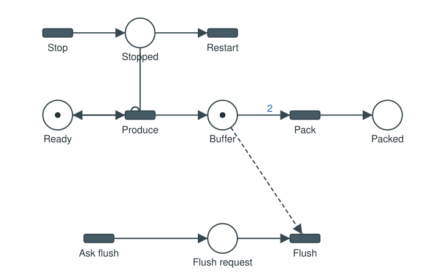
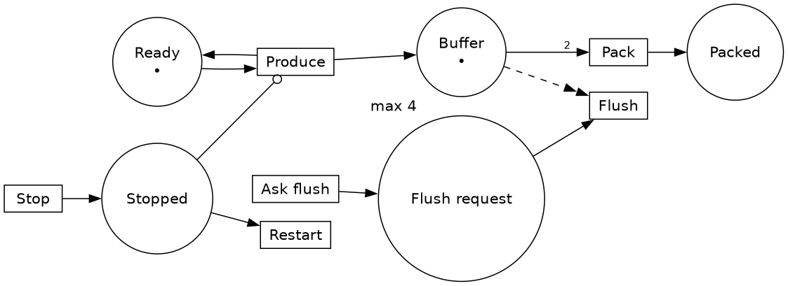

# 📄 15. File formats

What you will find here: the JSON file of the editor field by field (§1 to
§3), then every format the editor reads and writes (§4) and the formats of
the journals (§5). The excerpts were produced by exporting the examples of
[`examples/`](../examples/README.md) with the library of this commit.

---

## 1. The JSON file

*File > Save* writes a JSON file. You can also write it by hand, or
generate it from another program. Here is
[`FirstNet.json`](../examples/Petri-Nets/FirstNet/FirstNet.json) as the
editor saves it:

```json
{
  "revision": 2,
  "type": "Petri net",
  "nets": [
    {
       "name": "First net",
       "description": "The smallest Petri net. Press Space to simulate, then click on the green transition Fire: ...",
       "places": [
            { "id": 0, "caption": "Ready", "tokens": 1 },
            { "id": 1, "caption": "Done", "tokens": 0 }
       ],
       "transitions": [
            { "id": 0, "caption": "Fire" }
       ],
       "arcs": [
            { "from": "P0", "to": "T0" },
            { "from": "T0", "to": "P1", "duration": 0 }
       ],
       "actions": [
       ],
       "layout": {
          "places": [
             [150, 200],
             [450, 200]
          ],
          "transitions": [
             [300, 200]
          ]
       }
    }
  ],
  "inputs": [
  ]
}
```

```text
   (●) Ready ──► ▭ Fire ──► ( ) Done
```

### 1.1 The document

| Field | Meaning |
|-------|---------|
| `revision` | version of the syntax. **2**: the drawing is in a `layout` object, apart from the structure. Revision 1 (positions `x`, `y` in the nodes) and the older files (a `revision` up to 5 of the old numbering) are still read; their GRAFCET receptivities in reverse polish notation (`a b .`) are converted |
| `type` | `"Petri net"`, `"Timed Petri net"`, `"Timed event graph"` or `"GRAFCET"`: all the nets of the file have this type. `"Timed event graph"` is read as a timed Petri net drawn compactly (its places on its arcs) |
| `description` | optional: what the document is about, shown in the *Document* window |
| `nets` | one or several nets (a GEMMA has three) |
| `inputs`, `outputs` | GRAFCET only (§3) |

### 1.2 A net

| Field | Meaning |
|-------|---------|
| `name` | name of the net; the other graphs of a GRAFCET document use it (`Production:X3`, `Production{init}`) |
| `description` | optional: what the net does, written in its top left corner on the canvas |
| `colors` | optional: the names of the colors of tokens of the user, `["Good", "Bad"]` (§2) |
| `places` | the places (§1.3) |
| `transitions` | the transitions (§1.3) |
| `arcs` | the arcs (§1.3) |
| `actions` | GRAFCET only (§3) |
| `layout` | the drawing: `places` and `transitions` give the `[x, y]` of each node, in the order of the identifiers. Absent: `x` and `y` are read in the nodes (revision 1); a net without positions at all is placed by a spring layout when opened |

### 1.3 Places, transitions and arcs

| Element | Field | Meaning |
|---------|-------|---------|
| place | `id` | 0, 1, 2 ...: consecutive, without hole, in any order. The key of the place is `P` + `id` |
| | `caption` | any text (spaces allowed); a step of a GRAFCET shows it under its number |
| | `tokens` | initial number of tokens (a GRAFCET step: 0 or 1, 1 is an initial step) |
| | `capacity` | optional: the maximum number of tokens; unbounded when absent |
| transition | `id`, `caption` | as for places, key `T` + `id`; a GRAFCET transition: its caption is its receptivity |
| | `delay` | optional: seconds the transition stays enabled before it fires (a GRAFCET temporization, a timeout of a timed net) |
| | `priority` | optional integer: with the policy *Highest priority* (*Simulation > Conflicts*, and the runtime), the highest fires first |
| arc | `from`, `to` | `P<id>` or `T<id>`: a place to a transition or a transition to a place. Never two places nor two transitions; the pair is unique, so an arc has no identifier |
| | `duration` | on an arc from a transition: the time its tokens travel (timed nets); ignored on the arcs to a transition |
| | `weight` | optional, 1 when absent: the number of tokens taken or given |
| | `kind` | optional: `"normal"` (default), `"inhibitor"` or `"reset"`, only on an arc from a place |
| | `color` | optional: the color of the tokens taken (arc from a place) or given (arc to a place) (§2) |

The meaning of the extensions is taught in
[chapter 5](05-Extended-Petri-Nets.md). In short: a normal arc of weight
`w` takes (or gives) `w` tokens; an **inhibitor arc** of weight `w` lets the
transition fire only while its place holds fewer than `w` tokens; a
**reset arc** empties its place when the transition fires; a transition is
not enabled when its firing would put more tokens in a place than its
capacity.

Weights, inhibitor and reset arcs, capacities and colors extend the Petri
nets and the timed Petri nets only: a timed event graph or a GRAFCET using
them is refused when the file is read.

## 2. Colors

A **color** is the name of a kind of token. The built-in ones are
`Success`, `Failed` and `Canceled` (the results of the function of a
transition), the others are listed in `colors`. An arc from a place takes
only the tokens of its `color` (any color when absent); an arc to a place
gives tokens of its `color`, else of the result of the function of the
transition. The editor draws the colors on the arcs; its simulation does
not use them: the runtime does ([chapter 11](11-Runtime.md)). Example,
[`Colors.json`](../examples/Extended-Petri-Nets/Colors/Colors.json):

```json
"colors": ["Good", "Bad"],
...
"arcs": [
     { "from": "P0", "to": "T0" },
     { "from": "T0", "to": "P1" },
     { "from": "P1", "to": "T1", "color": "Good" },
     ...
     { "from": "P1", "to": "T2", "color": "Bad" },
```

## 3. GRAFCET: actions, inputs, outputs

A GRAFCET net has, after its arcs, the actions of its steps. Extracts of
[`GrafcetActions.json`](../examples/GRAFCET/GrafcetActions/GrafcetActions.json)
and of the Control and Safety graphs of `GEMMA-Dryer.json`:

```json
"actions": [
  { "place_id": 2, "qualifier": "D", "color": "green", "name": "Timer1", "script": "Wait before retract", "duration": 2 },
  { "place_id": 2, "qualifier": "S", "color": "green", "name": "Lamp1", "script": "Position indicator ON" },
  { "place_id": 5, "qualifier": "N", "color": "green", "name": "Right Motor", "script": "Manual run of the right motor", "condition": "Right" },
  { "place_id": 0, "script": "Production and Control in their initial state", "forcing": ["Production:{init}", "Control:{init}"] }
]
```

| Field | Meaning |
|-------|---------|
| `place_id` | the step |
| `qualifier` | `N` (default), `S`, `R`, `D`, `L`, `SD`, `DS`, `SL`, `P1`, `P0` ([chapter 9](09-GRAFCET.md)) |
| `name` | the output; empty for an action with forcing orders only |
| `duration` | the d of the timed qualifiers, in seconds |
| `condition` | optional: the action runs only while it is true (drawn `if Dr: Motor`) |
| `color` | color of the pilot light: `green`, `red`, `orange`, `yellow`, `blue`, `white` |
| `script` | a comment, written in the generated code |
| `forcing` | forcing orders, drawn `Production{init}` (the colon is optional) |

After the nets, the document lists the **inputs** of its GRAFCETs (what the
receptivities read) and their **outputs** (the names of the actions). Their
`kind` says how the control panel and the Outputs window draw them. An
extract of [`GEMMA-Dryer.json`](../examples/GRAFCET/GEMMA-Dryer/GEMMA-Dryer.json),
with a `clock` added to show its fields:

```json
"inputs": [
  { "name": "EStop", "kind": "emergency", "description": "Emergency stop (mushroom button)", "initial": 0 },
  { "name": "Start", "kind": "button", "description": "Start of the cycle", "initial": 0, "color": "green" },
  { "name": "Manual", "kind": "selector", "description": "Manual mode", "initial": 0, "group": "Mode" },
  { "name": "Auto", "kind": "selector", "description": "Automatic mode", "initial": 1, "group": "Mode" },
  { "name": "Temperature", "kind": "value", "description": "Temperature sensor of the dryer", "initial": 20,
    "min": 20, "max": 120, "unit": "°C", "driven_by": "Heat Oven", "rise": 6, "fall": 1 },
  { "name": "Blink", "kind": "clock", "initial": 0, "period": 1 }
],
"outputs": [
  { "name": "Left Motor", "kind": "motor", "description": "Moves the belt to the left" },
  { "name": "Heat Oven", "kind": "heater", "description": "Heating resistor of the dryer" }
]
```

| Input field | Meaning |
|-------------|---------|
| `name` | as written in the receptivities |
| `kind` | `switch` (default), `button`, `pulse`, `emergency`, `selector`, `value`, `clock` ([chapter 9](09-GRAFCET.md)) |
| `description` | what it is, shown in the tooltip of the panel |
| `initial` | value at the start of the simulation |
| `color` | cap of a button or switch: `green`, `red`, `black`, `yellow`, `blue`, `white`, `orange` |
| `group` | `selector`: the inputs of the same group are the positions of one selector |
| `min`, `max`, `unit` | `value`: range and unit of the sensor |
| `driven_by`, `rise`, `fall` | `value`: goes up by `rise` per second while the output `driven_by` is on, down by `fall` otherwise (a simple model of the machine) |
| `period` | `clock`: period in seconds |

| Output field | Meaning |
|--------------|---------|
| `name` | as written in the actions |
| `kind` | `light` (default), `motor`, `heater`, `valve`, `horn` |
| `description` | what it is |

The editor saves only the inputs and outputs that were described (*Edit* on
the control panel); the others are found again from the receptivities and
the actions when the file is opened. Files of old versions with `sensors`
instead of `inputs` are still read.

## 4. Other formats

*File > Open* and *File > Save as* choose the format by the extension of
the file; *File > Import* and *File > Export* list the formats by name. The
longest extension wins: `net.symmetri.pnml` is the Symmetri flavor of PNML.
*File > Export* lists only the formats that can write the active net: the
C++ GRAFCET and the GRAFCET LaTeX for a GRAFCET; the C++ for the runtime,
the Petri LaTeX and the PNML for Symmetri for the other nets; the Timed
Event Graph and Julia formats for a timed event graph.

| Format | Extension | Read | Write | For |
|--------|-----------|:----:|:-----:|-----|
| JSON | `.json` | yes | yes | the format of the editor (§1) |
| Petri Net Markup Language | `.pnml` | yes | yes | the standard exchange format of Petri net tools (§4.1) |
| PNML for Symmetri | `.symmetri.pnml` | yes | yes | [Symmetri](https://github.com/thorstink/Symmetri) (§4.1) |
| GreatSPN GRML | `.grml` | yes | yes | [GreatSPN](https://github.com/greatspn/SOURCES), read by Symmetri too (§4.2) |
| Flowshop | `.flowshop` | yes | | a factory as a table of processing times (§4.3) |
| Timed Event Graph | `.teg` | yes | yes | a compact text format of timed event graphs (§4.4) |
| SVG picture | `.svg` | | yes | a picture for a document or a web page (§4.5) |
| Petri LaTeX | `.tex` | | yes | a TikZ drawing for a document (§4.6) |
| Grafcet LaTeX | `.tex` | | yes | a GRAFCET drawing with the `grafcet2` package (§4.6) |
| Graphviz | `.gv`, `.dot` | | yes | a drawing laid out by Graphviz (§4.7) |
| Draw.io | `.drawio.xml` | | yes | an editable drawing in [draw.io](https://app.diagrams.net) (§4.8) |
| PN-Editor | `.pns` (with `.pnl`, `.pnk`, `.pnkp`) | | yes | [pn-editor](https://gitlab.com/porky11/pn-editor) (§4.8) |
| Symfony | `.yaml` | | yes | a [Symfony workflow](https://symfony.com/doc/current/components/workflow.html) (§4.8) |
| Julia | `.jl` | | yes | the (max,+) matrices of a timed event graph for [MaxPlus.jl](https://github.com/Lecrapouille/MaxPlus.jl) (§4.9) |
| C++ functions for the runtime | `.cpp`, `.cc`, `.cxx` | | yes | a program calling one function per transition ([chapter 12](12-Code-Generation.md)) |
| C++ GRAFCET (Arduino, computer) | `.hpp`, `.h`, `.hh`, `.h++` | | yes | the GRAFCETs of a document as C++ code ([chapter 12](12-Code-Generation.md)) |

What each format keeps:

| | weights | inhibitor arcs | reset arcs | durations | delays | colors | capacities | priorities | positions |
|---|:---:|:---:|:---:|:---:|:---:|:---:|:---:|:---:|:---:|
| JSON | yes | yes | yes | yes | yes | yes | yes | yes | yes |
| PNML | yes | yes (\*) | yes (\*) | yes (\*) | yes (\*) | yes | yes (\*) | yes (\*) | yes |
| GRML | yes | yes | refused | as delays of the transitions | | yes | | yes | yes |
| SVG, Petri LaTeX, draw.io | shown | shown | shown | shown | | shown | | | yes |
| Graphviz | shown | shown | shown | shown | | shown | shown | | layout of Graphviz |
| PN-Editor | yes (an arc of weight 3 is written 3 times) | refused | refused | | | | | | yes |
| Symfony | | | | | | | | | |

(\*) in `<toolspecific tool="TimedPetriNetEditor">` elements, that other
tools ignore: a PNML file written by the editor comes back the same.

A format refuses what it cannot keep, with a message:

```text
Failed to export the Petri net to 'BoundedBuffer.grml'. Reason: 'GRML has no reset arcs'
Failed to export the Petri net to 'BB.pns'. Reason: 'PN-Editor has no inhibitor nor reset arcs'
Failed to export the Petri net to 'c.teg'. Reason: 'the net is not an event graph'
Export GRAFCET LaTeX: the net must be of type GRAFCET
```

### 4.1 PNML and PNML for Symmetri

PNML writes the places with their initial marking, the transitions and the
arcs with their weight (`<inscription>`). The identifiers of the nodes are
their captions when they are unique (Symmetri calls the functions by them),
else their keys. What PNML does not know goes in `<toolspecific>`.
[`BoundedBuffer.json`](../examples/Extended-Petri-Nets/BoundedBuffer/BoundedBuffer.json)
exported (extract):

```xml
      <place id="Buffer">
        <name><text>Buffer</text></name>
        <graphics><position x="300" y="150"/></graphics>
        <initialMarking><text>1</text></initialMarking>
        <toolspecific tool="TimedPetriNetEditor" version="1"><capacity>4</capacity></toolspecific>
      </place>
      ...
      <arc id="A3" source="Stopped" target="Produce">
        <toolspecific tool="TimedPetriNetEditor" version="1"><kind>inhibitor</kind></toolspecific>
      </arc>
      <arc id="A4" source="Buffer" target="Pack">
        <inscription><text>2</text></inscription>
      </arc>
```

The Symmetri flavor writes one `<initialMarking>` per token and the colors
of the arcs in an attribute `color`;
[`PickAndPlace.json`](../examples/Runtime/PickAndPlace/PickAndPlace.json)
exported as `PickAndPlace.symmetri.pnml` (extract):

```xml
      <arc id="A4" source="Held" target="place" color="Success">
      </arc>
      <arc id="A5" source="place" target="Done">
      </arc>
      <arc id="A6" source="Held" target="retry" color="Failed">
      </arc>
```

The import reads both flavors, and the PNML files of the old versions of
the editor (where the inscription was the duration).

### 4.2 GRML (GreatSPN)

GRML is the XML of CosyVerif, written by GreatSPN and read by Symmetri:
places with their marking, transitions with their priority and their
distribution, arcs with their valuation (the weight) and their type (`arc`
or `inhibitorarc`). A timed net exports a transition as `DETERMINISTIC`
with the largest duration of its output arcs; the import gives the delay of
a `DETERMINISTIC` transition to its output arcs.
[`Durations.json`](../examples/Timed-Petri-Nets/Durations/Durations.json)
exported (extract):

```xml
<node id="4" nodeType="transition" x="250" y="200">
  <attribute name="name">Toast</attribute>
  <attribute name="distribution"><attribute name="type">DETERMINISTIC</attribute><attribute name="param"><attribute name="expr"><attribute name="numValue">3</attribute></attribute></attribute></attribute>
  <attribute name="priority"><attribute name="expr"><attribute name="intValue">0</attribute></attribute></attribute>
</node>
...
<arc id="7" arcType="arc" source="1" target="4">
  <attribute name="valuation"><attribute name="expr"><attribute name="intValue">1</attribute></attribute></attribute>
</arc>
```

### 4.3 Flowshop

A **flowshop** is a factory where every piece visits the machines in the
same order ([chapter 7](07-Timed-Event-Graphs.md)). The file is a table of
processing times; the editor turns it into a timed event graph.
[`simple.flowshop`](../examples/Timed-Event-Graphs/Flowshop/simple.flowshop):

```text
# Simple Flowshop example (2x3)
npieces: 3
nmachines: 2

# Tokens per machine class (nm) - horizontal cycle
nm: 1 1

# Tokens per piece class (np) - vertical cycle
np: 1 1 1

# Piece names (columns)
pieces: P1 P2 P3

# Processing times: machine_name: time1 time2 ...
# Note: (-inf means (max,+) 0 therefore no task to perform)
M1: 2.0 3.0 1.0
M2: 1.0 2.0 1.5
```

| Line | Meaning |
|------|---------|
| `npieces`, `nmachines` | the size of the table |
| `nm` | tokens of the loop of each machine (how many pieces it holds at once) |
| `np` | tokens of the loop of each piece (how many copies of the piece are in the factory) |
| `pieces` | the names of the pieces (the columns) |
| `M1: ...` | a machine and its processing time of each piece; `-inf`: the piece does not visit this machine |

### 4.4 Timed event graph (`.teg`)

A compact text format for timed event graphs, from the
[Howard algorithm](http://www.cmap.polytechnique.fr/~gaubert/HOWARD2.html)
project. The first line gives the number of transitions and of arcs, then
one line per arc between two transitions (the hidden place):
`<from> <to>: <duration> <tokens>`. The format has no names nor positions.
[`Howard2.json`](../examples/Timed-Event-Graphs/Howard2/Howard2.json)
exported:

```text
TimedEventGraph 4 5

0 2:   5    2
1 0:   5    0
2 1:   3    0
3 0:   1    0
2 3:   1    0
```

The first arc goes from `T0` to `T2`, lasts 5 and holds 2 tokens.

### 4.5 SVG

A picture of the net at the positions of the editor: places with their
tokens (GRAFCET: steps, double for the initial ones), transitions, arcs
with their weight, duration and color; inhibitor arcs end with a circle,
reset arcs are dashed. A timed event graph drawn compactly keeps its places
on its arcs. Open it in a browser, insert it in a document.



*`BoundedBuffer.json` exported as SVG (rendered here as PNG).*

### 4.6 LaTeX

Two exports write a `.tex` file to compile with `pdflatex file.tex` (on
Debian or Ubuntu: `sudo apt install texlive-pictures`):

- **Petri LaTeX** uses the `petri` library of TikZ: places with their
  tokens, transitions, arcs with their weight, duration and color
  (inhibitor arcs end with an open circle, reset arcs have a double head
  and are dashed). 50 pixels of the editor are 1 cm.
- **Grafcet LaTeX** (GRAFCET only) uses the
  [grafcet2](https://github.com/nagimov/grafcet2) package, given in
  [`data/grafcet2.sty`](../data/grafcet2.sty): steps (the initial ones
  double), transitions with their receptivity.

`FirstNet.json` as Petri LaTeX (complete):

```latex
% Generated by TimedPetriNetEditor from the net 'First net'.
\documentclass[border=0.2cm]{standalone}
\usepackage{tikz}
\usetikzlibrary{petri,arrows.meta}
\begin{document}
\begin{tikzpicture}[
  every place/.style={draw=blue!75, fill=blue!10, minimum size=7mm, thick},
  every transition/.style={draw=black, fill=black!70, minimum width=6mm, minimum height=2mm},
  every label/.style={font=\small},
  arc/.style={-{Latex}, thick},
  inhibitor/.style={-{Circle[open]}, thick},
  reset/.style={-{Latex}{Latex}, thick, dashed}]

% Places
\node[place, label=below:{Ready}, tokens=1] (P0) at (3.00, -4.00) {};
\node[place, label=below:{Done}] (P1) at (9.00, -4.00) {};

% Transitions
\node[transition, label=above:{Fire}] (T0) at (6.00, -4.00) {};

% Arcs
\draw[arc] (P0) -- (T0);
\draw[arc] (T0) -- (P1);
\end{tikzpicture}
\end{document}
```

[`GermanTrafficLights.json`](../examples/GRAFCET/GermanTrafficLights/GermanTrafficLights.json)
as Grafcet LaTeX (the body):

```latex
\begin{grafcet}
\Loop{
  \FirstStep[Green]{}
  \Transition{3s/X0}
  \Step[Yellow]{}
  \Transition{1s/X1}
  \Step[Red]{}
  \Transition{3s/X2}
  \Step[Red and yellow]{}
  \Transition{1s/X3}
}
\end{grafcet}
```

### 4.7 Graphviz

A `.dot` file: places as circles with their tokens (`•`) and their
capacity (`max 4`), transitions as boxes, arcs with their weight, duration
and color; inhibitor arcs end with `odot`, reset arcs are dashed with a
double head. The layout is the one of Graphviz, not the one of the editor
(the SVG export keeps the latter). View it with `xdot file.dot`, draw it
with `dot -Tpng file.dot -o file.png`.

```dot
digraph "Bounded buffer" {
  rankdir=LR;
  ...
  P1 [label="Buffer\n•", xlabel="max 4"];
  ...
  P3 -> T0 [arrowhead=odot];
  P1 -> T1 [label="2"];
  ...
  P1 -> T2 [arrowhead=normalnormal, style=dashed];
```



*`BoundedBuffer.json` exported to Graphviz, drawn by `dot -Tpng`.*

### 4.8 Draw.io, PN-Editor, Symfony

- **Draw.io**: an `mxfile` with one cell per node (and one per caption) and
  per arc, at the positions of the editor, editable in draw.io.
- **PN-Editor**: the four binary files of
  [pn-editor](https://gitlab.com/porky11/pn-editor) (`.pns` the structure,
  `.pnl` the positions, `.pnk` the names of the transitions, `.pnkp` the
  names of the places; pn-editor is installed by hand). An arc of weight 3
  is written three times.
- **Symfony**: a workflow of the Symfony framework (PHP): places,
  transitions with their `from` and `to`, the initial marking. Names are
  written in lower case with `_`:

```yaml
# Generated by TimedPetriNetEditor from the net 'First net'.
framework:
    workflows:
        first_net:
            type: 'workflow'
            ...
            initial_marking:
                - 'ready'
            places:
                - 'ready'
                - 'done'
            transitions:
                'fire':
                    from:
                        - 'ready'
                    to:
                        - 'done'
```

### 4.9 Julia

Writes, for a timed event graph, a Julia script for MaxPlus.jl: the
transitions, the arcs with their durations and tokens, the counter and
dater equations as comments, and the matrices `D`, `A`, `B`, `C` of the
(max,+) linear system of the canonical form ([chapter 8](08-Max-Plus-Algebra.md)).
`Howard2.json` exported (extract):

```julia
using MaxPlus, SparseArrays
...
# Timed event graph represented as dater equation:
# T0(k) = max(1 + T3(k), 5 + T1(k))
# T1(k) = max(3 + T2(k))
# T2(k) = max(5 + T0(k - 2))
# T3(k) = max(1 + T2(k))
...
D = sparse([1, 1, 2, 4], [2, 4, 3, 3], MP([5, 1, 3, 1]), 5, 5) # States without tokens
A = sparse([3, 5], [5, 1], MP([5, 0]), 5, 5) # States with 1 token
B = sparse([], [], MP([]), 5, 0) # Inputs
C = sparse([], [], MP([]), 0, 5) # Outputs
S = MPSysLin(A, B, C, D)
```

The tables of the *Analysis* window also have a *Copy as Julia* button
([chapter 17](17-Julia.md)).

## 5. Journals

The *Journal* window of the editor and the runtime write their journals
(the firings: instance, transition, event, result, date) as:

| Format | Extension | For |
|--------|-----------|-----|
| JSON lines | `.jsonl` (also `.json`, `.log`) | the editor (*Journal > Open*), `Runtime::restore()` after a crash |
| CSV | `.csv` | a spreadsheet |
| XES (IEEE 1849) | `.xes` | process mining: [ProM](https://promtools.org), [PM4Py](https://pm4py.fit.fraunhofer.de), Disco |

JSON lines, one object per line (from `build/examples/PickAndPlace`):

```text
{"instance":"order_42","transition":"grasp","event":"Completed","result":"Failed","date":0.150442702}
{"instance":"order_42","transition":"retry","event":"Scheduled","date":0.150442702}
{"instance":"order_42","transition":"retry","event":"Completed","result":"Success","date":0.150442702}
```

CSV (from `build/examples/MicroServices`, `orders.csv`):

```text
instance,transition,event,result,date
fast,request,Scheduled,,0
fast,request,Started,,0
fast,request,Completed,Success,0.0101056
fast,paid,Scheduled,,0.100624
```

XES: a trace per instance, an event per line; `concept:name` is the
transition, `lifecycle:transition` is `schedule`, `start` or `complete`,
`org:resource` the result, `time:timestamp` the date in seconds since an
origin (0 gives dates in 1970):

```xml
  <trace>
    <string key="concept:name" value="fast"/>
    <event>
      <string key="concept:name" value="request"/>
      <string key="lifecycle:transition" value="complete"/>
      <date key="time:timestamp" value="1970-01-01T00:00:00.010Z"/>
      <string key="org:resource" value="Success"/>
    </event>
```

In a program: `saveJournal(instance->log(), net.colors, "orders.xes")`
(`Runtime/Journal.hpp`) chooses the format by the extension
([chapter 16](16-Library.md)).

---

Next: [16. C++ library](16-Library.md).
