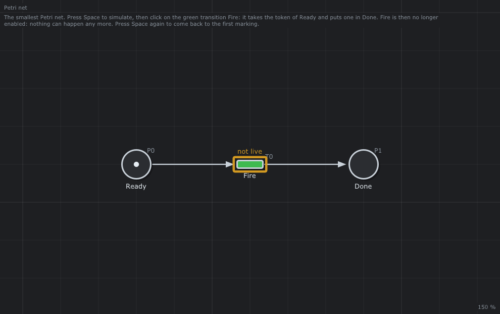
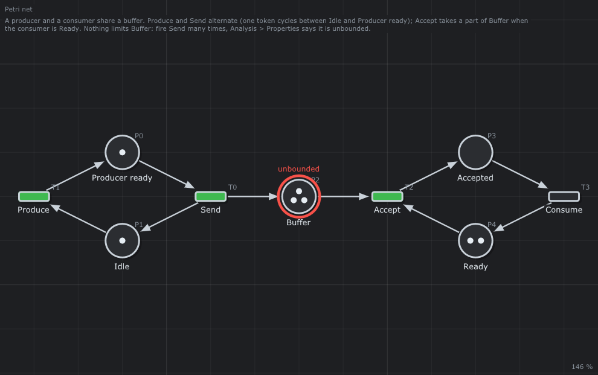
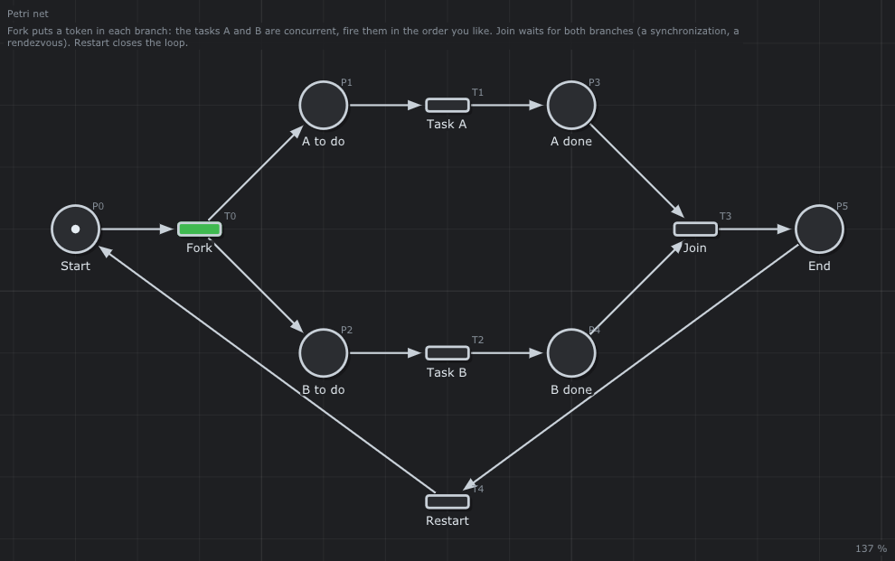
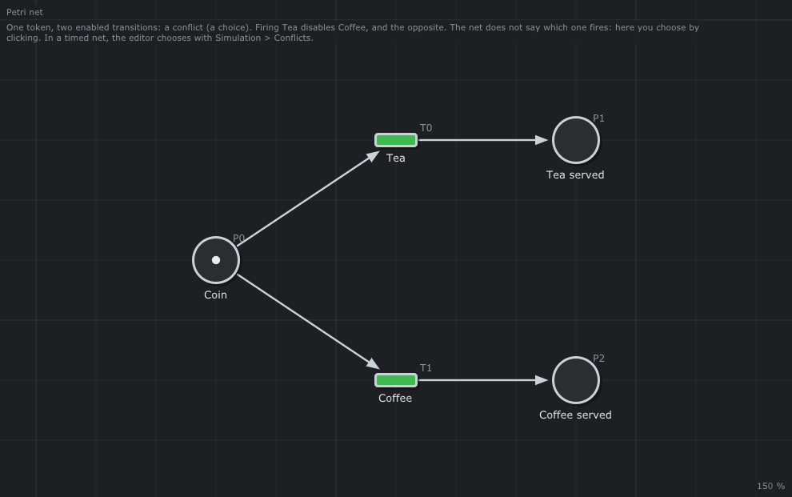
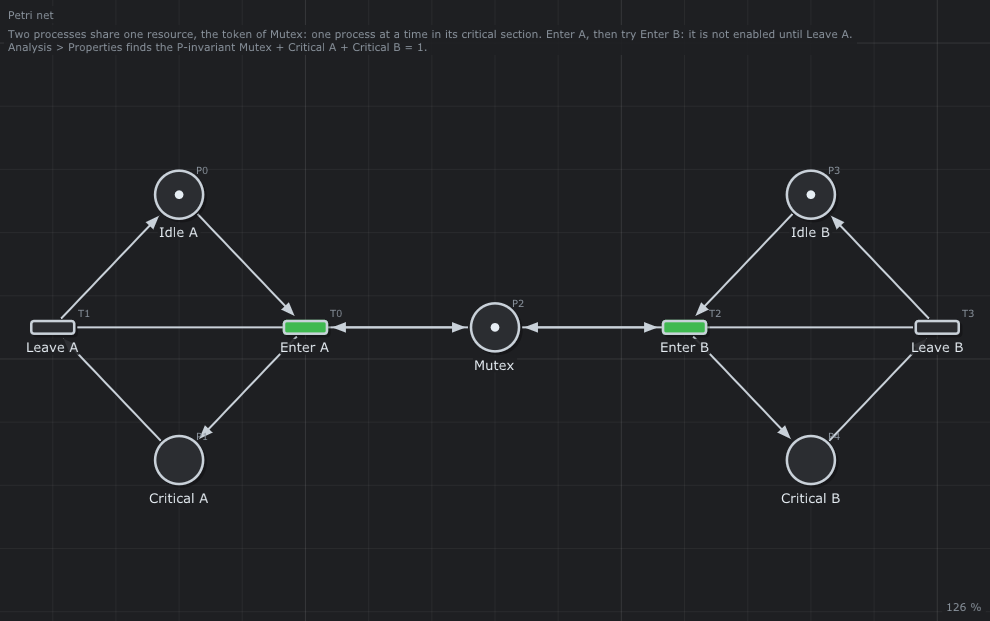
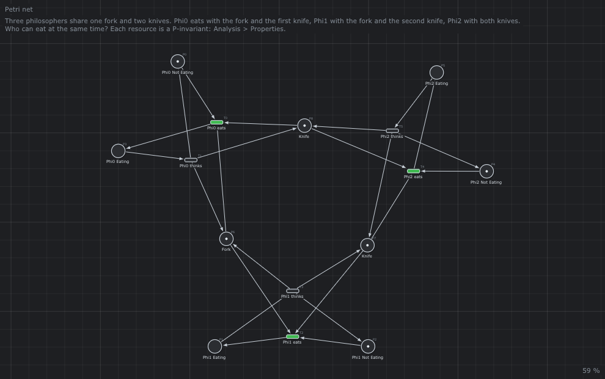
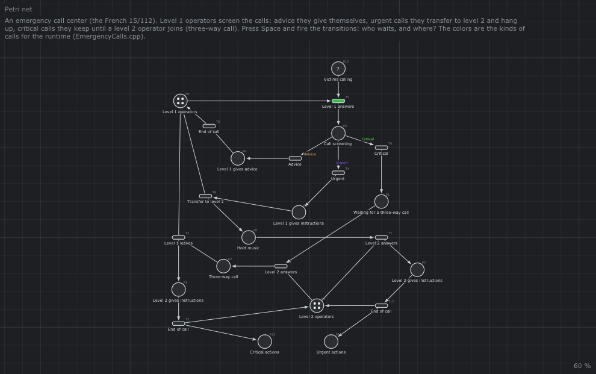

# 3. 🔵 Réseaux de Petri


[](../fr/03-Petri-Nets.md) [](../en/03-Petri-Nets.md)

**Ce que vous apprendrez**

- ce qu’est un réseau de Petri, en images et sous forme mathématique ;
- la règle de tir, calculée à la main sur de vrais exemples, et ce qu’est un marquage et une séquence de tirs ;
- la différence entre **concurrence** (des choses se produisent indépendamment) et **conflit** (des choses se disputent une ressource) ;
- les schémas que vous utiliserez pour modéliser des systèmes réels : séquence, fork et join, choix, exclusion mutuelle, ressources partagées, tampons, boucles ;
- les sous-classes de réseaux de Petri (machines à états, graphes d’événements, réseaux à choix libre) et pourquoi elles comptent ;
- comment l’éditeur dessine un réseau, l’exécute à la main et résout les conflits.

**Prérequis** : [chapitre 1](01-Introduction.md) (systèmes à événements discrets) et [chapitre 2](02-Getting-Started.md) (compiler l’éditeur, dessiner à la souris).

---

## 1. Pourquoi les réseaux de Petri ?

Un **système à événements discrets** est un système dont l’état change par sauts, à des instants appelés **événements** : une pièce tombe dans une machine à café, un robot saisit une pièce, le téléphone sonne, un feu passe au vert. Entre deux événements, rien ne change. De tels systèmes sont partout dans les usines, les ordinateurs, les réseaux, les transports et les organisations, et ils ont trois traits qui compliquent la conception :

- **parallélisme** : plusieurs choses se produisent en même temps (deux robots travaillent, quatre opérateurs répondent au téléphone) ;
- **synchronisation** : quelque chose attend plusieurs autres (le café est servi seulement quand l’eau est chaude *et* la pièce acceptée) ;
- **partage** : plusieurs activités se disputent les mêmes ressources (une fourchette pour trois philosophes, un outil pour deux robots).

Une machine à états (un automate) peut les décrire, mais le nombre d’états explose : deux machines indépendantes de 10 états en exigent 10 × 10 = 100 ensemble. En 1962, Carl Adam **Petri** propose dans sa thèse un modèle graphique et mathématique où l’état est *distribué* : chaque partie du système garde son état local, et les parties n’interagissent qu’où elles se rencontrent. Ce modèle, le **réseau de Petri**, reste compact quand le système grandit, montre le parallélisme sur le dessin, et peut être analysé par des algorithmes ([chapitre 4](04-Analysis.md)).

## 2. Les éléments d’un réseau de Petri

Un réseau de Petri est un graphe avec deux types de nœuds et des arcs entre eux :

| Élément | Signification | Symbole | Détail |
|---------|---------------|---------|--------|
| **Place** | Une condition, un stock | `( )` | Dessinée en cercle ; état local ou stock (« la machine est au repos », « pièces dans le tampon », « la porte est ouverte »). |
| **Transition** | Un événement | `▭` | Dessinée en barre ou rectangle ; une action (« démarrer », « envoyer », « la porte s’ouvre »). |
| **Arc** | Qui alimente qui | `──►` | Une flèche d’une place vers une transition (**place d’entrée**) ou d’une transition vers une place (**place de sortie**). Jamais entre deux places ni entre deux transitions : un réseau de Petri est un **graphe biparti**. |
| **Jeton** | Une ressource, une pièce, « vrai » | `●` | Contenu dans les places (points noirs, ou un nombre s’il y en a beaucoup) : ressources, pièces, personnes, ou simplement qu’une condition est vraie. |

Le nombre de jetons dans chaque place est le **marquage** du réseau : c’est l’état de tout le système. Le marquage au départ est le **marquage initial**, noté `M0`.

Voici le plus petit réseau, l’exemple [FirstNet](../../examples/Petri-Nets/FirstNet/README.md) :

```text
   Ready          Fire          Done
    (●)  ──────►   ▭   ──────►  ( )
```



*Le réseau dessiné par l’éditeur. La description écrite dans le fichier s’affiche au-dessus du réseau : chaque exemple indique quoi essayer.*

## 3. La règle de tir

La dynamique d’un réseau de Petri repose sur une seule règle.

> Une transition est **autorisée** (enabled) quand chacune de ses places d’entrée contient au moins un jeton. Une transition autorisée peut **tirer** : elle retire un jeton de chaque place d’entrée et ajoute un jeton à chaque place de sortie. Le tir est instantané.

Dans [FirstNet](../../examples/Petri-Nets/FirstNet/README.md), `Fire` est autorisée car `Ready` contient un jeton. Après le tir, `Ready` est vide et `Done` contient un jeton ; `Fire` n’est plus autorisée et plus rien ne peut se produire.

| Avant | Après |
|-------|-------|
| `(●) ──► ▭ ──► ( )` | `( ) ──► ▭ ──► (●)` |

Trois remarques qui surprennent les débutants :

1. Les jetons ne sont pas « déplacés » le long d’un chemin : ils sont **consommés** et **produits**. Une transition avec une entrée et deux sorties crée un jeton ; avec deux entrées et une sortie elle en détruit un. Le nombre de jetons n’est en général pas constant.
2. Une transition autorisée *peut* tirer ; elle n’est pas obligée de le faire. Un réseau de Petri dit ce qui est **possible**, pas ce qui se produit en premier. Le temps et les priorités viennent au [chapitre 6](06-Timed-Petri-Nets.md) et au [chapitre 5](05-Extended-Petri-Nets.md).
3. Une transition sans place d’entrée est toujours autorisée : c’est une **source** (arrivée de clients, de voitures). Une transition sans place de sortie est un **puits** (les clients partent).

### 3.1 Exemple détaillé : le producteur et le consommateur

L’exemple [ProducerConsumer](../../examples/Petri-Nets/ProducerConsumer/README.md) a cinq places et quatre transitions :

```text
  Produce          Send             Accept          Consume
    ▭ ──► (●) ──► ▭ ──► (●●●) ──► ▭ ──► ( ) ──► ▭
    ▲   Producer    │     Buffer    ▲   Accepted   │
    │    ready      ▼               │              ▼
    └────────── (●) Idle            └──── (●●) Ready
```



Numérotez places et transitions comme l’éditeur (`P0` … `P4`, `T0` … `T3`, voir §8) et écrivez le marquage en vecteur, dans l’ordre des places :

| Place | `P0` Producer ready | `P1` Idle | `P2` Buffer | `P3` Accepted | `P4` Ready |
|-------|:---:|:---:|:---:|:---:|:---:|
| `M0`  | 1 | 1 | 3 | 0 | 2 |

Quelles transitions sont autorisées dans `M0` ?

- `T0` Send a besoin de `P0` ≥ 1 : oui.
- `T1` Produce a besoin de `P1` ≥ 1 : oui.
- `T2` Accept a besoin de `P2` ≥ 1 et `P4` ≥ 1 : oui.
- `T3` Consume a besoin de `P3` ≥ 1 : non.

Tirez `Send` : retirez un jeton de `P0`, ajoutez-en un à `P1` et un à `P2`. Puis tirez `Accept` : retirez un de `P2` et un de `P4`, ajoutez un à `P3`. Puis `Consume`. La bibliothèque calcule la même chose (un petit programme appelant `fire()` de `PetriNet/Firing.hpp`, [chapitre 16](16-Library.md)) :

| Étape | Marquage | Transitions autorisées |
|-------|----------|------------------------|
| `M0` | `(1, 1, 3, 0, 2)` | Send, Produce, Accept |
| tir Send | `(0, 2, 4, 0, 2)` | Produce, Accept |
| tir Accept | `(0, 2, 3, 1, 1)` | Produce, Accept, Consume |
| tir Consume | `(0, 2, 3, 0, 2)` | Produce, Accept |

La liste des transitions tirées, `σ = Send Accept Consume`, est une **séquence de tirs** (l’ordre compte). Un marquage atteignable depuis `M0` en tirant des transitions une à une est un **marquage atteignable**. La notation `M0 [σ> M` signifie : partir du marquage `M0`, tirer chaque transition de `σ` dans l’ordre, et arriver au marquage `M`. Ici, `M0 [Send Accept Consume> (0, 2, 3, 0, 2)`.

## 4. La définition mathématique

Les dessins sont pour les humains ; les algorithmes ont besoin de nombres. Un réseau de Petri est un tuple

```text
N = (P, T, Pre, Post, M0)
```

- `P = {p1, ..., pn}` l’ensemble fini des places, `T = {t1, ..., tm}` l’ensemble fini des transitions, `P ∩ T = ∅` ;
- `Pre` la **matrice d’entrée** (`n` lignes, `m` colonnes) : `Pre(p, t)` est le nombre de jetons que `t` prend dans `p` (le poids de l’arc `p ─► t`, 0 s’il n’y a pas d’arc) ;
- `Post` la **matrice de sortie** : `Post(p, t)` est le nombre de jetons que `t` donne à `p` (le poids de l’arc `t ─► p`) ;
- `M0` le marquage initial, un vecteur de `n` entiers naturels.

Dans un réseau ordinaire tous les poids valent 1 ; des poids supérieurs à 1 sont une extension ([chapitre 5](05-Extended-Petri-Nets.md#1-poids)). Avec cette notation la règle de tir tient en deux lignes :

| Règle | Texte | | Formule |
|-------|:-----:|-|--------|
| Autorisation | `t` est autorisée dans `M` | ⇔ | `M(p) ≥ Pre(p, t)` pour toute place `p` |
| Tir   | tirer `t` donne `M'` | = | `M' = M − Pre(·, t) + Post(·, t)` |

Pour le producteur et le consommateur :

**Pre :**

| Place | T0 | T1 | T2 | T3 |
|-------|:--:|:--:|:--:|:--:|
| P0 | 1 | 0 | 0 | 0 |
| P1 | 0 | 1 | 0 | 0 |
| P2 | 0 | 0 | 1 | 0 |
| P3 | 0 | 0 | 0 | 1 |
| P4 | 0 | 0 | 1 | 0 |

**Post :**

| Place | T0 | T1 | T2 | T3 |
|-------|:--:|:--:|:--:|:--:|
| P0 | 0 | 1 | 0 | 0 |
| P1 | 1 | 0 | 0 | 0 |
| P2 | 1 | 0 | 0 | 0 |
| P3 | 0 | 0 | 1 | 0 |
| P4 | 0 | 0 | 0 | 1 |

`M0 − Pre(·, T0) + Post(·, T0) = (1,1,3,0,2) − (1,0,0,0,0) + (0,1,1,0,0) = (0,2,4,0,2)` : le marquage calculé ci-dessus. La différence `C = Post − Pre` est la **matrice d’incidence** ; le [chapitre 4](04-Analysis.md#5-la-matrice-dincidence-et-lequation-detat) s’en sert pour prouver des propriétés sans simuler.

## 5. Concurrence et conflit

Deux transitions autorisées peuvent être dans deux situations très différentes.

### 5.1 Concurrence : événements indépendants

Dans [ForkJoin](../../examples/Petri-Nets/ForkJoin/README.md), `Fork` met un jeton dans chaque branche. `Task A` et `Task B` sont alors toutes deux autorisées et ne partagent aucune place d’entrée : tirer l’une ne désactive pas l’autre. Elles sont **concurrentes** : elles peuvent se produire dans n’importe quel ordre, ou en même temps.



| Étape | Marquage | Transitions autorisées |
|-------|----------|------------------------|
| `M0` | `(1, 0, 0, 0, 0, 0)` | Fork |
| tir Fork | `(0, 1, 1, 0, 0, 0)` | Task A, Task B |
| tir Task B | `(0, 1, 0, 0, 1, 0)` | Task A |
| tir Task A | `(0, 0, 0, 1, 1, 0)` | Join |
| tir Join | `(0, 0, 0, 0, 0, 1)` | Restart |

`Join` attend les deux branches : c’est une **synchronisation** (rendez-vous). La concurrence est la force des réseaux de Petri : deux branches de 10 étapes font 20 places, pas 100 états.

### 5.2 Conflit : un choix

Dans [Conflict](../../examples/Petri-Nets/Conflict/README.md), une pièce et deux transitions `Tea` et `Coffee` partagent la place d’entrée `Coin`. Toutes deux sont autorisées, mais tirer l’une **désactive** l’autre : elles sont en **conflit** (un **choix**).



| Étape | Marquage | Transitions autorisées |
|-------|----------|------------------------|
| `M0` | `(1, 0, 0)` | Tea, Coffee |
| tir Tea | `(0, 1, 0)` | *(aucune — Coffee non autorisée)* |

Un réseau de Petri ne dit **pas** quelle transition tire : le modèle est **non déterministe**. C’est un atout quand on décrit ce qui *peut* arriver (un client veut du thé ou du café, une pièce est bonne ou mauvaise), et un danger quand on décrit ce qu’un contrôleur *doit* faire. Qui décide ?

- **dans l’éditeur, pour un réseau de Petri** : vous. Rien ne tire tout seul ; vous cliquez sur la transition voulue (§9).
- **dans l’éditeur, pour un réseau de Petri temporisé** : les transitions tirent seules, et *Simulation > Conflicts* choisit : **Random** (avec une **seed**, écrite dans la console, pour rejouer la même simulation), **Highest priority** (la `priority` des transitions, [chapitre 5](05-Extended-Petri-Nets.md#5-priorites)) ou **First declared** (l’identifiant le plus petit).
- **dans un GRAFCET**, les réceptivités des transitions décident, et le concepteur les rend exclusives ([chapitre 9](09-GRAFCET.md)).
- **dans un programme piloté par le runtime**, le résultat d’une fonction colore le jeton et la couleur choisit ([chapitre 11](11-Runtime.md)).

L’ancienne documentation de l’éditeur le disait bien : quand on conçoit un système réel, un conflit que personne ne tranche est un bug qui attend de se produire.

## 6. Schémas de modélisation

Les vrais réseaux se construisent à partir de quelques schémas. Apprenez à les reconnaître ; chaque exemple de [`examples/Petri-Nets`](../../examples/README.md) en est une combinaison.

| Schéma | Dessin | Signification | Exemple |
|--------|--------|---------------|---------|
| **Séquence** | <pre>(●) ─► ▭ ─► ( )&#10;  ( ) ◄─ ▭ ◄─┘</pre> | une étape après l’autre | [FirstNet](../../examples/Petri-Nets/FirstNet/README.md) |
| **Fork** (AND split) | <pre>(●) ─► ▭ ─► ( )&#10;       └───► ( )</pre> | démarrer plusieurs activités en parallèle | `Fork` de [ForkJoin](../../examples/Petri-Nets/ForkJoin/README.md) |
| **Join** (AND join) | <pre>(●) ─┐&#10;     ├─► ▭ ─► (●)&#10;(●) ─┘</pre> | attendre toutes | `Join` de ForkJoin, `Dispense` de [Coffee](../../examples/Petri-Nets/Coffee/README.md) |
| **Choix** (OR split) | <pre>(●) ─┬─► ▭&#10;     └─► ▭</pre> | l’une des deux se produira | [Conflict](../../examples/Petri-Nets/Conflict/README.md), `Accept` / `Reject Coin` de Coffee |
| **Fusion** (OR join) | <pre>▭ ─┐&#10;    ├─► (●)&#10;▭ ─┘</pre> | plusieurs chemins mènent au même état | `Level 1 operators` de [EmergencyCalls](../../examples/Petri-Nets/EmergencyCalls/README.md) |
| **Boucle** | <pre>↻ (●)</pre> | un comportement cyclique | `Restart` de ForkJoin |
| **Ressource** | <pre>▭ ─► (●) ─► ▭</pre> | une machine, un outil, un opérateur | `Tool 1` de [Deadlock](../../examples/Petri-Nets/Deadlock/README.md) |
| **Exclusion mutuelle** | <pre>▭ ─► (●) ◄─ ▭</pre> | un seul à la fois | `Mutex` de [MutualExclusion](../../examples/Petri-Nets/MutualExclusion/README.md) |
| **Tampon** | <pre>▭ ─► (●●) ─► ▭</pre> | découpler deux processus | `Buffer` de ProducerConsumer |
| **Arc de lecture** (test) | <pre>(●) ⇄ ▭</pre> | la transition a besoin de la condition sans la modifier | `Start` lit `Door shut` dans [ElevatorControl](../../examples/Petri-Nets/ElevatorControl/README.md) |
| **Compteur** | <pre>(●●●)</pre> | au plus N en même temps | `Remaining` de [SmarthomeSafety](../../examples/Petri-Nets/SmarthomeSafety/README.md) |

### 6.1 Exclusion mutuelle

Deux processus, chacun `Idle` ou en section `Critical`, partagent le jeton de `Mutex`. `Enter A` le prend, `Leave A` le rend. Tant que A est en section critique, `Enter B` n’est pas autorisée : il manque le jeton de `Mutex`.



### 6.2 Ressources partagées et dîneurs philosophes

Le problème des philosophes (Dijkstra, 1965) est le classique des ressources partagées. Dans [Philosophers](../../examples/Petri-Nets/Philosophers/README.md), trois philosophes partagent une fourchette et deux couteaux ; chacun a besoin de deux couverts pour manger. Chaque pièce est une place ressource avec un jeton. Qui peut manger en même temps ? Phi0 (fourchette + couteau 1) et Phi1 (fourchette + couteau 2) jamais ensemble, car ils partagent la fourchette ; Phi2 (les deux couteaux) jamais avec personne.



Quand les ressources sont prises **une à une** et dans des ordres différents, un **interblocage** peut apparaître : dans [Deadlock](../../examples/Petri-Nets/Deadlock/README.md), le robot A prend l’outil 1 puis l’outil 2, le robot B prend l’outil 2 puis l’outil 1. Après `A takes 1` et `B takes 2`, chaque robot attend l’outil tenu par l’autre, pour toujours. Le [chapitre 4](04-Analysis.md#3-proprietes) montre comment l’éditeur trouve de tels interblocages pour vous.

### 6.3 Un réseau réel : le centre d’appels d’urgence

[EmergencyCalls](../../examples/Petri-Nets/EmergencyCalls/README.md) combine tous les schémas. Sept victimes appellent ; quatre opérateurs niveau 1 (une ressource) répondent et trient les appels (un choix en trois) : conseils qu’ils donnent eux-mêmes, appels urgents transférés à un opérateur niveau 2 puis raccrochés, appels critiques qu’ils gardent jusqu’à ce qu’un opérateur niveau 2 les rejoigne en conférence à trois (un join de deux ressources). Voir cette [vidéo Youtube](https://www.youtube.com/watch?v=yP5qajIL_YM&t=261s) (en français).



Jouez-le dans l’éditeur : vous verrez les appels s’accumuler dans `Hold music` quand les quatre opérateurs niveau 2 sont occupés, et les opérateurs niveau 1 bloqués en conférence à trois. Les durées sont écrites sur les arcs, mais ce réseau est un réseau de Petri : les durées restent dans le fichier et sont ignorées (elles servent si vous passez le type en réseau de Petri temporisé, [chapitre 6](06-Timed-Petri-Nets.md)).

## 7. Sous-classes de réseaux de Petri

Restreindre la structure d’un réseau donne des sous-classes aux propriétés plus fortes et aux algorithmes plus rapides. Trois d’entre elles comptent ici :

| Sous-classe | Structure | Ce qu’elle peut décrire | Ce qu’elle ne peut pas |
|-------------|-----------|-------------------------|------------------------|
| **Machine à états** | chaque transition a exactement une place d’entrée et une de sortie | des choix ; avec un jeton, un automate classique | parallélisme, synchronisation |
| **Graphe d’événements** (graphe marqué) | chaque place a exactement une transition entrante et une sortante | parallélisme, synchronisation, bonnes propriétés mathématiques | choix, conflits |
| **Réseau à choix libre** | quand deux transitions partagent une place d’entrée, elles ont les mêmes places d’entrée | les deux, avec des choix qui ne dépendent pas du reste du réseau | choix mêlés à la synchronisation |

Les **graphes d’événements** sont la sous-classe de la seconde moitié de cette documentation : comme un jeton dans une place ne peut aller qu’à une transition, il n’y a pas de conflit, et avec des durées les dates de tous les événements obéissent à des équations linéaires en algèbre (max,+) ([chapitres 7](07-Timed-Event-Graphs.md) et [8](08-Max-Plus-Algebra.md)). L’éditeur vérifie cette structure avant de calculer un temps de cycle, et indique quelles places la violent :

```text
The Petri net is not an event graph. Because:
  P0 has more than one input arc: T3 T4
```

L’éditeur n’a pas de mode spécial pour les machines à états : ce sont des réseaux de Petri, et pour les grands systèmes réactifs, les [statecharts de Harel](https://www.itemis.com/en/products/itemis-create/documentation/user-guide/overview_what_are_state_machines) ou [SyncCharts](http://www-sop.inria.fr/members/Charles.Andre/CA%20Publis/Cesa96/SyncCharts_Cesa96.pdf) conviennent mieux. Vous pouvez utiliser mon outil Python de conversion de statecharts PlantUML vers C++ (en cours de développement).

## 8. Identifiants et libellés

L’éditeur nomme les nœuds lui-même : places `P0, P1, ...`, transitions `T0, T1, ...`. Ces **identifiants** sont des entiers consécutifs sans trou, pour servir directement d’indices de lignes et colonnes des matrices `Pre`, `Post`, `C` et des matrices (max,+) : pas de table de correspondance. Quand vous supprimez un nœud, le dernier nœud du même type prend son identifiant (et ses arcs le suivent). Le texte que vous écrivez sur un nœud est son **libellé** ; plusieurs nœuds peuvent avoir le même libellé (les trois `End of call` d’EmergencyCalls). Les arcs n’ont pas d’identifiant : la paire (origine, destination) est unique.

## 9. Dans l’éditeur

### 9.1 Dessiner

*File > New > Petri net* (ou choisissez *Petri net* dans la barre d’outils). Aucun mode à choisir : **le bouton gauche dessine, le droit déplace**.

| Vous faites | Vous obtenez |
|-------------|--------------|
| **clic gauche** dans le vide | une place |
| **clic droit** dans le vide | une transition |
| **glisser-déposer gauche** d’un nœud à un nœud | un arc (place ─► transition ou transition ─► place) |
| **glisser-déposer gauche** d’un nœud vers le vide | un nouveau nœud de l’autre type, avec son arc |
| **double clic** sur un nœud | modifier son libellé |
| souris sur une place, **+** / **-** | ajouter ou retirer un jeton |
| **clic droit** sur une place | son menu : *Tokens*, *Max tokens* (capacité, [chapitre 5](05-Extended-Petri-Nets.md#2-capacites)) |
| **clic droit** sur un arc | son menu : poids, type, couleur des jetons ([chapitre 5](05-Extended-Petri-Nets.md)) |
| touche **Delete** | supprimer la sélection, ou ce qui est sous la souris |

La barre d’état en bas indique toujours ce que ferait chaque bouton. Tous les gestes sont dans la [référence de l’éditeur](14-Editor-Reference.md).


*La machine à café dans l’éditeur. Les transitions autorisées sont vertes. L’inspecteur à droite liste les places et leurs jetons.*

### 9.2 Exécuter à la main

Appuyez sur **Space** : la simulation démarre, le cadre du réseau devient vert et la console dit ce que vous pouvez faire. Dans un réseau de Petri, rien ne tire tout seul :

- **clic gauche** sur une transition verte (autorisée) la tire ;
- **+** / **-** sur une place modifie ses jetons pendant l’exécution ;
- **Space** à nouveau arrête la simulation et **restitue le marquage initial** : vous pouvez essayer autant de scénarios que vous voulez.


*Les appels d’urgence en marche : le cadre est vert, `Level 1 answers` est la seule transition autorisée au départ. La console donne la seed des choix aléatoires.*

Chaque tir est écrit dans le *Journal* (à côté de la console), avec son numéro k : le 3ᵉ tir de `Accept` a `k = 3`. Le journal peut être enregistré et rejoué ([chapitre 13](13-Debugging.md)).

### 9.3 Vérifier

*Analysis > Properties* indique si le réseau peut s’interbloquer, si une place peut croître indéfiniment, et quelles sommes de jetons ne changent jamais : c’est le [chapitre 4](04-Analysis.md).

## 10. Essayez

| Exemple | Quoi faire | Quoi observer |
|---------|------------|---------------|
| [FirstNet](../../examples/Petri-Nets/FirstNet/README.md) | Space, clic sur `Fire` | la règle de tir ; la fin de toute activité |
| [ForkJoin](../../examples/Petri-Nets/ForkJoin/README.md) | tirer les tâches dans les deux ordres | concurrence et synchronisation |
| [Conflict](../../examples/Petri-Nets/Conflict/README.md) | choisir thé, arrêter, choisir café | un choix désactive l’autre branche |
| [ProducerConsumer](../../examples/Petri-Nets/ProducerConsumer/README.md) | tirer `Send` plusieurs fois | le tampon croît sans limite |
| [Coffee](../../examples/Petri-Nets/Coffee/README.md) | insérer une pièce, la rejeter, réinsérer, accepter | choix, puis synchronisation dans `Dispense` |
| [MutualExclusion](../../examples/Petri-Nets/MutualExclusion/README.md) | entrer A, puis essayer d’entrer B | un processus à la fois |
| [Philosophers](../../examples/Petri-Nets/Philosophers/README.md) | laisser chaque philosophe manger | ressources partagées |
| [Deadlock](../../examples/Petri-Nets/Deadlock/README.md) | `A takes 1`, puis `B takes 2` | un interblocage |
| [TrafficLights](../../examples/Petri-Nets/TrafficLights/README.md) | faire le tour du cycle des deux feux | un conflit qui protège le carrefour |
| [ElevatorControl](../../examples/Petri-Nets/ElevatorControl/README.md) | essayer d’ouvrir la porte en mouvement | arcs de lecture comme conditions de sécurité |
| [ChainSaw](../../examples/Petri-Nets/ChainSaw/README.md), [LandingGear](../../examples/Petri-Nets/LandingGear/README.md), [SmarthomeSafety](../../examples/Petri-Nets/SmarthomeSafety/README.md) | essayer l’action dangereuse | règles de sécurité en réseau |
| [EmergencyCalls](../../examples/Petri-Nets/EmergencyCalls/README.md) | répondre à tous les appels | une organisation réelle, ses goulots |
| [FourRoadJunctions](../../examples/Petri-Nets/FourRoadJunctions/README.md) | tirer les sources `u0` … `u3` | sources et puits |

## 11. Pièges

- **Un arc entre deux places** (ou deux transitions) est impossible : l’éditeur insère un nœud de l’autre type au milieu.
- **« Ma transition ne tire pas »** : dans un réseau de Petri il faut cliquer dessus, pendant que la simulation tourne (Space). Seuls les réseaux temporisés avancent seuls.
- **Un jeton oublié** : une séquence sans son jeton initial ne démarre jamais. Cherchez la double coche des P-invariants ([chapitre 4](04-Analysis.md#6-p-invariants)).
- **Conflits dans un contrôleur** : si deux transitions partagent une place d’entrée, demandez-vous qui choisit. Si la réponse est « ça dépend », ajoutez l’information au réseau (place condition, priorité, couleur).

## 12. Pour aller plus loin

- C. A. Petri, *Kommunikation mit Automaten*, thèse de doctorat, Bonn, 1962.
- T. Murata, *Petri nets: properties, analysis and applications*, Proceedings of the IEEE, 77(4), 1989 : l’article de référence, avec toutes les définitions de ce chapitre et du suivant.
- R. David, H. Alla, *Discrete, Continuous, and Hybrid Petri Nets*, Springer : des réseaux de Petri au GRAFCET, par des auteurs français.
- La [bibliographie](Bibliography.md) de cette documentation.

---

Suivant : [4. Analyse des réseaux de Petri](04-Analysis.md) — mon réseau peut-il s’interbloquer ? Une place peut-elle croître sans limite ? Qu’est-ce qui ne change jamais ?
