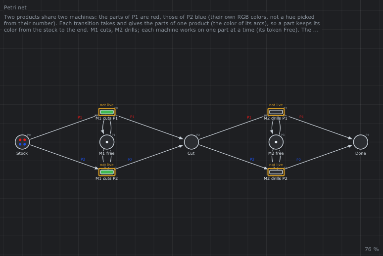

# 🎨 Colored parts

Two products share two machines: each part keeps the color of its product,
drawn with the RGB color of its parts.



## What it models

The stock holds two parts of `P1` and two of `P2`. `M1` cuts them, then `M2`
drills them; each machine works on one part at a time (its token in
`M1 free`, `M2 free`). Each transition takes and gives the parts of one
product: the arcs of `M1 cuts P1` ask for `P1` and give `P1`. So a part
keeps its color from the stock to `Done`, and `Cut` can hold parts of both
products at once.

The colors `P1` and `P2` have their own RGB value, red and blue, instead of a
hue picked from their number:

```json
"colors": [{ "name": "P1", "rgb": "#e61a1a" }, { "name": "P2", "rgb": "#1a4de6" }],
```

and the stock starts with two tokens of each (`"tokens": 4, "colors": { "P1": 2, "P2": 2 }`).
A program sets the same with `net.colors.rgb(color, 0xE61A1A)`: a factory
that draws its products with the color of its real parts, for example.

## What it teaches

- [Colored tokens, and the RGB value of a color](../../../doc/en/05-Extended-Petri-Nets.md#6-colored-tokens)
- [The runtime](../../../doc/en/11-Runtime.md)

## Try it in the editor

```sh
./build/linux-gcc-debug/bin/TimedPetriNetEditor examples/Extended-Petri-Nets/ColoredParts/ColoredParts.json
```

1. Open it: the stock has two red and two blue tokens, the arcs say which
   product they take.
2. Press **Space**, then click `M1 cuts P2`: a blue part goes to `Cut`. Only
   `M2 drills P2` can take it.
3. Right click on a place > *Tokens by color* to add parts of a product.

## Run it with the runtime

[`ColoredParts.cpp`](ColoredParts.cpp) runs the net with the runtime: each
operation is a function that prints its name. Build the examples
(`make -C examples`), then from the root of the project:

```text
$ build/examples/ColoredParts
P1 drawn #e61a1a, P2 drawn #1a4de6
  M1 cuts P1
  M1 cuts P1
  M1 cuts P2
  M1 cuts P2
  M2 drills P1
  M2 drills P1
  M2 drills P2
  M2 drills P2
lot_1: Deadlocked, done 2 P1 and 2 P2
```

The four parts are done, two of each color. The instance ends `Deadlocked`:
no part is left (no goal was given).

---

Back to the [examples](../../README.md) · Extended Petri nets: [chapter 5](../../../doc/en/05-Extended-Petri-Nets.md)
