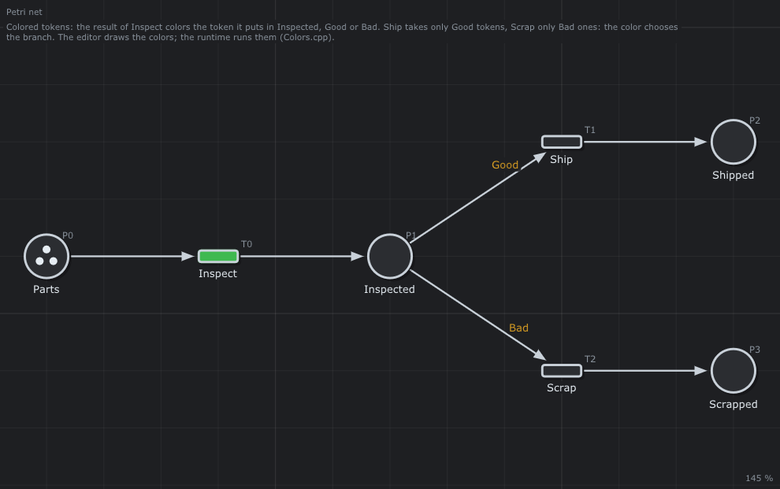

# 🎨 Colored tokens

Colored tokens: the result of an inspection chooses the branch.



## What it models

`Inspect` gives a token colored `Good` or `Bad` (colors of the net); `Ship` takes only `Good` tokens, `Scrap` only `Bad` ones. The colors are drawn on the arcs.

## What it teaches

- [Colored tokens, the colors of results](../../../doc/en/05-Extended-Petri-Nets.md#6-colored-tokens)
- [The runtime](../../../doc/en/11-Runtime.md)

## Try it in the editor

```sh
./build/linux-gcc-debug/bin/TimedPetriNetEditor examples/Extended-Petri-Nets/Colors/Colors.json
```

1. Open it: the colors `Good` and `Bad` are written on the arcs.
2. Press **Space** and fire `Inspect`: the simulation has no function to give a result, so it draws `Good` or `Bad` at random (the colors asked after `Inspect`). Only `Ship` or only `Scrap` is then enabled, as with the runtime.
3. Right click on an arc > *Color of the tokens* to change a color, or type a new one.

## Run it with the runtime

[`Colors.cpp`](Colors.cpp) runs this net with the runtime of the project: each transition is a function of the program ([chapter 11](../../../doc/en/11-Runtime.md)). Build the examples (`make -C examples`), then from the root of the project:

```text
$ build/examples/Colors
inspect part 1: Good
inspect part 2: Bad
inspect part 3: Good
  ship it
  ship it
  scrap it
lot_1: Deadlocked, shipped 2, scrapped 1
```

`Inspect` is a function that returns the color `Good` or `Bad`; the second part has a scratch. The runtime gives the token this color, and only the arc of the same color can take it: two parts are shipped, one is scrapped. The instance ends `Deadlocked`: no part is left (no goal was given).

---

Back to the [examples](../../README.md) · Extended Petri nets: [chapter 5](../../../doc/en/05-Extended-Petri-Nets.md)
