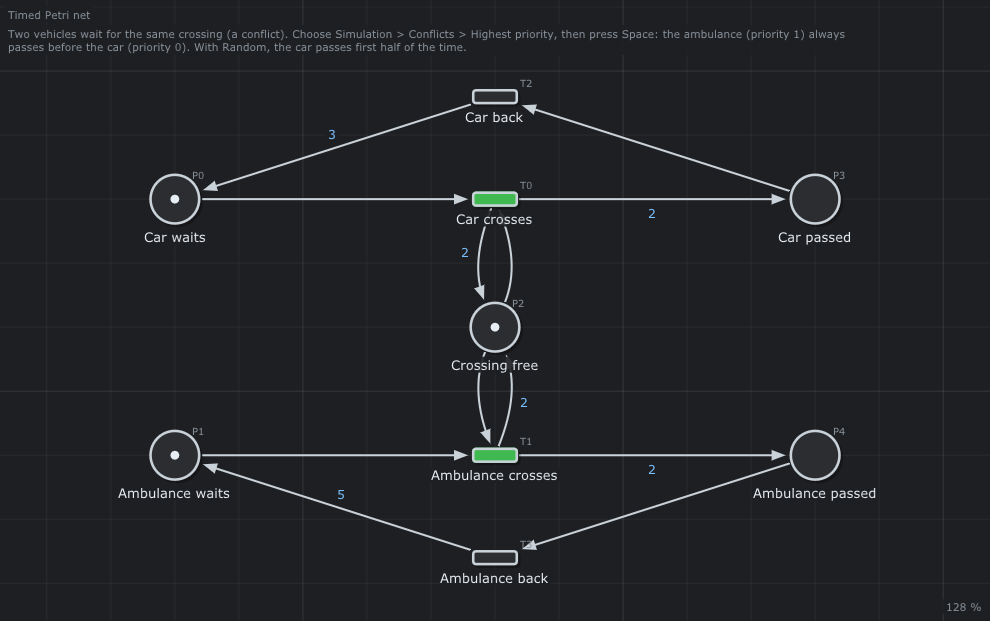

# 🚨 Priorities

Priorities in a timed Petri net: the ambulance crosses first.



## What it models

A car and an ambulance wait for the same crossing (a conflict on `Crossing free`). `Ambulance crosses` has priority 1, `Car crosses` priority 0. The arcs have durations: this is a timed Petri net, it runs by itself.

## What it teaches

- [Priorities](../../../doc/en/05-Extended-Petri-Nets.md#5-priorities)
- [Conflicts in timed nets](../../../doc/en/03-Petri-Nets.md#52-conflict-a-choice)

## Try it in the editor

```sh
./build/linux-gcc-debug/bin/TimedPetriNetEditor examples/Extended-Petri-Nets/Priorities/Priorities.json
```

1. Choose *Simulation > Conflicts > Highest priority*, press **Space**: the ambulance crosses first, every time.
2. Stop, choose *Random*: the car crosses first about half of the time; the seed is in the console, *Replay the last simulation* gives the same run.
3. The *Transitions* tab of the inspector shows and changes the priorities.

## Run it with the runtime

[`Priorities.cpp`](Priorities.cpp) runs this net with the runtime of the project ([chapter 11](../../../doc/en/11-Runtime.md)). The runtime solves the conflicts as the editor does, with `Runtime::Options::policy`: `Priority` (the default) fires the transition of highest priority, `Random` draws one with a seed. The net is timed: the program gives the dates to `step()` (a simulated clock), the durations are waited without sleeping. Build the examples (`make -C examples`), then from the root of the project:

```text
$ build/examples/Priorities
Policy Priority:
  t =  0.0  Ambulance crosses
  t =  2.0  Car crosses
  t =  7.0  Ambulance crosses
  t =  9.0  Car crosses
  t = 14.0  Ambulance crosses
  t = 16.0  Car crosses
Policy Random, first to cross for the seeds 1 to 10:
  Car Ambulance Ambulance Ambulance Ambulance Ambulance Ambulance Car Ambulance Ambulance
  the car first 42 times for the seeds 1 to 100
Seed 7 twice: the same crossings
```

With `Priority`, both wait at `t = 0` and at `t = 7` (they come back at the same date): the ambulance crosses first every time. With `Random`, the first one depends on the seed only: the same seed gives the same run, to replay a bug.

---

Back to the [examples](../../README.md) · Extended Petri nets: [chapter 5](../../../doc/en/05-Extended-Petri-Nets.md)
