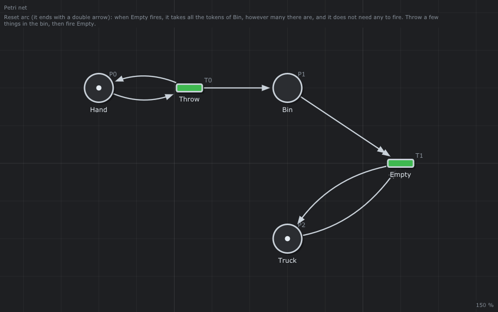

# 🗑️ Reset arc

A reset arc: empty the bin, however full it is.



## What it models

`Throw` puts an object in `Bin`; `Empty` has a reset arc from `Bin` (double arrow head): it removes all its tokens, and does not need any to fire.

## What it teaches

- [Reset arcs](../../../doc/05-Extended-Petri-Nets.md#4-reset-arcs)
- [What reset arcs cost](../../../doc/05-Extended-Petri-Nets.md#8-what-the-extensions-cost)

## Try it in the editor

```sh
./build/TimedPetriNetEditor examples/Extended-Petri-Nets/Reset/Reset.json
```

1. Press **Space**, fire `Throw` three times, then `Empty`: `Bin` is empty at once.
2. Fire `Empty` again: it fires on an empty bin.
3. *Analysis > Properties*: the graph is infinite (`Throw` fires for ever) and Karp-Miller is refused for reset arcs.

---

Back to the [examples](../../README.md) · Extended Petri nets: [chapter 5](../../../doc/05-Extended-Petri-Nets.md)
