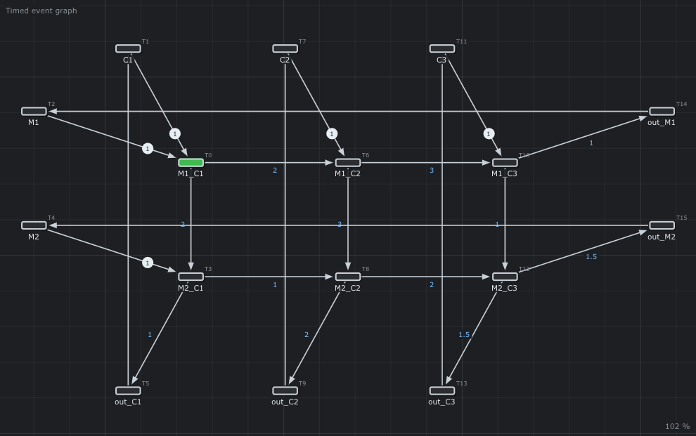

# 🏭 Flowshop

A factory that produces parts. On the timed event graph, each machine is a horizontal cycle and each conveyor a vertical one. The file is a table of processing times; `*n` after a name is how many of this resource the factory owns.



## What it models

[`simple.flowshop`](simple.flowshop) has 2 machines and 3 conveyors, one of each, as a table of processing times (`M1` works 2 on `C1`, 3 on `C2`, 1 on `C3`):

```text
machine\conveyor,C1,C2,C3
M1,2.0,3.0,1.0
M2,1.0,2.0,1.5
```

The editor builds the timed event graph: `M1_C2` is the operation of machine `M1` on conveyor `C2`. [`complex.flowshop`](complex.flowshop) is a bigger factory, 8 machines and 6 conveyors, still one of each, written in the older syntax of the `.flowshop` files (`key: values` lines), still read. *File > New > Flowshop...* fills such a table in a window.

## What it teaches

- [The flowshop](../../doc/en/07-Timed-Event-Graphs.md#6-tutorial-how-fast-is-my-factory): machines and conveyors, the critical resource, the Gantt chart
- [The flowshop format](../../doc/en/15-File-Formats.md#43-flowshop)

## Try it in the editor

```sh
./build/TimedPetriNetEditor examples/Flowshops/simple.flowshop
```

1. *Analysis > Critical circuit*: λ = 6. The red circuit is the row of `M1` (2 + 3 + 1). `M1` is the limit; the column of `C2` is only 3 + 2 = 5.
2. *Gantt*: one row per machine, one color per conveyor. `M1`, `C1` and the `out_...` transitions take no time, so they have no bar.
3. Press **Space**: the *Journal* gives the same dates, `M1_C1` at 0, `M1_C2` and `M2_C1` at 2.
4. Open [`complex.flowshop`](complex.flowshop) and *Critical circuit*: λ = 16.95, and the red circuit is the column of `Conveyor3`. A conveyor is the scarce resource.
5. Open [`complex-conveyors.flowshop`](complex-conveyors.flowshop): `Conveyor3` now has two conveyors (`Conveyor3*2`). λ = 15.12. The red circuits are the columns of `Conveyor2` and `Conveyor5`, and the row of `Machine3`.
6. Open [`complex-machine.flowshop`](complex-machine.flowshop): two of every conveyor (`Conveyor1*2` ... `Conveyor6*2`). λ = 12.30, and the only red circuit is the row of `Machine3`. The machine is now the limit. The editor does not choose these numbers: there is no automatic setting of an ideal flowshop.

---

Back to the [examples](../README.md) · Timed event graphs: [chapter 7](../../doc/en/07-Timed-Event-Graphs.md) · (max,+) algebra: [chapter 8](../../doc/en/08-Max-Plus-Algebra.md)
