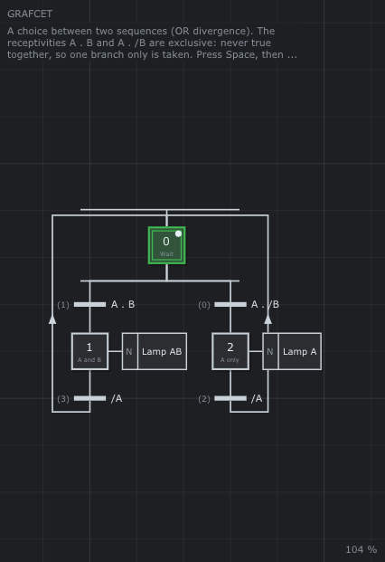

# 🔀 Exclusive choice

The smallest choice between two sequences: from step 0, the receptivity
`A . B` goes to step 1 (lamp AB), and `A . /B` to step 2 (lamp A). Releasing
`A` (`/A`) comes back to step 0.



**Notions**: OR divergence and OR convergence, exclusive receptivities
([chapter 9 §4.2](../../../doc/en/09-GRAFCET.md#42-choice-or-divergence-and-or-convergence)),
rule 2: a true receptivity does not fire a transition that is not enabled
([§3](../../../doc/en/09-GRAFCET.md#3-the-five-rules-of-evolution)).

**Try it**

```sh
./build/TimedPetriNetEditor examples/GRAFCET/ExclusiveChoice/ExclusiveChoice.json
```

1. Press **Space**. The two `/A` receptivities are drawn in orange (true)
   but nothing fires: steps 1 and 2 are not active.
2. On the control panel, turn `B` on, then `A`: step 1 and *Lamp AB*.
3. Turn `A` off: back to step 0. Turn `B` off, then `A` on: step 2 and
   *Lamp A*.
4. Whatever you do, steps 1 and 2 are never active together: `A . B` and
   `A . /B` are never true together. Edit the right receptivity to `A`
   (double click on it) and try again with `A` and `B` on: both branches
   start, the mistake that exclusive receptivities avoid.

With `true` instead of `/A` on the way back, the GRAFCET would turn for
ever while `A` is held: see the pitfall of the unstable GRAFCET
([§12](../../../doc/en/09-GRAFCET.md#12-pitfalls)).
