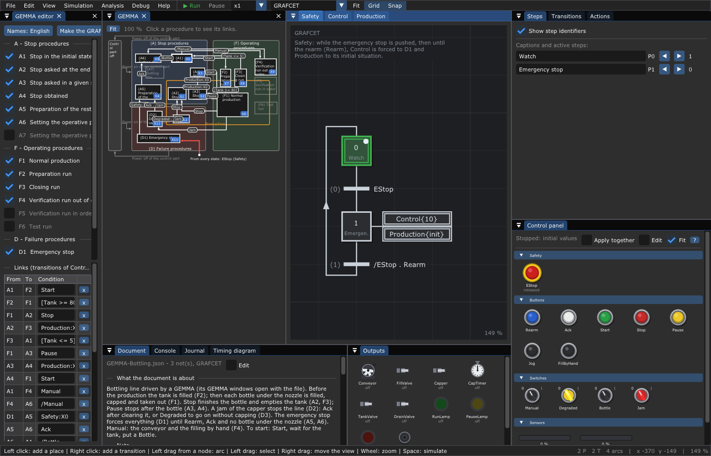

# 🍾 GEMMA of a bottling line

A bottle under the nozzle is filled until it is full, capped, and taken out
by the conveyor. Before the production the tank is filled; after it, the
tank is emptied. The run and stop modes come from a GEMMA of 13 procedures,
made with the GEMMA window of the editor (opened with the file): the editor
wrote the GRAFCETs **Safety** and **Control** from it, **Production** was
then written by hand.



| Procedure | In this machine |
|-----------|-----------------|
| A1 | stopped, ready |
| F2 | preparation: `TankValve` fills the tank up to 80 % |
| F1 | normal production, `RunLamp` |
| A2, F3 | `Stop`: the bottle is finished, then `DrainValve` empties the tank |
| A3, A4 | `Pause`: the bottle is finished, then the line waits (`PauseLamp`) |
| F4 | manual: `Jog` runs the conveyor, `FillByHand` the filling valve |
| D1 | emergency stop (forced by Safety), `FaultLamp` |
| A5, A6 | after a failure: `Ack`, then no bottle under the nozzle |
| D2 | jam of the capper: the production is frozen, `Buzzer`, `FaultLamp` |
| D3 | degraded: the bottles go out without cap |

**Notions**: a GEMMA made in the editor
([chapter 10 §5](../../../doc/en/10-GEMMA.md#5-make-your-own-gemma-in-the-editor)),
the GMMA as the GRAFCET Control, the forcing of Production by each mode
(`{init}`, `{*}`), the steps of another graph in a receptivity
(`Control:X6`), a selection of sequences in Production (capping or not), and
the drawings of the outputs panel: motor, valves, timer, lamps, buzzer.

**Try it**

```sh
./build/TimedPetriNetEditor examples/GRAFCET/GEMMA-Bottling/GEMMA-Bottling.json
```

Press **Space**, then on the control panel: **Start**, wait 4 s for the
tank, switch **Bottle** on and watch the filling, the capping (the timer
`CapTimer`) and the conveyor; switch **Bottle** off. Switch **Jam** on: the
buzzer. Switch **Degraded** on and **Jam** off: the next bottle goes out
without cap. **Stop** empties the tank. Hit the emergency stop, then
**Rearm** and **Ack**.

Then, in the GEMMA editor: keep another procedure (F5), add its links
of the guide (A1 → F5, F1 → F5) and a way back with *Another link* (F5 → A1,
`/StepByStep . Production:X0`), *Make the GRAFCETs*, and see Control change
while Production follows its steps.
