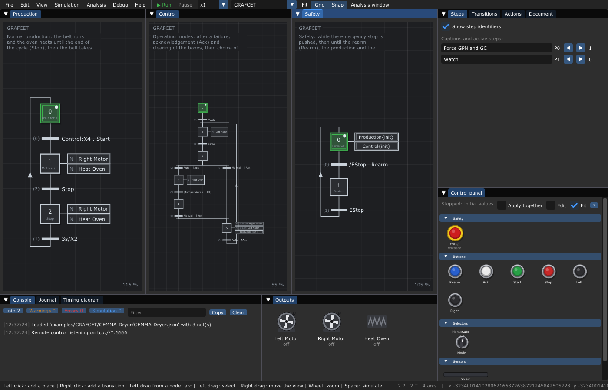

# 🛑 GEMMA of a dryer

A belt brings boxes into an oven, they dry, the belt takes them out. The
control of the dryer is split, as a GEMMA asks, into three GRAFCETs that run
together:

- **Safety**: while the emergency stop is pushed, then until `Rearm`, it
  forces the two others to their initial situation;
- **Control**: the modes. After a failure, `Ack` and the clearing of the
  boxes; then the choice of the mode with the selector: automatic (the oven
  heats up to 80 °C before the production may start) or manual (the
  buttons `Left` and `Right` drive the motors);
- **Production**: the normal cycle: `Start`, the belt runs and the oven
  heats until `Stop`, then the belt runs 3 s more.



**Notions**: the GEMMA and its procedures A, F, D, a hierarchy of GRAFCETs
with forcing orders, steps of another graph in a receptivity
(`Control:X4 . Start`), conditional actions (`if Right: Right Motor`), edges
(`↑Ack`), a time operator (`3s/X1`), an integer comparison
(`[Temperature >= 80]`), and every kind of input of the control panel:
emergency stop, push buttons, selector, sensor driven by an output.
The whole tutorial is [chapter 10](../../../doc/10-GEMMA.md#4-tutorial-the-gemma-of-a-dryer).

**Try it**

```sh
./build/TimedPetriNetEditor examples/GRAFCET/GEMMA-Dryer/GEMMA-Dryer.json
```

Press **Space**, then on the control panel: **Rearm**, **Ack**, wait 3 s,
**Ack** again (the selector is on Auto), wait for 80 °C on the thermometer,
**Start**, then **Stop**. Hit the emergency stop while the belt runs. Then
try the manual mode: selector on **Manual**, **Ack**, and hold **Right**.

Credit: the GEMMA lessons of NetProf
(<https://www.youtube.com/watch?v=y8lWIG71040>, in French). The names of the
original course were `AU`, `Réarm`, `Val`, `Dcy`, `Acy`, `GA`, `DR`; they are
`EStop`, `Rearm`, `Ack`, `Start`, `Stop`, `Left`, `Right` here.
