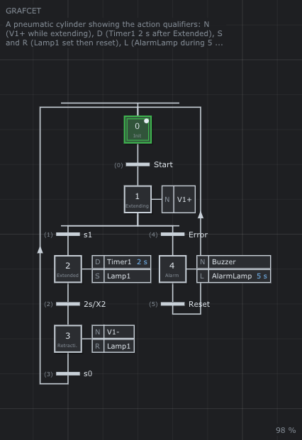

# 🔧 Action qualifiers: a pneumatic cylinder

A cylinder extends on `Start` until the sensor `s1`, stays out 2 s, then
retracts until `s0`. An `Error` while extending goes to an alarm, left with
`Reset`. Each step shows another qualifier of action.



| Step | Actions | Qualifier |
|------|---------|-----------|
| 1 Extending | `N V1+` | continuous: while the step is active |
| 2 Extended | `D Timer1` (2 s), `S Lamp1` | delayed; set (stored) |
| 3 Retracting | `N V1-`, `R Lamp1` | continuous; reset of the stored lamp |
| 4 Alarm | `N Buzzer`, `L AlarmLamp` (5 s) | continuous; limited to 5 s |

**Notions**: the qualifiers N, S, R, D, L and their timing
([chapter 9 §6](../../../doc/en/09-GRAFCET.md#6-actions)), the time operator
`2s/X2` ([§5.2](../../../doc/en/09-GRAFCET.md#52-time)), an OR divergence on
`s1` / `Error`.

**Try it**

```sh
./build/linux-gcc-debug/bin/TimedPetriNetEditor examples/GRAFCET/GrafcetActions/GrafcetActions.json
```

1. Press **Space**, turn `Start` on: step 1, `V1+` is on.
2. Turn `Start` off and `s1` on: step 2. `Lamp1` is set at once. `Timer1`
   would come on 2 s later, but `2s/X2` leaves step 2 at this very instant:
   the delayed action never runs. Watch it in the *Timing diagram*; change
   the duration of `D Timer1` to 1 s in the *Actions* panel to see it.
3. Step 3: `V1-` is on and `Lamp1` is reset. Turn `s1` off and `s0` on:
   back to step 0.
4. Start again, and turn `Error` on while extending: the buzzer sounds, the
   alarm lamp goes off after 5 s while the buzzer goes on. Turn `Error` off,
   then `Reset`: back to step 0.

⚠️ Do not keep `Start`, `Error` and `Reset` on together: the graph turns
0 → 1 → 4 → 0 ... for ever inside each cycle (an unstable GRAFCET, the
console warns and the editor uses a whole core). It is the example of the
pitfall of [chapter 9 §12](../../../doc/en/09-GRAFCET.md#12-pitfalls).

The *Outputs* window draws each output as what it is (`outputs` in the
file): `V1+` and `V1-` as cylinders, `Timer1` as a stopwatch whose hand
turns while it is on, `Lamp1` and `AlarmLamp` (red) as lamps, `Buzzer` as
a buzzer that beeps.

*Help > GRAFCET actions (qualifiers)* draws the timing diagram of every
qualifier.
