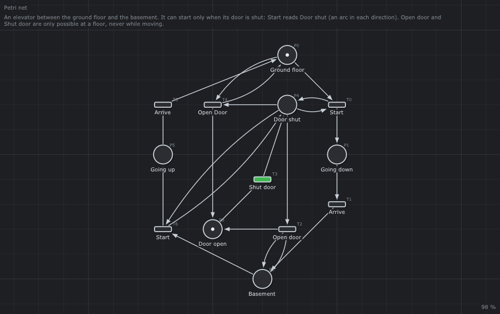

# 🛗 Elevator control

An elevator between the ground floor and the basement, that never moves with its door open.



## What it models

The elevator is at a floor or moving; its door is open or shut. `Start` reads `Door shut` (an arc in each direction), and the door transitions read the floor places.

## What it teaches

- [Read arcs as safety conditions](../../../doc/03-Petri-Nets.md#6-patterns-of-modeling)
- [P-invariants: position and door](../../../doc/04-Analysis.md#6-p-invariants)

## Try it in the editor

```sh
./build/TimedPetriNetEditor examples/Petri-Nets/ElevatorControl/ElevatorControl.json
```

1. Press **Space**: `Start` is grey, the door is open.
2. Fire `Shut door`, then `Start`: the elevator goes down; no door transition is enabled while moving.
3. *Analysis > Properties*: `Door open + Door shut = 1`, and the four positions of the elevator sum to 1.

---

Back to the [examples](../../README.md) · Petri nets: [chapter 3](../../../doc/03-Petri-Nets.md)
