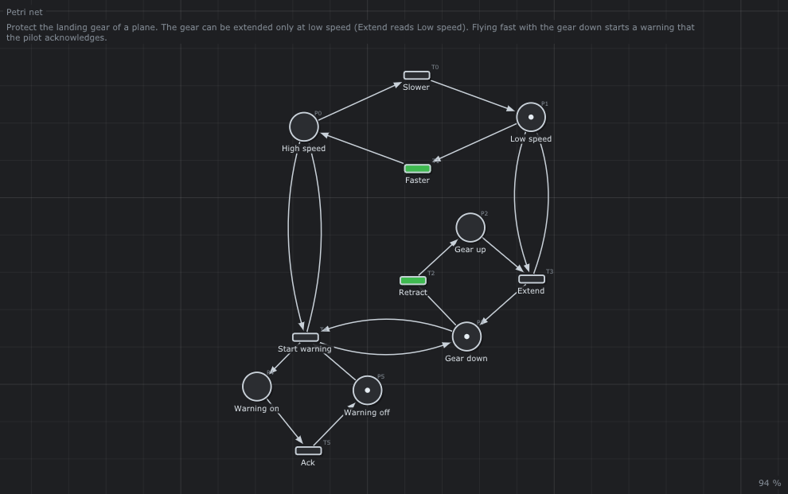

# ✈️ Landing gear

The safety rules of the landing gear of a plane.



## What it models

The plane flies at `Low speed` or `High speed`; its gear is up or down. `Extend` reads `Low speed`: the gear can go down only at low speed. Flying fast with the gear down fires `Start warning`, which the pilot acknowledges (`Ack`).

## What it teaches

- [Read arcs and safety rules](../../../doc/en/03-Petri-Nets.md#6-patterns-of-modeling)
- [P-invariants](../../../doc/en/04-Analysis.md#6-p-invariants)

## Try it in the editor

```sh
./build/linux-gcc-debug/bin/TimedPetriNetEditor examples/Petri-Nets/LandingGear/LandingGear.json
```

1. Press **Space**, fire `Faster`: `Start warning` turns green.
2. Fire `Retract`, then try `Extend`: it is grey at high speed.
3. Fire `Slower`: `Extend` is enabled again.

## Run it with the runtime

[`LandingGear.cpp`](LandingGear.cpp) runs this net with the runtime of the project: each transition is a function of the program ([chapter 11](../../../doc/en/11-Runtime.md)). Build the examples (`make -C examples`), then from the root of the project:

```text
$ build/examples/LandingGear
t = 1  pilot: Faster
        Faster done
        WARNING: gear down at high speed!
t = 2  pilot: Retract
        Retract done
t = 3  pilot: Ack
        Ack done
t = 4  pilot: Extend  (refused by the net, the order waits)
t = 5  pilot: Slower
        Slower done
        Extend done
end: [Low speed] [Gear down] [Warning off]
```

The net is the safety layer of a scripted flight. The orders of the pilot reach the transitions through guards (a guard holds a transition until its order comes); `Start warning` has no guard and fires by itself. At t = 4 the pilot asks `Extend` at high speed: the net refuses, the order waits, and the gear goes down as soon as the plane slows down at t = 5.

## Credits

Credit: YAWL User Group, [the landing gear](https://www.youtube.com/shorts/IqMyF5JKoE4).

---

Back to the [examples](../../README.md) · Petri nets: [chapter 3](../../../doc/en/03-Petri-Nets.md)
