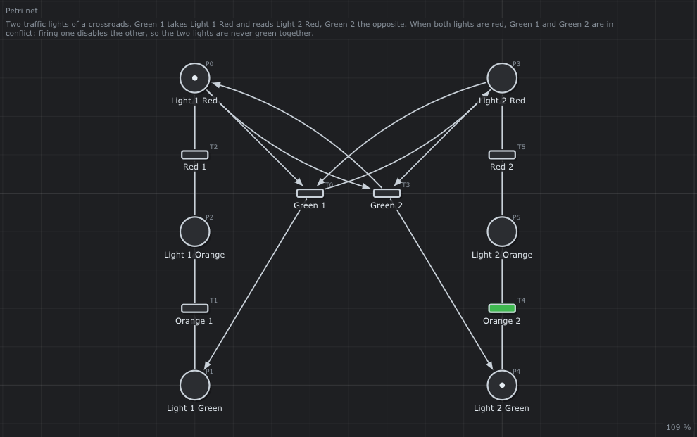

# 🚦 Traffic lights

Two traffic lights of a crossroads, never green together.



## What it models

Each light goes green, orange, red. `Green 1` takes `Light 1 Red` and reads `Light 2 Red`; `Green 2` the opposite. When both lights are red, the two transitions are in conflict.

## What it teaches

- [A conflict used as a safety rule](../../../doc/en/03-Petri-Nets.md#52-conflict-a-choice)
- [Read arcs](../../../doc/en/03-Petri-Nets.md#6-patterns-of-modeling)

## Try it in the editor

```sh
./build/TimedPetriNetEditor examples/Petri-Nets/TrafficLights/TrafficLights.json
```

1. Press **Space** and go around the cycle of light 2 until both are red.
2. `Green 1` and `Green 2` are both green: fire one, the other turns grey.
3. *Analysis > Properties*: no marking has both lights green (look at the P-invariants: one per light).

---

Back to the [examples](../../README.md) · Petri nets: [chapter 3](../../../doc/en/03-Petri-Nets.md)
