# 🖼️ Examples

One folder per example, grouped by family of nets. Each folder holds the
net (`.json`, `.flowshop` or `.teg`), its picture, a README explaining what
it models and what to try, and sometimes a C++ program that runs it with
the runtime ([chapter 11](../doc/11-Runtime.md)). Most nets also carry a
**description**, written on the canvas above the net: it tells you what to
do and what to look at.

Open any of them from the root of the project:

```sh
./build/TimedPetriNetEditor examples/Petri-Nets/Philosophers/Philosophers.json
```

and build and run the programs with `make -C examples` then, for example,
`./build/examples/Coffee`. 📝 marks the small "textbook" examples that teach
one notion each, ⚙️ the examples with a program.

## 🔵 Petri nets

Chapters [3](../doc/03-Petri-Nets.md) and [4](../doc/04-Analysis.md).

| | Example | Notions |
|-|---------|---------|
|  | 📝 [FirstNet](Petri-Nets/FirstNet/README.md) | the firing rule on the smallest net |
|  | 📝 [ForkJoin](Petri-Nets/ForkJoin/README.md) | concurrency, synchronization |
|  | 📝 [Conflict](Petri-Nets/Conflict/README.md) | choice between two transitions |
|  | 📝 [MutualExclusion](Petri-Nets/MutualExclusion/README.md) | a shared resource, a P-invariant |
| 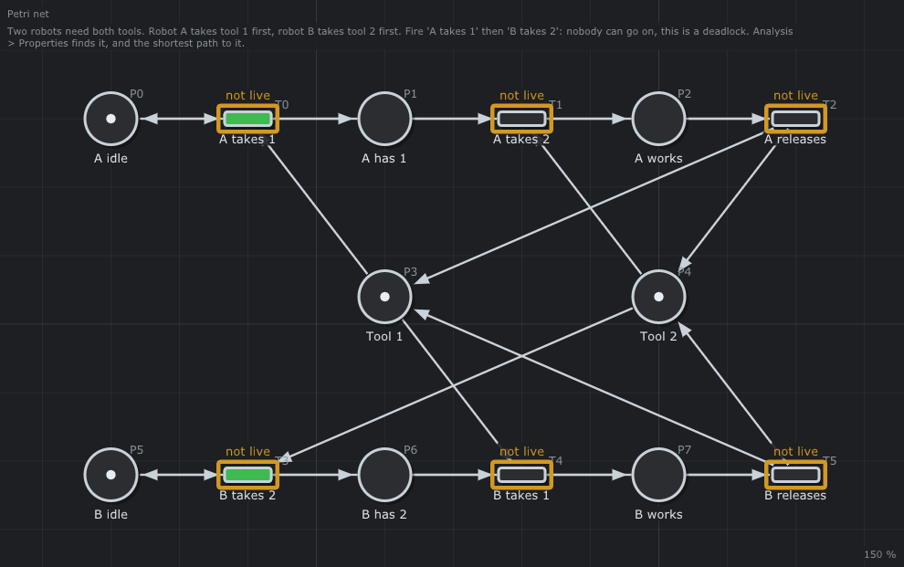 | 📝 [Deadlock](Petri-Nets/Deadlock/README.md) | a deadlock and the path to it |
|  | ⚙️ [ProducerConsumer](Petri-Nets/ProducerConsumer/README.md) | a buffer, an unbounded place; restart after a crash |
|  | ⚙️ [Philosophers](Petri-Nets/Philosophers/README.md) | shared resources, invariants; tokens as locks of threads |
| 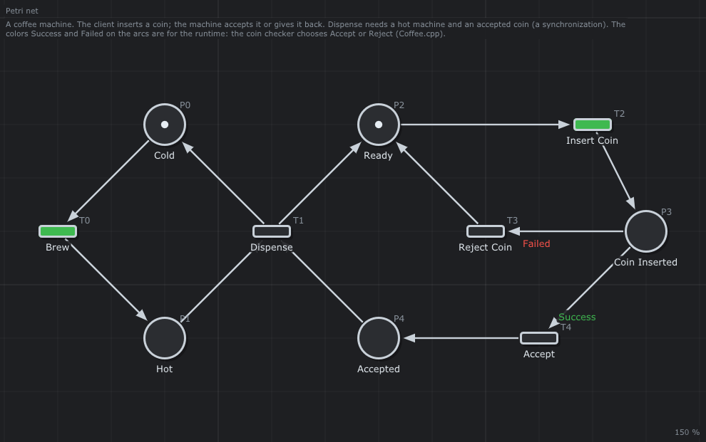 | ⚙️ [Coffee](Petri-Nets/Coffee/README.md) | synchronization, choice by the result of a function |
|  | [TrafficLights](Petri-Nets/TrafficLights/README.md) | safety by a conflict: never two greens |
|  | ⚙️ [LandingGear](Petri-Nets/LandingGear/README.md) | a net as a safety layer; read arcs |
|  | ⚙️ [EmergencyCalls](Petri-Nets/EmergencyCalls/README.md) | operators as resources, colored calls |
|  | [ElevatorControl](Petri-Nets/ElevatorControl/README.md) | an interlock: move only with the door shut |
| 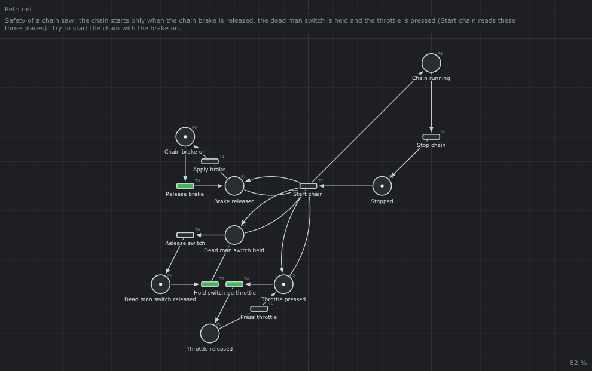 | [ChainSaw](Petri-Nets/ChainSaw/README.md) | safety conditions read by a transition |
| 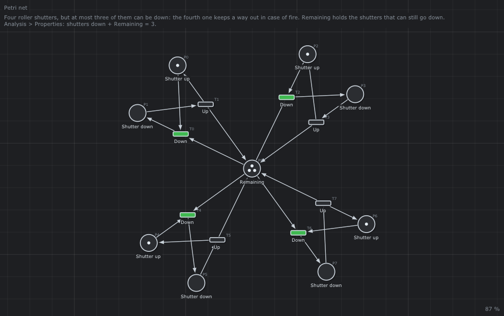 | [SmarthomeSafety](Petri-Nets/SmarthomeSafety/README.md) | a counter of resources: at most 3 of 4 |
| 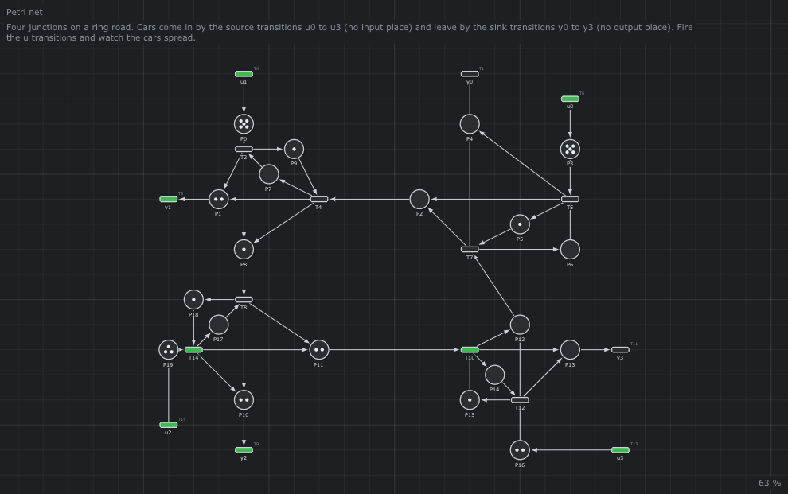 | [FourRoadJunctions](Petri-Nets/FourRoadJunctions/README.md) | sources and sinks of a road network |

## 🧪 Extended Petri nets

Chapter [5](../doc/05-Extended-Petri-Nets.md).

| | Example | Notions |
|-|---------|---------|
|  | 📝 [Weights](Extended-Petri-Nets/Weights/README.md) | arc weights: 2 H2 + O2 → 2 H2O |
|  | 📝 [Capacity](Extended-Petri-Nets/Capacity/README.md) | a place of capacity 3 |
|  | 📝 [Inhibitor](Extended-Petri-Nets/Inhibitor/README.md) | the zero test |
|  | 📝 [Reset](Extended-Petri-Nets/Reset/README.md) | emptying a place |
|  | 📝 ⚙️ [Priorities](Extended-Petri-Nets/Priorities/README.md) | a conflict solved by priorities, or at random with a seed |
|  | 📝 ⚙️ [Colors](Extended-Petri-Nets/Colors/README.md) | the color of a token chooses its way |
| 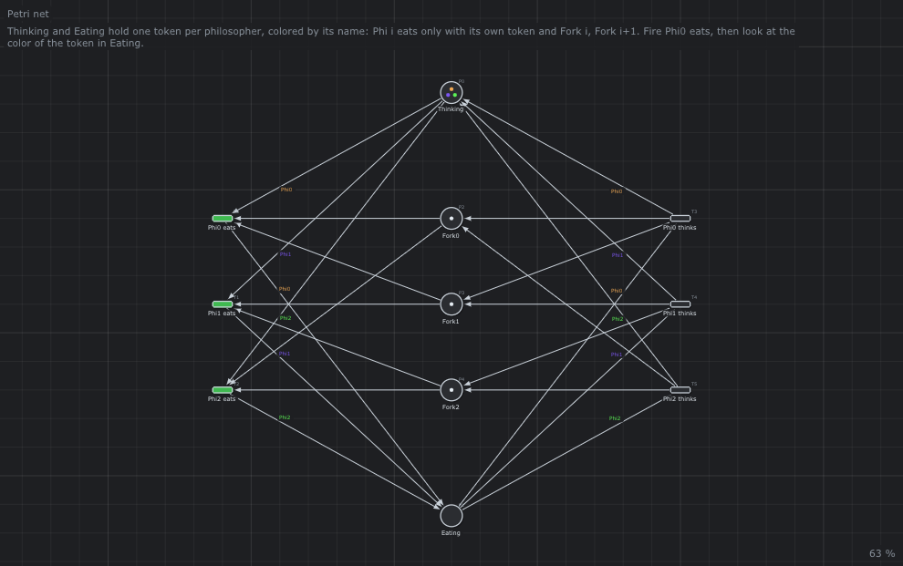 | 📝 ⚙️ [ColoredPhilosophers](Extended-Petri-Nets/ColoredPhilosophers/README.md) | colored initial tokens fold places; simulation and runtime agree |
|  | ⚙️ [BoundedBuffer](Extended-Petri-Nets/BoundedBuffer/README.md) | all the extensions together |

## ⏱️ Timed Petri nets

Chapter [6](../doc/06-Timed-Petri-Nets.md).

| | Example | Notions |
|-|---------|---------|
|  | 📝 [Durations](Timed-Petri-Nets/Durations/README.md) | tokens travel along the arcs |
|  | 📝 [Timeout](Timed-Petri-Nets/Timeout/README.md) | a delay in conflict with an answer |
|  | [TimedConflict](Timed-Petri-Nets/TimedConflict/README.md) | a conflict in a timed net |
| 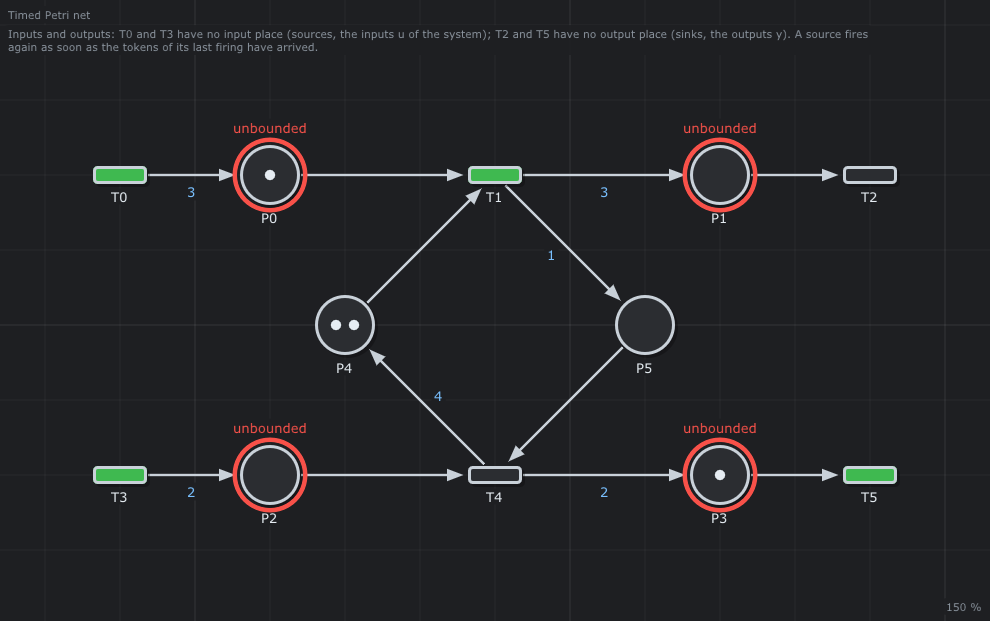 | [InputsOutputs](Timed-Petri-Nets/InputsOutputs/README.md) | sources and sinks |
|  | [Unbounded](Timed-Petri-Nets/Unbounded/README.md) | a place that grows for ever |

## 🔁 Timed event graphs and (max,+) algebra

Chapters [7](../doc/07-Timed-Event-Graphs.md) and [8](../doc/08-Max-Plus-Algebra.md).

| | Example | Notions |
|-|---------|---------|
| 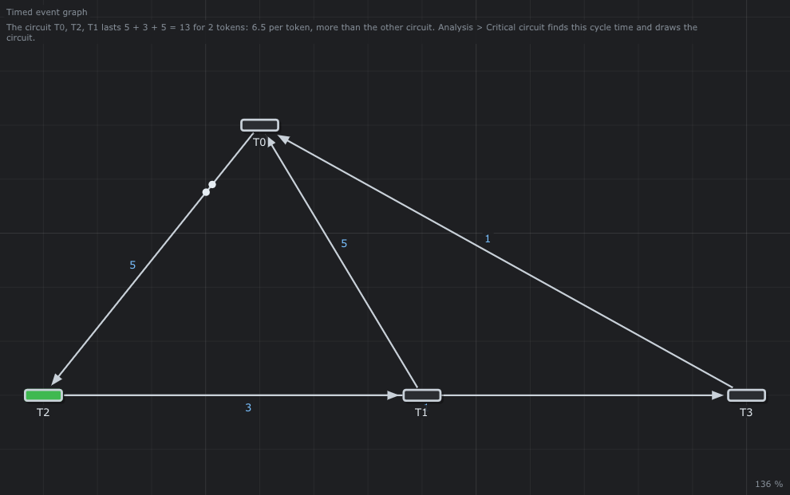 | 📝 [Howard2](Timed-Event-Graphs/Howard2/README.md) | cycle time 6.5, critical circuit |
| 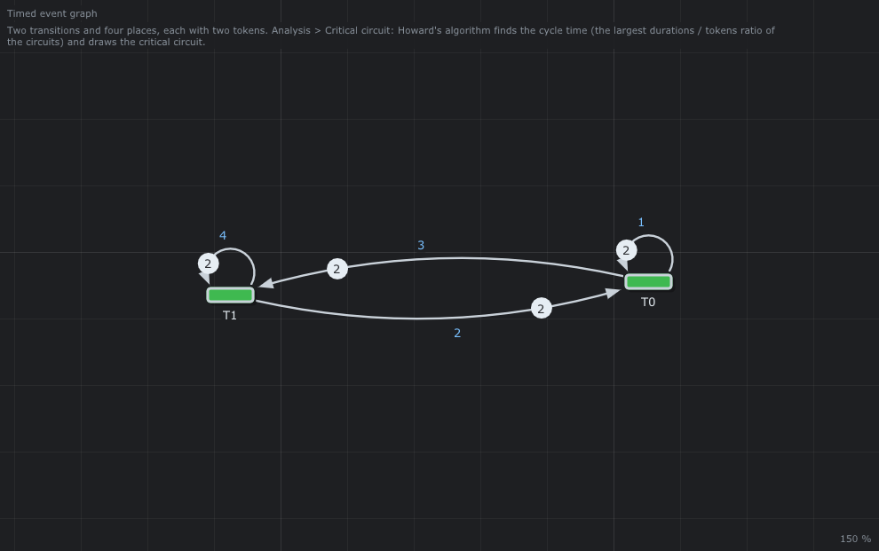 | [Howard1](Timed-Event-Graphs/Howard1/README.md) | the Howard algorithm |
|  | [EventGraph](Timed-Event-Graphs/EventGraph/README.md) | the event graph of *Synchronization and Linearity* |
|  | [JPQ](Timed-Event-Graphs/JPQ/README.md) | inputs, outputs, the (max,+) linear system |
| 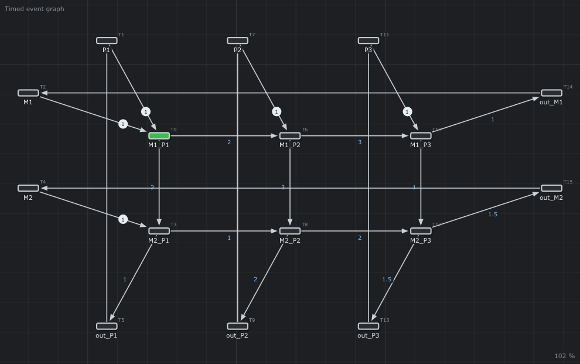 | [Flowshop](Timed-Event-Graphs/Flowshop/README.md) | a factory: cycle time, bottleneck, Gantt chart |
| 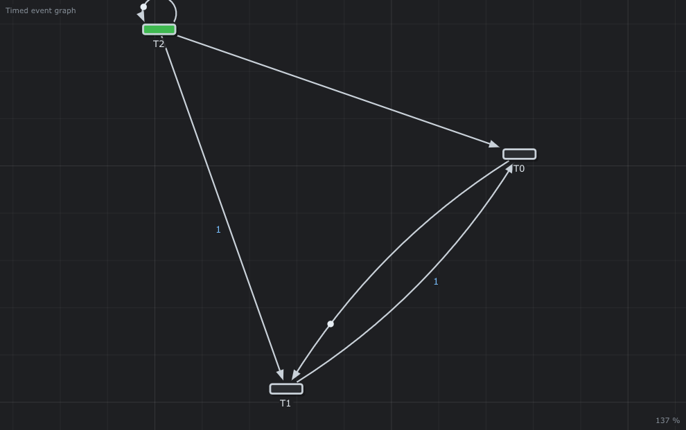 | [SemiHoward](Timed-Event-Graphs/SemiHoward/README.md) | the `.teg` format |
|  | [SemiNetherlands](Timed-Event-Graphs/SemiNetherlands/README.md) | a bigger `.teg` net |

## 🔘 GRAFCET and GEMMA

Chapters [9](../doc/09-GRAFCET.md) and [10](../doc/10-GEMMA.md).

| | Example | Notions |
|-|---------|---------|
|  | 📝 [GermanTrafficLights](GRAFCET/GermanTrafficLights/README.md) | a sequence with timers |
|  | 📝 [ExclusiveChoice](GRAFCET/ExclusiveChoice/README.md) | OR divergence, exclusive receptivities |
| 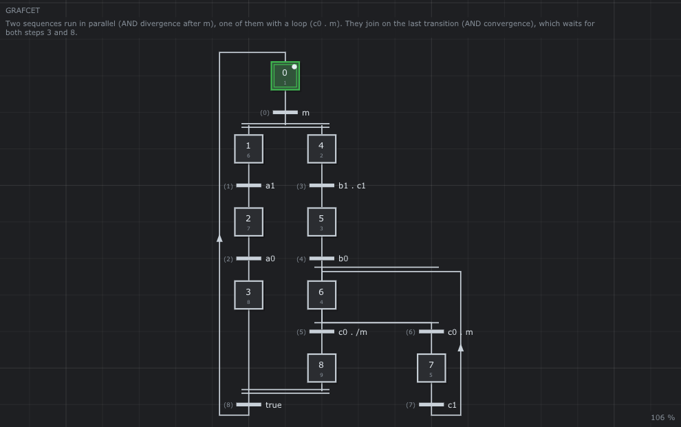 | 📝 [ParallelSequences](GRAFCET/ParallelSequences/README.md) | AND divergence and convergence |
|  | [GrafcetActions](GRAFCET/GrafcetActions/README.md) | the action qualifiers |
|  | [GEMMA-Dryer](GRAFCET/GEMMA-Dryer/README.md) | three GRAFCETs, forcing orders, a control panel |

## ⚙️ Runtime

Chapters [11](../doc/11-Runtime.md), [12](../doc/12-Code-Generation.md) and
[13](../doc/13-Debugging.md). The programs next to the nets above (⚙️) are
runtime examples too.

| | Example | Notions |
|-|---------|---------|
|  | ⚙️ [PickAndPlace](Runtime/PickAndPlace/README.md) | a robot: results that choose the branch, the editor as a debugger |
| | ⚙️ [MicroServices](Runtime/MicroServices/README.md) | a service answering late, a timeout, journals for process mining |
| | ⚙️ [TrafficLight](Runtime/TrafficLight/README.md) | a micro-controller: `setup()`, `loop()`, no thread |
| | ⚙️ [Ros2Node](Runtime/Ros2Node/README.md) | a ROS 2 node |
| | ⚙️ [Benchmark](Runtime/Benchmark/README.md) | this runtime against Symmetri |

## 🔄 Make the pictures again

The pictures are taken by the editor itself:

```sh
tools/screenshots.sh            # all of them
tools/screenshots.sh Coffee     # the ones whose path contains Coffee
```

A file `screenshot.args` next to a net gives other options than the net
alone (`-w` for the whole window, `-r -d 3` after 3 s of simulation).
