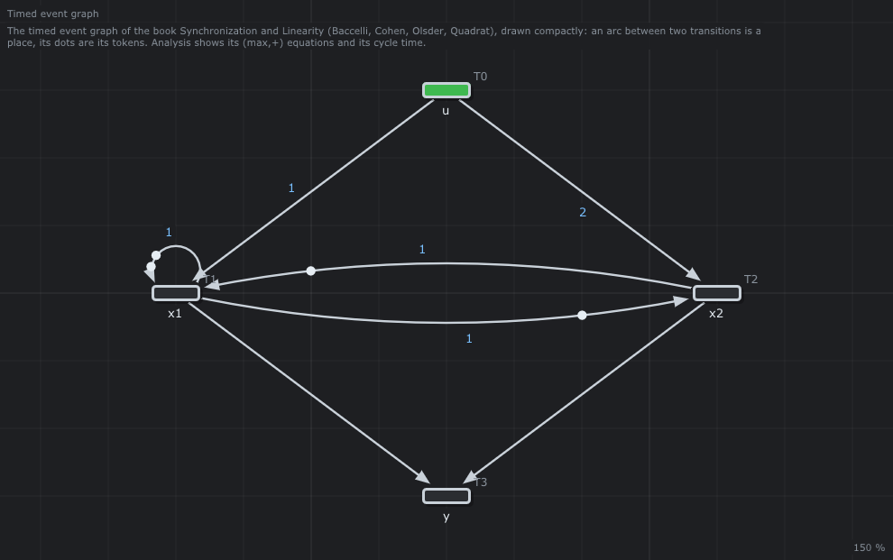

# 📘 EventGraph

The timed event graph of the book *Synchronization and Linearity* (Baccelli, Cohen, Olsder, Quadrat, 1992), with an input and an output.



## What it models

The input `u` feeds the internal transitions `x1` and `x2`, whose firings make the output `y`. Its dater equations (*Analysis > Equations*):

```text
T1(k) = max(1 + T0(k), 1 + T2(k - 1), 1 + T1(k - 2))
T2(k) = max(1 + T1(k - 1), 2 + T0(k))
T3(k) = max(T1(k), T2(k))
```

with `T0 = u`, `T1 = x1`, `T2 = x2`, `T3 = y`.

## What it teaches

- [Inputs and outputs](../../../doc/en/07-Timed-Event-Graphs.md#5-inputs-and-outputs)
- [The linear system `X(k) = D X(k) ⊕ A X(k-1) ⊕ B U(k)`, `Y(k) = C X(k)`](../../../doc/en/08-Max-Plus-Algebra.md#4-the-linear-system-of-a-timed-event-graph)

## Try it in the editor

```sh
./build/linux-gcc-debug/bin/TimedPetriNetEditor examples/Timed-Event-Graphs/EventGraph/EventGraph.json
```

1. *Analysis > (max,+) algebra > Equations*: the equations above; *Linear system*: `D` and `A` (3 × 3), `B` (3 × 1), `C` (1 × 3).
2. *Gantt* (the input always ready): `x1: 1 3 3 5`, `x2: 2 2 4 4`, `y: 2 3 4 5`. The output fires once per time unit: the circuit `x1 → x2 → x1` lasts 2 for 2 tokens, λ = 1.
3. *Critical circuit* says `No optimal policy found`: Howard's algorithm needs an input place for every transition, and `u` has none ([why](../../../doc/en/08-Max-Plus-Algebra.md#63-in-the-editor)).

---

Back to the [examples](../../README.md) · Timed event graphs: [chapter 7](../../../doc/en/07-Timed-Event-Graphs.md) · (max,+) algebra: [chapter 8](../../../doc/en/08-Max-Plus-Algebra.md)
