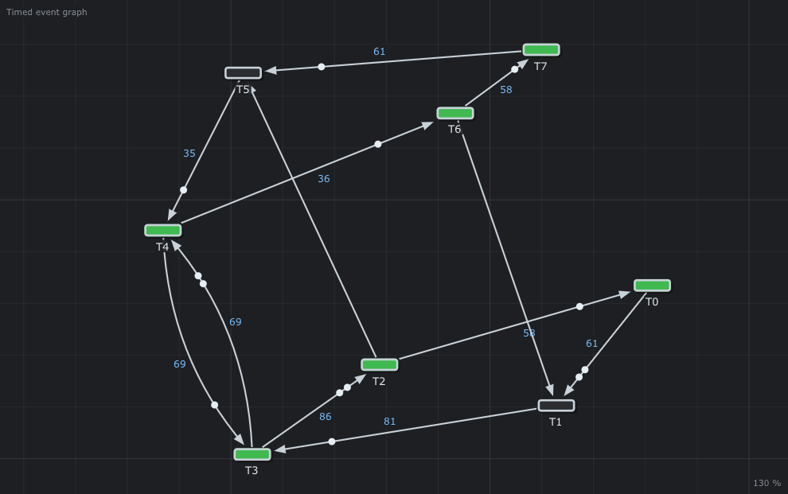

# 🚆 SemiNetherlands

A bigger net in the `.teg` format: 8 transitions, 12 places.



## What it models

[`SemiNetherlands.teg`](SemiNetherlands.teg) is a timed event graph of 8 transitions and 12 hidden places, with durations from 0 to 86, in the spirit of the models of railway timetables studied with the (max,+) algebra (the Dutch railways in the book of Heidergott, Olsder and van der Woude, *Max Plus at Work*).

## What it teaches

- [The `.teg` format](../../../doc/en/07-Timed-Event-Graphs.md#7-the-teg-file-format)
- [The cycle time is an eigenvalue](../../../doc/en/08-Max-Plus-Algebra.md#5-the-cycle-time-is-an-eigenvalue), found by [Howard's algorithm](../../../doc/en/08-Max-Plus-Algebra.md#6-howards-algorithm) on a net too big to do by hand

## Try it in the editor

```sh
./build/TimedPetriNetEditor examples/Timed-Event-Graphs/SemiNetherlands/SemiNetherlands.teg
```

1. *Analysis > (max,+) algebra > Critical circuit*: λ = 47.67 for every transition, the critical circuit `T0 → T1 → T3 → T2 → T0` (58 + 61 + 81 + 86 = 286 for 6 tokens) is red.
2. *Equations*: `T0(k) = max(58 + T2(k - 1))`, `T1(k) = max(61 + T0(k - 2), T6(k))` ...
3. *Gantt*: the earliest dates of the first cycles.

---

Back to the [examples](../../README.md) · Timed event graphs: [chapter 7](../../../doc/en/07-Timed-Event-Graphs.md) · (max,+) algebra: [chapter 8](../../../doc/en/08-Max-Plus-Algebra.md)
