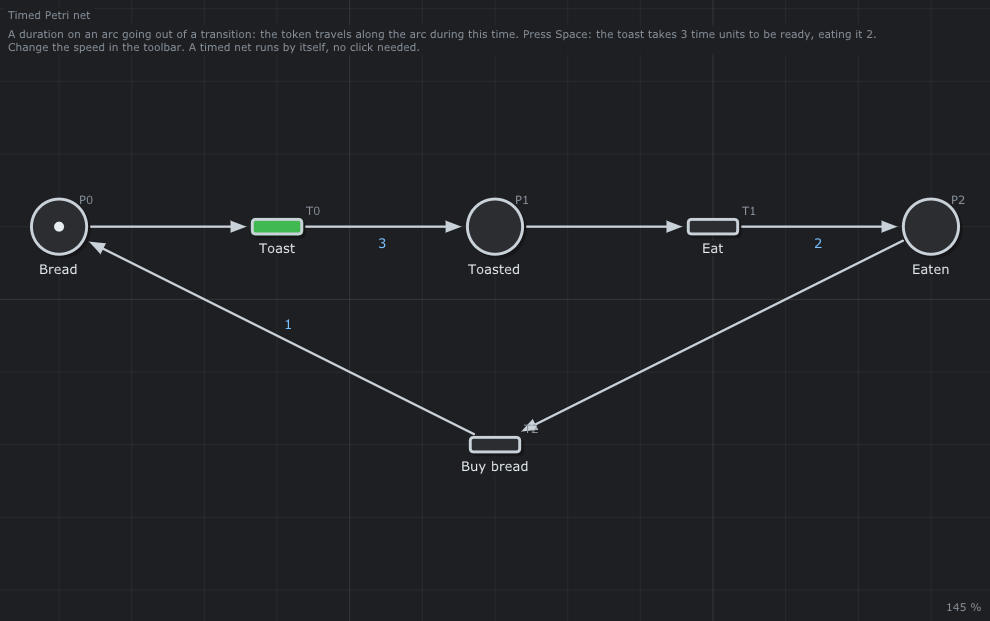

# 🍞 Durations: the toaster

The smallest timed Petri net: a toast takes 3 time units, eating it 2, buying bread 1.



## What it models

`Toast`, `Eat` and `Buy bread` follow each other in a loop with one token. The **duration** is written on the arc going out of a transition: the token travels along the arc during this time, and no place holds it meanwhile. A timed net runs by itself: no click is needed.

## What it teaches

- [The duration of an arc](../../../doc/en/06-Timed-Petri-Nets.md#31-the-duration-of-an-arc)
- [The dates computed by hand](../../../doc/en/06-Timed-Petri-Nets.md#5-your-first-timed-net-the-toaster): `Toast` fires at 0, 6, 12 ... a cycle of 3 + 2 + 1 = 6

## Try it in the editor

```sh
./build/linux-gcc-debug/bin/TimedPetriNetEditor examples/Timed-Petri-Nets/Durations/Durations.json
```

1. Press **Space**: the token is a green disk travelling along the arcs; the top left corner writes the simulated time.
2. Change the speed in the toolbar (`x5`): the same dates, faster.
3. The *Journal* lists the firings: `Toast` at 0, `Eat` at 3, `Buy bread` at 5, `Toast` at 6 ...
4. The net is also an event graph: *Analysis > (max,+) algebra > Critical circuit* finds the cycle time λ = 6.
5. *Analysis > Properties*: `Bread + Toasted + Eaten = 1`, live, 1-bounded (the durations are not considered there).

---

Back to the [examples](../../README.md) · Timed Petri nets: [chapter 6](../../../doc/en/06-Timed-Petri-Nets.md)
