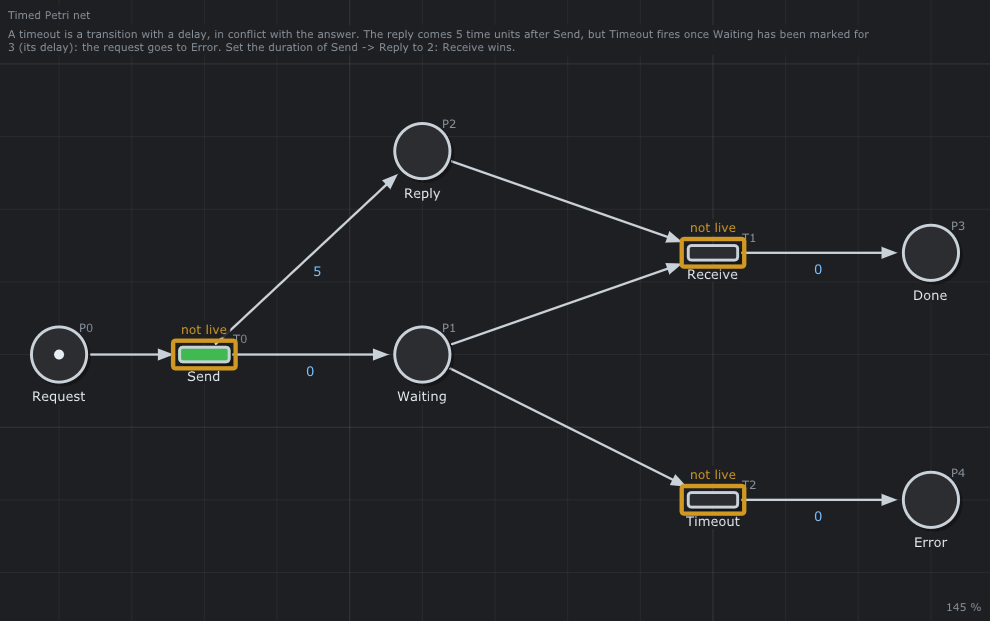

# ⏱️ Timeout

A request waits for its reply, but not for ever: a transition with a **delay** in conflict with the answer.



## What it models

`Send` puts a token in `Waiting` at once and the reply in `Reply` after 5. `Receive` needs both; `Timeout` needs only `Waiting`, but has a **delay** of 3: it can fire only once `Waiting` has held its token for 3 time units. `Receive` and `Timeout` share the token of `Waiting`: the first one able to fire wins.

## What it teaches

- [The delay of a transition](../../../doc/en/06-Timed-Petri-Nets.md#32-the-delay-of-a-transition)
- [The pattern of the timeout](../../../doc/en/06-Timed-Petri-Nets.md#62-the-timeout), used by every protocol

## Try it in the editor

```sh
./build/linux-gcc-debug/bin/TimedPetriNetEditor examples/Timed-Petri-Nets/Timeout/Timeout.json
```

1. Press **Space**: at `t = 3` `Timeout` fires, the request goes to `Error`; the reply arrives at 5 and stays alone in `Reply`.
2. Stop, double click the arc `Send → Reply` and give it the duration 2. Press **Space**: at `t = 2` `Receive` fires, the request is `Done`; the timeout never fires.
3. *Analysis > Properties*: two P-invariants, `Request + Reply + Done = 1` and `Request + Waiting + Done + Error = 1`; a deadlock is found (the end of the request), and the transitions are not live: a request is sent once.

## In a program

The runtime of the project runs the same pattern against a real (fake) service that answers late: [MicroServices](../../Runtime/MicroServices/README.md).

---

Back to the [examples](../../README.md) · Timed Petri nets: [chapter 6](../../../doc/en/06-Timed-Petri-Nets.md)
