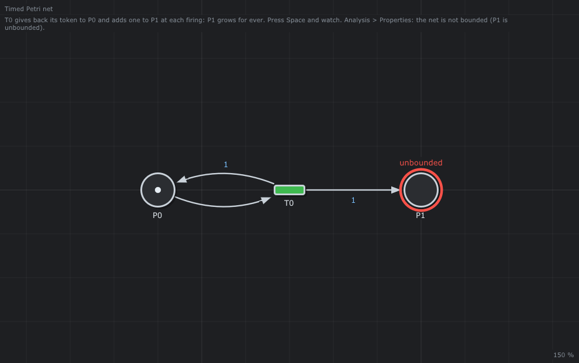

# 📈 Unbounded

The smallest net that grows for ever.



## What it models

`T0` takes the token of `P0`, gives it back and gives one more to `P1`, after 1 time unit. Nothing takes the tokens of `P1`: it grows by one at each firing (`t = 0, 1, 2 ...`).

## What it teaches

- [The queue that grows](../../../doc/en/06-Timed-Petri-Nets.md#64-the-queue-that-grows)
- [Boundedness and the Karp-Miller tree](../../../doc/en/04-Analysis.md)

## Try it in the editor

```sh
./build/TimedPetriNetEditor examples/Timed-Petri-Nets/Unbounded/Unbounded.json
```

1. Press **Space** and watch `P1`: one token more every time unit.
2. *Analysis > Properties*: `Bounded: no` (`P1` is unbounded) and the P-invariant `P0 = 1`. The exploration of the markings stops at *max markings*: it can never end, there are infinitely many.
3. Right click on `P1` > *Max tokens*, give 5: the place has a capacity, `T0` stops when it is full. *Properties*: 5-bounded, 6 markings, and a deadlock when `P1` is full.

---

Back to the [examples](../../README.md) · Timed Petri nets: [chapter 6](../../../doc/en/06-Timed-Petri-Nets.md)
